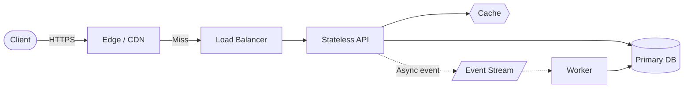
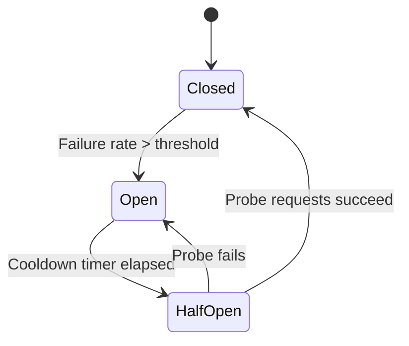

# Animations, Interactive Visuals & Mermaid Catalog

Every concept in this course pairs prose with **one focused Mermaid diagram** and—where dynamics or parameter trade-offs matter—**one interactive visualization or step animation** usable both on the website and inside downloadable `.html` slide decks.

Follow the [Slide Grid, Mermaid Grammar & Animation Spec](../../shared/design-system/slide-and-animation-spec.md) when authoring.

---

## 1. Existing Diagram Sources (`diagrams/`)

- [system-overview.mmd](diagrams/system-overview.mmd) — 5-layer architecture map (Client → Edge → LB → App → DB/Cache/Queue/Worker + Observability).
- [request-sequence.mmd](diagrams/request-sequence.mmd) — End-to-end synchronous browser-to-database request sequence.

---

## 2. Standard Mermaid Templates (Copy & Adapt)

### Architecture Flowchart Template

### Distributed State Machine Template

---

## 3. Master Catalog of 20 Flagship Interactive Visualizations & Animations

All Tier-2 widgets below are designed as **portable, zero-dependency HTML/SVG/JS components (< 150 lines each)** so learners can interact with them inside **web articles AND downloaded standalone `.html` slides**.

| ID | Widget / Animation | Lesson | Tier | User Inputs / Controls | Visual Output & Core Insight |
|---|---|---:|---|---|---|
| `anim-request-layers` | **5-Layer Request Path Tracer** | L01 | Tier 1 | Toggle `Sync Read`, `Sync Write`, `Async Queue` | Highlights which layers participate and why async decouples slow work |
| `anim-tail-latency` | **Percentile vs Average Explorer** | L02 | Tier 2 | Skew slider (% slow requests) | Shows average staying flat at `45ms` while `p99` climbs above `1,200ms` |
| `sim-capacity-calculator` | **Back-of-the-Envelope Sizing Calc** | L03 | Tier 2 | DAU, req/day, peak ×, payload bytes, retention | Live recalculation of Avg/Peak QPS, raw/provisioned TB, and Gbps egress |
| `sim-tail-amplification` | **Parallel Fan-Out Tail Calculator** | L04 | Tier 2 | Number of downstream services (`1..50`), node `p99` | Plots probability that *at least one* call hits tail latency (`1 - 0.99^N`) |
| `anim-dns-resolution` | **Recursive DNS Hop Stepper** | L05 | Tier 1 | `Next Step` / `Cache Hit` toggle | Traces Stub → Resolver → Root → `.com` TLD → Authoritative nameserver |
| `anim-http-multiplexing` | **HTTP/1.1 vs HTTP/2 vs HTTP/3** | L06 | Tier 2 | Toggle protocol + packet loss `%` | Animates HoL blocking in TCP/HTTP1.1 vs independent QUIC streams |
| `anim-cdn-cache-flow` | **Edge PoP & Cache-Control Tracer** | L07 | Tier 2 | `max-age`, `s-maxage`, `stale-while-revalidate` | Animates user hits at nearby PoP vs origin shield misses |
| `sim-load-balancer` | **LB Algorithm & Slow-Node Sim** | L08 | Tier 2 | `Round-Robin`, `Least-Conn`, `Weighted`; inject slow node | Visualizes queue pileup under Round-Robin vs relief under Least-Connections |
| `anim-idempotency-retry` | **Duplicate Payment Retry Guard** | L09 | Tier 1 | Toggle `Idempotency-Key` ON/OFF + drop response | Shows double-charge bug on timeout retry vs safe cached `201` replay |
| `sim-btree-vs-lsm` | **B+Tree vs LSM-Tree Write/Read** | L11 | Tier 2 | `Insert Key` / `Read Key` / `Trigger Compaction` | Animates in-place page split vs append-only WAL + MemTable + SSTables |
| `anim-isolation-anomalies` | **MVCC Isolation Level Stepper** | L13 | Tier 1 | `Read Committed`, `Repeatable Read`, `Serializable` | Steps two concurrent transactions to demonstrate dirty read & write skew |
| `sim-eviction-policies` | **Cache Eviction Hit-Ratio Sim** | L16 | Tier 2 | Policy (`LRU`, `LFU`, `FIFO`), cache capacity, Zipf skew | Streams colored keys and charts real-time hit ratio |
| `sim-cache-stampede` | **Thundering Herd & Singleflight** | L17 | Tier 2 | Cache expiry trigger; `Singleflight` + `Jitter` toggles | 100 concurrent request dots collapse to 1 DB hit with Singleflight ON |
| `sim-consistent-hashing` | **Consistent Hash Ring Explorer** | L20 | Tier 2 | Add/remove node button, `Virtual Nodes (1..100)` slider | Shows keys around `360°` ring and live % keys remapped |
| `anim-saga-compensation` | **Saga Rollback Choreography** | L25 | Tier 1 | `Success Path` vs `Fail Payment` / `Fail Inventory` | Animates forward execution then backward compensating transactions |
| `sim-retry-jitter-circuit` | **Retry Storm & Circuit Breaker** | L28 | Tier 2 | Retry policy (`None`, `Exp`, `Full Jitter`), `Circuit Breaker` | Plots backend QPS spike crashing recovery vs smooth recovery with Full Jitter |
| `anim-fencing-tokens` | **Stale Lock & Fencing Token** | L29 | Tier 1 | Toggle `Fencing Token Check` + trigger GC pause | Shows stale holder overwriting data unless storage enforces monotonic token |
| `sim-quorum-rw` | **Quorum `R + W > N` Explorer** | L30 | Tier 2 | Sliders for `N`, `W`, `R` + kill replicas | Highlights replica sets and flags whether strong overlap or stale read occurs |
| `sim-raft-election` | **Raft Leader Election & Partition** | L31 | Tier 2 | Kill Leader / Partition cluster (3 vs 2) | Animates randomized election timers, `RequestVote`, and minority halt |
| `sim-rate-limiter-algorithms` | **Rate Limiter Burst Simulator** | L35 | Tier 2 | `Token Bucket`, `Fixed Window`, `Sliding Window` + burst btn | Demonstrates boundary double-burst bug in Fixed Window vs smooth Token Bucket |

---

## 4. Complete Mermaid Diagram Index (`45+ Diagrams`)

| Module | Diagram Slug | Type | Question Answered |
|---|---|---|---|
| **00** | `system-overview` | `flowchart TB` | What are the 5 layers of any software system? |
| **00** | `nfr-tradeoff-tree` | `flowchart LR` | How do business constraints map to SLIs/SLOs and architecture choices? |
| **00** | `capacity-budget-flow` | `flowchart LR` | How do DAU and payload size determine QPS, TB, and bandwidth? |
| **00** | `fanout-tail-latency` | `sequenceDiagram` | Why does parallel fan-out amplify p99 latency? |
| **01** | `request-sequence` | `sequenceDiagram` | What happens from URL press to rendered response? |
| **01** | `dns-recursive-lookup` | `sequenceDiagram` | How does a recursive resolver locate an authoritative IP? |
| **01** | `tls-http-handshakes` | `sequenceDiagram` | How many RTTs separate HTTP/1.1, HTTP/2, and HTTP/3 (QUIC)? |
| **01** | `edge-gateway-boundary` | `flowchart LR` | Where do CDN, WAF, TLS termination, and API Gateway sit? |
| **01** | `l4-vs-l7-routing` | `flowchart TB` | What can L7 inspect that L4 cannot? |
| **01** | `sync-vs-realtime-apis` | `sequenceDiagram` | How do REST, gRPC, SSE, and WebSockets manage connections? |
| **02** | `data-model-decision-flow` | `flowchart TD` | Which data access patterns map to SQL, Document, KV, Wide-Column, or Graph? |
| **02** | `lsm-write-read-path` | `flowchart LR` | How do WAL, MemTable, SSTables, and Bloom filters handle writes vs reads? |
| **02** | `index-scan-vs-seq-scan` | `flowchart TB` | When does a composite or covering index avoid table heap lookups? |
| **02** | `mvcc-concurrency-timeline` | `sequenceDiagram` | How does write skew happen under Snapshot Isolation? |
| **02** | `presigned-multipart-upload` | `sequenceDiagram` | How do clients upload multi-GB blobs without bottlenecking API servers? |
| **03** | `cache-write-policies` | `flowchart LR` | How do Cache-Aside, Write-Through, and Write-Behind differ on failure? |
| **03** | `cdc-cache-invalidation` | `flowchart LR` | How do teams invalidate derived caches safely via WAL/CDC? |
| **03** | `singleflight-coalescing` | `sequenceDiagram` | How does request coalescing stop 1,000 misses from hitting the DB? |
| **03** | `connection-pool-exhaustion` | `flowchart TB` | Why do unpooled microservice pods overwhelm relational databases? |
| **04** | `replication-lag-anomaly` | `sequenceDiagram` | Why can a user write data and immediately fail to read it back? |
| **04** | `consistent-hash-ring` | `flowchart LR` | How do virtual nodes keep consistent hash partitions balanced? |
| **04** | `expand-contract-migration` | `flowchart LR` | How do you change schemas or shard keys with zero downtime? |
| **04** | `snowflake-bit-layout` | `flowchart LR` | How are 64 bits partitioned inside a distributed Snowflake ID? |
| **05** | `queue-vs-partitioned-log` | `flowchart LR` | Why can multiple independent consumers replay a Kafka log unlike a queue? |
| **05** | `dlq-retry-pipeline` | `flowchart LR` | How do exponential retries and DLQs isolate poison-pill events? |
| **05** | `transactional-outbox-cdc` | `flowchart LR` | How does the Outbox pattern guarantee atomic state + event publishing? |
| **05** | `search-indexing-pipeline` | `flowchart LR` | How do DB writes synchronize asynchronously into inverted & vector indexes? |
| **05** | `stream-window-watermarks` | `flowchart LR` | How do streaming engines bound late-arriving event windows? |
| **06** | `circuit-breaker-state` | `stateDiagram-v2` | How do `Closed`, `Open`, and `Half-Open` states protect failing dependencies? |
| **06** | `stale-lock-fencing-token` | `sequenceDiagram` | Why can a GC pause break distributed locks without fencing tokens? |
| **06** | `quorum-overlap-diagram` | `flowchart TB` | Why does `R + W > N` guarantee reading at least one latest replica? |
| **06** | `raft-leader-election` | `sequenceDiagram` | How does Raft elect a unique leader and reject stale minority leaders? |
| **06** | `etcd-leader-lease` | `sequenceDiagram` | How do TTL leases and watch streams coordinate cluster workers? |
| **07** | `overload-control-layers` | `flowchart LR` | How do rate limits, priority load shedding, and bulkheads stack together? |
| **07** | `otel-trace-propagation` | `sequenceDiagram` | How does `traceparent` link HTTP and async queue spans end-to-end? |
| **07** | `oauth-pkce-and-trust-boundaries` | `sequenceDiagram` | How does OAuth 2.1 Authorization Code + PKCE protect token exchange? |
| **07** | `canary-rollout-pipeline` | `flowchart LR` | How do progressive canary weights auto-roll back on SLO burn? |
| **07** | `multi-region-active-active` | `flowchart TB` | How do Geo-DNS, regional clusters, and async replication serve global traffic? |
| **08** | `design-interview-loop` | `flowchart LR` | How do you pace a 45-minute architecture design or RFC review? |
| **08** | `rag-and-llm-gateway` | `flowchart LR` | Where do semantic caching, hybrid retrieval, and GPU batching sit in AI apps? |
| **08** | `strangler-fig-extraction` | `flowchart LR` | How do you extract services incrementally from a running monolith? |
