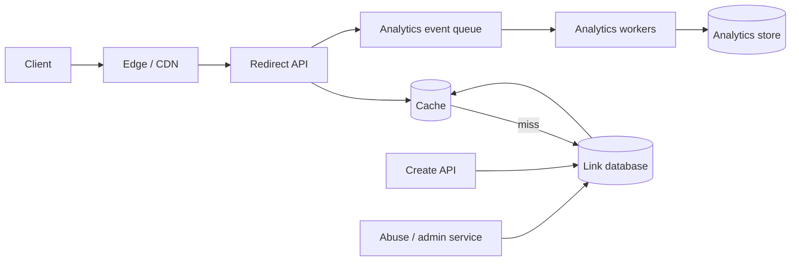

# Case Study 01 · URL Shortener

**Level:** Beginner → Intermediate · **Status:** Exercise brief

## Problem statement

Design a service that turns a long URL into a short URL and redirects visitors to the original destination. Do not begin with a database or cache choice. First write down product behavior and constraints.

## Functional requirements
- Create a short link from a valid long URL.
- Redirect a short code to its destination.
- Allow the owner to optionally set expiration and edit/delete a link.
- Provide abuse reporting and administrative takedown.

Out of scope for v1: custom domains, analytics dashboards, QR codes and enterprise controls.

## Non-functional questions
- What redirect latency target is reasonable?
- What availability target is required for redirects versus link creation?
- Is a redirect allowed to serve a recently stale destination?
- How long are links retained?
- How are malicious URLs detected and removed?
- What is the recovery plan for corrupted or deleted mappings?

## API sketch

```http
POST /v1/links
Content-Type: application/json

{ "url": "https://example.com/a/very/long/path", "expiresAt": null }
```

Possible response: `201 Created` with `{ "code": "aZ81kP", "shortUrl": "https://s.shade.to/aZ81kP" }`.

```http
GET /{code}
```

A valid code returns a redirect. Decide whether to use 301 or 302 based on whether destinations can change and whether clients may cache the redirect. Make that decision explicit.

## High-level design



The edge cache is optional in the first version. Analytics should not make the redirect wait for a slow downstream analytics database.

## Deep-dive prompts
1. **Code generation:** random token, sequence, hash, or encoded ID? Compare collision handling, predictability, enumeration and coordination.
2. **Persistence:** relational or key-value? What query patterns and uniqueness constraints matter?
3. **Cache:** cache-aside or write-through? How will edits, deletions and expiration behave?
4. **Hot links:** what happens if one link receives a sudden traffic spike?
5. **Analytics:** at-most-once vs at-least-once processing; how do you deduplicate?
6. **Abuse:** malicious redirects, phishing, spam, rate limits, takedowns and audit logs.
7. **Reliability:** cache outage, database failover, queue backlog, regional outage.
8. **Operations:** metrics, alerts, SLOs, backups, migrations and cost controls.

## Deliverables
- [ ] Requirements and exclusions.
- [ ] Traffic, storage and bandwidth estimates using the [capacity lab](../labs/01-capacity-estimation.md).
- [ ] API contract and data model.
- [ ] High-level and sequence diagrams.
- [ ] Two alternatives with trade-offs.
- [ ] Failure-mode table.
- [ ] Observability and security plan.
- [ ] One ADR using the [ADR template](../templates/adr.md).

Do not look at a reference solution until you have a first design. Practice reasoning rather than copying a diagram.
