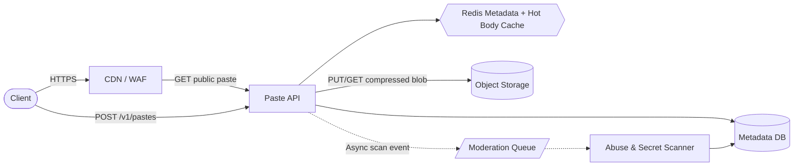

# Case Study 02 · Pastebin / Text Sharing Platform

**Level:** Beginner → Intermediate · **Status:** Exercise brief

## Problem statement

Developers, support engineers, and automated CI tools need a lightweight service to upload text snippets (code, logs, configs up to several megabytes), share a short URL, optionally set an expiration TTL or burn-after-read flag, and view snippets quickly without creating an account.

## Functional requirements

- Create a paste from UTF-8 text (`1 byte` to `10 MB`) with optional syntax hint, visibility (`public` / `unlisted`), and expiration (`10m`, `1h`, `1d`, `30d`, `never`).
- Retrieve a paste via a short, non-enumerable key (`GET /{paste_key}` or raw `GET /raw/{paste_key}`).
- Support owner/admin deletion and automated abuse takedown.
- Support optional **burn-after-read** (delete atomically after first successful read).

Out of scope for v1: real-time collaborative editing, full-text search across pastes, syntax-highlighting server rendering (render client-side), and enterprise SSO.

## Quality requirements and constraints

| Attribute | Target / constraint | Scope and rationale |
|---|---|---|
| Latency | `GET` paste `p95 < 60 ms` (CDN/cache hit) / `p95 < 180 ms` (origin); `POST` paste `p95 < 250 ms` | Fast share-and-open loop for links pasted in chat |
| Availability | `99.95%` monthly for reads; `99.9%` for writes | Read path must survive DB maintenance via edge/cache |
| Durability | `99.999999999%` (`11 nines`) on durable object blobs until TTL expiry | Acknowledged non-expired pastes must not vanish |
| Consistency | Read-your-own-writes for newly created paste (`< 1s`); eventual TTL purge (`<= 60s` grace for reads, storage reclaim async) | Burn-after-read requires atomic delete/claim on first read |
| Security / privacy | Non-enumerable random keys (`>= 48` bits entropy); XSS-safe `Content-Type: text/plain` on raw endpoint; malware/credential-leak scanning | Prevent secret scraping and stored XSS attacks |
| Cost | Keep metadata DB small by offloading paste bodies `> 4 KB` (or all bodies) to object storage + gzip compression | Object storage is ~10× cheaper per GB than NVMe relational storage |

## Workload assumptions

| Input | Estimate | Confidence / source |
|---|---:|---|
| Daily active users | `2,000,000` | Teaching assumption |
| Writes per user / day | `0.5` (`1,000,000` new pastes/day) | Skewed toward devs/CI bots |
| Reads per user / day | `10` (`20,000,000` reads/day, `20:1` read/write) | Teaching assumption |
| Peak multiplier | `5×` | Incident/outage log-sharing spikes |
| Average paste size | `20 KB` uncompressed (`~6 KB` gzip-compressed); max `10 MB` | Logs and stack traces compress ~3× |
| Retention | Average effective retention `180 days` (mix of `1d` and `never`) | Product assumption |

**Workload math (explicit units):**
- **Write QPS:** `1,000,000 ÷ 86,400 ≈ 11.6 writes/s` avg → **Peak ≈ 58 writes/s**.
- **Read QPS:** `20,000,000 ÷ 86,400 ≈ 231.5 reads/s` avg → **Peak ≈ 1,157 reads/s**.
- **Storage growth (decimal):** `1,000,000 × 6 KB` (compressed) = **`6 GB/day`** → `6 GB × 180 days ≈ 1.08 TB` steady-state object bytes (`~3.24 TB` with 3× object durability, plus `~300 bytes/record × 180M = 54 GB` metadata DB).
- **Egress bandwidth:** At `1,157 peak reads/s × 20 KB` = **`23.1 MB/s` (`~185 Mbps`)** before CDN offload (`80%` CDN hit rate cuts origin egress to `~37 Mbps`).

## API and data model

```http
POST /v1/pastes
Content-Type: application/json
Idempotency-Key: 9b1deb4d-3b7d-4bad-9bdd-2b0d7b3dcb6d

{ "content": "...", "syntax": "go", "ttlSeconds": 86400, "burnAfterRead": false }
```
Response: `201 Created` → `{ "key": "k9Qp2LmX", "url": "https://p.shade.to/k9Qp2LmX", "expiresAt": "2026-11-27T10:00:00Z" }`.

```http
GET /v1/pastes/{key}
GET /raw/{key}   # Always returns Content-Type: text/plain; charset=utf-8 + X-Content-Type-Options: nosniff
DELETE /v1/pastes/{key}
```

**Data model (`pastes` metadata table):**
- `paste_key VARCHAR(16) PRIMARY KEY` (8-char Base62 CSPRNG = `62^8 ≈ 2.18 × 10^14` keys)
- `object_key VARCHAR(128) NOT NULL` (pointer to compressed blob in Object Store)
- `size_bytes INT NOT NULL`, `sha256 CHAR(64)`
- `expires_at TIMESTAMPTZ NULL`, `burn_after_read BOOLEAN NOT NULL DEFAULT FALSE`
- `status SMALLINT NOT NULL` (`0=active, 1=deleted, 2=quarantined`)
- `created_at TIMESTAMPTZ NOT NULL`
- Partial index on `(expires_at) WHERE expires_at IS NOT NULL AND status = 0` for batch TTL cleanup.

## Architecture



- **Sync path:** Client writes paste → API compresses body, uploads to Object Store *first*, then commits metadata row (orphan blob cleaned by lifecycle rule if DB write fails). Reads check `expires_at` before serving and return `410 Gone` if expired.
- **Burn-after-read path:** Bypass CDN (`Cache-Control: no-store`), execute atomic `UPDATE pastes SET status = 1 WHERE paste_key = $1 AND burn_after_read = TRUE AND status = 0 RETURNING object_key` so two concurrent GETs cannot both read the secret.

## Deep-dive prompts

1. **Metadata vs payload split:** When should small pastes (`< 4 KB`) be inlined vs always stored in Object Storage? Compare latency, DB bloat, and operational simplicity.
2. **TTL expiration & storage reclaim:** Lazy expiration on read stops serving expired pastes, but how do you purge billions of expired blobs from Object Storage without melting the DB? (Bucket lifecycle policies vs partitioned expiry index sweeps.)
3. **Burn-after-read concurrency:** How do you guarantee *exact* single-read semantics under network retries and prefetching link-preview bots (Slack/Discord unfurlers)?
4. **Abuse & leaked secrets:** Pastebins attract stolen API keys, malware payloads, and CSAM. How do you scan asynchronously without blocking normal uploads, and purge CDN caches immediately on takedown?
5. **Key generation:** Compare CSPRNG 8-char Base62 vs KGS pre-generated pool vs encrypted sequence.

## Alternatives and trade-offs

| Option | Benefits | Risks / costs | Decision |
|---|---|---|---|
| **Store paste body in Postgres `TEXT` column** | Single transactional write/delete; zero orphan blobs | Bloats DB RAM/backups; expensive storage; vacuum pressure on TTL deletes | **Rejected** for `> 4 KB`; keep DB lean with metadata only |
| **Metadata in DB + compressed blob in Object Storage** | Cheap durable storage (`~10×` cheaper); S3 lifecycle auto-deletes TTL tiers | Two-phase write risk (orphan object if DB commit fails); extra `~15 ms` miss hop | **Selected** (clean separation + Redis cache for hot `< 256 KB` pastes) |
| **Always inline small `< 4 KB` in Redis/DB + large in S3** | Saves one S3 GET on 80% of tiny pastes | Two code paths to maintain and migrate | **Optional optimization** once S3 `GET` cost/latency shows up in profiling |

## Failure and abuse scenarios

| Scenario | User impact | Detection | Mitigation / recovery |
|---|---|---|---|
| **Slack/chat link unfurler consumes burn-after-read link** | Intended human recipient sees `410 Gone` | High rate of `burn_after_read` consumed `< 2s` after creation | Serve empty HTML preview to bot `User-Agent`s or require explicit `POST /reveal` click in browser |
| **Credential/malware paste goes viral** | Abuse/legal risk; origin spike | Secret-scanner match or abuse report spike | Set `status = quarantined` in DB, delete Redis key, issue CDN surrogate-key purge |
| **Object Storage elevated `5xx` or latency** | Cache misses fail or stall | S3 `5xx` alert + API `p95 > 300 ms` | Serve hot pastes from Redis/CDN; shed large `> 1 MB` uploads first with `503 Retry-After` |
| **Paste write spam botnet** | Storage bill explosion | Per-IP/ASN create QPS anomaly | Edge WAF + Token-Bucket rate limit by IP/subnet + shorter forced TTL for anonymous bursts |

## Deliverables

- [ ] Requirements and explicit exclusions.
- [ ] Estimates with assumptions and units using [capacity lab](../labs/01-capacity-estimation.md).
- [ ] API contract (including `burn-after-read` and raw XSS headers) and metadata schema.
- [ ] Architecture diagram + burn-after-read sequence diagram.
- [ ] One ADR using [templates/adr.md](../templates/adr.md) (metadata/blob split or key generation).
- [ ] Security, TTL cleanup, and abuse takedown plan.

## References

- [OWASP Cross-Site Scripting (XSS) Prevention & Content-Type Sniffing](https://cheatsheetseries.owasp.org/cheatsheets/Cross_Site_Scripting_Prevention_Cheat_Sheet.html) — why raw text endpoints require `X-Content-Type-Options: nosniff` and sandboxed domains.
- [AWS S3 Lifecycle Management](https://docs.aws.amazon.com/AmazonS3/latest/userguide/object-lifecycle-mgmt.html) — zero-DB-load prefix/tag expiration of object blobs.
- [MDN HTTP Caching & `Cache-Control: no-store`](https://developer.mozilla.org/en-US/docs/Web/HTTP/Caching) — preventing CDN leaks on private/burn-after-read pastes.
