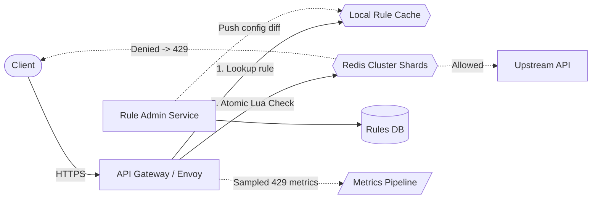

# Case Study 03 · Distributed Rate Limiter

**Level:** Intermediate · **Status:** Exercise brief

## Problem statement

An API platform serving thousands of third-party developers and microservices needs a distributed rate limiter to stop accidental infinite loops, scraping, and DDoS bursts from exhausting downstream databases and GPU/compute pools—while adding negligible latency (`< 2 ms`) on every single API request.

## Functional requirements

- Enforce configurable rate-limit rules per key (`api_key`, `user_id`, `ip`, or `route`), e.g. `100 req/min` with burst `20`.
- Return standard rate-limit decision metadata (`allowed: bool`, `remaining`, `reset_at`, `retry_after_sec`).
- Support dynamic rule updates propagating to edge/gateway nodes within `10 seconds` without restarts.
- Support both **soft shadow mode** (log violations without blocking) and **hard enforce mode** (`HTTP 429`).

Out of scope for v1: ML anomaly detection, billing invoice generation, and client-side SDK backoff libraries (though headers guide them).

## Quality requirements and constraints

| Attribute | Target / constraint | Scope and rationale |
|---|---|---|
| Latency | `p99 < 2 ms` added overhead per `CheckLimit` call in-region | Runs inline on the hot path of **100%** of API requests |
| Availability | `99.99%` effective gateway availability; limiter failure must not take down core APIs | Configurable **fail-open** (default for normal APIs) vs **fail-closed** (auth/payment endpoints) |
| Durability | Ephemeral counter state; loss of 1–10s of counter window on shard restart is acceptable | Speed outweighs disk `fsync` durability for rate counters |
| Consistency | Eventual / bounded drift (`< 5%` over-limit under extreme concurrency) | Strict global linearizability across regions costs `~80 ms` WAN RTT and violates `< 2 ms` budget |
| Security / privacy | Hash raw IPs/API keys in telemetry; prevent Redis key-injection; protect rule-admin API via RBAC | Rate limiter itself must resist memory-exhaustion attacks (millions of random spoofed keys) |
| Cost | Keep memory footprint `< 100 bytes/active key`; use pipelined/batched local sync at extreme QPS | Calling central Redis synchronously at `1M QPS` creates huge network/CPU bill |

## Workload assumptions

| Input | Estimate | Confidence / source |
|---|---:|---|
| Active API keys / IPs per minute | `5,000,000` | Teaching assumption |
| Total API gateway traffic | `200,000 QPS` avg → `500,000 QPS` peak (`2.5×`) | High-traffic SaaS API edge |
| Read/write mix | Every check reads & increments counter (`1:1` atomic RMW) | Rate limiting is a write-per-request workload |
| State size per key | `~80 bytes` (key hash + tokens + timestamp + Redis overhead) | Compact Lua/hash representation |
| Window / TTL | `1 minute` – `1 hour` sliding TTL | Active keys expire automatically |

**Workload math (explicit units):**
- **Check QPS:** **`500,000` atomic read-modify-write ops/sec** at peak.
- **Single-Redis limit:** One Redis shard handles `~80k–120k` Lua ops/sec → requires **at least 6–10 Redis Cluster shards** (`hash_tag` on `{rate_key}`) *or* **local in-memory token buckets syncing asynchronously** every `200 ms` (reducing Redis ops by `20×–50×`).
- **RAM footprint:** `5,000,000 active keys × 80 bytes ≈ 400 MB` (decimal) / `~381 MiB` → easily fits in RAM across shards, even under a `10×` (`4 GB`) cardinality attack with strict TTL + `maxmemory-policy volatile-lru`.
- **Network bandwidth:** `500,000 checks/s × ~150 bytes` request+reply = `75 MB/s` (`600 Mbps`) between gateways and Redis.

## API and data model

Internal gRPC / Middleware contract (`RateLimiter.Check`):
```protobuf
message CheckRequest {
  string rule_id = 1;       // e.g. "post_links_v1"
  string subject_key = 2;   // e.g. "key:ak_91f2"
  int32 cost = 3;           // 1 for normal HTTP, N tokens for LLM/bulk endpoints
}
message CheckResponse {
  bool allowed = 1;
  int64 remaining = 2;
  int64 reset_epoch_ms = 3;
  int32 retry_after_sec = 4;
}
```
HTTP response headers on every request:
`X-RateLimit-Limit: 100`, `X-RateLimit-Remaining: 42`, `X-RateLimit-Reset: 1732614060`, plus `Retry-After: 12` on `429 Too Many Requests`.

**Data model in Redis (Token Bucket hash/keys):**
- Key: `rl:{rule_id}:{subject_key}` (with `EXPIRE` set to `2 × refill_window`)
- Fields: `tokens` (float), `last_refill_ms` (int64)
- Rules stored in Config DB + pushed via watch stream (`etcd` / S3 / PubSub) into gateway local memory cache (`< 10s` propagation).

## Architecture



- **Atomicity:** Never do `GET` → compute → `SET` from app code (classic TOCTOU race lets concurrent requests bypass limits). Execute the refill + check + decrement inside a **single-threaded Redis Lua script** (`EVALSHA`).
- **Sync vs Async:** Rule reads hit local in-memory cache (`0 ms`); counter check is sync over persistent connection pool to Redis (`~0.6 ms` same-AZ); metrics/429 audit logs emit asynchronously.

## Deep-dive prompts

1. **Algorithm comparison:** Compare **Fixed Window Counter** (2× boundary burst bug), **Sliding Window Log** (exact but huge memory at high limits), **Sliding Window Counter**, and **Token Bucket / GCRA** (smooth bursts, O(1) memory).
2. **Race conditions:** Trace two gateway pods executing `GET` then `DECR` concurrently vs an atomic Redis Lua script or `INCR` pipeline.
3. **Failure policy (`fail-open` vs `fail-closed`):** What happens if a Redis shard dies or times out at `2 ms`? How do you apply **fail-open** for browsing vs **fail-closed** for login/OTP?
4. **High-QPS local-sync batching:** At `5,000,000 QPS`, how do you batch increments in gateway RAM (local token lease of 50 tokens or `100 ms` async flush) and what accuracy drift do you trade off?
5. **Distributed multi-region limits:** If a user hits `us-east` and `eu-west` simultaneously with a global `100 req/min` quota, do you split quota per region, route home-region, or replicate asynchronously?

## Alternatives and trade-offs

| Option | Benefits | Risks / costs | Decision |
|---|---|---|---|
| **Fixed Window Counter (`INCR + EXPIRE`)** | Trivial implementation; 1 integer per key | Allows `2×` burst across minute boundary (`:59` + `:00`) | **Rejected** for strict APIs; okay only for coarse quotas |
| **Sliding Window Log (Redis `ZSET`)** | 100% exact timestamp window | `O(limit)` RAM per user (`10k req/min` = `~640 KB/user`) | **Rejected** for high-limit keys; memory explodes |
| **Token Bucket / GCRA in Redis Lua** | `O(1)` memory (`2` numbers/key); native burst + steady rate control | Requires Lua `EVALSHA` & clock consistency (use Redis `TIME` or server ms) | **Selected** for general API + token-cost endpoints |
| **Sticky Local Memory Only (Consistent Hash LB)** | Zero Redis network hop (`< 0.05 ms`) | Rescaling/redeploying gateways resets counters; uneven LB skew breaks accuracy | **Rejected** as sole store; useful as L1 batching optimization |

## Failure and abuse scenarios

| Scenario | User impact | Detection | Mitigation / recovery |
|---|---|---|---|
| **Redis shard timeout / blackout** | Gateway stalls waiting on `500 ms` default socket timeout | Redis latency `p99 > 5 ms`; timeout counter | Set aggressive `2 ms` client timeout + circuit breaker: **fail-open** on non-auth routes, **fail-closed** on `/login` |
| **Cardinality attack (millions of random spoofed headers/IPs)** | Redis RAM fills up and evicts real tenant keys | Keyspace growth rate + `evicted_keys` metric | Limit by `/24` IPv4 / `/48` IPv6 prefix at WAF; enforce `maxmemory volatile-lru` + tight TTLs |
| **Retry storm triggered by `429` responses** | Clients immediately retry `429`, multiplying edge QPS `5×` | `429` ratio spike + edge CPU climb | Return `Retry-After` header; drop abusive clients at L4/WAF edge before gateway |
| **Hot tenant saturates single Redis shard** | One `100k QPS` tenant slows other keys on same shard | Redis single-shard CPU `> 80%` | Use gateway-local L1 leaky cache (cache `DENY` for `500 ms` once blocked, or lease batches locally) |

## Deliverables

- [ ] Requirements, fail-open/closed matrix, and explicit exclusions.
- [ ] QPS, memory, and Redis shard count estimates ([capacity lab](../labs/01-capacity-estimation.md)).
- [ ] gRPC/HTTP contract + Redis Lua token-bucket pseudocode.
- [ ] Architecture diagram + race-condition sequence diagram.
- [ ] One ADR using [templates/adr.md](../templates/adr.md) (algorithm choice or sync vs local-batched counters).
- [ ] Overload, cardinality-attack, and multi-region plan.

## References

- [Redis Patterns: Rate Limiting & Lua Atomicity](https://redis.io/glossary/rate-limiting/) — single-threaded Lua execution semantics.
- [Stripe Engineering: Scaling Your API with Rate Limiters](https://stripe.com/blog/rate-limiters) — load shedding vs concurrency/token-bucket limiters in production.
- [Cloudflare Blog: How We Built Rate Limiting Capable of Scaling to Millions of Domains](https://blog.cloudflare.com/counting-things-a-lot-of-different-things/) — sliding window counter math and memory efficiency.
