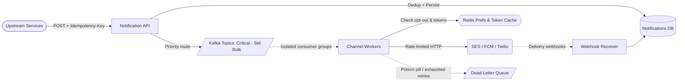

# Case Study 04 · Multi-Channel Notification Platform

**Level:** Intermediate → Advanced · **Status:** Exercise brief

## Problem statement

Product services (auth, billing, orders, marketing) need one shared platform to send transactional and promotional notifications across Email, Mobile Push (APNs/FCM), SMS, and In-App Inbox—without duplicating retry logic in every service, violating user opt-out rules, or letting a million-user marketing blast delay a 6-digit login OTP.

## Functional requirements

- Accept notification requests (`POST /v1/notifications`) with `user_id`, `template_id`, `channel_overrides`, `priority` (`critical` | `standard` | `bulk`), and `idempotency_key`.
- Respect per-user, per-category channel preferences and quiet hours (`do_not_disturb`), except mandatory security/legal notices.
- Render localized templates and dispatch through third-party vendors (SES/SendGrid, APNs/FCM, Twilio) with automatic vendor failover.
- Expose delivery status tracking (`queued`, `sent`, `delivered`, `bounced`, `failed`) via webhooks and query API.

Out of scope for v1: drag-and-drop marketing campaign visual builder, A/B open-rate ML optimization, and two-way conversational SMS replies.

## Quality requirements and constraints

| Attribute | Target / constraint | Scope and rationale |
|---|---|---|
| Latency | Enqueue API `p95 < 40 ms`; `critical` OTP end-to-end dispatch `p95 < 2 seconds`; `bulk` best-effort `< 15 min` | Enqueue is sync; vendor HTTP calls are always async |
| Availability | `99.99%` for `critical` enqueue path; `99.9%` for `standard`/`bulk` | Auth/password-reset flows depend on notification ingestion |
| Durability | Zero silent drop of accepted notifications (durable log + Outbox before `202 Accepted`) | Lost receipts/OTPs erode user trust |
| Consistency | **Effectively-once** user delivery via idempotency dedup (`at-least-once` queue + idempotent dispatch record) | Users hate receiving 5 duplicate "Payment charged" emails |
| Security / privacy | Encrypt PII (`email`, `phone`) at rest with KMS; redact OTPs/tokens from logs; validate vendor webhook HMAC signatures | Prevent PII leaks and webhook spoofing |
| Cost | Enforce per-tenant/per-day SMS cost caps (SMS costs ~$0.01–$0.08/msg vs ~$0.0001/email); suppress dead device tokens/hard bounces | Unchecked SMS retry loops can burn thousands of dollars in minutes |

## Workload assumptions

| Input | Estimate | Confidence / source |
|---|---:|---|
| Monthly active users | `20,000,000` | Teaching assumption |
| Notifications / day | `60,000,000` total (`5M` critical, `25M` transactional, `30M` bulk) | Mixed SaaS/e-commerce load |
| Peak multiplier | `10×` on `bulk` campaigns (flash sale push); `4×` on `critical` | Marketing blasts create massive step spikes |
| Payload size | `~1.5 KB` event metadata + rendered payload | Compact JSON + template params |
| Delivery log retention | `90 days` hot queryable, `2 years` cold archive | Compliance & support debugging |

**Workload math (explicit units):**
- **Average total rate:** `60,000,000 ÷ 86,400 ≈ 694 notifications/sec`.
- **Peak burst rate:** Suppose a marketing blast sends `10M` notifications in `10 minutes` (`600s`) → **`~16,667/sec` bulk burst**, plus `5M × 4 ÷ 86,400 ≈ 231/s` critical OTPs.
- **Storage growth (decimal):** `60M × 1.5 KB = 90 GB/day` raw delivery logs → `90 days = 8.1 TB` hot (`~24 TB` with 3× replicas) before cold Parquet archival.
- **Vendor concurrency (Little's Law):** If email vendor takes `150 ms` per HTTP call, sustaining `5,000 emails/sec` requires `5,000 × 0.15 = 750` concurrent outbound HTTP connections (must throttle to vendor rate limit!).

## API and data model

```http
POST /v1/notifications
Idempotency-Key: order_8812_paid_v1
Content-Type: application/json

{
  "userId": "usr_4412",
  "category": "billing_receipt",
  "priority": "standard",
  "channels": ["email", "push"],
  "templateId": "receipt_v3",
  "vars": { "amount": "$49.00" }
}
```
Response: `202 Accepted` → `{ "notificationId": "ntf_01J9...", "status": "queued" }`.

**Core Entities:**
- `notification_requests(idempotency_key PK, notification_id UNIQUE, user_id, priority, payload_json, created_at)`
- `user_preferences(user_id, category, channel, enabled, quiet_start_utc, quiet_end_utc, PRIMARY KEY(user_id, category, channel))`
- `delivery_attempts(attempt_id PK, notification_id, channel, vendor, status, vendor_msg_id, updated_at)` — unique constraint on `(notification_id, channel)` prevents duplicate dispatch across worker retries.

## Architecture



- **Priority isolation:** Dedicated Kafka topics *and* separate worker deployments for `critical`, `standard`, and `bulk`. Even if `10M` bulk messages back up for 20 minutes, `critical` OTP workers stay 100% idle and sub-second.
- **Vendor rate shaping:** Each channel worker pool checks a per-vendor Token Bucket (`e.g., SES 2,000/s`) so backpressure pauses consumption rather than hammering vendors into `429` bans.

## Deep-dive prompts

1. **Dual-write & deduplication:** Upstream service commits an order in its DB and needs to trigger a notification—how does Transactional Outbox prevent missing notifications, and how do you deduplicate on both ingestion (`Idempotency-Key`) and worker dispatch?
2. **Priority & noisy-neighbor isolation:** Why isn't a single priority field inside one shared Kafka topic enough to isolate `critical` OTPs from `bulk` blasts? (Head-of-line blocking inside partitions.)
3. **Flaky vendors & failover:** Twilio EU goes down (`503`). How do you avoid retrying infinitely (`exponential backoff + full jitter`), trip a circuit breaker, and route SMS to a backup vendor?
4. **User preferences & quiet hours:** If a user sets quiet hours `22:00–07:00` local time, how do you defer a `standard` notification until `07:00` without scanning a billion rows every minute? (Bucketed delay queues / Redis sorted sets / time-wheel partitions.)
5. **Bounced tokens & poison pills:** How do you separate transient `503` (retry) from permanent `InvalidDeviceToken` / malformed template (deactivate token, route to DLQ for inspection)?

## Alternatives and trade-offs

| Option | Benefits | Risks / costs | Decision |
|---|---|---|---|
| **Single shared queue with `priority` column** | Simple topology (1 topic, 1 worker fleet) | Bulk blast fills partitions/worker pools and starves OTPs (head-of-line blocking) | **Rejected**; breaks critical SLA |
| **Separate topics + isolated worker pools per priority** | Complete blast-radius & queue-depth isolation; independent autoscaling | 3× deployments/topics to monitor | **Selected** (`critical`, `standard`, `bulk`) |
| **Synchronous vendor send inside `POST /notifications`** | Caller knows immediately if email failed | Couples caller `p95` to third-party SMTP/Twilio (`200–2,000 ms`) and drops on timeout | **Rejected**; always async after durable enqueue |

## Failure and abuse scenarios

| Scenario | User impact | Detection | Mitigation / recovery |
|---|---|---|---|
| **SMS pumping / OTP toll-fraud bot attack** | Huge Twilio bill; degraded SMS throughput | Spike in SMS sends to high-cost country prefixes + low OTP verify conversion | Per-IP/phone rate limit, country allowlists, CAPTCHA escalation, hard daily SMS spend cap |
| **Primary Email vendor (`SES`) partial outage** | Delayed receipts/OTPs | Vendor `5xx` rate `> 5%` + circuit breaker opens | Auto-route `critical` traffic to secondary vendor (`SendGrid/Postmark`); queue `bulk` for retry |
| **Malformed template variable crashes worker** | Poison-pill infinite crash-loop blocks partition | Consumer lag climbs + crash-loop alert | Catch non-retryable validation errors → route to **DLQ** after 1 attempt; page template owner |
| **Duplicate webhook or queue replay** | Users get double/triple push alerts | Duplicate `delivery_attempts` metric | Enforce `INSERT ... ON CONFLICT (notification_id, channel) DO NOTHING` before calling vendor |

## Deliverables

- [ ] Requirements, priority tiers, and explicit exclusions.
- [ ] Capacity math (peak bulk vs critical, vendor concurrency via Little's Law) using [capacity lab](../labs/01-capacity-estimation.md).
- [ ] API contract, idempotency semantics, and schema.
- [ ] Architecture diagram + failure/DLQ retry sequence diagram.
- [ ] One ADR using [templates/adr.md](../templates/adr.md) (queue isolation or delay scheduling).
- [ ] SMS fraud protection, PII encryption, and vendor failover plan.

## References

- [AWS Builders' Library: Timeouts, Retries and Backoff with Jitter](https://aws.amazon.com/builders-library/timeouts-retries-and-backoff-with-jitter/) — avoiding retry storms against external vendors.
- [Microservices.io: Transactional Outbox Pattern](https://microservices.io/patterns/data/transactional-outbox.html) — atomic state + notification publishing.
- [Uber Engineering: Building Reliable Reprocessing and Dead Letter Queues with Kafka](https://www.uber.com/blog/reliable-reprocessing/) — non-blocking retry topics and DLQ replay.
