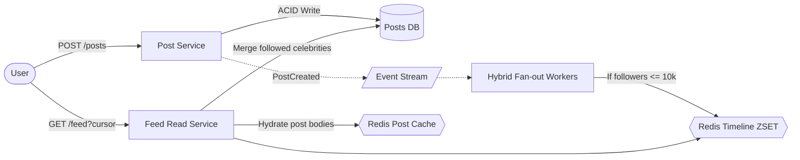

# Case Study 05 · Social News Feed / Timeline

**Level:** Intermediate → Advanced · **Status:** Exercise brief

## Problem statement

Design the core home-timeline and post-publishing backend for a social network where users follow other accounts, publish short text/media posts, and open an endlessly scrollable home feed ranked chronologically (with room for lightweight scoring) in tens of milliseconds.

## Functional requirements

- Publish a post (`POST /v1/posts`) with text (`<= 500 chars`) and optional pre-uploaded media references.
- Follow and unfollow accounts (`POST /v1/follows`, `DELETE /v1/follows/{targetId}`).
- Read personalized home feed (`GET /v1/feed?cursor=...&limit=20`) containing posts from followed accounts.
- Delete a post and remove it from followers' visible timelines promptly.

Out of scope for v1: ML ranking feature stores, algorithmic "For You" non-follower discovery, live nested comment trees, and ad auctions.

## Quality requirements and constraints

| Attribute | Target / constraint | Scope and rationale |
|---|---|---|
| Latency | `GET /v1/feed` `p95 < 80 ms`, `p99 < 150 ms`; `POST /v1/posts` `p95 < 150 ms` | Feed open is the highest-frequency user action; write returns before fan-out finishes |
| Availability | `99.95%` for feed reads; `99.9%` for publishing | Prefer serving a slightly stale cached feed over an empty error page |
| Durability | `0` lost acknowledged posts (`Post DB` durable); timeline caches are **derived** and rebuildable | Redis timeline cache loss degrades latency/compute, never loses posts |
| Consistency | Eventual feed propagation `< 5 seconds` after publish; **read-your-own-writes** immediate for the author | Authors panic if they refresh right after posting and don't see their post |
| Security / privacy | Enforce private/blocked-account visibility checks; rate-limit spam follows & mass mentions | Blocked users must never appear in feeds even if cached |
| Cost | Avoid storing `50M` duplicate timeline entries per celebrity post in Redis RAM | Hybrid fan-out bounds RAM footprint to active users + normal authors |

## Workload assumptions

| Input | Estimate | Confidence / source |
|---|---:|---|
| Daily active users | `50,000,000` | Teaching assumption |
| New posts / user / day | `0.2` (`10,000,000` posts/day) | Typical creator/lurker ratio |
| Feed reads / user / day | `10` (`500,000,000` reads/day, `50:1` read/write) | Teaching assumption |
| Peak multiplier | `4×` | Evening/breaking-news spikes |
| Average followers / user | `200` median; top `0.01%` ("celebrities") have `10,000,000`+ followers | Extreme power-law skew |
| Timeline cache depth | Top `500` post IDs (`8-byte Snowflake ID + 8-byte score/overhead ≈ 24 bytes/entry`) per active user | Only active users cached in RAM |

**Workload math (explicit units):**
- **Write QPS:** `10,000,000 ÷ 86,400 ≈ 116 posts/s` avg → **Peak ≈ 464 posts/s**.
- **Read QPS:** `500,000,000 ÷ 86,400 ≈ 5,787 reads/s` avg → **Peak ≈ 23,148 feed reads/s**.
- **Pure fan-out-on-write trap:**
  - Normal post (`200` followers): `464 × 200 ≈ 92,800` Redis timeline writes/s (very manageable!).
  - **1 celebrity post (`10M` followers):** `10,000,000` Redis writes for *one* click → saturates fan-out queues for minutes (**celebrity hot-key problem**).
- **Timeline cache RAM (decimal):** `50M DAU × 500 post IDs × 24 bytes ≈ 600 GB` (`~559 GiB`) across a Redis Cluster (sharded by `user_id`), plus `~1 KB/post × 10M/day = 10 GB/day` (`3.65 TB/year` logical post storage).

## API and data model

```http
POST /v1/posts
Idempotency-Key: post_99182_v1
{ "text": "System design notes...", "mediaIds": [] }
```

```http
GET /v1/feed?cursor=189401928374123&limit=20
```
Response: `{ "items": [ ... ], "nextCursor": "189401920001122" }`.

**Data model:**
- `posts(post_id BIGINT PK /*Snowflake*/, author_id BIGINT, body TEXT, media_keys JSONB, is_deleted BOOL, created_at TIMESTAMPTZ)` — sharded by `author_id` or `post_id` (index on `(author_id, post_id DESC)` for fast celebrity post fetch!).
- `follows(follower_id BIGINT, followee_id BIGINT, created_at TIMESTAMPTZ, PRIMARY KEY(follower_id, followee_id))` + reverse index `(followee_id, follower_id)` + `author_stats(author_id PK, follower_count BIGINT, is_celebrity BOOL)`.
- **Derived Redis Timeline:** `ZSET timeline:{user_id}` storing `(score = post_id, member = post_id)` capped to latest `500` items via `ZREMRANGEBYRANK`.

## Architecture



- **Hybrid Fan-out:**
  - **Write path (`followers <= 10,000`):** Worker pushes `post_id` into active followers' `timeline:{follower_id}` ZSETs asynchronously.
  - **Celebrity skip (`followers > 10,000`):** Worker does *not* push to 10M timelines; instead caches celebrity's recent `post_id` list (`celeb_posts:{author_id}`).
  - **Read path:** `Feed Read Service` fetches `timeline:{user_id}`, fetches recent posts from the user's followed celebrities (usually 5–30 accounts), **k-way merges** by Snowflake `post_id`, prepends author's own latest posts (read-your-own-writes), filters blocked authors, and **hydrates** post bodies from `Redis Post Cache` (`MGET`) → `Posts DB` fallback.

## Deep-dive prompts

1. **Cursor pagination vs OFFSET:** Why does `OFFSET` duplicate or skip posts when new posts arrive, and how do Snowflake IDs enable stable keyset cursors across merged push+pull feeds?
2. **Inactive user waste:** If a user hasn't opened the app in 6 months, should fan-out workers maintain their Redis timeline? How do you evict cold timelines and **backfill on return**?
3. **Celebrity read fan-out explosion:** What happens if a user follows `500` celebrities? How do you cache `celeb_posts:{author_id}` in Redis so read merge doesn't hit `Posts DB` 500 times?
4. **Post deletion & unfollow:** When a user unfollows someone or deletes a post, do you eagerly scrub millions of ZSETs or filter during hydration?
5. **Hydration hot key:** When a celebrity posts and `500,000` users fetch `post_id` simultaneously, how do you prevent a Redis/DB hot-key stampede on `Post Cache`? (Local L1 pod cache for `5s` + singleflight + sharded read replicas.)

## Alternatives and trade-offs

| Option | Benefits | Risks / costs | Decision |
|---|---|---|---|
| **Pure Fan-out-on-Read (Pull)** | Zero write amplification; instant unfollow/celebrity handling | `GET /feed` runs expensive scatter-gather across `200–2,000` followees (`p99` spikes) | **Rejected** as sole strategy; too slow on read-heavy `50:1` workload |
| **Pure Fan-out-on-Write (Push)** | `GET /feed` is a single `O(1)` Redis ZRANGE | Celebrity with `20M` followers stalls workers & bloats RAM | **Rejected** due to power-law follower skew |
| **Hybrid Push/Pull (Threshold e.g. `10k` followers)** | Fast reads (`< 80 ms`) AND bounded write amplification | More complex read-time k-way merge & dual cache invalidation | **Selected** (industry standard at X/Twitter, Instagram scale) |

## Failure and abuse scenarios

| Scenario | User impact | Detection | Mitigation / recovery |
|---|---|---|---|
| **Redis timeline cluster shard loss** | Affected users see empty or slow feed | Redis shard down + cache miss spike | Rebuild user's top-200 feed on-demand from `follows` + `Posts DB` (`read fallback`) and warm Redis async |
| **Viral celebrity post hydration storm** | Post-cache Redis shard CPU hits 100% | Single-key ops/s alert on `Post Cache` | Replicate hot post into in-process L1 LRU cache (`5s–15s` TTL) on every `Feed Read` pod |
| **Fan-out worker backlog lags by 5 min** | Friends' new posts appear delayed | Consumer lag alert `> 30s` | Shed fan-out for inactive users (`last_seen > 14d`), autoscale workers, prioritize recent authors |
| **Spam bot mass-creates & deletes posts** | Wastes fan-out queue & Redis memory | Per-account write/follow burst alert | Token-bucket publish limits + shadow-ban flag (skip fan-out for flagged accounts) |

## Deliverables

- [ ] Requirements, NFRs, and explicit exclusions.
- [ ] Push vs Pull vs Hybrid capacity math ([capacity lab](../labs/01-capacity-estimation.md)).
- [ ] Cursor-paginated API contract and Snowflake + ZSET data model.
- [ ] Architecture diagram + hybrid read-merge sequence diagram.
- [ ] One ADR using [templates/adr.md](../templates/adr.md) (hybrid fan-out threshold & inactive-user eviction).
- [ ] Hot-key hydration, backfill, and moderation plan.

## References

- [High Scalability / Twitter Architecture (Timelines at Scale)](http://highscalability.com/blog/2013/7/8/the-architecture-twitter-uses-to-deal-with-150m-active-users.html) — classic hybrid fan-out rationale for celebrity skew.
- [Meta Engineering: TAO — Distributed Data Store for the Social Graph](https://www.usenix.org/conference/atc13/technical-sessions/presentation/bronson) — read-optimized graph + cache architecture.
- [Snowflake IDs / RFC 9562 UUIDv7](https://www.rfc-editor.org/rfc/rfc9562) — time-ordered unique IDs for stable keyset pagination.
