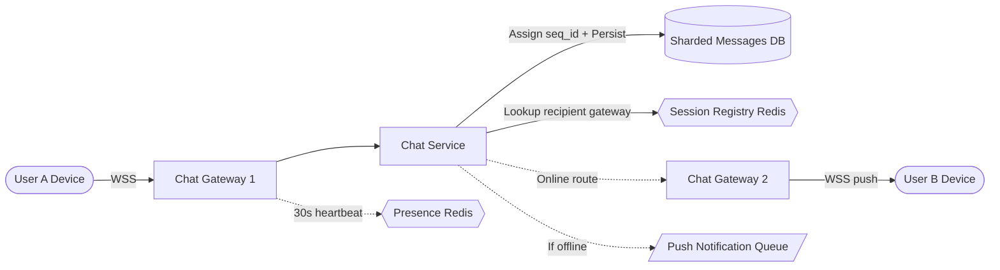

# Case Study 06 · Real-Time Chat & Presence

**Level:** Intermediate → Advanced · **Status:** Exercise brief

## Problem statement

Design a messaging platform supporting `1:1` and small-group chats (`up to 250` members) with instant delivery when recipients are online, reliable offline catch-up sync when devices reconnect, delivery/read receipts, and lightweight online/last-seen presence indicators.

## Functional requirements

- Send and receive `1:1` and group (`<= 250` members) text messages in real time over persistent connections.
- Guarantee consistent message ordering per conversation across all participants and devices.
- Sync missed messages when a client reconnects after being offline (`after_seq`).
- Support delivery acknowledgments (`sent`, `delivered`, `read`) and online/last-seen presence.
- Trigger mobile push notifications (APNs/FCM) when a recipient has no active WebSocket session.

Out of scope for v1: voice/video WebRTC calls, massive `100,000`-member public broadcast channels, and searchable encrypted attachments.

## Quality requirements and constraints

| Attribute | Target / constraint | Scope and rationale |
|---|---|---|
| Latency | In-region message relay `p95 < 60 ms`; cross-region `p95 < 220 ms` | Real-time conversational feel |
| Availability | `99.99%` for message send/receive; presence allowed to degrade (`99.5%`) | Never drop chats because presence Redis hiccuped |
| Durability | Zero loss of acknowledged messages (`replicated commit` before `sent` ACK) | Chat history is user-trusted durable data |
| Consistency | **Total causal/sequence order per conversation** via server-assigned monotonic `seq_id`; idempotent send via `client_msg_id` | Client clocks cannot be trusted for ordering |
| Security / privacy | TLS/WSS transport; JWT auth + group membership check on every frame; optional E2EE payload opacity | Prevent unauthorized room eavesdropping |
| Cost | Millions of idle WebSockets cost RAM/FDs (`~15 KB/conn`); presence heartbeats must not crush DB | Batch/debounce presence updates; isolate presence from core message DB |

## Workload assumptions

| Input | Estimate | Confidence / source |
|---|---:|---|
| Daily active users | `20,000,000` | Teaching assumption |
| Concurrent WebSocket connections | `10,000,000` peak concurrent | Always-on mobile/web tabs |
| Messages sent / user / day | `40` (`800,000,000` messages/day) | Teaching assumption |
| Peak multiplier | `4×` | Evening / New Year's bursts |
| Average message payload | `300 bytes` (text + metadata) | Small JSON/Protobuf frames |
| Presence heartbeat interval | `30 seconds` per connected client | Trade-off between freshness and QPS |

**Workload math (explicit units):**
- **Message write QPS:** `800,000,000 ÷ 86,400 ≈ 9,259 msgs/s` avg → **Peak ≈ 37,037 msgs/s**.
- **Fan-out delivery:** Assuming average `1.8` recipients per message (mix of `1:1` and small groups), peak outbound deliveries ≈ `66,667 frames/s` (`~20 MB/s` = `160 Mbps` payload).
- **WebSocket connection fleet:** `10M` concurrent connections at `100,000` connections per optimized gateway box (`~1.5 GB` RAM for socket buffers) → **100+ Chat Gateway nodes** (plus `N+20` headroom for rolling deploys).
- **Presence heartbeat storm:** `10,000,000 ÷ 30s` = **`333,333` heartbeats/sec**! Must never touch the durable database—handle in sharded Redis / edge gateway state and only publish state *transitions* (`offline -> online`).
- **Storage growth (decimal):** `800M × 300 bytes = 240 GB/day` → **`87.6 TB/year`** raw (`~263 TB/year` with 3× replicas) → **must shard Messages DB** by `conversation_id`.

## API and data model

WebSocket Frame (`SendMessage`):
```json
{ "type": "msg.send", "convId": "c_8812", "clientMsgId": "uuid_v4_1", "body": "On my way!" }
```
Server ACK to sender: `{ "type": "msg.ack", "clientMsgId": "uuid_v4_1", "seqId": 4912, "serverTs": 1732614011000 }`.

Offline Sync REST endpoint:
`GET /v1/conversations/{convId}/messages?afterSeq=4890&limit=100`

**Data model (Sharded Wide-Column / Partitioned SQL by `conversation_id`):**
- `messages(conversation_id BIGINT, seq_id BIGINT, msg_id BIGINT, sender_id BIGINT, client_msg_id UUID, body_bytes BYTEA, created_at TIMESTAMPTZ, PRIMARY KEY(conversation_id, seq_id))`
- Unique dedup index on `(conversation_id, sender_id, client_msg_id)` (or recent Redis dedup cache + DB key) to make retries idempotent.
- `user_sessions` in Redis: `sessions:{user_id} -> Set<{gateway_node_id, conn_id}>` (supports multi-device!).
- `presence:{user_id} -> {status, last_seen}` with `45s` TTL.

## Architecture



- **Sync vs Async:** Message persistence + `seq_id` assignment happens synchronously before `msg.ack` to sender; gateway-to-gateway push relay and offline APNs/FCM push notifications run asynchronously.
- **Per-conversation `seq_id`:** Partition `Chat Service` / sequencer (or shard DB partition) by `conversation_id` so every message in a chat gets a gapless, strictly increasing `seq_id`.

## Deep-dive prompts

1. **Stateful gateway routing:** `User A` is on `Gateway 1` and `User B` is on `Gateway 2`. How does `Chat Service` locate `Gateway 2` in `< 2 ms`, and how do you clean up stale `Session Registry` entries when a gateway crashes (`kill -9`)?
2. **Reconnect thundering herd:** If `Gateway 1` (`100,000` sockets) restarts, `100,000` mobile clients reconnect in 1 second. How do **exponential backoff + full jitter** and JWT validation caching prevent an auth/DB meltdown?
3. **Presence fan-out explosion:** If a user has `500` contacts, pushing every `30s` heartbeat to `500` people creates `166M` updates/s! How do you switch to **pull-on-view / lazy subscription** + **debounce offline status** (`wait 15s before marking offline`)?
4. **Wide-column vs sharded Postgres:** Why do WhatsApp/Discord use partitioned/wide-column stores (`Cassandra`/`ScyllaDB` keyed by `(channel_id, bucket, message_id)`) for chat history, and how do you handle **hot-group partitions**?
5. **Multi-device sync & receipts:** If a user reads a chat on laptop and phone, how do you sync `last_read_seq` without creating a write row per user per message? (Store `read_cursor(conversation_id, user_id, last_read_seq)` per participant.)

## Alternatives and trade-offs

| Option | Benefits | Risks / costs | Decision |
|---|---|---|---|
| **HTTP Long-Polling** | Works through broken corporate proxies; stateless gateways | High HTTP header overhead; `2–3×` higher server CPU/latency | **Rejected** as primary transport; keep only as fallback |
| **WebSockets + Gateway Session Registry** | True full-duplex sub-60 ms push; low frame overhead | Stateful connections complicate rolling deploys & draining | **Selected** with graceful `GOAWAY` drain + jittered reconnect |
| **Push presence to all contacts on every heartbeat** | Instant green dot everywhere | `O(N × contacts)` bandwidth/CPU storm (`> 100M/s`) | **Rejected**; query/subscribe only for active chat viewport + debounce |

## Failure and abuse scenarios

| Scenario | User impact | Detection | Mitigation / recovery |
|---|---|---|---|
| **Chat Gateway node crashes (`100k` sockets drop)** | Brief disconnect; reconnect storm risk | Gateway health-check drop + spike in `WSS` handshakes | Clients use **jittered backoff (`1s–30s`)**; stale Redis session keys expire via lease TTL |
| **Mobile client retries `msg.send` on flaky LTE** | Potential duplicate chat bubbles | Duplicate `client_msg_id` rate | Deduplicate on `(conversation_id, sender_id, client_msg_id)` and return original `seq_id` ACK |
| **Presence Redis cluster degrades** | Green "online" dots disappear or show stale | Presence Redis error/latency alert | **Isolate & shed presence** completely; core chat messaging continues unaffected |
| **Spam bot floods 1,000 groups** | Noise, DB write spike | Per-user message & new-DM rate limit | Token-bucket per `(user_id)` and `(user_id, conv_id)` + trust-score throttling |

## Deliverables

- [ ] Requirements, ordering guarantees, and explicit exclusions.
- [ ] WebSocket fleet, heartbeat QPS, and storage math ([capacity lab](../labs/01-capacity-estimation.md)).
- [ ] WebSocket frame + offline sync REST contract and `(conversation_id, seq_id)` schema.
- [ ] Architecture diagram + cross-gateway message delivery & offline-sync sequence diagram.
- [ ] One ADR using [templates/adr.md](../templates/adr.md) (message storage engine or `seq_id` ordering).
- [ ] Reconnect storm, presence isolation, and multi-region evolution plan.

## References

- [Discord Engineering: How Discord Stores Trillions of Messages](https://discord.com/blog/how-discord-stores-trillions-of-messages) — ScyllaDB migration, hot partitions, and request coalescing.
- [Slack Engineering: Real-time Messaging Architecture](https://slack.engineering/) — WebSocket gateway topologies and presence fan-out scaling.
- [AWS Builders' Library: Jittered Reconnect & Backoff](https://aws.amazon.com/builders-library/timeouts-retries-and-backoff-with-jitter/) — surviving mass socket reconnect storms.
