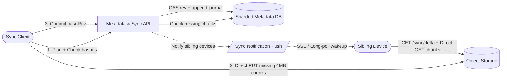

# Case Study 07 · Cloud File Storage & Sync

**Level:** Intermediate → Advanced · **Status:** Exercise brief

## Problem statement

Design a cross-device file storage and synchronization service (like Dropbox or Google Drive sync) that lets users upload large files, edit small portions of multi-megabyte documents without re-uploading the whole file, share folders, and resolve concurrent offline edits safely across desktop and mobile devices.

## Functional requirements

- Upload, download, rename, move, and delete files (`up to 50 GB`) and nested folders.
- Synchronize file changes incrementally across all of a user's linked devices using **block/chunk delta sync**.
- Maintain version history (`30 days`) and resolve concurrent offline conflicts without silently overwriting user work.
- Support direct-to-object-store multipart uploads and real-time sync notifications to online devices.

Out of scope for v1: live character-by-character collaborative document editing (Google Docs CRDTs), client-side zero-knowledge encryption key recovery, and photo ML face-tagging.

## Quality requirements and constraints

| Attribute | Target / constraint | Scope and rationale |
|---|---|---|
| Latency | Metadata sync check `p95 < 100 ms`; sync notification to online sibling devices `< 2 seconds` | Users expect fast save-and-appear across laptop and phone |
| Availability | `99.95%` for metadata & sync; `99.99%` for blob downloads | File access is critical daily workflow |
| Durability | `99.999999999%` (`11 nines`) on stored file chunks; atomic metadata commits | Losing a user's file is catastrophic |
| Consistency | **Strong consistency** on per-namespace metadata versions (optimistic concurrency `parent_rev`); **immutable content-addressed chunks** | Prevents lost updates and partial-file downloads |
| Security / privacy | TLS in transit; per-chunk or per-file envelope encryption (KMS); pre-signed time-bounded object URLs; ACL checks on folder share | Clients must never access other users' deduplicated chunks directly without signed authorization |
| Cost | Cross-device/user **chunk deduplication** + **delta uploads** cut storage and egress bandwidth dramatically | Sending only changed 4 MB chunks saves 95%+ bandwidth on big file edits |

## Workload assumptions

| Input | Estimate | Confidence / source |
|---|---:|---|
| Daily active users | `10,000,000` | Teaching assumption |
| Devices per user | `2.5` (`25,000,000` active sync clients) | Laptop + phone + work machine |
| File edits / uploads per DAU / day | `4` (`40,000,000` file sync events/day) | Mix of small saves and large uploads |
| Average changed payload per event | `500 KB` (thanks to `4 MB` chunk delta sync; average whole file `10 MB`) | Delta sync saves ~20× ingress |
| Peak multiplier | `4×` | Workday start/end sync bursts |
| Retention | `30 days` deleted/old versions + active working set | Product policy |

**Workload math (explicit units):**
- **Metadata write QPS:** `40,000,000 ÷ 86,400 ≈ 463 commits/s` avg → **Peak ≈ 1,852 metadata commits/s**.
- **Sync notification fan-out:** `1,852 × 1.5` sibling online devices ≈ `2,778` push notifications/s.
- **Ingress byte rate (after delta):** `40,000,000 × 500 KB = 20 TB/day` raw (`~16 TB/day` after compression/dedup = **`5.84 PB/year`**).
- **Peak upload bandwidth:** `1,852 × 500 KB ≈ 926 MB/s` (`~7.4 Gbps`) → **MUST bypass API servers** via **Direct Presigned Object Storage URLs**, otherwise API fleet network interfaces saturate immediately.

## API and data model

```http
POST /v1/files/upload-plan
{ "namespaceId": "ns_42", "path": "/docs/report.pdf", "baseRev": 14,
  "chunks": [{ "sha256": "a1b2...", "size": 4194304 }, { "sha256": "c3d4...", "size": 1048576 }] }
```
Response: `200 OK` → `{ "missingChunks": [{ "sha256": "c3d4...", "putUrl": "https://s3.../presigned..." }], "uploadSessionId": "up_91" }` (chunk `a1b2...` already exists—skipped!).

```http
POST /v1/files/commit
{ "uploadSessionId": "up_91", "namespaceId": "ns_42", "path": "/docs/report.pdf", "baseRev": 14 }
```
Returns `201 Created` (`newRev: 15`) or `409 Conflict` if `current_rev != 14` (client creates `"report (conflicted copy).pdf"`).

**Data model:**
- `namespaces(namespace_id PK, owner_id, root_folder_id)`
- `file_entries(namespace_id, file_id, parent_id, name, current_rev, latest_version_id, is_deleted, PRIMARY KEY(namespace_id, file_id))` — sharded by `namespace_id`.
- `file_versions(version_id PK, file_id, rev, size_bytes, chunk_list_json /* ordered [sha256...] */, author_device_id, created_at)`
- `chunk_index(sha256 CHAR(64) PK, s3_key, size_bytes, ref_count BIGINT)` (or tenant-scoped dedup key to avoid cross-tenant side-channel leaks!).
- `sync_journal(namespace_id, cursor_seq BIGINT, file_id, rev, event_type, PRIMARY KEY(namespace_id, cursor_seq))` for delta polling (`GET /v1/sync/delta?cursor=...`).

## Architecture



- **Sync vs Async:** Chunk bytes always flow **Client ↔ Object Storage** directly via presigned URLs; API servers only handle lightweight JSON metadata (`< 4 KB`) and optimistic concurrency (`baseRev`) commits.
- **Real-time sync wakeup:** Online clients hold a lightweight SSE / long-poll connection to `Notification Push` (like Dropbox's long-poll edge) and call `/v1/sync/delta?cursor=...` only when woken up.

## Deep-dive prompts

1. **Chunking strategy:** Fixed `4 MB` chunks vs **Content-Defined Chunking (Rabin fingerprinting / FastCDC)**. Why does inserting 10 bytes at the start of a 100 MB file break fixed-size chunk deduplication?
2. **Cross-tenant deduplication security risk:** If `User B` uploads a chunk hash and the server replies *"already exists, skip upload"*, can `User B` probe whether `User A` owns a secret leaked PDF? (Mitigate with per-tenant/namespace dedup or proof-of-ownership challenge.)
3. **Conflict resolution:** Two laptops edit `budget.xlsx` while offline. Trace how `baseRev` optimistic locking detects the collision and preserves both versions (`conflicted copy`) without data loss.
4. **Garbage collection of unreferenced chunks:** A user deletes a file or an upload aborts halfway. How do you safely delete orphaned chunks in Object Storage without race-deleting a chunk that another user *just* referenced in `/upload-plan`? (Grace period / two-phase mark-and-sweep / never decrement `ref_count` synchronously on hot upload.)
5. **Large folder renames:** Moving a folder with `100,000` nested files—why store hierarchical `parent_id` instead of full materialized paths `/a/b/c/...`?

## Alternatives and trade-offs

| Option | Benefits | Risks / costs | Decision |
|---|---|---|---|
| **Proxy file bytes through API servers** | Simpler client; easy inline virus scanning | API fleet bandwidth saturates (`7.4 Gbps`+); high compute cost | **Rejected**; use direct presigned URLs + async object-created scan |
| **Fixed-size 4 MB chunks** | Fast, trivial slicing | Byte insertion near start shifts all chunk boundaries (0% dedup on edits) | **Acceptable for v1 media**; upgrade to **FastCDC** for document/binary delta sync |
| **Global cross-tenant chunk dedup** | Maximum storage savings (~30%–50%) | Side-channel existence leak + complex cross-tenant GC ref-counting | **Use per-account/org dedup** for strict tenant isolation |

## Failure and abuse scenarios

| Scenario | User impact | Detection | Mitigation / recovery |
|---|---|---|---|
| **Client uploads 9 of 10 chunks then crashes** | Incomplete file; orphan chunks in S3 | Missing `/commit` call after 24h | Uncommitted upload sessions expire; S3 lifecycle / sweep deletes unreferenced staging chunks after 7 days |
| **Sync loop bug (two apps rewrite same file endlessly)** | Bandwidth & version history explosion | High version velocity (`> 20 revs/min` on 1 `file_id`) | Client + server exponential backoff & throttle on rapid edits to the same `file_id` |
| **Notification Push service outage** | Sibling devices stop auto-syncing immediately | SSE disconnect rate + push lag | Clients fall back to jittered periodic delta polling (`every 60s`) |
| **Ransomware encrypts user's local synced folder** | Encrypted files overwrite clean cloud files | Sudden mass rename/modify burst (`> 500` files/min) | Retain `30-day` immutable chunk versions + one-click point-in-time folder rewind |

## Deliverables

- [ ] Requirements, conflict semantics, and explicit exclusions.
- [ ] Bandwidth, metadata QPS, and storage growth math ([capacity lab](../labs/01-capacity-estimation.md)).
- [ ] Upload-plan, commit (`baseRev`), and delta-sync APIs + schema.
- [ ] Architecture diagram + chunk-dedup upload sequence diagram.
- [ ] One ADR using [templates/adr.md](../templates/adr.md) (Fixed vs Content-Defined Chunking or Dedup Scope).
- [ ] Garbage-collection safety and ransomware rewind plan.

## References

- [Dropbox Tech Blog: Streaming File Synchronization (Nucleus)](https://dropbox.tech/infrastructure/) — block server, metadata separation, and delta sync architecture.
- [FastCDC: Fast and Efficient Content-Defined Chunking (USENIX ATC 2016)](https://www.usenix.org/conference/atc16/technical-sessions/presentation/xia) — shift-resistant chunk boundaries.
- [AWS S3 Presigned URLs & Multipart Upload](https://docs.aws.amazon.com/AmazonS3/latest/userguide/mpuoverview.html) — direct-to-storage upload patterns.
