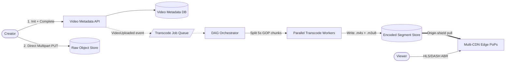

# Case Study 08 · Video Upload, Transcoding & Streaming Platform

**Level:** Intermediate → Advanced · **Status:** Exercise brief

## Problem statement

Design a video platform (like YouTube or Loom) where creators upload multi-gigabyte raw video files over unreliable networks, the backend transcodes each video into multiple resolutions/bitrates (`360p` to `4K`) using a fault-tolerant DAG pipeline, and millions of viewers stream smoothly over adaptive bitrate (`HLS`/`DASH`) CDNs without buffering stalls.

## Functional requirements

- Resumable multipart upload of raw video files (`up to 20 GB`, MP4/MOV/WebM).
- Asynchronous transcoding into Adaptive Bitrate (ABR) segments (`360p, 720p, 1080p, 4K`) + thumbnail sprite sheets + audio normalization.
- Publish video state transitions (`uploading → processing → playable_sd → ready_hd → failed`).
- Stream video playback via HLS/DASH manifests with seek support and view-count telemetry.

Out of scope for v1: ultra-low-latency live streaming (WebRTC/LL-HLS ingest), DRM Widevine/FairPlay licensing servers, and ML recommendation feeds.

## Quality requirements and constraints

| Attribute | Target / constraint | Scope and rationale |
|---|---|---|
| Latency | Playback start (time-to-first-frame) `p95 < 1.2s` on CDN hit; `360p` preview playable `< 2 min` after upload | Fast feedback keeps creators engaged while `4K` transcodes async |
| Availability | `99.99%` for video playback (CDN edge); `99.9%` for upload & transcode | Playback is `100:1`+ read-heavy and isolated from transcode failures |
| Durability | `11 nines` for raw uploaded source + encoded segments in Object Storage | Never force a creator to re-upload a 10 GB raw video |
| Consistency | Eventual catalog visibility (`< 5s` after transcode completion); strong upload chunk ETags/checksums | Video manifest must only switch to `ready` once all referenced `.ts`/`.m4s` segments exist |
| Security / privacy | Private/unlisted videos use signed CloudFront/CDN URLs (`15-min` expiry); virus/CSAM hash matching before `public` publish | Prevent hotlinking paid/private videos |
| Cost | Bandwidth egress & GPU/CPU transcode dominate (`> 85%` of total bill); match codec (`H.264` universal vs `AV1/VP9` for top `10%` viral videos) | Encoding every unpopular video in 3 heavy codecs wastes compute |

## Workload assumptions

| Input | Estimate | Confidence / source |
|---|---:|---|
| Daily active viewers | `20,000,000` | Teaching assumption |
| Videos uploaded / day | `200,000` (avg raw size `500 MB`, avg duration `5 min`) | Mix of shorts and long-form |
| Video views / day | `200,000,000` (avg watched `4 min` at `3 Mbps` avg bitrate) | `1,000:1` view-to-upload ratio |
| Peak multiplier | `3×` | Evening prime-time viewing |
| ABR ladder storage multiplier | `~1.5×` of raw source across `360p/720p/1080p` encoded segments | Compressed H.264/HEVC ladder |

**Workload math (explicit units):**
- **Upload ingress:** `200,000 × 500 MB = 100 TB/day` raw (`~1.16 GB/s` avg → **`~3.5 GB/s` / `28 Gbps` peak**). Must upload directly via **S3 Multipart Presigned URLs** (`10–50 MB` parts).
- **Storage growth (decimal):** `100 TB` raw + `150 TB` encoded ABR ladder = **`250 TB/day`** → **`~91.25 PB/year`**! Lifecycle rules archive raw sources to Glacier/cold tier after 30 days.
- **Playback egress bandwidth (the giant number):**
  - Per view: `4 min (240s) × 3 Mbps ÷ 8 = 90 MB/view`.
  - Daily egress: `200,000,000 × 90 MB = 18 PB/day`!
  - Average egress rate: `18 PB ÷ 86,400 ≈ 208 GB/s` (`~1.67 Tbps`) → **Peak (3×) ≈ `5.0 Tbps`**!
  - **Architectural trigger:** Origin object storage cannot serve `5 Tbps` affordably—**multi-CDN edge caching + ISP peering (Open Connect style)** must absorb `95%+` of segment bytes.

## API and data model

```http
POST /v1/videos/uploads/init
{ "title": "Distributed Consensus Explained", "sizeBytes": 524288000, "sha256": "..." }
```
Response: `{ "videoId": "vid_771", "uploadId": "mpu_992", "partSizeBytes": 16777216, "partUrls": [...] }`.

```http
POST /v1/videos/{videoId}/complete
{ "parts": [{ "partNumber": 1, "etag": "\"abc\"" }, ...] }
```

Playback manifest: `GET https://cdn.shade.video/v/{videoId}/master.m3u8` (lists bitrate variants pointing to `seg_0001.m4s`, `seg_0002.m4s`, etc.).

**Data model:**
- `videos(video_id PK, creator_id, status, raw_s3_key, manifest_s3_key, duration_sec, visibility, created_at)`
- `transcode_jobs(job_id PK, video_id, stage /* split|encode_360|encode_1080|package */, status, worker_id, attempt, lease_until)`

## Architecture



- **Split-and-stitch DAG:** Never transcode a 2-hour 4K video sequentially on one CPU (`takes 4 hours`). Split at **GOP (Group of Pictures) keyframes** into `5–10 second` chunks, transcode all chunks + resolutions in parallel across spot workers, then stitch the `.m3u8` manifest in seconds!
- **Progressive publish:** Route `360p` chunk encoding on a high-priority queue so creators/viewers get playback in `< 2 minutes`, while `1080p`/`4K` finishes asynchronously.

## Deep-dive prompts

1. **Chunk-parallel transcoding:** How do you split a raw MP4 without corrupting frame boundaries (IDR keyframe alignment) so `HLS` segments align cleanly across `360p`, `720p`, and `1080p` for seamless bitrate switching?
2. **Adaptive Bitrate (ABR) streaming:** How does the player decide when to drop from `1080p` to `360p` using `.m3u8` manifest playlists and short `4s` segments?
3. **Upload resilience on flaky Wi-Fi:** A creator uploads `80%` of a `10 GB` file and closes their laptop. How do multipart `ETag` state tracking and client-side resume avoid restarting from byte `0`?
4. **CDN cache-hit optimization & long-tail cost:** `5%` of viral videos generate `80%` of traffic, while `80%` of uploaded videos get `< 10` views. How do you avoid encoding unpopular videos into expensive `AV1/VP9` until they cross a view-velocity threshold?
5. **View counter scale:** A viral video gets `50,000 views/sec`. Updating `UPDATE videos SET views = views + 1` in SQL melts the row lock—how do you buffer/aggregate views in a streaming pipeline?

## Alternatives and trade-offs

| Option | Benefits | Risks / costs | Decision |
|---|---|---|---|
| **Single-worker sequential FFmpeg encode** | Simple pipeline; zero chunk-stitching logic | `2-hour` 4K video takes hours; single spot preemption restarts from 0% | **Rejected**; fails time-to-playable target |
| **GOP-split parallel DAG transcoding** | `10×–30×` faster time-to-ready; cheap spot-instance tolerance | Needs keyframe splitter & manifest packager | **Selected** |
| **Encode all codecs (`H.264` + `VP9` + `AV1`) upfront for every upload** | Best compression on day 1 | Wastes `~70%` transcode CPU on zero-view videos | **Rejected**; encode `H.264` upfront, trigger `AV1/VP9` lazily on popular videos |

## Failure and abuse scenarios

| Scenario | User impact | Detection | Mitigation / recovery |
|---|---|---|---|
| **Spot worker killed mid-encode of a 5s chunk** | Delayed video ready state | Worker lease timeout expires | Re-queue only the failed 5s chunk (`idempotent S3 key overwrite`), never the whole video |
| **Corrupt/malformed codec bomb uploaded (10 KB file claiming 100-hour duration)** | Worker OOM / infinite decode hang | Worker timeout + cgroup memory kill | Inspect container headers (`ffprobe` in sandboxed pod) + strict CPU/RAM/time limits per chunk + quarantine to DLQ |
| **Primary CDN provider outage in region** | Viewer buffering / `5xx` | Client QoE telemetry (`rebuffer_ratio`, CDN error beacons) | Multi-CDN DNS/manifest steering shifts playback URLs to backup CDN within `30s` |
| **Viral video causes origin shield stampede** | Encoded S3 bucket throttling (`503 SlowDown`) | Origin egress spike + CDN miss ratio | Enable CDN request coalescing (collapsed forwarding) + Origin Shield tier |

## Deliverables

- [ ] Requirements, ABR/codec policy, and explicit exclusions.
- [ ] Upload, storage (`PB/year`), and CDN egress (`Tbps`) math ([capacity lab](../labs/01-capacity-estimation.md)).
- [ ] Multipart upload + manifest APIs and job-DAG state schema.
- [ ] Architecture diagram + chunked parallel transcode sequence diagram.
- [ ] One ADR using [templates/adr.md](../templates/adr.md) (GOP parallel transcoding or lazy multi-codec tiering).
- [ ] Multi-CDN steering, sandboxing, and cold-storage lifecycle plan.

## References

- [Netflix TechBlog: High Quality Video Encoding at Scale](https://netflixtechblog.com/) — chunked per-shot encoding and adaptive bitrate ladders.
- [AWS S3 Multipart Upload & Presigned URLs](https://docs.aws.amazon.com/AmazonS3/latest/userguide/mpuoverview.html) — resilient multi-GB upload mechanics.
- [RFC 8216: HTTP Live Streaming (HLS)](https://www.rfc-editor.org/rfc/rfc8216) — `.m3u8` master/media playlists and segment alignment.
