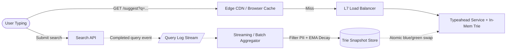

# Case Study 09 · Search Autocomplete / Typeahead

**Level:** Intermediate → Advanced · **Status:** Exercise brief

## Problem statement

Design a real-time search autocomplete (typeahead) service that returns the top `5–10` most relevant query suggestions on every single keystroke (`"sy"`, `"sys"`, `"syste"`) in under `50 ms` end-to-end—while continuously adapting to trending topics and filtering out offensive or noisy typos.

## Functional requirements

- Given a normalized UTF-8 prefix (`1` to `50` chars), return up to `10` ranked query completions.
- Support both global popularity ranking and **freshness/trending boosts** (e.g., breaking news or new product launches within `5–15 minutes`).
- Filter blocked/NSFW/PII suggestions before serving.
- Support optional client-side debouncing and typo tolerance for common 1-edit mistakes on short prefixes (stretch / documented).

Out of scope for v1: personalized user search history blending (though noted in deep-dive), full-document snippet previews, and multi-language spell-correction pipelines.

## Quality requirements and constraints

| Attribute | Target / constraint | Scope and rationale |
|---|---|---|
| Latency | Server-side `p95 < 20 ms`, `p99 < 40 ms` (so browser round-trip stays `< 80 ms`) | Keystroke lag above `100 ms` feels broken to users |
| Availability | `99.99%` for read suggestions; graceful fallback to cached top queries on shard issue | Typing in a search box hits every user session |
| Durability | Derived read index—can rebuild from query log (`S3/Kafka`) within `30 min`; zero loss of raw search logs | Index nodes hold immutable/swappable snapshots in RAM |
| Consistency | Eventual ranking updates (`5–15 min` for trending queries; `daily` batch rebuild for long tail) | Strict real-time read-after-write per search is unnecessary and hurts cacheability |
| Security / privacy | Never suggest another user's email/SSN/private query (`k-anonymity` threshold e.g. `>= 50` unique users); strip control chars/XSS | Autocomplete leaks have caused real PII disclosures |
| Cost | Keep entire hot prefix index in **RAM** (Trie / FST with pre-computed Top-K per node) to achieve `O(prefix_len)` `< 2 ms` lookups | Disk seeks during keystroke typing violate `20 ms` budget |

## Workload assumptions

| Input | Estimate | Confidence / source |
|---|---:|---|
| Daily active searchers | `20,000,000` | Teaching assumption |
| Searches / user / day | `6` (`120M` completed searches/day) | Teaching assumption |
| Keystrokes / search | `6` (`720,000,000` autocomplete requests/day) | Even with `50–100 ms` client debounce |
| Peak multiplier | `4×` | Midday / breaking news bursts |
| Unique valid query corpus | `50,000,000` distinct popular queries (after `k-anonymity` filter) | Long-tail 1-off queries pruned |
| Avg query string | `25 bytes` | ~4 words |

**Workload math (explicit units):**
- **Autocomplete Read QPS:** `720,000,000 ÷ 86,400 ≈ 8,333 QPS` avg → **Peak ≈ 33,333 QPS** (note: single-letter prefixes like `"a"`, `"s"` represent a huge fraction of hits!).
- **Query Log Write QPS:** `120,000,000 ÷ 86,400 ≈ 1,389` completed searches/s avg → **Peak ≈ 5,556/s** (ingested **async** via stream, *never* updating the Trie synchronously!).
- **Index RAM Footprint (decimal):**
  - Raw `50M` strings × `25 bytes` = `1.25 GB`.
  - Naive Trie storing full `Top-10` lists (`~250 bytes`) at every character node (~`200M` nodes) could balloon to `50+ GB`!
  - **Optimization:** Compressed Radix Trie / **FST (Finite State Transducer)** storing Top-K *only* at nodes up to depth `5–6` (or pruning low-frequency branches) fits in **`~8–15 GB` RAM**—small enough to replicate **in full** across stateless read nodes or shard by 1-2 character prefix!
- **Egress:** `33,333 QPS × 500 bytes` JSON = `16.7 MB/s` (`~133 Mbps`).

## API and data model

```http
GET /v1/suggest?q=syste&locale=en-US&limit=8
Cache-Control: public, max-age=60, stale-while-revalidate=300
```
Response:
```json
{
  "prefix": "syste",
  "suggestions": [
    { "text": "system design", "score": 9820 },
    { "text": "system design interview", "score": 8410 }
  ]
}
```

**Data structures (Two-Tier Index):**
1. **In-Memory Prefix Trie / Radix Tree (with Pre-computed Top-K):** Each node `n` stores `{ char, children[], topK: [(query_id, weight)...] }`. Lookup for `"syste"` walks `5` pointers (`O(5)`) and returns `topK` immediately without traversing subtrees!
2. **Batch + Streaming Weight Table (Offline/Nearline):** `query_stats(normalized_query PK, dec_smoothed_count, unique_users_hll, blocked_flag, updated_at)` using **Exponential Moving Average (EMA)** decay so yesterday's meme fades naturally.

## Architecture



- **Read vs Write decoupling:** `Typeahead Service` **never writes** to the Trie during a user request. Completed searches stream asynchronously to `Aggregator`, which computes EMA weights, applies safety/PII filters, builds a new serialized immutable Trie snapshot every `5–15 minutes`, and pushes it for zero-lock **pointer-swap reload** in `Typeahead Service`.
- **Edge caching:** For short `1–3` char prefixes (`"a"`, `"th"`, `"sys"`), a `60s` CDN TTL absorbs **50%–70%** of all global QPS!

## Deep-dive prompts

1. **Trie vs FST vs Inverted N-gram index:** Compare a standard Trie (pre-computed Top-K per node), a Memory-mapped **FST** (like Lucene Suggester), and a Redis `ZSET` prefix approach. Which wins on RAM vs update speed?
2. **Single-letter hot prefixes (`"a"`, `"s"`):** Why does `"a"` get `100×` more QPS than `"astron"`, and how do CDN + client caching + L1 memory handle it?
3. **Freshness vs stability (EMA decay):** How do you combine a `30-day` baseline Trie with a `5-minute` streaming trending delta so breaking news appears quickly without letting 10 spam bots hijack `"a"`?
4. **Trie sharding:** If the corpus grows `20×` (`1B` queries) and no longer fits on one machine's RAM, how do you shard by prefix range (`a-c`, `d-f`, ..., rebalancing skewed buckets like `s*` vs `x*`)?
5. **Client optimizations:** Explain `100 ms` input debounce, cancelling in-flight `AbortController` requests on new keystrokes, and local browser caching.

## Alternatives and trade-offs

| Option | Benefits | Risks / costs | Decision |
|---|---|---|---|
| **SQL `LIKE 'sys%' ORDER BY weight DESC`** | Zero custom data structure; always fresh | Full index range scan + sort on every keystroke (`> 100 ms`, DB melts) | **Rejected**; fails `< 20 ms` budget |
| **Redis `ZSET` per prefix** | Easy incremental updates | Stores duplicate suffixes across every prefix (`10×` RAM bloat) + network hop per keystroke | **Rejected** for primary hot path; usable for tiny catalogs |
| **Immutable In-Memory Radix Trie / FST + Pre-computed Top-K** | `O(prefix_len)` `< 1 ms` lookup; zero lock contention on reads | Snapshot rebuild takes seconds/minutes (not instant per-keystroke updates) | **Selected** (plus small merged trending overlay for `5-min` freshness) |

## Failure and abuse scenarios

| Scenario | User impact | Detection | Mitigation / recovery |
|---|---|---|---|
| **Offensive / PII query leaks into Top-K** | PR/legal incident | Automated blocklist + `HyperLogLog` unique-user `< 50` filter | Hard deny-list overlay checked at serve time (instant block without waiting for full Trie rebuild) |
| **Snapshot builder crashes or produces corrupt Trie** | Suggestions freeze or service OOMs on reload | Snapshot checksum / count validation `< 50%` of prior snapshot | Reject bad snapshot; serve previous known-good immutable Trie in RAM indefinitely |
| **Typing bot floods random 40-char gibberish prefixes** | Bypasses CDN cache (`0%` hit rate) | Cache-miss ratio spike + deep-prefix QPS alert | Cap prefix lookup length (`max 20 chars` server-side) + edge rate limiting |
| **User types fast causing out-of-order UI flashes** | Stale `"sy"` results overwrite `"syst"` results | Client UI bug | Client attaches monotonic sequence/AbortController to discard stale responses |

## Deliverables

- [ ] Requirements, privacy (`k-anonymity`), and explicit exclusions.
- [ ] Keystroke QPS, CDN offload, and Trie/FST RAM math ([capacity lab](../labs/01-capacity-estimation.md)).
- [ ] Suggest API + caching headers and Trie/Snapshot schema.
- [ ] Architecture diagram + async snapshot-swap flow.
- [ ] One ADR using [templates/adr.md](../templates/adr.md) (In-memory Trie/FST snapshot vs live Redis/Search engine).
- [ ] Blocklist fast-purge and prefix-sharding evolution plan.

## References

- [Apache Lucene / Elasticsearch Completion Suggester (FST)](https://www.elastic.co/guide/en/elasticsearch/reference/current/search-suggesters.html) — memory-efficient Finite State Transducer prefix lookup.
- [Wikipedia: Radix Tree / Compressed Trie](https://en.wikipedia.org/wiki/Radix_tree) — memory reduction over naive character tries.
- [Google Search Autocomplete: How Predictions Work](https://blog.google/products/search/how-google-autocomplete-works-search/) — policy filtering, freshness, and query aggregation concepts.
