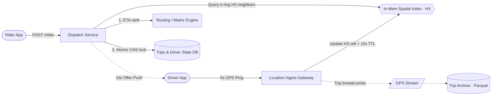

# Case Study 10 · Ride-Hailing & Geospatial Dispatch

**Level:** Advanced · **Status:** Exercise brief

## Problem statement

Design the real-time location tracking and driver-rider dispatch core of a ride-hailing platform (like Uber or Lyft) capable of ingesting continuous GPS pings from millions of active drivers, matching a rider with a nearby available driver in seconds, and guaranteeing **never double-booking one driver to two riders simultaneously**.

## Functional requirements

- Drivers stream live GPS coordinates (`lat, lon, heading, status`) every `4–5 seconds` while online.
- Riders request an upfront fare/ETA quote and dispatch (`POST /v1/rides`) for a pickup location.
- Match the rider to an optimal nearby `AVAILABLE` driver, offer the trip with a `15-second` accept timeout, and cascade on decline/timeout.
- Stream live matched driver location to the rider until pickup and trip completion.

Out of scope for v1: shared/carpool multi-stop route optimization, dynamic surge-pricing ML training, and driver payroll/tax payouts.

## Quality requirements and constraints

| Attribute | Target / constraint | Scope and rationale |
|---|---|---|
| Latency | Driver GPS ingest `p95 < 50 ms`; initial candidate lookup `< 100 ms`; full match offer `< 2 seconds` | Riders abandon if dispatch spins > 5s; drivers move quickly |
| Availability | `99.99%` for active trip state & dispatch; `99.9%` for ephemeral GPS pings | Missing 1 GPS ping is fine; losing an active ride state breaks safety & billing |
| Durability | Trip state transitions (`REQUESTED -> MATCHED -> IN_PROGRESS -> COMPLETED`) durable in DB; raw historical GPS logs archived async | Current driver coordinates live in **ephemeral spatial memory**, not heavy SQL disk rows |
| Consistency | **Strict mutual exclusion** on driver assignment (`1 driver -> at most 1 active offer/trip`); eventual `~5s` consistency on map pin display | Double-dispatching a driver creates real-world chaos |
| Security / privacy | Mask exact rider home dropoff until pickup; validate driver JWT + anti-GPS-spoofing velocity checks; TLS everywhere | Prevent stalker scraping and fake-GPS fare fraud |
| Cost | Writing `200k+` GPS pings/sec to a relational DB destroys IOPS budget—use sharded in-memory spatial grid (`H3` / `S2` / Redis Geo) | Only persist trip milestones + compressed trip breadcrumb batches |

## Workload assumptions

| Input | Estimate | Confidence / source |
|---|---:|---|
| Active drivers online concurrently | `1,000,000` global peak | Teaching assumption |
| Driver GPS ping interval | Every `5 seconds` while online | Mobile battery vs freshness balance |
| Completed rides / day | `20,000,000` (`4×` peak during Friday evening rush) | Major metro mobility platform |
| Location ping size | `80 bytes` (`driver_id`, `lat`, `lon`, `h3_idx`, `status`, `ts`) | Compact Protobuf/binary payload |
| Trip breadcrumb retention | `1 year` compressed for safety/dispute replay | Regulatory & support need |

**Workload math (explicit units):**
- **Location Ingest QPS:** `1,000,000 drivers ÷ 5s` = **`200,000` GPS writes/sec** (sustained peak!).
- **Location Ingress Bandwidth:** `200,000 × 80 bytes` = `16 MB/s` (`~128 Mbps`) payload—tiny bytes, **huge IOPS** if sent to disk!
- **In-memory Spatial Index RAM:** `1,000,000 × 128 bytes` (entry + H3 bucket pointers) ≈ **`128 MB`** per region/global total—fits effortlessly in RAM across a few spatial-index shards!
- **Ride Dispatch QPS:** `20,000,000 ÷ 86,400 ≈ 231 rides/s` avg → **Peak (4×) ≈ 926 ride requests/s**. With `~2.5` driver offers per match (declines/timeouts), **`~2,315` atomic driver lock attempts/s**.
- **Trip Breadcrumb Storage (decimal):** `20M trips × 15 min avg ÷ 5s = 180 pings/trip` × `30 bytes` compressed = `5.4 KB/trip` → `20M × 5.4 KB = 108 GB/day` (`~39.4 TB/year` in cold Object Storage/Parquet).

## API and data model

```http
PUT /v1/drivers/me/location   (or persistent gRPC/WebSocket stream)
{ "lat": 37.7749, "lon": -122.4194, "heading": 90, "status": "AVAILABLE", "tsMs": 1732614011000 }
```

```http
POST /v1/rides
Idempotency-Key: ride_req_9912
{ "pickupLat": 37.7749, "pickupLon": -122.4194, "dropoffLat": 37.7897, "dropoffLon": -122.4014, "product": "standard" }
```

**Data model:**
- **Spatial Index (Sharded In-Memory / Redis / Actor per City/H3 Cell):**
  - `H3 Resolution 8/9` (`~0.1–0.7 km²` hex cell): `h3_available:{h3_cell} -> Set<driver_id>` with `15s` TTL per driver coordinate `driver_loc:{driver_id}`.
- **Driver Lock / State (Partitioned by `driver_id` or City):**
  - `driver_state(driver_id PK, status /* OFFLINE|AVAILABLE|OFFERED|ON_TRIP */, current_trip_id, fencing_version BIGINT)`
- **Trips DB (Sharded by `city_id` / `trip_id`):**
  - `trips(trip_id PK, city_id, rider_id, driver_id, state, pickup_geohash, fare_cents, idempotency_key UNIQUE, created_at)`

## Architecture



- **Geospatial lookup (`H3` k-ring):** Convert rider pickup `(lat, lon)` to an `H3` hex cell, inspect the center cell + `k=1,2` surrounding hex rings (`7` or `19` cells total) in `O(1)` hash lookups (`< 2 ms`), filter `AVAILABLE` drivers, then call the road-network **Routing/ETA Matrix** on the top `10–20` candidates (never straight-line Haversine alone, which matches drivers across a river!).
- **Preventing double-booking:** Execute conditional CAS update `UPDATE driver_state SET status = 'OFFERED', current_trip_id = $1, fencing_version = fencing_version + 1 WHERE driver_id = $2 AND status = 'AVAILABLE'` (or Redis Lua lock + DB check) before sending the offer.

## Deep-dive prompts

1. **Spatial indexing (`H3` vs `Geohash` vs `Quadtree`):** Why do hexagonal `H3` cells outperform square `Geohash` tiles for uniform neighbor distances (`k-ring` queries) and eliminate Geohash boundary edge bugs?
2. **Distributed matching & city sharding:** Why is `city_id` / regional cell partitioning a natural shard key for ride-hailing (a driver in Tokyo never picks up a rider in London), and how do you handle drivers near city borders?
3. **Supply/Demand race & "DISCO" batching:** If `500` riders in one stadium request rides simultaneously while `50` drivers exist, greedy first-come matching yields awful ETAs. How does `500 ms`–`2s` **bipartite batch matching** (Hungarian algorithm) optimize global wait times?
4. **Offer timeout & zombie locks:** Driver app loses signal while `OFFERED` a ride. How do `15s` lease TTLs + fencing versions guarantee the driver becomes `AVAILABLE` (or `OFFLINE`) cleanly without blocking future trips?
5. **GPS spoofing & jitter:** How do you smooth noisy tunnel GPS jumps (`map matching` to road segments) and detect impossible teleportation speeds?

## Alternatives and trade-offs

| Option | Benefits | Risks / costs | Decision |
|---|---|---|---|
| **PostGIS `ST_DWithin` on relational DB for 200k pings/s** | Rich SQL spatial queries; single store | Disk WAL & R-Tree index locks collapse above `~10k–20k` spatial writes/s | **Rejected** for live GPS pings |
| **In-memory `H3` Hex Grid (sharded by region/cell) + Redis/Actors** | Sub-2 ms `k-ring` lookups; handles `200k+` updates/s trivially in RAM | Ephemeral state lost on restart (recovers naturally in `5s` from next driver pings!) | **Selected** |
| **Greedy 1-by-1 matching vs Micro-batch bipartite matching** | Greedy has lowest latency on sparse load | Greedy produces suboptimal routes during dense airport/concert surges | **Hybrid:** Greedy when sparse, `1–2s` micro-batch inside dense surge cells |

## Failure and abuse scenarios

| Scenario | User impact | Detection | Mitigation / recovery |
|---|---|---|---|
| **Spatial Index shard restarts (empty map)** | No drivers visible for a few seconds | Shard health alert + empty candidate count | Drivers ping every `5s`—index self-heals `100%` within `5–10 seconds` automatically! |
| **Airport/concert flash crowd (`10k` riders in 1 H3 cell)** | Lock contention on same 50 drivers; dispatch latency spikes | High CAS conflict rate + `OFFERED` fail count | Switch cell to **bipartite batch match**; cap active offers per driver (`1` lock); shed non-matched quotes gracefully |
| **GPS-spoofer fakes location inside surge zone** | Unfair dispatch / bonus fraud | Velocity jump `> 200 km/h` or mock-location attestation signal | Reject anomalous pings from spatial index; flag driver account for trust review |
| **Driver accepts offer right as `15s` timer expires** | Rider matched to someone else while driver drives toward pickup | Fencing token / state version mismatch on `ACCEPT` | Reject stale `ACCEPT` cleanly (`409 Offer Expired`) and notify driver app immediately |

## Deliverables

- [ ] Requirements, double-match invariant, and explicit exclusions.
- [ ] Location ingest (`200k/s`), RAM spatial index, and trip storage math ([capacity lab](../labs/01-capacity-estimation.md)).
- [ ] Location ping, ride request (`Idempotency-Key`), and driver-offer state machine APIs.
- [ ] Architecture diagram + atomic driver lock & offer-timeout sequence diagram.
- [ ] One ADR using [templates/adr.md](../templates/adr.md) (`H3` in-memory grid vs PostGIS, or City-Cell sharding).
- [ ] Flash-crowd batching, GPS spoofing, and self-healing index recovery plan.

## References

- [Uber Engineering: H3 — Hexagonal Hierarchical Spatial Index](https://www.uber.com/blog/h3/) — why Uber moved from Geohash to H3 hex grids.
- [Uber Engineering: Fulfillment & Matching (DISCO)](https://www.uber.com/blog/) — supply-demand geospatial sharding and bipartite dispatch.
- [Google S2 Geometry Library](https://s2geometry.io/) — hierarchical spherical spatial cells alternative.
