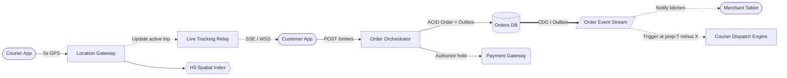

# Case Study 11 · Food Delivery & Logistics Tracking

**Level:** Advanced · **Status:** Exercise brief

## Problem statement

Design a three-sided logistics platform (Customer ↔ Merchant ↔ Courier) that coordinates order placement, restaurant acceptance, courier dispatch, accurate dynamic delivery ETA predictions, and real-time order status + map tracking without losing consistency across asynchronous payment and kitchen workflows.

## Functional requirements

- Browse nearby restaurants with accurate "currently open & prep-time ETA" estimates.
- Place an order (`POST /v1/orders`) coordinating payment authorization, merchant ticket acceptance, and courier assignment as a reliable multi-step workflow.
- Track live order milestones (`PLACED → MERCHANT_ACCEPTED → PREPARING → COURIER_ASSIGNED → PICKED_UP → DELIVERED`) plus live courier GPS updates.
- Support cancellations and refunds cleanly at valid state transitions.

Out of scope for v1: restaurant menu CMS editing, ads/sponsored placement auctions, and multi-merchant stacked batch orders (addressed in deep dive).

## Quality requirements and constraints

| Attribute | Target / constraint | Scope and rationale |
|---|---|---|
| Latency | Restaurant search `p95 < 150 ms`; checkout `p95 < 500 ms`; live status push `< 1s` | Hungry customers refresh constantly if status stalls |
| Availability | `99.99%` for checkout & active order tracking | Dinner-rush outages directly lose perishable food & revenue |
| Durability | Zero lost paid orders; immutable order state-transition audit log | Financial & merchant disputes require exact event history |
| Consistency | **Strict per-order state machine** (no jumping backwards or charging without order record); eventual `~5s` ETA/map updates | Prevents charging a customer after merchant auto-rejects |
| Security / privacy | Mask customer apartment/phone via masked proxy numbers; authorize state changes strictly by actor role (merchant vs courier vs customer) | Couriers should only see delivery address while assigned |
| Cost | Push live courier GPS only to customers actively watching an in-flight order (not polling DB every 2s) | Eliminates `90%` of wasted tracking queries |

## Workload assumptions

| Input | Estimate | Confidence / source |
|---|---:|---|
| Daily orders | `10,000,000` orders/day | Large metro food-delivery platform |
| Active couriers at dinner peak | `400,000` (pinging every `5s`) | `80,000` GPS pings/s at peak |
| Dinner-rush peak multiplier | `6×` (`18:00–20:30` local time) | Extreme meal-time concentration |
| Order state events per order | `~8` transitions + `~180` tracking pings (`30 min` avg delivery) | Lifecycle span ~35 min |
| Order + audit payload | `~4 KB` per order | Menu items, pricing, events |

**Workload math (explicit units):**
- **Order write QPS:** `10,000,000 ÷ 86,400 ≈ 116 orders/s` avg → **Dinner Peak (6×) ≈ 694 orders/s**.
- **Active in-flight orders at peak:** By Little's Law (`L = λ × W`), `694 orders/s × 1,800s (30 min)` = **`~1,250,000` concurrent active orders**!
- **Tracking stream:** `400,000` couriers pinging every `5s` = **`80,000 GPS pings/s`** → forwarded to `~1.25M` active customer SSE/WebSocket viewers when viewing the tracking screen (`~20%` open screen simultaneously = `~250k` active tracking streams, `~50k outbound frames/s`).
- **Storage growth (decimal):** `10M × 4 KB = 40 GB/day` order records (`~14.6 TB/year` before replicas) + `10M × 180 × 40 B = 72 GB/day` GPS breadcrumbs (`~26.3 TB/year` cold Parquet).

## API and data model

```http
POST /v1/orders
Idempotency-Key: ord_idem_7721
{ "merchantId": "m_102", "items": [{"sku": "b1", "qty": 2}], "paymentMethodId": "pm_9" }
```

Live Tracking Stream: `GET /v1/orders/{orderId}/events` (SSE) or WebSocket subscription `sub:order:{orderId}`.

**Data model (Order State & Outbox):**
- `orders(order_id BIGINT PK, customer_id, merchant_id, courier_id NULL, state, total_cents, version INT, idempotency_key UNIQUE, updated_at)`
- `order_events(event_id PK, order_id, from_state, to_state, actor_type, payload_json, created_at)`
- `outbox_events(outbox_id PK, aggregate_id, event_type, payload_json, published_at NULL)`
- `merchant_load(merchant_id PK, active_orders INT, avg_prep_sec INT, is_paused BOOL)` — drives real-time kitchen prep-time ETA.

## Architecture



- **Orchestration Saga:** `Order Orchestrator` manages the multi-party Saga: (1) Authorize payment hold (never capture immediately before merchant accepts!), (2) Notify merchant tablet (3-minute accept timeout), (3) If merchant declines/times out → trigger compensating `void_authorization`, (4) When merchant accepts, schedule **Just-In-Time (JIT) Courier Dispatch** so the courier arrives right as the food finishes cooking (minimizing cold food and driver idle wait!).

## Deep-dive prompts

1. **Saga orchestration & timeouts:** Trace what happens if the merchant tablet loses Wi-Fi for 4 minutes right after `Payment Authorized`. How do delayed timers and compensating refunds keep money and food aligned?
2. **Just-in-Time (JIT) dispatch vs immediate dispatch:** If a pizza takes `20 min` to bake and a driver is `3 min` away, dispatching immediately wastes `17 min` of courier time! How do you predict `prep_time` (kitchen backlog + item complexity) and delay dispatch?
3. **ETA prediction accuracy:** ETA = `kitchen_prep_time + courier_pickup_travel + handoff_buffer + delivery_travel`. Which component has the highest variance, and how do you update ETA incrementally as real events arrive (`COURIER_PICKED_UP`)?
4. **Merchant menu surge & inventory staleness:** A restaurant runs out of burritos at `19:15`, or gets overwhelmed (`40` orders in 5 min) and needs auto-throttling (`busy mode`). How do you prevent stale caches from accepting impossible orders?
5. **Tracking push fan-out:** How do you route `80,000` courier GPS pings/s only to the specific customer currently watching `order:{order_id}` without hammering `Orders DB`?

## Alternatives and trade-offs

| Option | Benefits | Risks / costs | Decision |
|---|---|---|---|
| **Capture payment immediately on checkout** | Simpler payment flow | 5%–10% merchant rejects require slow 3-day bank refunds & fees | **Rejected**; **Auth Hold first, Capture on Pickup/Accept** |
| **Choreography Saga (pure events, no central state)** | Loose service coupling | Hard to track multi-party timeouts (`merchant 3m`, `courier 20s`) and debug stuck orders | **Rejected**; **Orchestrated Saga** owned by `Order Service` is far clearer |
| **Client polling `GET /orders/{id}` every 2s** | Stateless API | `1.25M` active orders ÷ `2s` = **`625k` polling QPS**! | **Rejected**; use **SSE/WebSocket push** triggered by state transitions & courier stream |

## Failure and abuse scenarios

| Scenario | User impact | Detection | Mitigation / recovery |
|---|---|---|---|
| **Merchant tablet offline during dinner rush** | Customer waits 15 min with no acceptance | Heartbeat miss on tablet + `3m` accept timer expires | Auto-cancel order, void auth hold, notify customer, and temporarily auto-pause merchant |
| **Payment Gateway webhook delayed or duplicated** | Order stuck in `PENDING_PAYMENT` or double-charged | Webhook timeout / duplicate `payment_intent_id` | Poll PSP status after `10s`; enforce idempotency keys & unique `order_events` transitions |
| **Courier cancels after accepting (`unassign`)** | Food cools on counter while finding new courier | `COURIER_UNASSIGNED` event | Re-enter high-priority dispatch tier with boosted courier incentive/radius |
| **Promo-code / referral abuse farm** | Financial loss on free-delivery credits | Device fingerprint + shared payment card / address graph cluster | Velocity limits per device/address/card hash before applying promo discount |

## Deliverables

- [ ] Requirements, actor state-machine rules, and explicit exclusions.
- [ ] Dinner-peak orders, Little's Law active orders (`1.25M`), and tracking bandwidth math ([capacity lab](../labs/01-capacity-estimation.md)).
- [ ] Order Saga APIs, idempotency, and `orders` + `order_events` + `outbox` schema.
- [ ] Architecture diagram + Payment-Hold → Merchant-Accept → JIT-Dispatch Saga sequence diagram.
- [ ] One ADR using [templates/adr.md](../templates/adr.md) (Orchestrated Saga vs Choreography, or Auth-then-Capture).
- [ ] Merchant outage, ETA drift, and promo-abuse plan.

## References

- [DoorDash Engineering: Next-Gen Dispatch & ETA Systems](https://doordash.engineering/) — JIT courier assignment, prep-time prediction, and batching.
- [Microservices.io: Saga Orchestration Pattern](https://microservices.io/patterns/data/saga.html) — multi-step compensating transactions.
- [Uber Eats Engineering: Real-Time Order Tracking & Marketplace Architecture](https://www.uber.com/blog/uber-eats/) — three-sided marketplace state coordination.
