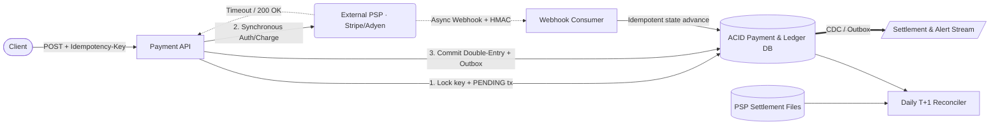

# Case Study 12 · Payment Processing & Double-Entry Ledger

**Level:** Advanced · **Status:** Exercise brief

## Problem statement

Design a payment processing engine and immutable financial ledger for a marketplace or fintech platform where customer charges, platform fees, merchant payouts, and refunds must **never double-charge, silently drop money, or drift out of balance**, even when external Payment Service Providers (PSPs like Stripe/Adyen) time out or send duplicate webhooks out of order.

## Functional requirements

- Execute idempotent payment intents (`POST /v1/payments`) and captures/refunds against an external PSP.
- Record every money movement in an **append-only double-entry ledger** where debits equal credits (`SUM(amount) == 0` per journal transaction).
- Handle asynchronous PSP webhook confirmations (`payment_succeeded`, `chargeback`, `payout_settled`) safely regardless of retries or out-of-order delivery.
- Run automated **daily T+1 reconciliation** comparing internal ledger postings against external PSP settlement files.

Out of scope for v1: storing raw PAN credit-card numbers directly (use PSP tokenization to stay out of full PCI-DSS SAQ-D scope), multi-hop FX currency trading desks, and tax filing automation.

## Quality requirements and constraints

| Attribute | Target / constraint | Scope and rationale |
|---|---|---|
| Latency | Payment API `p95 < 400 ms` (dominated by external PSP round-trip); internal ledger transfer `p95 < 25 ms` | Correctness & durability outrank sub-5 ms caching tricks |
| Availability | `99.99%` for payment intake & ledger; graceful degradation if PSP A is down via PSP B routing | Failed checkout directly loses revenue |
| Durability | **Zero RPO** (`synchronous WAL replication` across AZs + immutable audit log) | Financial records are legally regulated (`7–10 years`) |
| Consistency | **Strict ACID Serializable / Row-locked** balance invariants; **integer minor units** (`cents`, never IEEE-754 floats!) | Floating-point rounding or race conditions create missing/free money |
| Security / privacy | PCI-DSS tokenized cards only; HMAC-verified webhooks; mTLS internal; immutable append-only ledger (no `DELETE`/`UPDATE` grants to app role) | Prevent insider tampering and webhook spoofing |
| Cost | Ledger scale is modest in QPS compared to social media; spend money on synchronous multi-AZ durability and reconciliation rather than complex NoSQL | Relational ACID DB (sharded by `ledger_account_id` / `tenant_id` later) is ideal |

## Workload assumptions

| Input | Estimate | Confidence / source |
|---|---:|---|
| Payments / day | `10,000,000` transactions/day | Large marketplace / fintech |
| Ledger journal lines / payment | `4` rows (Debit Buyer, Credit Escrow, Debit Escrow, Credit Merchant + Fee) | Double-entry accounting |
| Peak multiplier | `5×` | Black Friday / payday bursts |
| Record size | `~250 bytes` per ledger entry + `500 bytes` payment intent | Compact financial schema |
| Retention | `7 years` regulatory retention (hot `1 year`, cold WORM archive `6 years`) | Compliance mandate |

**Workload math (explicit units):**
- **Payment QPS:** `10,000,000 ÷ 86,400 ≈ 116 payments/s` avg → **Peak (5×) ≈ 580 payments/s**.
- **Ledger row writes:** `580 × 4 ≈ 2,320` immutable `INSERT` rows/s at peak (easily handled by partitioned PostgreSQL / CockroachDB / Spanner, *except* on **hot system accounts** like `platform_fee_account`—must stripe/shard hot internal accounts!).
- **Storage growth (decimal):** `10M × (500 B + 4 × 250 B) = 15 GB/day` → **`5.48 TB/year`** (`~38.3 TB` over 7 years raw, `~115 TB` with 3× sync replicas).

## API and data model

```http
POST /v1/payments
Idempotency-Key: pay_usr99_cart441_v1
{ "amountCents": 4999, "currency": "USD", "sourceToken": "tok_visa_123", "merchantAccountId": "acct_m88" }
```
Response: `200 OK` (replay) or `201 Created` → `{ "paymentId": "pay_01J9...", "status": "SUCCEEDED" }`.

**Double-Entry Schema (Append-Only):**
- `idempotency_keys(key PK, request_hash, response_status, response_body, lock_state, created_at)`
- `payments(payment_id PK, idempotency_key UNIQUE, amount_cents BIGINT, currency CHAR(3), state, psp_ref, version INT)`
- `accounts(account_id PK, currency CHAR(3), available_cents BIGINT, pending_cents BIGINT, allow_negative BOOL, version BIGINT)`
- `journal_transactions(tx_id PK, idempotency_key UNIQUE, description, created_at)`
- `ledger_entries(entry_id PK, tx_id FK, account_id FK, amount_cents BIGINT /* +credit / -debit */, created_at)` — enforced by DB constraint/trigger that `SUM(amount_cents) = 0` per `tx_id`!

## Architecture



- **Never hold a DB transaction open across the external PSP HTTP call!** Do a 3-step state machine:
  1. **Local DB Tx 1:** Record `idempotency_key` (`IN_FLIGHT`) and `payment` (`INITIATED`) + reserve/lock buyer wallet if applicable; **commit & release DB locks**.
  2. **External PSP HTTP Call:** Send `Idempotency-Key` to PSP (`100–500 ms`).
  3. **Local DB Tx 2:** Persist PSP result (`SUCCEEDED`/`FAILED`), insert balanced `ledger_entries` + `outbox_events`, save cached response in `idempotency_keys`.

## Deep-dive prompts

1. **Idempotency across crash boundaries:** Client sends `POST /payments`, our server charges Stripe (`200 OK`), and **crashes before committing Tx 2**! How do client retry, `Idempotency-Key` forwarding to Stripe, and async **PSP status polling / webhook recovery** prevent double-charging or orphaned payments?
2. **Hot-account lock contention:** Every single payment credits `platform_fee_revenue` (`1` row in `accounts`!). At `580–5,000 payments/s`, updating that one row serializes the entire marketplace! How do **account striping/bucketing** (`platform_fee_bucket_0..63`) or **deferred balance rollups** eliminate contention?
3. **Concurrent balance checks (Double-Spend prevention):** Two concurrent withdrawal requests of `$80` hit a `$100` wallet simultaneously. Contrast `SELECT ... FOR UPDATE` (ordered by `account_id` to prevent deadlocks!), optimistic `version` CAS, and `SERIALIZABLE` isolation.
4. **Out-of-order webhooks:** `refund_succeeded` arrives 200 ms *before* `charge_succeeded` due to network jitter. How does a strict monotonic state-transition table handle out-of-order events?
5. **T+1 Reconciliation:** How do you classify and auto-heal vs page humans for mismatches (`Internal SUCCEEDED missing in PSP`, `PSP settled amount != ledger amount`, `orphan PSP refund`)?

## Alternatives and trade-offs

| Option | Benefits | Risks / costs | Decision |
|---|---|---|---|
| **Mutable `UPDATE balances SET amount = ...` without ledger** | Tiny storage; fast single update | Zero audit trail; silent bug corrupts balances forever with no way to reconstruct | **Rejected**; fails financial auditability |
| **Eventual NoSQL store for balances** | High raw write scale | Risk of double-spend / negative balances during partition; complex compensation | **Rejected**; `580–5,000 TPS` fits comfortably on ACID SQL / NewSQL |
| **Immutable Double-Entry Ledger + Striped Hot Accounts** | Provable `SUM=0` invariant, full audit trail, safe concurrency | Slightly higher write amplification (`4` rows/tx) + needs T+1 reconciliation | **Selected** |

## Failure and abuse scenarios

| Scenario | User impact | Detection | Mitigation / recovery |
|---|---|---|---|
| **Network timeout between Payment API and PSP** | Ambiguous payment state ("did my card get charged?") | PSP HTTP timeout spike | Mark payment `AMBIGUOUS`; return `202` or retry with **same PSP idempotency key**; background reaper queries PSP `/intents/{id}` after 5s |
| **Webhook spoofing attack (`POST /webhooks/psp`)** | Fake "payment succeeded" triggers free goods | HMAC signature verification failure | Reject unsigned payloads (`401`); check timestamp replay window (`<= 5 min`); verify directly against PSP API for high-value orders |
| **Deadlock between Transfer A→B and Transfer B→A** | Failed `40P01` transactions under load | DB deadlock counter | Always acquire row locks in **canonical ascending `account_id` order** (`min(a,b)` then `max(a,b)`) |
| **Duplicate retry while Tx 1 is `IN_FLIGHT`** | Confusing `500` or double-charge | Concurrent `idempotency_key` hit | Return `409 Conflict (Request in progress, Retry-After: 1)` until Tx 2 writes cached response |

## Deliverables

- [ ] Requirements, `SUM=0` invariant, and PCI scope exclusions.
- [ ] Payment TPS, ledger row growth, and hot-account contention math ([capacity lab](../labs/01-capacity-estimation.md)).
- [ ] Idempotent payment API, double-entry schema, and deadlock-free locking rules.
- [ ] Architecture diagram + crash-during-PSP-call recovery sequence diagram.
- [ ] One ADR using [templates/adr.md](../templates/adr.md) (Double-entry + Striped accounts, or Tx-splitting around PSP calls).
- [ ] T+1 reconciliation, webhook replay, and multi-PSP failover plan.

## References

- [Stripe Engineering: Designing Robust and Predictable APIs with Idempotency](https://stripe.com/blog/idempotency) — atomic state phases around external PSP calls.
- [TigerBeetle / Modern Treasury: Accounting for Developers (Double-Entry Ledgers)](https://www.moderntreasury.com/journal/accounting-for-developers) — immutable journal entries and balance invariants.
- [CockroachDB / PostgreSQL Transaction Isolation](https://www.postgresql.org/docs/current/transaction-iso.html) — preventing write skew and deadlocks.
