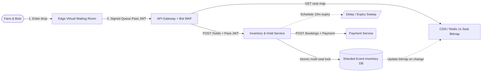

# Case Study 13 · Ticket Booking & Inventory Reservation

**Level:** Advanced · **Status:** Exercise brief

## Problem statement

Design a high-contention event ticketing system (like Ticketmaster or SeatGeek) that serves millions of fans refreshing a stadium seating map during a 10:00 AM Taylor Swift / World Cup flash on-sale, grants a short exclusive **10-minute checkout hold** on selected seats, and guarantees **zero double-sold seats** without crashing the primary database under 100× bot and fan bursts.

## Functional requirements

- Browse event metadata and real-time seat availability map (section/row/seat status: `AVAILABLE`, `HELD`, `BOOKED`).
- Reserve `1–6` specific seats atomically (`POST /v1/holds`) with a `10-minute` TTL while the user enters payment details.
- Confirm booking (`POST /v1/orders`) upon payment capture, transitioning seats permanently to `BOOKED`, or release seats automatically when the hold expires.
- Protect on-sale launches with a **Virtual Waiting Room** (queued admission token) so origin checkout stays below saturation.

Out of scope for v1: secondary ticket resale marketplace, dynamic airline-style yield pricing, and physical stadium NFC turnstile hardware.

## Quality requirements and constraints

| Attribute | Target / constraint | Scope and rationale |
|---|---|---|
| Latency | Seat map read `p95 < 80 ms`; `POST /holds` `p95 < 150 ms`; queue position poll `< 50 ms` | Fans click seats in milliseconds during flash drops |
| Availability | `99.99%` for waiting room & seat-map reads; `99.95%` for hold/booking mutations | Better to queue gracefully (`202` waiting room) than serve `500` crash pages |
| Durability | Zero loss of `BOOKED` tickets; temporary `HELD` locks survivable or cleanly recoverable within `10 min` | Confirmed purchases are binding financial/legal inventory |
| Consistency | **Strict mutual exclusion / linearizability** on `(event_id, seat_id)` state transitions (`AVAILABLE -> HELD -> BOOKED`) | Double-selling a physical seat is the #1 fatal bug |
| Security / privacy | Anti-bot PoW / Turnstile / behavioral challenges before Waiting Room token issuance; per-account ticket cap (`max 4–6`); signed hold tokens | Ticket scalper bots generate `90%+` of flash-sale traffic |
| Cost | Absorb `99%` of read traffic via CDN/Redis seat-map snapshots; shed excess bots at the edge before touching Postgres | Provisioning SQL for `500k` RPS flash bursts is economically absurd |

## Workload assumptions

| Input | Estimate | Confidence / source |
|---|---:|---|
| Flash-sale concurrent fans + bots | `2,000,000` users hitting 1 stadium (`70,000` seats) at `10:00:00` | Extreme hot-event contention |
| Peak seat-map read QPS | `500,000 QPS` (refreshing sections) | Read-heavy browsing before hold |
| Admitted checkout/hold QPS | Capped at **`5,000 holds/sec`** via Virtual Waiting Room | Protects inventory DB saturation knee |
| Average hold payload | `~200 bytes` per seat record | Compact inventory row |
| Event catalog size | `50,000` active events × `10,000` avg seats = `500M` seat rows | Partitioned cleanly by `event_id` |

**Workload math (explicit units):**
- **Hot-partition reality:** Without a waiting room, `2,000,000` users clicking `70,000` seats at once creates `~28` concurrent contenders per seat and **`500,000` SQL read/write queries/sec** targeting **one single `event_id` shard**!
- **With Virtual Waiting Room:** Edge queue admits **`3,000–5,000` users/sec** (`~180k–300k/min`), keeping origin `Hold API` under **`5,000 TPS`**—where a single `event_id` shard handles atomic seat locks smoothly!
- **Seat-map snapshot size:** `70,000 seats × 1 bit/byte state` = **`70 KB`** uncompressed (`~8 KB` gzipped bitmap/JSON per stadium)! Caching that `8 KB` snapshot in CDN/Redis (`1s–2s` TTL) serves `500,000 QPS` at `~4 GB/s` edge CDN bandwidth with **0.001% origin DB hits**.
- **Total seat DB storage (decimal):** `500M seats × 200 bytes = 100 GB` (`~300 GB` with indexes + 3× replicas)—tiny in bytes, **massive in lock contention**.

## API and data model

```http
POST /v1/events/{eventId}/holds
Authorization: Bearer <waiting_room_pass_jwt>
Idempotency-Key: hold_u44_e991_1
{ "seatIds": ["SEC101-R4-S12", "SEC101-R4-S13"] }
```
Response: `201 Created` → `{ "holdId": "hld_881", "expiresAt": "2026-11-26T10:10:00Z", "holdToken": "..." }` or `409 Conflict` (`seat already held`).

```http
POST /v1/bookings
Idempotency-Key: book_hld_881
{ "holdId": "hld_881", "paymentIntentId": "pi_9912" }
```

**Data model (`seats` table partitioned by `event_id`):**
- `seats(event_id BIGINT, seat_id VARCHAR(32), status SMALLINT /* 0=AVAIL,1=HELD,2=BOOKED */, hold_id UUID NULL, hold_expires_at TIMESTAMPTZ NULL, version BIGINT, PRIMARY KEY(event_id, seat_id))`
- `holds(hold_id UUID PK, event_id, user_id, seat_ids JSONB, state /* ACTIVE|CONFIRMED|EXPIRED|RELEASED */, expires_at TIMESTAMPTZ)`
- Atomic SQL Hold:
  ```sql
  UPDATE seats
  SET status = 1, hold_id = $hold_id, hold_expires_at = now() + interval '10 minutes', version = version + 1
  WHERE event_id = $event_id AND seat_id = ANY($seat_ids)
    AND (status = 0 OR (status = 1 AND hold_expires_at < now()));
  -- Verify affected_rows == len(seat_ids) inside transaction, else ROLLBACK (all-or-nothing seats!)
  ```

## Architecture



- **Why multi-seat holds must be all-or-nothing:** Locking seat 1 succeeds, seat 2 fails → roll back seat 1 immediately (`TX rollback`), never leave the user paying for 1 isolated seat when they wanted 2 adjacent seats!
- **Lazy + active expiration:** Notice the SQL predicate `OR (status = 1 AND hold_expires_at < now())` guarantees an expired hold can be claimed *immediately* at `10:10:00.001` without waiting for a background cron sweeper—while a background sweeper periodically resets expired rows so the cached `seat bitmap` reflects newly freed seats.

## Deep-dive prompts

1. **Pessimistic vs Optimistic vs Redis Lua seat locks:** Compare SQL conditional `UPDATE` (`status=0 OR expired`), Redis Lua `SET NX EX` locks paired with SQL `BOOKED` confirmation, and `SELECT ... FOR UPDATE`. What happens if Redis crashes mid-hold?
2. **Deadlocks on multi-seat holds:** User A locks `[S1, S2]` while User B locks `[S2, S1]`. How does sorting `seatIds` lexicographically before locking eliminate deadlocks?
3. **Virtual Waiting Room mechanics:** How do you build a fair, tamper-proof edge queue (Cloudflare/Edge Worker issuing signed monotonic `ticket_num` + periodic `current_serving_num` broadcast) that drops `2M` waiting browsers cleanly without hitting origin?
4. **General Admission (GA) vs Reserved Seating:** For `50,000` GA standing tickets (no seat numbers), updating 1 row `UPDATE events SET remaining = remaining - 1` creates a brutal single-row lock! How does **inventory striping** (`100` buckets of `500` GA tickets each) boost throughput `100×`?
5. **Payment succeeds 2 seconds *after* hold expired:** User's 3D-Secure bank challenge took 10m02s; Stripe captured payment while another user just grabbed the expired seat! How do you detect `hold_expires_at` mismatch before final commit and trigger an automatic refund + apology?

## Alternatives and trade-offs

| Option | Benefits | Risks / costs | Decision |
|---|---|---|---|
| **Direct DB hits without Waiting Room** | Simpler edge | `500k QPS` hot-row lock pileup crashes Postgres for everyone | **Rejected**; edge Waiting Room is mandatory for flash drops |
| **Redis-only seat holds (`SET NX EX 600`)** | Very fast `< 2 ms` lock checks | Redis failover loses active holds (double-hold risk unless confirmed in DB anyway) | **Use DB atomic `UPDATE` for correctness** (shielded by Waiting Room); optionally front with Redis pre-filter |
| **Single `remaining_count` row for GA concerts** | Exact single counter | `1` row lock caps throughput to ~`1k` TPS | **Use striped inventory buckets** (`bucket_0..99`) for GA events |

## Failure and abuse scenarios

| Scenario | User impact | Detection | Mitigation / recovery |
|---|---|---|---|
| **Scalper botnet bypasses UI and hammers `POST /holds`** | Real fans see instant sold-out | High hold-to-purchase abandonment + datacenter ASN spike | Require **signed Waiting Room JWT** + bot attestation + per-user/card/IP max-hold limit (`1` active hold) |
| **User holds 6 seats and abandons cart repeatedly ("inventory hoarding")** | Seats stay artificially locked for 10 min | Same user/IP repeatedly hits expiry without checkout | Progressive penalty: shorter TTL (`3 min`) or temporary cooldown after `2` expired holds |
| **Stale `1s` Redis/CDN seat-map shows seat available, `POST /holds` returns `409`** | Minor user frustration ("someone just grabbed it") | Normal expected race (`409` rate) | Client highlights taken seat and prompts quick re-select; acceptable trade-off to keep `500k` reads off DB |
| **Payment captured after hold expired** | Double-booking risk or forced refund | `version` / `hold_expires_at` CAS check fails at `POST /bookings` | **Reject booking** (`409 Hold Expired`), immediately trigger **automatic PSP refund**, never double-book seat |

## Deliverables

- [ ] Requirements, mutual-exclusion invariant, and explicit exclusions.
- [ ] Flash-sale QPS, `8 KB` bitmap CDN math, and Waiting Room drain rate ([capacity lab](../labs/01-capacity-estimation.md)).
- [ ] Waiting Room pass, `POST /holds`, `POST /bookings`, and sorted-seat SQL schema.
- [ ] Architecture diagram + multi-seat hold / payment-race sequence diagram.
- [ ] One ADR using [templates/adr.md](../templates/adr.md) (Waiting Room + DB conditional lock vs Redis lock).
- [ ] Bot throttling, GA bucket striping, and expired-hold refund plan.

## References

- [Ticketmaster / High-Contention Inventory Patterns](https://tech.ticketmaster.com/) — virtual waiting rooms and hot-event isolation.
- [PostgreSQL Concurrency Control & Atomic Conditional Updates](https://www.postgresql.org/docs/current/mvcc-intro.html) — row-level locking and deadlock avoidance.
- [Cloudflare Waiting Room Architecture](https://developers.cloudflare.com/waiting-room/) — edge-queued admission tokens protecting origin saturation.
