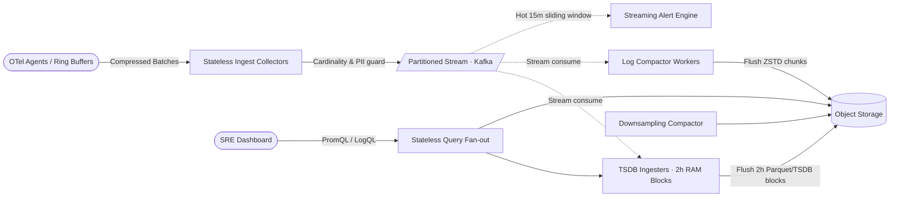

# Case Study 14 · Metrics & Log Ingestion Pipeline

**Level:** Advanced · **Status:** Exercise brief

## Problem statement

Design an observability ingestion and query backend (like Datadog, Prometheus/Mimir, or ClickHouse/Loki) that collects millions of time-series metrics and structured log lines per second from thousands of customer microservices—without dropping alerts during traffic bursts, choking on high-cardinality tag explosions, or blowing up storage costs for 90-day retention.

## Functional requirements

- Ingest time-series metrics (`POST /v1/metrics`, OTLP/Prometheus remote-write) and structured JSON logs (`POST /v1/logs`) via lightweight agents.
- Support real-time **alert evaluation** (`p99 > 500 ms` over `5 min` window) within `15 seconds` of metric emission.
- Query time-series aggregations (`rate`, `sum`, `p95` histograms) and full-text/field-filtered logs over `1h` to `90d` windows.
- Automatically **downsample** old raw metrics (e.g., `10s` raw → `1m` rollups after 7 days → `1h` rollups after 30 days) and expire old logs via TTL.

Out of scope for v1: APM distributed flamegraphs, browser RUM session video replay, and custom anomaly-detection ML model training.

## Quality requirements and constraints

| Attribute | Target / constraint | Scope and rationale |
|---|---|---|
| Latency | Ingest ACK `p95 < 30 ms`; Alert evaluation lag `< 15s`; Dashboard `24h` query `p95 < 500 ms` | Observability must stay fast *especially* when production is on fire |
| Availability | `99.99%` for ingestion pipeline (must survive query cluster slowness!) | Never lose outage telemetry because a user ran an expensive `90d` regex query |
| Durability | Buffer burst spikes safely (`Kafka`/WAL); minor `5s` tail loss on agent crash acceptable for metrics, durable for audit logs | Write path is 100:1+ write-heavy |
| Consistency | Eventual query visibility (`2–5 seconds` after ingestion); out-of-order sample handling within `2-min` watermark | Distributed agents flush asynchronously |
| Security / privacy | Strict tenant isolation; PII redaction pipeline (`credit_card`, `Authorization` headers) at agent/ingest edge; per-tenant cardinality caps | One noisy tenant logging `user_id` as a metric tag must not crash shared TSDB RAM |
| Cost | Storage & compression dominate (`Gorilla XOR` float compression ~`1.5 bytes/sample`, columnar `ZSTD` for logs ~`5×–8×`) | Uncompressed JSON logs cost `10×` too much on disk and network |

## Workload assumptions

| Input | Estimate | Confidence / source |
|---|---:|---|
| Monitored hosts / pods | `100,000` active containers | Mid-to-large multi-tenant cloud fleet |
| Metric samples / pod / 10s | `200` active time-series per pod | CPU, mem, HTTP status, latencies |
| Log lines / pod / sec | `20` lines/sec avg (`500 bytes` raw JSON each) | Standard structured app logs |
| Peak incident multiplier | `5×` (outage stack traces & error logs spike massively!) | Critical observability design assumption |
| Retention | Metrics: `14d` raw (`10s`), `90d` (`1m`), `1y` (`1h`); Logs: `30d` hot/warm | Tiered retention |

**Workload math (explicit units):**
- **Metrics Write Rate:** `(100,000 × 200) ÷ 10s` = **`2,000,000` metric samples/sec** avg → **Peak (5×) ≈ `10,000,000` samples/sec**!
  - Compressed (`~2 bytes/sample` Gorilla/Delta-of-delta): `2M × 2 B = 4 MB/s` (`~345 GB/day` raw metric blocks!).
- **Logs Write Rate:** `100,000 × 20` = **`2,000,000` log lines/sec** avg → **Peak (5×) ≈ `10,000,000` lines/sec**!
  - Uncompressed: `2M × 500 B = 1 GB/s` (`8 Gbps`) avg → **Peak `5 GB/s` (`40 Gbps`)**!
  - Daily uncompressed logs: `1 GB/s × 86,400 = 86.4 TB/day`. With **`6×` ZSTD columnar compression** = **`14.4 TB/day`** → `30 days = 432 TB` stored in Object Storage!
- **Read vs Write ratio:** Easily **`1,000:1` write-heavy**! Traditional B+Tree databases die from random write amplification; **LSM-Tree / Append-Only Time-Partitioned Blocks + Object Storage** is mandatory.

## API and data model

```http
POST /v1/metrics   (Protobuf OTLP / Snappy-compressed batch)
X-Tenant-ID: org_881
```
Agents batch every `5–10 seconds` or `1 MB` chunk—never 1 HTTP call per metric!

**Data model:**
1. **Metrics TSDB (Inverted Label Index + Columnar Time Chunks):**
   - Series dictionary: `series_id = hash(metric_name, sorted_labels)` → e.g., `http_req_duration_ms{service="checkout",status="500"}` -> `id: 991827`.
   - Time chunks (`2-hour` immutable blocks): `(series_id, [(ts_delta_of_delta, gorilla_xor_val), ...])` flushed to S3/Object Store with a compact label inverted index (`bitmap` per label pair).
2. **Logs Columnar Store (ClickHouse / Loki-style):**
   - Partitioned by `(tenant_id, day, hour)`: low-cardinality index labels (`service`, `env`, `level`) + ZSTD-compressed columnar blocks (`timestamp`, `trace_id`, `message`, `attrs_json`) in Object Storage.

## Architecture



- **Decoupling Ingest from Storage & Query:** Agents maintain a local disk/RAM **ring buffer** (drops oldest debug logs first if network drops); `Ingesters` push to `Kafka` immediately so ingestion stays sub-30 ms even if `TSDB` or `S3` hiccups.
- **Query Fan-out:** `Query Engine` merges **hot recent data** (`last 2h` in TSDB Ingester RAM) with **historical immutable blocks** directly from `Object Storage` (cached on local NVMe).

## Deep-dive prompts

1. **High-cardinality explosion:** A developer accidentally puts `user_id` or `request_uuid` into a Prometheus metric label `{endpoint="/pay", user_id="u_99182"}`. Suddenly `20M` unique series spawn in 5 minutes and OOM the TSDB Ingester! How do per-tenant **active-series caps** and **streaming cardinality monitors** protect the fleet?
2. **Gorilla / Delta-of-Delta & Columnar Compression:** Why does encoding timestamps as `delta-of-delta` and floats as `XOR` reduce `16 bytes/sample` down to `~1.37 bytes/sample`?
3. **Outage self-feedback loop (Observability during an incident):** When production crashes, apps emit `5×` error logs—*right when SREs refresh 50 dashboards simultaneously*! How do **Read/Write physical isolation**, **tail-based log sampling** (keep 100% of `ERROR`, sample `1%` of `DEBUG`/`INFO`), and **per-tenant query concurrency slots** prevent monitoring from collapsing during an outage?
4. **Downsampling & Histograms (`p95`/`p99`):** You cannot average two `p99` values across 10 servers! Explain why **HDRHistograms / DDSketch / Prometheus native buckets** must be stored as mergeable counters/sketches for accurate fleet-wide `p99` rollups.
5. **Log indexing trade-off (Full Inverted Index vs Label-Only + Brute-Force Parallel Scan):** Compare Elasticsearch (full inverted index on every word—fast lookup, huge index RAM/disk) vs Grafana Loki / ClickHouse (index only metadata labels + stream-scan compressed chunks in parallel).

## Alternatives and trade-offs

| Option | Benefits | Risks / costs | Decision |
|---|---|---|---|
| **Single B+Tree Relational DB (e.g., standard Postgres)** | Familiar SQL | Write amplification & index bloat collapse well before `2M` samples/sec | **Rejected** |
| **Full Inverted Index on every log token (Elasticsearch)** | Sub-100 ms arbitrary keyword grep | `1.5×–3×` raw log size in index storage + heavy JVM heap cost at `86 TB/day` | **Rejected** for bulk logs; reserve for indexed traces/security audit |
| **Kafka Buffer + Label-Indexed Columnar Blocks on Object Storage** | `10×` cheaper storage (`S3 + ZSTD`), elastic stateless query workers, isolated ingest | Cold regex scan over 30 days takes seconds instead of `50 ms` | **Selected** (plus `1m`/`1h` pre-aggregated metric rollups) |

## Failure and abuse scenarios

| Scenario | User impact | Detection | Mitigation / recovery |
|---|---|---|---|
| **Tenant pushes `10M` unique `uuid` label values** | Ingester OOMs; neighbors lose metrics | Active series per tenant `> limit` | Drop/aggregate offending label at Ingest Collector (`429` warning header + drop metric series) before Kafka/TSDB |
| **Incident triggers `5×` debug log storm** | Kafka lag climbs; storage cost spikes | Bytes/sec burst per service | Agent-side rate limit + dynamic **head/tail sampling** (preserve 100% `ERROR/WARN`, drop excess `DEBUG`) |
| **SRE runs unindexed `90-day` `.*` regex query across `400 TB`** | Query nodes OOM and slow alerts | Query scan bytes / execution time watchdog | Reject unbounded scans (`max time range` or `require >= 1 label filter`); isolate **Alert Engine** on dedicated read path |
| **Object Storage slowness delays block flush** | Ingester RAM fills up | `pending_flush_blocks` alert | Spill WAL segments to local NVMe disk; pause low-priority ingest via backpressure before OOM |

## Deliverables

- [ ] Requirements, cardinality bounds, and explicit exclusions.
- [ ] Samples/sec, `86 TB/day -> 14 TB/day` compression math, and retention tiers ([capacity lab](../labs/01-capacity-estimation.md)).
- [ ] Compressed batch ingest API and TSDB/Columnar block layout.
- [ ] Architecture diagram + hot/cold query merge + alert evaluation flow.
- [ ] One ADR using [templates/adr.md](../templates/adr.md) (Full Inverted Index vs Label-Indexed Columnar Store, or Cardinality Enforcement).
- [ ] Outage-storm sampling, PII redaction, and read/write isolation plan.

## References

- [Facebook Gorilla: A Fast, Scalable, In-Memory Time Series Database (VLDB 2015)](https://www.vldb.org/pvldb/vol8/p1816-teller.pdf) — delta-of-delta timestamps and XOR float compression.
- [Grafana Mimir / Cortex Architecture](https://grafana.com/docs/mimir/latest/references/architecture/) — stateless ingesters, ring hashing, and object-storage block compaction.
- [Datadog / DDSketch Paper](https://arxiv.org/abs/1908.10693) — mergeable quantile sketches for distributed `p95`/`p99` aggregation.
