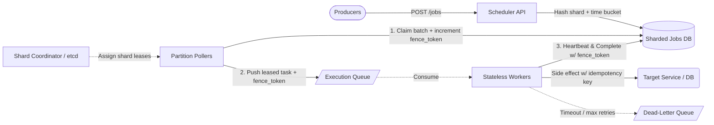

# Case Study 15 · Distributed Job Scheduler

**Level:** Advanced · **Status:** Exercise brief

## Problem statement

Design a fault-tolerant distributed task & cron scheduler (like Temporal timers, AWS EventBridge Scheduler, or Airflow's execution engine) that reliably schedules millions of one-shot delayed jobs (`"send reminder in 24h"`) and recurring cron jobs across thousands of workers—ensuring **no job is silently forgotten on node failure** and **stale zombie workers cannot corrupt downstream state**.

## Functional requirements

- Schedule one-shot jobs (`run_at` timestamp) and recurring cron jobs (`cron_expr`, timezone-aware) with payload, retry policy, and timeout.
- Trigger jobs within a tight delay bound (`<= 2 seconds` past `run_at` for normal priority).
- Support cancellation, pause/resume, manual trigger, and execution history inspection (`PENDING`, `LEASED`, `RUNNING`, `SUCCEEDED`, `FAILED`, `DEAD`).
- Enforce concurrency limits (`max_concurrent_runs` per job/tenant) and idempotent execution fencing.

Out of scope for v1: arbitrary multi-stage DAG data-pipeline visual authoring (covered in transcoding/workflow engines) and arbitrary untrusted user code sandboxing (workers execute registered handlers).

## Quality requirements and constraints

| Attribute | Target / constraint | Scope and rationale |
|---|---|---|
| Latency | Schedule API `p95 < 50 ms`; trigger accuracy `p95 < 2 seconds` past `run_at` | Delayed notifications & billing renewals depend on timely fire |
| Availability | `99.99%` for trigger & lease engine | Scheduler downtime freezes all downstream background workflows |
| Durability | Zero loss of scheduled or recurring job definitions (`multi-AZ ACID store`) | Forgotten billing or SLA jobs break business contracts |
| Consistency | **At-least-once execution with monotonic fencing tokens** (prevent split-brain duplicate runs from paused/zombie workers) | True "exactly-once execution" over an unreliable network is impossible—**fenced idempotent handlers** achieve *effectively-once* outcomes |
| Security / privacy | Tenant-scoped job namespaces; signed/authenticated worker callbacks; encrypted job payloads | Prevent cross-tenant job tampering or payload injection |
| Cost | Polling a 100M-row table every second (`SELECT * WHERE run_at <= now()`) melts DB CPU—must partition by **time-bucket + shard** | Efficient time-range scanning is the core storage challenge |

## Workload assumptions

| Input | Estimate | Confidence / source |
|---|---:|---|
| Active scheduled/cron jobs | `100,000,000` pending jobs in store | Mix of 30-day reminders & cron tasks |
| New jobs scheduled / day | `50,000,000` | High-volume SaaS automation |
| Jobs triggered / sec | `~600/s` avg → **`10,000/s` peak** (`:00` top-of-minute cron spike!) | Cron expressions align on `:00` seconds (`0 * * * *`) |
| Job record + history size | `~1 KB` per job + `~500 B` per run history | Compact JSON parameters |
| Execution history retention | `30 days` hot | Support & debugging |

**Workload math (explicit units):**
- **Top-of-minute cron thundering herd:** Notice `0 * * * *` and `0 0 * * *` align millions of cron jobs to the **exact same second** (`:00`)! Peak trigger rate at `00:00:00` UTC can easily hit `20×–50×` the daily average (`10,000–30,000` triggers/sec).
- **Storage growth (decimal):** `100M` active jobs × `1 KB` = **`100 GB`** active working set. Plus `50M runs/day × 500 B = 25 GB/day` (`750 GB` for 30 days history → `~2.5 TB` with 3× replicas).
- **Queue polling math:** Scanning `100M` rows with one poller fails. Partitioning `scheduled_jobs` into **64 hash shards × 1-minute time buckets** (`bucket_minute = floor(run_at / 60)`) means a poller at `10:05` reads **only** `(shard_k, bucket='2026-11-26T10:05')`—a tiny sequential range of `~1,000` rows!

## API and data model

```http
POST /v1/jobs
Idempotency-Key: sched_invoice_9912
{ "jobType": "send_invoice", "runAt": "2026-11-27T09:00:00Z", "payload": {...}, "maxRetries": 5 }
```

**Data model (Sharded by `shard_id` + Time Bucket):**
- `jobs(shard_id SMALLINT, bucket_minute BIGINT, job_id BIGINT, run_at TIMESTAMPTZ, cron_expr TEXT NULL, state SMALLINT /* PENDING|LEASED|DONE|DEAD */, lease_until TIMESTAMPTZ NULL, fence_token BIGINT NOT NULL DEFAULT 0, attempt INT, payload JSONB, PRIMARY KEY(shard_id, bucket_minute, run_at, job_id))`
- **Clustered Primary Key** keeps all jobs due in the current minute physically adjacent on disk!
- `job_executions(exec_id PK, job_id, fence_token, worker_id, status, started_at, finished_at)`

## Architecture



- **Fencing Tokens (Preventing Zombie Workers):** Suppose `Worker 1` claims `job_42` with `fence_token = 7` and `lease_until = 10:00:30`. `Worker 1` suffers a 45-second JVM GC pause. At `10:00:31`, the poller sees `lease_until` expired, re-leases `job_42` to `Worker 2` with `fence_token = 8`. When `Worker 1` wakes up and tries to mark `job_42` `DONE` (or write to `Target DB`), **both `Jobs DB` and `Target DB` reject `fence_token 7 < 8`**!
- **Cron next-occurrence atomicity:** When a recurring cron job completes (or is triggered), compute `next_run_at` and insert/update the next bucket **in the same ACID transaction** so a crash never skips or duplicates a recurring schedule.

## Deep-dive prompts

1. **Time-bucket partitioning & DB bloat:** What happens to Postgres `VACUUM` / RocksDB tombstones when you insert and delete `50M` jobs/day from `jobs`? Compare **Time-partitioned table drops** (drop yesterday's completed partition in `O(1)`!) vs `DELETE` rows, or **Hierarchical Timing Wheels** in memory backed by WAL.
2. **Top-of-hour cron stampede (`0 * * * *`):** If `500,000` users schedule a daily report at `00:00 UTC`, how do **deterministic cron jitter** (spread across `:00–:59s` unless exact-second flag is set) and **per-tenant concurrency caps** prevent self-DDoS?
3. **Why "Exactly-Once Execution" is an illusion:** Walk through the crash window between *"Worker finishes sending email"* and *"Worker commits `status=DONE` to Jobs DB"*. How do `fence_token` + target-side `idempotency_key` (`job_id + scheduled_run_ts`) make retries safe?
4. **Long-running jobs (`1 hour`) vs short jobs (`200 ms`):** Why shouldn't a 1-hour job hold a fixed `30s` visibility timeout without a **lease-heartbeat extension loop**?
5. **High-delay jobs (`runAt = 6 months from now`):** How do you keep `100M` far-future jobs out of hot memory/queues until `T - 5 minutes`? (Two-tier: cold bucketed DB/Parquet store → hot 5-minute lookahead poller → Redis/Kafka execution queue.)

## Alternatives and trade-offs

| Option | Benefits | Risks / costs | Decision |
|---|---|---|---|
| **Redis `ZSET` (`ZRANGEBYSCORE`) as sole scheduler** | Sub-ms polling; simple | Loses schedules on Redis RAM loss; `100M` jobs (`~30 GB+`) expensive in RAM | **Rejected** as sole durable store; use as hot `5-min` lookahead cache only |
| **Single unpartitioned SQL table polled by `SELECT FOR UPDATE SKIP LOCKED`** | Simple ACID leases | `SKIP LOCKED` scans degrade rapidly past `1k–2k` triggers/s & heavy `VACUUM` bloat | **Rejected** for `10k+` peak; works only for small workloads |
| **Shard + Time-Bucket Partitioned DB + Lookahead Pollers + Fencing Tokens** | `O(1)` partition drops, horizontal shard scale, crash-safe leases | Higher coordination complexity (assigning shards to pollers via `etcd` leases) | **Selected** |

## Failure and abuse scenarios

| Scenario | User impact | Detection | Mitigation / recovery |
|---|---|---|---|
| **Worker GC pause / zombie worker wakes up late** | Duplicate side effects or stale `DONE` overwriting active retry | `fence_token < current_fence_token` rejected metric | Storage & target API reject stale `fence_token`; worker logs warning and aborts cleanly |
| **Poller node crashes mid-lease assignment** | Batch of jobs delayed briefly | `etcd` poller session lease expires (`~10s`) | Rebalance shard ownership to healthy poller; expired `lease_until` jobs re-claimed automatically |
| **Poison-pill job payload crashes every worker (`OOM`)** | Wastes worker fleet in infinite retry loop | `attempt >= maxRetries` | Move job to `DEAD` state + **DLQ** with exponential backoff (`10s, 30s, 2m, 10m`) + full jitter |
| **Tenant schedules `1M` tight-loop 1-second jobs** | Starves other tenants' scheduled tasks | Per-tenant pending/QPS quota alert | Enforce per-tenant **pending-job cap**, **min cron interval (`1 min`)**, and **fair-share worker queues** |

## Deliverables

- [ ] Requirements, at-least-once + fencing guarantees, and explicit exclusions.
- [ ] Top-of-minute cron spike, active working-set storage, and partition math ([capacity lab](../labs/01-capacity-estimation.md)).
- [ ] Schedule API, `(shard_id, bucket_minute, run_at)` schema, and fencing-token contract.
- [ ] Architecture diagram + GC-pause zombie-worker fencing sequence diagram.
- [ ] One ADR using [templates/adr.md](../templates/adr.md) (Time-bucket partitioned DB vs Timing Wheel, or Fencing Token protocol).
- [ ] Cron jitter, partition-drop cleanup, and tenant fair-queuing plan.

## References

- [Martin Kleppmann: How to Do Distributed Locking (Fencing Tokens)](https://martin.kleppmann.com/2016/02/08/how-to-do-distributed-locking.html) — why leases without storage-enforced fencing tokens are unsafe.
- [Uber Engineering: Cherami / Cadence / Temporal Timer Queues](https://docs.temporal.io/) — time-partitioned timer shards and durable workflow state machines.
- [Hashed and Hierarchical Timing Wheels (Varghese & Lauck)](https://dl.acm.org/doi/10.1145/41457.37504) — `O(1)` in-memory timer insertion and firing.
