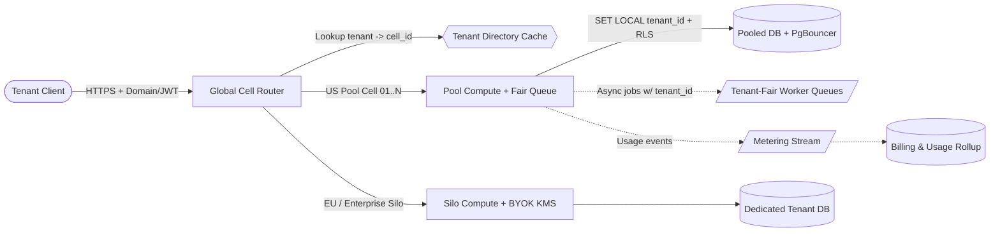

# Case Study 16 · Multi-Tenant SaaS Architecture

**Level:** Advanced / Staff · **Status:** Exercise brief

## Problem statement

Design the foundational multi-tenant architecture for a B2B SaaS platform serving `50,000` small-to-midsize startups alongside `200` regulated enterprise banks/hospitals. You must prevent one runaway tenant ("noisy neighbor") from degrading everyone else, guarantee **zero cross-tenant data leakage**, support enterprise compliance (region pinning, customer-managed encryption keys), and meter usage accurately for billing.

## Functional requirements

- Onboard tenants into appropriate **isolation tiers** (`Free/Pro Shared Pool`, `Dedicated Enterprise Silo`, or regional `EU`/`US` cells).
- Authenticate users (`OIDC`/`SAML SSO`) and enforce tenant-scoped RBAC/ABAC authorization on every API, cache, queue, and DB query.
- Enforce per-tenant resource quotas (API QPS, storage GB, async job concurrency) to isolate noisy neighbors.
- Meter billable usage events accurately (`API calls`, `active seats`, `storage GB-hours`) for monthly invoicing.

Out of scope for v1: self-hosted on-premise air-gapped appliances, custom per-tenant UI white-labeling CSS engines, and automated sales CRM workflows.

## Quality requirements and constraints

| Attribute | Target / constraint | Scope and rationale |
|---|---|---|
| Latency | Tenant resolution & AuthZ check `p99 < 5 ms`; core API `p95 < 100 ms` | Tenant context runs on every single request |
| Availability | `99.99%` for Enterprise tier; `99.9%` for Shared Pool; **Blast-radius cap (`<= 2%` tenants per deployment cell)** | A bad migration or DDoS in one cell must never take down all 50,000 customers |
| Durability | Zero cross-tenant backup restore collisions (must support **per-tenant point-in-time restore** for Enterprise!) | Restoring Tenant A's accidentally deleted workspace cannot overwrite Tenant B's data |
| Consistency | Strong tenant ACL & quota-revocation propagation (`< 5s`); eventual billing aggregation (`< 5 min`) | Revoked SSO user must lose access immediately |
| Security / privacy | **Defense-in-depth isolation**: JWT `tenant_id` claim + PostgreSQL **Row-Level Security (RLS)** + prefixed Redis/S3 keys + optional **BYOK KMS** | Never trust `WHERE tenant_id = ?` in application code alone—one missed `WHERE` clause is a catastrophic breach |
| Cost | Shared **Pool** keeps `50,000` free/SMB tenants profitable (`< $0.20/tenant/month` idle infra); **Silo/Cell** justifies `$2,000+/month` Enterprise contracts | Spinning up `50,000` separate Kubernetes clusters & RDS instances would bankrupt the company |

## Workload assumptions

| Input | Estimate | Confidence / source |
|---|---:|---|
| Total tenants | `50,000` (`49,800` SMB/Free, `200` Enterprise) | Classic SaaS power-law distribution |
| Peak global API QPS | `100,000 QPS` (top `1%` tenants generate `60%` of load!) | Extreme multi-tenant skew |
| Tenant metadata + catalog | `10 TB` shared pool + `20 TB` across Enterprise silos (`30 TB` total) | Teaching assumption |
| Usage metering events / day | `1,000,000,000` billable events/day | High-volume SaaS telemetry |
| Regional compliance | `65%` US, `30%` EU (strict GDPR residency), `5%` APAC | Drives cell placement |

**Workload math (explicit units):**
- **Silo cost vs Pool math:** Provisioning 1 dedicated RDS Postgres (`~$100/mo`) per tenant for `50,000` SMB tenants = **`$5,000,000/month` just for idle databases**! Using **20 Pooled DB Cells** (`~2,500` tenants/cell) costs `~$20,000/month` (`250×` cheaper) while capping cell blast radius to `5%` (`1/20th`).
- **Metering stream QPS:** `1,000,000,000 ÷ 86,400 ≈ 11,574 events/s` avg → **Peak (4×) ≈ `46,300` metering events/s**. Aggregate in streaming windows (`1-minute` rollups per `(tenant_id, metric)`) before writing to the Billing DB (`50k × 1,440 min/day` = manageable batch upserts).
- **Per-tenant noisy-neighbor cap:** If one cell holds `5,000 QPS` capacity across `2,500` tenants, cap any single pooled tenant at e.g. `500 QPS` burst + `max 10%` DB connection pool slots (`PgBouncer` per-tenant pool limits or weighted fair queuing).

## API and data model

Tenant Context Propagation (Edge Gateway → Downstream Services):
- Inbound JWT validated at Edge; Gateway strips untrusted client `X-Tenant-ID` headers and injects cryptographically signed internal `X-Verified-Tenant-Context` (`tenant_id`, `tier`, `cell_id`, `region`, `roles`).

**Data Isolation Models (Pool vs Bridge vs Silo):**
1. **Pool Model (Shared DB + Shared Schema + Postgres RLS):**
   ```sql
   ALTER TABLE projects ENABLE ROW LEVEL SECURITY;
   CREATE POLICY tenant_isolation ON projects
     USING (tenant_id = current_setting('app.current_tenant_id')::uuid);
   ```
   Every connection sets `SET LOCAL app.current_tenant_id = '...'` inside the transaction!
2. **Bridge Model (Shared DB Server, Separate Schema per Tenant):** Good up to `~200–500` schemas/DB before Postgres catalog (`pg_class`) bloat & migration time break down.
3. **Silo Model (Dedicated DB / Dedicated Cell):** Reserved for top `200` paying Enterprise tenants needing custom backup restore, BYOK KMS keys, and physical noisy-neighbor isolation.

## Architecture



- **Cell-Based Architecture:** Group pooled tenants into self-contained **Cells** (e.g., `cell-us-01`, `cell-eu-01`, `2,500` tenants each, capped at known DB/compute capacity). Scale horizontally by adding `cell-us-02`—never create one giant global single database!
- **Tenant Migration (Pool → Silo):** When an SMB tenant upgrades to Enterprise (or explodes in size), migrate them from `Pool Cell` to `Dedicated Silo` using **CDC backfill + dual-write + Tenant Directory swap** (Lesson 40 Strangler pattern!).

## Deep-dive prompts

1. **Row-Level Security (RLS) pitfalls with connection pooling:** Why does `SET app.current_tenant_id` (session-level) leak Tenant A's data to Tenant B when using `PgBouncer` in transaction-pooling mode—and why is **`SET LOCAL` inside an explicit transaction** mandatory?
2. **Noisy-neighbor protection across ALL layers:** How do you prevent one noisy tenant from starving others in: (a) **API Gateway** (per-tenant token bucket), (b) **Worker Queues** (shuffle sharding or per-tenant fair-share queues instead of 1 shared FIFO!), and (c) **Database** (statement timeout + connection cap)?
3. **Per-tenant backup & restore in a Pooled DB:** Tenant A accidentally deletes all their projects at `14:00`. You cannot roll back the entire `2,500`-tenant DB to `13:55`! How do soft-delete tombstones (`30d` trash), CDC audit streams, or logical restore-to-staging solve single-tenant recovery?
4. **Customer-Managed Encryption Keys (BYOK / KMS):** How does **Envelope Encryption** (Data Encryption Key per tenant wrapped by Tenant's KMS Master Key) let an Enterprise customer revoke access instantaneously without re-encrypting `10 TB` of blobs?
5. **Cross-cell global features:** If `Tenant Directory` moves a tenant from `cell-01` to `cell-02`, how do you prevent split-brain writes during the 5-second cache TTL window? (Drain/read-only fence on old cell during cutover.)

## Alternatives and trade-offs

| Option | Benefits | Risks / costs | Decision |
|---|---|---|---|
| **Silo-for-All (1 DB + 1 cluster per tenant)** | Perfect physical isolation & trivial per-tenant restore | `$5M+/mo` idle infra waste; schema migrations across `50,000` DBs take days | **Rejected** for SMB; reserve for Enterprise tier |
| **Single Giant Global Pooled DB (`WHERE tenant_id = ?`)** | Lowest day-1 ops cost | 1 missing `WHERE` = global breach; 1 bad migration or runaway query crashes 100% of customers | **Rejected** at scale; unsafe blast radius |
| **Cell-Based Hybrid (Pooled RLS Cells + Enterprise Silos + Shuffle Sharding)** | Economical for 50k SMBs, strict RLS safety, capped blast radius, smooth upgrade path | Requires Tenant Directory Router, `SET LOCAL` discipline, and cell-aware tooling | **Selected** (AWS/Slack/Shopify gold standard) |

## Failure and abuse scenarios

| Scenario | User impact | Detection | Mitigation / recovery |
|---|---|---|---|
| **Missing `SET LOCAL` or connection-pool leak exposes wrong tenant** | Catastrophic data breach | Automated integration test asserting RLS active on all tables + DB role lacks `BYPASSRLS` | Enforce **fail-closed RLS** (unset `app.current_tenant_id` returns **0 rows**, never falls back to all rows!) |
| **One tenant dumps `1M` heavy export jobs into background queue** | All other tenants' emails/exports stall for 3 hours | Per-tenant queue depth & consumer lag alert | Use **Shuffle Sharding** (assign each tenant 2 of 16 worker partitions) or **fair-share weighted round-robin** |
| **Enterprise tenant revokes BYOK KMS key** | Must immediately block decryption of their data | KMS `AccessDenied` / `DisabledException` | Cache DEKs briefly (`<= 5 min` TTL) or flush DEK cache via webhook; return `403 Tenant Key Revoked` cleanly |
| **Deployment bug breaks Cell `us-01`** | `5%` of tenants experience errors | Automated canary error-budget gate on `cell-us-01` | Halt rollout before `cell-us-02..20` (`95%` of customers untouched!); auto-rollback `cell-us-01` |

## Deliverables

- [ ] Requirements, isolation guarantees, and explicit exclusions.
- [ ] Pool vs Silo cost math, metering QPS, and cell sizing ([capacity lab](../labs/01-capacity-estimation.md)).
- [ ] Tenant-context propagation spec, RLS schema (`SET LOCAL`), and Shuffle-Sharding design.
- [ ] Architecture diagram + Pool-to-Silo live migration sequence diagram.
- [ ] One ADR using [templates/adr.md](../templates/adr.md) (Pool/Bridge/Silo tiering or Shuffle Sharding).
- [ ] Fail-closed RLS, noisy-neighbor queue isolation, and single-tenant restore plan.

## References

- [AWS SaaS Architecture Fundamentals (Pool, Bridge, Silo & Cell Architectures)](https://docs.aws.amazon.com/whitepapers/latest/saas-architecture-fundamentals/saas-architecture-fundamentals.html) — tiering, tenant context, and noisy-neighbor controls.
- [AWS Builders' Library: Workload Isolation Using Shuffle-Sharding](https://aws.amazon.com/builders-library/workload-isolation-using-shuffle-sharding/) — bounding multi-tenant blast radius mathematically.
- [PostgreSQL Row Security Policies (`RLS`)](https://www.postgresql.org/docs/current/ddl-rowsecurity.html) — enforcing database-level fail-closed tenant boundaries.
