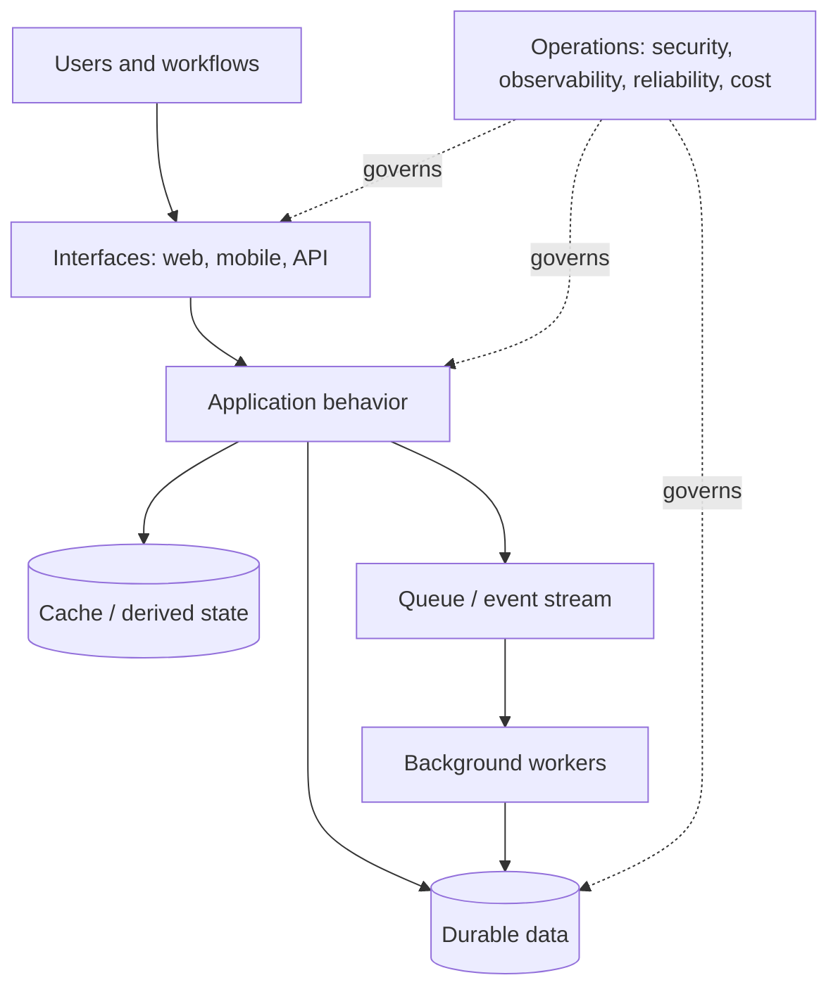

# 01 · Thinking in Systems

**Level:** Beginner · **Status:** First draft · **Prerequisites:** Basic programming and web-app familiarity

## Learning objectives

By the end, you should be able to:
- Explain what system design covers and what it does not.
- Decompose a product into users, interfaces, services, data stores and external dependencies.
- Distinguish a requirement from a proposed implementation.
- Explain at least one trade-off in a design.

## 1. Start with the problem, not the boxes

A system is a set of components that interact to produce an outcome. System design is the work of choosing boundaries, responsibilities, communication paths and operational properties so that the outcome remains useful under expected conditions.

A common mistake is to hear "design a chat app" and immediately draw Kafka, Redis, Kubernetes and microservices. Those are implementation choices. First ask what users need, what constraints matter, and what the simplest correct version looks like.

## 2. A useful mental model

Think in five layers: people and workflows; interfaces; application behavior; state; and operations.

This is a map, not a universal architecture. A small product may combine most application responsibilities into one deployable process and one database.

## 3. Requirements and constraints are different

A requirement says what outcome is needed. A constraint limits the solution. Examples:
- Requirement: a user can retrieve their uploaded document.
- Quality target: 99.9% monthly availability for document reads.
- Constraint: the first version must run within a small monthly budget.
- Design choice: store file bytes in object storage and metadata in a relational database.

Do not turn a design choice into a requirement unless the problem explicitly mandates it.

## 4. Optimize for the actual bottleneck

A system can be limited by CPU, memory, disk I/O, network bandwidth, lock contention, a remote dependency, a database query, or a human operational process. Adding more application servers does not fix every bottleneck.

Ask: what resource is saturated, what evidence supports that diagnosis, and what change would reduce the constraint without creating a worse one?

## 5. Trade-offs are the work

- Caching can reduce database load, but introduces stale data and invalidation complexity.
- Replication can improve read capacity and availability, but introduces replication lag and failover decisions.
- Microservices can allow independent ownership and deployment, but add network failure, observability and operational overhead.
- Synchronous APIs are easy to reason about, but couple the caller to downstream latency and availability.

There is rarely one universally best architecture. There is a design that fits a particular workload and set of constraints.

## Mini exercise

Choose a product you use daily. Draw its major components without naming vendors. Trace one read and one write. For every arrow, write what is sent, who owns the data, and what happens if the receiver is unavailable.

## Retrieval practice

1. Why clarify requirements before selecting technologies?
2. Give an example of a quality attribute and a separate implementation choice.
3. Why does adding application servers not necessarily solve a slow request?
4. Name a benefit and a cost of introducing a cache.

Hints

1. Different requirements lead to different architectures.
2. "Read p95 under 200 ms" is a target; "use Redis" is a design choice.
3. The bottleneck may be database I/O, a dependency, network or lock contention.
4. Lower repeated-read latency / load, but stale data and invalidation complexity.

## Further reading
- [System Design Primer](https://github.com/donnemartin/system-design-primer) — broad topic map and practice designs.
- [Azure Architecture Center](https://learn.microsoft.com/en-us/azure/architecture/) — reference architectures and patterns.
- [AWS Well-Architected Framework](https://docs.aws.amazon.com/wellarchitected/) — quality attributes and review questions.

## Next
Continue to [02 · Requirements and capacity](02-requirements-and-capacity.md).
