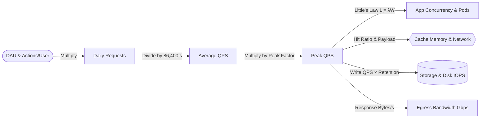

# 03 · Back-of-the-Envelope Capacity Estimation

**Level:** Beginner · **Status:** Draft · **Prerequisites:** [02 · Requirements and capacity](02-requirements-and-capacity.md)

> **Slides & Visuals:** [Capacity Estimation Deck](../slides/03-capacity-estimation.md) · Diagram: [capacity-budget-flow.mmd](../diagrams/capacity-budget-flow.mmd) · Interactive visual: `sim-capacity-calculator` ([catalog](../animations-and-visuals.md)) · Lab: [Lab 01 · Capacity Estimation](../labs/01-capacity-estimation.md)

## Learning objectives

By the end of this lesson, you should be able to:
- Convert DAU/MAU and per-user actions into average and peak QPS.
- Calculate average concurrency (`L = λW`) using Little's Law to size server pools and connection limits.
- Estimate multi-year storage using explicit decimal (`GB`/`TB`) vs. binary (`GiB`/`TiB`) units, including replication and index overhead.
- Compute network egress bandwidth and pinpoint which single assumption dominates infrastructure cost.

---

## 1. The problem

Suppose your team is launching a collaborative document-sharing feature for **10 million monthly active users (MAU)**. A product manager asks: *"Will two medium database instances and a single web server survive launch week, or do we need a cache tier and object storage on day one?"*

Guessing "two servers sounds fine" risks an outage at noon on launch day. Guessing "let's provision 50 servers and shard the database now" wastes engineering months and cloud budget on complexity you may not need for three years. You need **order-of-magnitude math**—fast, transparent arithmetic that turns vague product assumptions into concrete compute, memory, disk, and network budgets before a single line of infrastructure code is written.

---

## 2. Mental model

Think of capacity estimation as **a plumbing budget**, not a crystal ball:

- **Flow rate ($\lambda$, QPS):** How many requests arrive each second—both on a quiet Tuesday afternoon (**average QPS**) and during a morning login spike (**peak QPS**).
- **Pipe volume ($L = \lambda W$, Little's Law):** How many requests sit inside your system simultaneously. Even modest QPS explodes concurrency if each request stalls waiting on a slow dependency ($W$).
- **Tank size (Storage):** How fast durable bytes accumulate over years once you multiply logical payloads by indexes, replicas, backups, and retention windows.
- **Pipe width (Bandwidth):** How many megabits or gigabits per second leave your servers—especially for media, feeds, and large JSON payloads.

Key terms:
- **DAU / MAU:** Daily Active Users / Monthly Active Users. The ratio `DAU / MAU` measures stickiness.
- **QPS (Queries Per Second):** Request rate ($\lambda$). Often split into **Read QPS** and **Write QPS**.
- **Decimal vs. Binary units:** Storage vendors and network teams usually quote **decimal** powers of $10^3$ (`1 KB = 1,000 B`, `1 GB = 10^9 B`, `1 TB = 10^{12} B`), while OS kernels and RAM specs often use **binary** powers of $2^{10}$ (`1 KiB = 1,024 B`, `1 GiB = 2^{30} B ≈ 1.074 GB`, `1 TiB ≈ 1.10 TB`). Always label which one you use.

---

## 3. How it works under the hood

Every estimation pass flows from user behavior down to four hardware budgets: **compute concurrency**, **cache memory**, **durable storage**, and **network egress**.

*(Source diagram: [capacity-budget-flow.mmd](../diagrams/capacity-budget-flow.mmd))*

Step by step:
1. **Daily volume to average QPS:** Memorize one constant: `1 day = 24 × 3,600 = 86,400 seconds` (rough mental shortcut: `~10^5` seconds for instant sanity checks, `86,400` for written tables).
2. **Average to peak QPS:** Multiply by a **peak-to-average multiplier** (typically `3×–5×` for normal diurnal curves, `10×–50×` for ticket drops, live sports, or push-notification storms).
3. **QPS to concurrency via Little's Law:** In any stable system, the average number of concurrent requests in flight ($L$) equals arrival rate ($\lambda$) multiplied by average response time ($W$):
   $$L = \lambda \times W$$
   If $\lambda = 2,000\text{ QPS}$ and average response time $W = 0.050\text{ s}$ ($50\text{ ms}$), only $L = 100$ requests are active at once. If a slow database query pushes $W$ to $2.0\text{ s}$, concurrency jumps to $L = 4,000$ in-flight requests—potentially exhausting thread pools and database connections even though QPS never changed.
4. **Logical to provisioned storage:** Start with `writes/day × record_bytes × retention_days`, then apply a **storage amplification factor** for B-tree/secondary indexes (`~1.2×–1.5×`), replication (`3×` for 1 primary + 2 replicas), and snapshots/WAL retention.

---

## 4. Worked example & interactive visualization

Let's size a **snippet-sharing app** (like a lightweight Pastebin) using explicit assumptions and units:

| Assumption | Value | Unit / Basis |
|---|---|---|
| MAU | `10,000,000` | Product target |
| DAU (`30%` of MAU) | `3,000,000` | Daily active users |
| Reads / DAU / day | `10` | `30,000,000` reads/day |
| Writes / DAU / day | `1` | `3,000,000` writes/day |
| Peak multiplier | `5×` | Evening commute burst |
| Average snippet payload | `10 KB` (`10,000 B`) | Decimal bytes |
| Metadata + overhead / record | `500 B` | ID, owner, TTL, timestamps |
| Retention | `5 years` (`1,825 days`) | Product policy |
| Target read latency ($W$) | `40 ms` (`0.040 s`) | Average app processing time |

### Step 1 · Average and Peak QPS
- **Average Read QPS:** `30,000,000 ÷ 86,400 s ≈ 347 QPS`
- **Peak Read QPS (`5×`):** `347 × 5 ≈ 1,735 QPS`
- **Average Write QPS:** `3,000,000 ÷ 86,400 s ≈ 34.7 QPS`
- **Peak Write QPS (`5×`):** `34.7 × 5 ≈ 174 QPS`

### Step 2 · Concurrency (`L = λW`)
- At peak read rate (`1,735 QPS`) with `W = 0.040 s`:
  $$L = 1,735\text{ req/s} \times 0.040\text{ s} \approx 69.4\text{ concurrent requests}$$
- If a single app instance safely handles `50` concurrent requests, `2–4` instances suffice during normal peaks (plus headroom for deploys and AZ failure).

### Step 3 · 5-Year Storage (Decimal vs. Binary)
- **Logical bytes per write:** `10,000 B + 500 B = 10,500 B` (`10.5 KB`)
- **Daily logical growth:** `3,000,000 × 10,500 B = 31.5 × 10^9 B = 31.5 GB/day` (`≈ 29.3 GiB/day`)
- **5-year logical storage:** `31.5 GB/day × 1,825 days ≈ 57.49 TB` (`≈ 52.29 TiB`)
- **Provisioned storage (`3×` replication + `1.15×` index/overhead on metadata):** Roughly `~175 TB` decimal across primary, replicas, and object/DB blocks unless old snippets are compressed (`3:1` text compression cuts raw body bytes to `~19 TB` logical).

### Step 4 · Peak Bandwidth
- **Peak Read Egress:** `1,735 req/s × 10.5 KB = 18.22 MB/s ≈ 145.8 Mbps` (`0.146 Gbps`)
- **Peak Write Ingress:** `174 req/s × 10.5 KB = 1.83 MB/s ≈ 14.6 Mbps`

> **Interactive Simulation:** Experiment with **`sim-capacity-calculator`** in the [Animations & Visuals Catalog](../animations-and-visuals.md) (and inside the [03 · Capacity Estimation Slide Deck](../slides/03-capacity-estimation.md)) by sliding DAU, peak multiplier, payload bytes, and retention years to see when storage vs. egress becomes the dominant cost driver.

---

## 5. Trade-offs and failure modes

| Choice | Benefit | Cost / Risk | Fails When |
|---|---|---|---|
| **Provision for average QPS** | Lowest baseline cloud bill | Zero headroom for diurnal peaks or retries | Daily peak (`3×–5×`) saturates queues and triggers cascading timeouts |
| **Provision for extreme peak (20×) statically** | Absorbs unexpected spikes cleanly | `75%–95%` idle compute most of the day | Tight unit-economics / FinOps budget cannot carry idle fleets |
| **Autoscaling on CPU / QPS** | Matches cost to diurnal demand | Cold-start lag (`30 s–5 min`) during flash bursts | Viral spike hits faster than container/VM scale-out |
| **Ignoring replication & compression in storage math** | Simpler initial estimate | `3×–4×` under-budgeting or surprise disk-full incidents | Disk reaches `85%+` capacity and compaction/WAL stalls writes |

### What changes at 10× and 100× scale?
- **At 10× scale (`30M DAU`, `~17,350 peak read QPS`, `~1.46 Gbps` egress):** A single uncached primary database starts saturating disk/CPU on repeated hot reads (`80/20` Pareto skew), and `~575 TB` logical text storage makes putting 10 KB bodies inside relational DB rows expensive. You introduce a **read-through cache** for hot snippets and offload snippet bodies to **object storage + gzip/zstd compression**.
- **At 100× scale (`300M DAU`, `~173,500 peak read QPS`, `~14.6 Gbps` egress, `~5.75 PB` 5-year logical):** Egress fees and regional latency dominate. You push static/immutable snippets to a **CDN edge**, shard metadata horizontally, and enforce lifecycle tiering (hot → infrequent-access → expiry deletion) so storage growth plateaus instead of compounding forever.

---

## 6. Practical exercise

Complete **[Lab 01 · Back-of-the-Envelope Capacity Estimation](../labs/01-capacity-estimation.md)** to apply this workflow to a URL shortener, including recalculating at `20×` peak burst, modeling `90/10` hot-key skew, and separating logical bytes from replica + index overhead.

Deliverable check: write out an **Assumptions Table** with units on every line (`req/s`, `ms`, `GB` vs. `GiB`, `Mbps`) and flag the **top two assumptions** that would change your architecture if they were off by `5×`.

---

## 7. Retrieval practice

1. Why does Little's Law (`L = λW`) explain outages where incoming QPS stayed flat?
2. A service handles `43.2 million` writes/day at `4 KB` (decimal) per record. What is its average write QPS and daily logical storage in `GB` and `GiB`?
3. Why is `1 TB` of logical database rows rarely `1 TB` of billed cloud disk?
4. When does a `4×` peak multiplier fail as a sizing assumption?

Hints

1. If downstream latency `W` spikes (e.g., due to lock contention or GC pauses), in-flight concurrency `L` grows proportionally even when arrival rate `λ` is unchanged, exhausting threads and connections.
2. `43,200,000 ÷ 86,400 = 500 QPS`. Daily bytes = `43.2M × 4,000 B = 172.8 GB/day` (`172.8 × 10^9 ÷ 2^30 ≈ 160.9 GiB/day`).
3. Secondary indexes, page/tuple headers, write-ahead logs (WAL), synchronous/async replicas, and backup snapshots typically multiply logical row bytes by `2×–5×`.
4. Correlated flash bursts—push notifications, celebrity links, ticket sales, or retry storms—can produce `20×–100×` spikes within seconds.

## Sources and further reading

- **Tier 2 · Official Workbook:** [Google SRE Workbook — Capacity Planning & Managing Load](https://sre.google/workbook/table-of-contents/) — practical guidance on demand forecasting, headroom, and N+2 redundancy.
- **Tier 5 · Reference Guide (summary/open repo):** [System Design Primer · Back-of-the-Envelope Calculations](https://github.com/donnemartin/system-design-primer) — classic latency numbers and quick power-of-two sizing tables.
- **Tier 3 · Queueing Theory:** John D. C. Little (1961), *"A Proof for the Queuing Formula: L = λW"*, Operations Research — foundation for concurrency and queue sizing.

## Next lesson

Continue to [04 · Latency, Throughput & Bottleneck Analysis](04-latency-and-bottlenecks.md).
