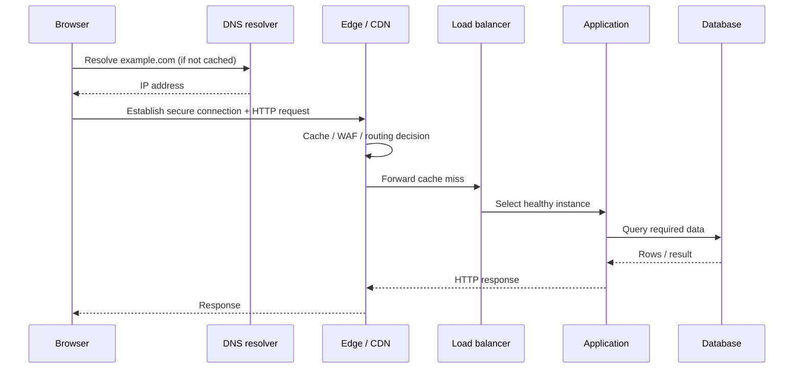

# 03 · The Life of a Web Request

**Level:** Beginner → Intermediate · **Status:** First draft · **Prerequisite:** Basic networking vocabulary

## Learning objectives
- Trace a browser request from a URL to an application response.
- Explain DNS, TCP, TLS, HTTP and the roles of proxies and load balancers.
- Identify which parts of latency come from network setup, application work and dependencies.
- Draw a sequence diagram and identify likely failure points.

## 1. The simplified journey

When a user opens `https://example.com/profile`, the client needs to resolve a hostname, establish secure transport, send an HTTP request, receive a response, and render the result. Real browsers reuse connections, cache DNS and resources, negotiate protocols, and may contact multiple origins.

This omits recursive DNS details, certificate validation, TCP/TLS handshakes, HTTP/2 multiplexing, HTTP/3 over QUIC, service meshes and connection pooling. Those are later deep dives.

## 2. DNS

DNS maps names to records such as A/AAAA addresses, CNAME aliases and other resource types. Resolvers and clients cache answers according to TTLs. DNS changes are not necessarily visible everywhere immediately because caches may retain older responses until expiry.

DNS is not a load balancer by itself, although DNS-based routing can direct clients toward different endpoints. It also cannot instantly move every established connection.

Reference: [Cloudflare Learning Center · DNS](https://www.cloudflare.com/learning/dns/what-is-dns/).

## 3. TCP, TLS and HTTP

- **TCP** provides a reliable, ordered byte stream. It does not understand application messages.
- **TLS** protects data in transit and authenticates the server (and optionally the client).
- **HTTP** defines request/response semantics: methods, status codes, headers and message content.
- **HTTP/2** allows multiple streams over one connection.
- **HTTP/3** maps HTTP semantics onto QUIC, which uses UDP as its transport substrate.

Primary references: [HTTP Semantics, RFC 9110](https://www.rfc-editor.org/rfc/rfc9110), [TLS 1.3, RFC 8446](https://www.rfc-editor.org/rfc/rfc8446), [HTTP/3, RFC 9114](https://www.rfc-editor.org/rfc/rfc9114).

## 4. Reverse proxy, load balancer and CDN

- A **reverse proxy** accepts requests on behalf of upstream services and can handle TLS termination, routing, compression or access policy.
- A **load balancer** distributes requests across available backends using a selection and health-check strategy.
- A **CDN** serves cacheable content from edge locations closer to users and can reduce origin load.

One product can perform multiple roles. Focus on responsibilities rather than memorizing product names.

## 5. Latency budget

A request's total time can include DNS resolution, connection setup, edge processing, network transit, queueing, application execution, database calls and response transfer. Some stages overlap, some are cached, and some are repeated for multiple dependencies.

Set a total budget and allocate it across stages. Measure the real system before optimizing; guessed latency budgets are hypotheses.

## Mini lab

Use browser developer tools → Network:
1. Load a page with cache disabled, then with cache enabled.
2. Inspect status, protocol, transferred size, timing and cache headers.
3. Find one request that blocks another and identify why.
4. Compare a static asset request with an API request.
5. Write down what the browser can reveal and what still requires server-side tracing.

## Retrieval practice
1. What does DNS resolve, and why can DNS changes take time to propagate?
2. What guarantees does TCP provide?
3. How does a reverse proxy differ from a forward proxy?
4. When can a CDN reduce origin traffic? When might it not help?

## Sources
- [Cloudflare Learning Center](https://www.cloudflare.com/learning/) — DNS, CDN, HTTP, TLS, caching and networking explainers.
- [MDN · HTTP](https://developer.mozilla.org/en-US/docs/Web/HTTP) — practical protocol documentation.
- [RFC 9110 · HTTP Semantics](https://www.rfc-editor.org/rfc/rfc9110).
- [RFC 8446 · TLS 1.3](https://www.rfc-editor.org/rfc/rfc8446).
