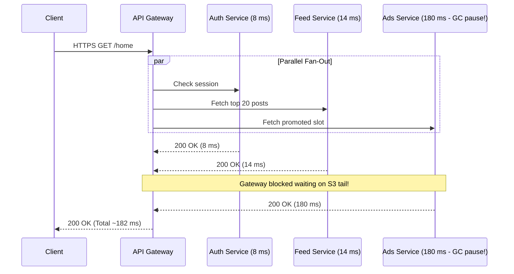

# 04 · Latency, Throughput & Bottleneck Analysis

**Level:** Beginner · **Status:** Draft · **Prerequisites:** [03 · Back-of-the-Envelope Capacity Estimation](03-capacity-estimation.md)

> **Slides & Visuals:** [Latency & Bottlenecks Deck](../slides/04-latency-and-bottlenecks.md) · Interactive visual: `sim-tail-amplification` ([catalog](../animations-and-visuals.md)) · Module Assessment: [Checkpoint 01 · Foundations](../assessments/checkpoint-01.md)

## Learning objectives

By the end of this lesson, you should be able to:
- Separate **latency** (time per request) from **throughput** (work completed per second) and explain why queues make them interact nonlinearly.
- Classify system bottlenecks across **CPU**, **memory**, **disk IOPS/throughput**, **network**, **lock contention**, and **downstream dependencies**.
- Compute how **fan-out calls** amplify `p99` tail latency using $P(\text{slow}) = 1 - (1 - p)^n$.
- Prioritize bottleneck diagnosis with measured evidence instead of blindly adding application servers.

---

## 1. The problem

Your monitoring dashboard shows good news and terrible news at the same time:
- Every individual microservice reports a healthy **median (`p50`) latency of `12 ms`** and **`p99` latency of `50 ms`**.
- CPU utilization across your web fleet is only **35%**.
- Yet **nearly 40% of user page loads take over `50 ms`**, and during checkout spikes users experience **2-second freezes** even after you double the number of app containers.

Why did adding more application servers accomplish nothing—and why did fast individual services combine into a sluggish user experience? To solve this, you need to understand **queues**, **single-point bottlenecks**, and **tail latency amplification**.

---

## 2. Mental model

Picture a highway toll plaza:
- **Latency** is how many seconds *one car* spends from joining the toll line to exiting the gate.
- **Throughput** is how many *cars per minute* pass through all toll booths combined.
- **Saturation & Queueing:** When cars arrive at `50%` of booth capacity, there is almost no line. At `95%` capacity, random arrival clumps create a long queue—latency skyrockets even though throughput barely changed.
- **The Narrowest Pipe:** Opening 10 more toll lanes helps **nothing** if all lanes merge onto a single one-lane bridge 100 meters ahead. That bridge is your **bottleneck** (database lock, disk IOPS, or rate-limited external API).
- **Convoy / Fan-Out Effect:** If a family trip requires **20 separate cars** to all arrive at a restaurant before anyone can sit down, you wait for the **slowest single car**, not the average car.

Key terms:
- **Utilization ($\rho$):** Fraction of time a resource is busy (`arrival rate / service capacity`). Near $\rho \to 1$, queue wait time rises nonlinearly ($\approx \frac{\rho}{1 - \rho}$ in classic $M/M/1$ queues).
- **Tail Latency (`p95`, `p99`, `p99.9`):** The latency threshold below which 95%, 99%, or 99.9% of requests finish.
- **Serial vs. Parallel Fan-Out:** Calling `N` downstream services one-by-one (sum of latencies) vs. concurrently in one request (maximum of `N` latencies).

---

## 3. How it works under the hood

When an API gateway serves a modern page, it rarely hits one box. It often fans out across multiple backend services or database shards. Even when all `N` calls run **in parallel**, the parent request cannot respond until the **slowest** child finishes:

### The Five Classic Bottleneck Families

| Bottleneck | What Saturates | Observable Symptom (USE Method) | Typical Root Cause |
|---|---|---|---|
| **CPU** | Cores / run-queue | High CPU %, rising run-queue length, GC pauses | JSON serialization, TLS handshakes without session reuse, regex/crypto loops |
| **Memory** | RAM / heap | Swap activity, OOM kills, frequent stop-the-world GC | Unbounded in-process caches, large payload buffering, memory leaks |
| **Disk I/O** | IOPS or MB/s | High `iowait`, deep disk queue, WAL fsync spikes | Unindexed full-table scans, unbuffered random writes, noisy neighbor EBS bursts |
| **Network** | NIC Gbps or packet rate | Retransmits, socket buffer drops, cross-AZ latency | Oversized responses, chatty N+1 RPCs, cross-region synchronous calls |
| **Contention / Locks** | Mutexes, DB rows, pools | Low CPU (`<30%`) paired with soaring latency & timeouts | Hot row updates (`UPDATE counters`), exhausted DB connection pool, single-threaded bottleneck |

---

## 4. Worked example & interactive visualization

Let's quantify **tail latency amplification** on a parallel fan-out endpoint.

Suppose every individual microservice has a `p99` latency of `150 ms` (meaning each single call has a `p = 0.01`, or `1%`, chance of exceeding `150 ms`), while its `p50` is `10 ms`.

If a single user request makes **`N` independent parallel sub-calls** before returning:
$$P(\text{all } N \text{ calls fast}) = (1 - p)^N$$
$$P(\text{at least 1 call exceeds } 150\text{ ms}) = 1 - (1 - p)^N$$

Let's compute the numbers explicitly:

| Parallel Fan-Out (`N`) | Formula `1 - 0.99^N` | Probability Request Exceeds `150 ms` |
|---:|---|---:|
| `N = 1` | `1 - 0.99^1` | **`1.0%`** (matches node `p99`) |
| `N = 5` | `1 - 0.99^5` | **`4.9%`** (~1 in 20 users hit the tail) |
| `N = 20` | `1 - 0.99^{20}` | **`18.2%`** (nearly 1 in 5 requests!) |
| `N = 50` | `1 - 0.99^{50}` | **`39.5%`** (almost 2 in 5 requests!) |
| `N = 100` | `1 - 0.99^{100}` | **`63.4%`** (the "tail" becomes the common case!) |

Now check **utilization queueing** on a single database core serving `100` queries/second (`service time = 8 ms`, max capacity `= 125 QPS`, utilization $\rho = 80\%$):
- Under an $M/M/1$ approximation, average queue + service time is $\frac{W_s}{1 - \rho} = \frac{8\text{ ms}}{1 - 0.80} = 40\text{ ms}$.
- If traffic rises just **18%** to `118 QPS` ($\rho = 94.4\%$), latency jumps to $\frac{8\text{ ms}}{1 - 0.944} \approx 143\text{ ms}$—more than **3.5× slower** from a small traffic bump!

> **Interactive Simulation:** Open **`sim-tail-amplification`** in the [Animations & Visuals Catalog](../animations-and-visuals.md) (also embedded in [04 · Latency & Bottlenecks Slides](../slides/04-latency-and-bottlenecks.md)). Drag the fan-out slider from `N = 1` to `N = 50` and adjust per-node `p99` to watch the overall request `p99` climb exponentially.

---

## 5. Trade-offs and failure modes

| Choice | Benefit | Cost / Risk | Fails When |
|---|---|---|---|
| **Scale app tier horizontally** | Fixes stateless CPU/RAM saturation | Increases connection count & load on shared DB | Bottleneck is DB IOPS, hot-row locks, or a slow third-party API |
| **Hedged requests (send backup copy after `p95`)** | Cuts tail latency sharply on idempotent reads | Adds `~5%` extra load (or much more under broad slowdown) | System is already overloaded (hedging amplifies a retry storm) |
| **Tight per-hop timeouts + partial degradation** | Bounds tail latency (e.g., drop optional ads/recs) | Users occasionally see degraded/cached widgets | Applied to mandatory steps like auth or payment ledger checks |
| **Run resources at `85%–95%` utilization** | Maximizes hardware cost efficiency | Tiny burst or slow dependency triggers exponential queue buildup | Traffic has diurnal spikes, GC pauses, or node failures (`N-1` pushes $\rho > 1$) |

### What changes at 10× and 100× scale?
- **At 10× scale:** Serial N+1 queries and chatty microservices dominate latency. You batch requests, collapse unnecessary RPC hops, keep target steady-state utilization around `50%–65%` for latency-sensitive tiers, and introduce strict timeouts + non-critical fallbacks (serve stale recommendations rather than blocking checkout).
- **At 100× scale:** Distributed shard fan-out (scatter-gather across 50+ partitions) hits the `1 - (1 - p)^N` law on almost every query. Production systems use **hedged requests** (with strict concurrency budgets), **canary/outlier ejection** at load balancers so one degraded host doesn't poison every fan-out, and **precomputed/denormalized views** so hot reads touch 1–2 partitions instead of 50.

---

## 6. Practical exercise

1. **Bottleneck triage:** Suppose your checkout endpoint `p99` jumps from `120 ms` to `2,400 ms` during a promotion, while app CPU sits at `22%` and database CPU sits at `18%`. List **three measurements** you would inspect in the first 5 minutes (hint: think locks, connection pools, and downstream APIs).
2. **Fan-out math:** A search aggregator fans out in parallel to `32` index shards, each with `p99 = 80 ms`. Calculate the probability that a search request hits at least one shard in its `> 80 ms` tail.
3. **Checkpoint Assessment:** Complete **[Checkpoint 01 · Foundations](../assessments/checkpoint-01.md)** without looking back at Lessons 01–04, and score each answer `0–3` using the readiness rubric.

---

## 7. Retrieval practice

1. Why can doubling the number of application servers actually make a database-bound outage *worse*?
2. According to `1 - (1 - p)^n`, if 10 parallel downstream calls each have a `2%` chance of taking over `200 ms`, what fraction of parent requests will take over `200 ms`?
3. What is the **USE method** for diagnosing resource bottlenecks?
4. When do **hedged requests** reduce tail latency safely, and when are they dangerous?

Hints

1. More app servers open more concurrent connections and send even more unpooled queries/retries into an already lock- or I/O-saturated database.
2. `1 - (1 - 0.02)^{10} = 1 - 0.98^{10} ≈ 1 - 0.817 = 18.3%`.
3. For every hardware/software resource, check **U**tilization (% busy), **S**aturation (queued work waiting), and **E**rrors.
4. Safe for idempotent reads under normal load when tail slowness is isolated to individual hosts; dangerous when the whole cluster is overloaded because extra copies add load and worsen queueing.

## Sources and further reading

- **Tier 3 · Classic Paper:** Jeffrey Dean & Luiz André Barroso (2013), *"The Tail at Scale"*, Communications of the ACM ([Google Research publication](https://research.google/pubs/the-tail-at-scale/)) — definitive analysis of fan-out tail amplification, hedged requests, and micro-partitioning.
- **Tier 2 · Official Methodology:** Brendan Gregg, *The USE Method* ([brendangregg.com/usemethod.html](https://www.brendangregg.com/usemethod.html)) — Utilization, Saturation, and Errors checklist for systems performance.
- **Tier 2 · Official Docs:** [Google SRE Book — Addressing Cascading Failures](https://sre.google/sre-book/addressing-cascading-failures/) — queue saturation, overload behavior, and graceful degradation.

## Next lesson

Continue to Module 01: [05 · DNS & The Web Request Lifecycle](03-the-web-request.md).
