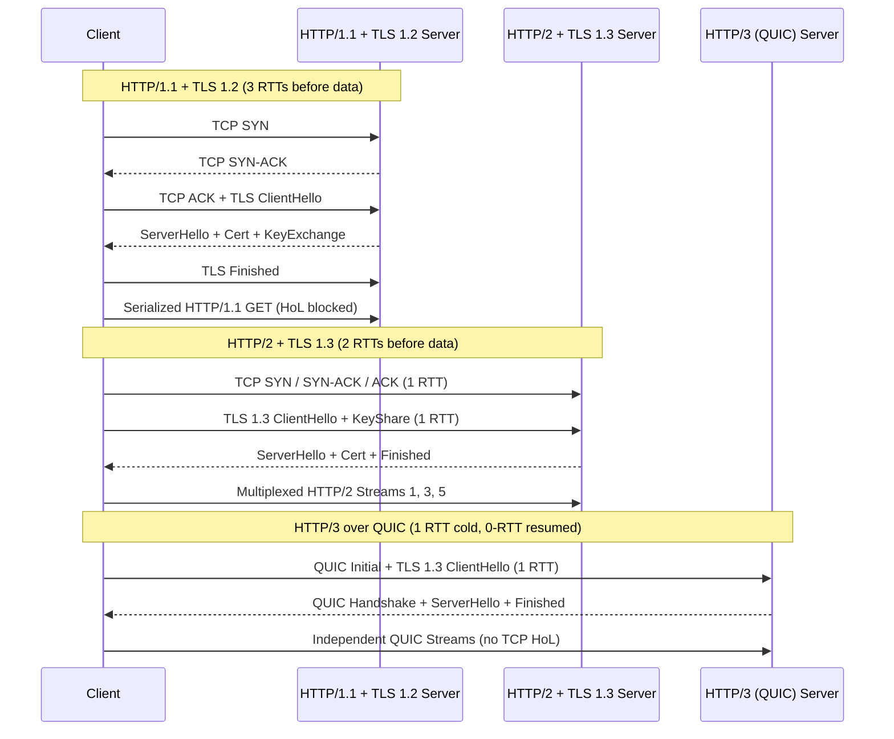

# 06 · TCP, UDP, TLS 1.3 & HTTP/1.1–HTTP/3

**Level:** Beginner → Intermediate · **Status:** Draft · **Prerequisites:** [05 · DNS & The Web Request Lifecycle](03-the-web-request.md)

> **Slides & Visuals:** [Transport, TLS & HTTP Deck](../slides/06-transport-tls-http.md) · Diagram: [tls-http-handshakes.mmd](../diagrams/tls-http-handshakes.mmd) · Interactive visual: `anim-http-multiplexing` ([catalog](../animations-and-visuals.md)) · Lab: [Lab 02 · HTTP & TLS Timing](../labs/02-http-tls-timing.md)

## Learning objectives

By the end of this lesson, you should be able to:
- Explain why **TCP** guarantees ordered byte delivery while **UDP** trades reliability for lower overhead and custom control.
- Count the **round-trip times (RTTs)** required for TCP + TLS 1.2 vs. TLS 1.3 (`1-RTT` and `0-RTT`) vs. QUIC.
- Diagnose **HTTP-level vs. TCP-level head-of-line (HoL) blocking** across HTTP/1.1, HTTP/2, and HTTP/3.
- Choose the right transport and HTTP version for mobile APIs, static assets, and real-time media.

---

## 1. The problem

Suppose a traveler in Singapore opens your mobile app whose API origin sits in Frankfurt (`170 ms` network RTT). Before the server sends a single byte of JSON, the app downloads a `45 KB` CSS file, `120 KB` JS bundle, and `6` small API payloads.

Under HTTP/1.1 + TLS 1.2, opening a fresh connection burns **510 ms** just on handshakes—and if one packet drops on airport Wi-Fi, **all six multiplexed responses freeze behind it** even under HTTP/2. Why do transport protocols dominate mobile latency, and how do TLS 1.3 and HTTP/3 (QUIC) eliminate wasted round trips?

---

## 2. Mental model

Think of moving data across the internet like shipping boxes between two warehouses:
- **UDP (Unreliable Datagrams):** You throw numbered postcards into the mail. No greeting, no delivery receipt, no waiting if card #2 arrives after card #3. Fast, minimal overhead—ideal when late data is useless (voice/video calls) or when the application builds its own framing (QUIC).
- **TCP (Reliable Ordered Byte Stream):** A courier service that shakes hands first (`SYN`, `SYN-ACK`, `ACK`), numbers every byte, retransmits lost packets, and slows down when roads jam (**congestion control**). Every byte **must** leave the receiving warehouse in strict order.
- **TLS 1.3 (Encrypted Tunnel):** Wraps the connection in confidentiality, integrity, and server identity verification using modern ECDHE key exchange in **1 RTT** (down from 2 RTTs in TLS 1.2).
- **HTTP/1.1 → HTTP/2 → HTTP/3:** The evolution from *one request per lane* (`HTTP/1.1`), to *many logical streams sharing one TCP lane* (`HTTP/2`), to *many independent QUIC lanes over UDP* (`HTTP/3`).

Key terms:
- **RTT (Round-Trip Time):** Time for a signal to travel client → server → client (`ms`).
- **Head-of-Line (HoL) Blocking:** When one stalled request or lost packet prevents *unrelated* responses behind it from being delivered.
- **ALPN (Application-Layer Protocol Negotiation):** TLS extension that lets client and server agree on `h2` or `http/1.1` inside the TLS handshake with zero extra round trips.

---

## 3. How it works under the hood

Compare the connection setup RTTs across protocol generations:

*(Source diagram: [tls-http-handshakes.mmd](../diagrams/tls-http-handshakes.mmd))*

### Why HTTP/2 Still Stalls on Packet Loss
1. **HTTP/1.1** solves HoL poorly by opening **6 parallel TCP connections** per origin—multiplying handshake overhead, TLS CPU, and slow-start congestion windows.
2. **HTTP/2** multiplexes dozens of binary **streams** over **one TCP connection**, adding header compression (**HPACK**) and eliminating HTTP-level HoL blocking.
3. **The hidden catch:** The OS kernel's TCP stack knows nothing about HTTP/2 streams. If packet #4 (carrying bytes for Stream 1) is lost, the kernel **buffers packets #5, #6, #7 (carrying Streams 3 and 5)** until packet #4 is retransmitted and arrives. That is **TCP-level Head-of-Line blocking**.
4. **HTTP/3 (QUIC)** runs over **UDP**, implementing encryption (TLS 1.3) and reliability **per stream** in user space. Packet loss on Stream 1 only pauses Stream 1; Streams 3 and 5 keep delivering immediately. QUIC also embeds a **Connection ID**, allowing seamless Wi-Fi → 5G IP changes without re-handshaking.

---

## 4. Worked example & interactive visualization

Let's compare **cold-connection Time-To-First-Byte (TTFB)** for a client on a **`170 ms` RTT** link when the server takes **`25 ms`** to build the response:

$$\text{Cold TTFB} = (\text{Handshake RTTs} + 1\text{ request RTT}) \times \text{RTT} + \text{Server Time}$$

| Stack | Handshake RTTs | Request RTT | Formula (`RTT = 170 ms`, `Server = 25 ms`) | Cold TTFB (`ms`) |
|---|---:|---:|---|---:|
| **HTTP/1.1 + TLS 1.2** | `3` (`1` TCP + `2` TLS 1.2) | `1` | `(4 × 170) + 25` | **`705 ms`** |
| **HTTP/2 + TLS 1.3** | `2` (`1` TCP + `1` TLS 1.3) | `1` | `(3 × 170) + 25` | **`535 ms`** |
| **HTTP/3 (QUIC) Cold** | `1` (combined QUIC + TLS 1.3) | `1` | `(2 × 170) + 25` | **`365 ms`** |
| **HTTP/3 (QUIC) 0-RTT Resumed** | `0` (early data in Initial packet) | `1` | `(1 × 170) + 25` | **`195 ms`** |
| **Warm Reused HTTP/2 or HTTP/3** | `0` (connection already open) | `1` | `(1 × 170) + 25` | **`195 ms`** |

*(Warning on TLS 1.3 / QUIC `0-RTT`: early data is **not replay-safe**—an attacker on the wire can replay the first UDP/TCP packet. Only allow **idempotent** `GET` requests over `0-RTT`, never `POST /payments`.)*

> **Interactive Simulation:** Launch **`anim-http-multiplexing`** in the [Animations & Visuals Catalog](../animations-and-visuals.md) (and in [06 · Transport, TLS & HTTP Slides](../slides/06-transport-tls-http.md)). Toggle between `HTTP/1.1`, `HTTP/2`, and `HTTP/3` and increase packet loss from `0%` to `3%` to watch TCP HoL freeze all HTTP/2 streams while HTTP/3 keeps healthy streams moving.

---

## 5. Trade-offs and failure modes

| Choice | Benefit | Cost / Risk | Fails When |
|---|---|---|---|
| **HTTP/1.1 (with keep-alive)** | Simplest debugging, universal proxy support | `6` connections/origin, uncompressed headers, HoL blocking | High-latency mobile pages loading dozens of assets |
| **HTTP/2 over TCP + TLS 1.3** | Single TCP connection, HPACK, mature server/LB support | TCP HoL blocking on lossy wireless networks (`>1–2%` packet loss) | Spotty cellular/Wi-Fi where TCP stalls every multiplexed stream |
| **HTTP/3 over QUIC** | `1-RTT` cold setup, `0-RTT` resume, stream-isolated loss, connection migration | Higher CPU per packet (user-space crypto), ~3–5% corporate firewalls block UDP 443 | Enterprise networks dropping UDP—requires automatic fallback to HTTP/2 |
| **TLS 1.3 `0-RTT` Early Data** | Shaves `1 RTT` off resumed requests | Vulnerable to **replay attacks** if endpoint mutates state | Enabled blindly on non-idempotent `POST`/`DELETE` routes |

### What changes at 10× and 100× scale?
- **At 10× scale:** TCP/TLS handshakes become a major CPU and latency tax if clients open short-lived connections. You enable **TLS session tickets/resumption**, extend **keep-alive timeouts** (`60–120 s`), terminate TLS at an **edge reverse proxy / CDN** close to users (shrinking `RTT` from `170 ms` to `15 ms`), and reuse **HTTP/2 connection pools** internally.
- **At 100× scale:** Edge PoPs handle both **HTTP/3 (for last-mile lossy mobile networks)** and **HTTP/2 (fallback + stable data-center backbones)** while tuning kernel TCP congestion control (**BBR** instead of loss-based CUBIC) and UDP GSO/GRO hardware offloading to keep QUIC CPU overhead competitive with TCP.

---

## 6. Practical exercise

Complete **[Lab 02 · HTTP, TLS 1.3 & Protocol Timing Inspection](../labs/02-http-tls-timing.md)** using `curl -w` to separate DNS, TCP, TLS, and server TTFB durations in milliseconds across cold HTTP/1.1, cold HTTP/2, and pooled HTTP/2 connections.

---

## 7. Retrieval practice

1. Why does HTTP/2 still suffer from Head-of-Line blocking even though it multiplexes streams?
2. How many RTTs does a cold **TLS 1.3 + TCP** connection require before the client sends its first HTTP request, and how does QUIC reduce that?
3. Why must servers restrict **TLS 1.3 `0-RTT` early data** to idempotent operations?
4. Why do browsers still maintain an **HTTP/2 fallback** when enabling HTTP/3?

Hints

1. All HTTP/2 streams share a single ordered TCP byte stream; one lost TCP segment forces the OS kernel to hold back bytes belonging to other HTTP/2 streams until retransmission succeeds.
2. TCP (`1 RTT`) + TLS 1.3 (`1 RTT`) = `2 RTTs` before HTTP data (unless TCP Fast Open is used). QUIC combines transport and TLS 1.3 negotiation into a single `1-RTT` handshake.
3. Because `0-RTT` packets arrive before a fresh server-generated nonce/handshake completes, an attacker can replay them; non-idempotent mutations would execute twice.
4. Some corporate/public Wi-Fi firewalls throttle or block UDP port 443, so clients race or fall back cleanly to HTTP/2 over TCP.

## Sources and further reading

- **Tier 1 · Standard:** [RFC 9110 · HTTP Semantics](https://www.rfc-editor.org/rfc/rfc9110) — core protocol methods, caching, and connection model.
- **Tier 1 · Standard:** [RFC 8446 · Transport Layer Security (TLS) 1.3](https://www.rfc-editor.org/rfc/rfc8446) — 1-RTT handshake, key shares, and Section 8 (`0-RTT` replay considerations).
- **Tier 1 · Standard:** [RFC 9114 · HTTP/3](https://www.rfc-editor.org/rfc/rfc9114) & [RFC 9000 · QUIC](https://www.rfc-editor.org/rfc/rfc9000) — stream multiplexing over UDP and connection migration.
- **Tier 4 · Engineering Blog:** [Cloudflare Blog · Comparing HTTP/3 vs. HTTP/2 Performance](https://blog.cloudflare.com/) — real-world packet-loss and mobile RTT measurements.

## Next lesson

Continue to [07 · Edge Infrastructure: Reverse Proxies, CDNs & Gateways](07-proxies-cdn-gateway.md).
