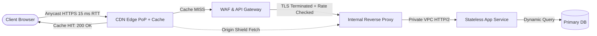

# 07 · Edge Infrastructure: Reverse Proxies, CDNs & Gateways

**Level:** Beginner → Intermediate · **Status:** Draft · **Prerequisites:** [06 · TCP, UDP, TLS 1.3 & HTTP/1.1–HTTP/3](06-transport-tls-http.md)

> **Slides & Visuals:** [Proxies, CDNs & Gateways Deck](../slides/07-proxies-cdn-gateway.md) · Interactive visual: `anim-cdn-cache-flow` ([catalog](../animations-and-visuals.md))

## Learning objectives

By the end of this lesson, you should be able to:
- Tell apart a **forward proxy**, **reverse proxy**, **CDN**, and **API Gateway** without mixing up vendor names and architectural roles.
- Configure **`Cache-Control`** directives (`public` vs. `private`, `max-age`, `s-maxage`, `stale-while-revalidate`) and **`ETag`** revalidation safely.
- Calculate how CDN **hit ratio** and **origin shield** layers protect your origin from bandwidth bills and traffic bursts.
- Decide which cross-cutting concerns (TLS termination, WAF, rate limiting, JWT verification) belong at the edge vs. inside application services.

---

## 1. The problem

Your product serves **500 KB** product images and **40 KB** catalog JSON responses from a single cloud region in Virginia (`us-east-1`). Users in Tokyo see `260 ms` network RTT on every TLS handshake and image download, and whenever a flash sale starts, **100% of static asset requests slam your origin servers**, saturating outbound VPC egress (`$0.09/GB`) and starving checkout API threads.

Should your application servers handle TLS handshakes, serve PNGs, check DDoS rules, and validate API keys all by themselves? No—that's why production architectures place **edge infrastructure** in front of the origin.

---

## 2. Mental model

Sort proxies by **whose side they sit on**:
- **Forward Proxy (Client's Agent):** Sits in front of *users* (corporate office proxy, VPN). The internet sees the proxy's IP, not the employee's laptop.
- **Reverse Proxy (Server's Agent):** Sits in front of *your servers* (NGINX, Envoy, HAProxy). Clients think they are talking to the origin, while the reverse proxy terminates TLS, compresses payloads, and routes traffic to private internal nodes.
- **CDN (Globally Distributed Reverse Proxy + Cache):** Places reverse-proxy **Points of Presence (PoPs)** in 100+ cities worldwide so users finish TCP/TLS handshakes `15 ms` away instead of `250 ms` away, and cacheable bytes never cross the ocean twice.
- **API Gateway (Application-Aware Edge Router):** A specialized reverse proxy for APIs that enforces authentication, per-tenant rate limits, request schema routing, and versioning before requests reach internal microservices.

Key terms:
- **PoP (Point of Presence):** A regional edge data center operated by a CDN provider.
- **Origin Shield:** An intermediate regional cache tier between edge PoPs and your origin server so 100 edge PoPs collapse into `1` origin fetch on a cold cache miss.
- **TLS Termination:** Decrypting HTTPS at the edge/proxy so internal traffic can be inspected, routed, and forwarded over pooled connections.

---

## 3. How it works under the hood

Traffic crosses clear **trust and caching boundaries** from public internet into your private VPC:

### Pull CDN vs. Push CDN
- **Pull CDN (Most common):** Edge PoP checks local cache on a request. On a **miss**, it fetches the object from your origin, stores it according to `Cache-Control`, and serves subsequent nearby users from RAM/NVMe. Zero upload pipeline needed; first user per PoP pays one cold miss.
- **Push CDN:** Your build/upload pipeline proactively pushes files (e.g., `2 GB` game patches or video segments) to CDN storage ahead of launch. Higher storage ops, zero cold-miss latency spike.

### Essential `Cache-Control` & Revalidation Mechanics
1. **Versioned static assets (`/assets/app.8f3a1c.js`):**
   `Cache-Control: public, max-age=31536000, immutable` — cached for 1 year in both browser and CDN; deploy new versions with a new content hash in the filename.
2. **Semi-dynamic public APIs (`/v1/catalog`):**
   `Cache-Control: public, max-age=10, s-maxage=60, stale-while-revalidate=30` — browsers cache `10 s`, shared CDN PoPs cache `60 s`, and for `30 s` after expiry the CDN serves stale JSON instantly while refreshing asynchronously in the background.
3. **Personalized/authenticated responses (`/v1/me/orders`):**
   `Cache-Control: private, no-store` — **never** allow a shared CDN PoP to store user-specific data, or User B may receive User A's response!
4. **Conditional Revalidation (`ETag` / `If-None-Match`):**
   Even when `max-age` expires, the client/PoP sends `If-None-Match: "v42"`. If unchanged, the origin replies `304 Not Modified` with **0 payload bytes**, saving bandwidth.

---

## 4. Worked example & interactive visualization

Suppose a flash sale drives **20,000 peak QPS** for product pages and images:
- **85%** of requests (`17,000 QPS`) are static images & JS bundles averaging **`200 KB`** (`200,000 B`).
- **15%** of requests (`3,000 QPS`) are dynamic catalog/checkout API calls averaging **`20 KB`**, of which **two-thirds (`2,000 QPS`)** are public catalog reads (`s-maxage=30`) and **one-third (`1,000 QPS`)** are uncacheable cart/checkout writes.

Let's compare **No CDN** vs. **Edge CDN (`95%` static hit ratio + `90%` catalog hit ratio)**:

| Metric | Without CDN (All Origin) | With Edge CDN + Gateway | Reduction |
|---|---:|---:|---:|
| **Origin QPS** | `20,000 QPS` | `850` static misses + `200` catalog misses + `1,000` writes = **`2,050 QPS`** | **`89.8%` less origin RPS** |
| **Origin Egress** | `17,000 × 200 KB + 3,000 × 20 KB` = **`3.46 GB/s`** (`27.7 Gbps`) | `850 × 200 KB + 200 × 20 KB + 1,000 × 20 KB` = **`0.194 GB/s`** (`1.55 Gbps`) | **`94.4%` less origin egress** |
| **First-Byte Handshake RTT (Tokyo → Virginia)** | `~260 ms` RTT (`~780 ms` cold TLS 1.3) | `~15 ms` to Tokyo PoP (`~45 ms` cold TLS 1.3) | **`~17×` faster TLS setup** |

*(Note: Total user-facing egress is still `~27.7 Gbps`—the CDN delivers it at lower per-GB edge cost instead of expensive cloud VPC egress.)*

> **Interactive Simulation:** Open **`anim-cdn-cache-flow`** in the [Animations & Visuals Catalog](../animations-and-visuals.md) (and inside [07 · Proxies, CDNs & Gateways Slides](../slides/07-proxies-cdn-gateway.md)). Tweak `max-age`, `s-maxage`, and `stale-while-revalidate` to watch PoP cache hits, origin shield collapsing, and background revalidation in real time.

---

## 5. Trade-offs and failure modes

| Choice | Benefit | Cost / Risk | Fails When |
|---|---|---|---|
| **Aggressive CDN caching (`s-maxage` high)** | Slashes origin QPS, egress bill, and global latency | Stale prices/inventory or slow emergency takedowns | Forgot content-hashed URLs or missing purge API for urgent edits |
| **Caching without `Vary` / `private` discipline** | High hit ratio | **Cache poisoning or cross-user data leak** | `Set-Cookie` or `Authorization` endpoints accidentally marked `public` |
| **Thick API Gateway (heavy custom business logic)** | Centralizes auth, routing, and rate limits | Single deployment bottleneck & tight coupling across teams | Teams embed domain DB lookups inside gateway Lua/JS plugins |
| **TLS termination at Edge only (plain HTTP inside VPC)** | Lower internal CPU and easier packet inspection | Plaintext lateral traffic if VPC is compromised | Zero-trust / compliance requires end-to-end **mTLS** between internal hops |

### What changes at 10× and 100× scale?
- **At 10× scale:** A global cache flush or cold launch across `100+` CDN PoPs creates an origin thundering herd (`100` PoPs fetching the same uncached URL simultaneously). You add an **Origin Shield** (collapsing `100` PoPs into `1–2` regional shield caches) and **request coalescing** at the edge.
- **At 100× scale:** A single CDN vendor outage or misconfigured WAF rule can blackhole your entire domain. Large platforms use **multi-CDN DNS steering**, automated **canary WAF rule rollouts**, and **tiered edge compute** (verifying JWT signatures and serving stale fallbacks directly at PoPs even if origin is unreachable).

---

## 6. Practical exercise

Audit any public website or your own local app using browser DevTools (`Network` tab) or `curl -I`:
1. Compare the `Cache-Control`, `Age`, `ETag`, and `CF-Cache-Status` / `X-Cache` headers on:
   - One hashed static asset (`.js` / `.css` / image)
   - One HTML document or public JSON endpoint
2. Calculate: if a `500 KB` hero image has `max-age=60` instead of `max-age=31536000` with a filename hash, how much extra revalidation/transfer traffic does `100,000` daily returning visitors generate?

---

## 7. Retrieval practice

1. What is the fundamental difference between a **forward proxy** and a **reverse proxy**?
2. Why does `Cache-Control: public, max-age=10, s-maxage=300` specify *both* `max-age` and `s-maxage`?
3. What catastrophic bug happens if a CDN caches an endpoint returning personalized account data without `Cache-Control: private`?
4. How does an **Origin Shield** protect your backend during a cold cache miss across 80 global PoPs?

Hints

1. A forward proxy acts on behalf of clients (hiding client identity, filtering outbound traffic); a reverse proxy acts on behalf of origin servers (TLS termination, caching, routing).
2. `max-age` applies to the user's browser cache (`10 s` so users see fresh updates quickly), while `s-maxage` overrides it for shared proxies/CDNs (`300 s`, which you can purge centrally via CDN API).
3. **Cross-user data leakage (web cache deception/poisoning):** the CDN serves User A's private JSON/HTML to User B.
4. All 80 edge PoPs route cache misses through a single designated shield PoP, which coalesces concurrent misses into **one** origin fetch instead of 80.

## Sources and further reading

- **Tier 2 · Official Docs:** [MDN Web Docs · HTTP Caching](https://developer.mozilla.org/en-US/docs/Web/HTTP/Caching) — complete reference for `Cache-Control`, `ETag`, `Vary`, and `stale-while-revalidate`.
- **Tier 1 · Standard:** [RFC 9111 · HTTP Caching](https://www.rfc-editor.org/rfc/rfc9111) — formal specification of shared vs. private caches and freshness lifetimes.
- **Tier 4 · Engineering Explainers:** [Cloudflare Learning · What is a CDN?](https://www.cloudflare.com/learning/cdn/what-is-a-cdn/) — Anycast routing, PoPs, and origin shielding.

## Next lesson

Continue to [08 · Load Balancing & Traffic Routing](08-load-balancing.md).
