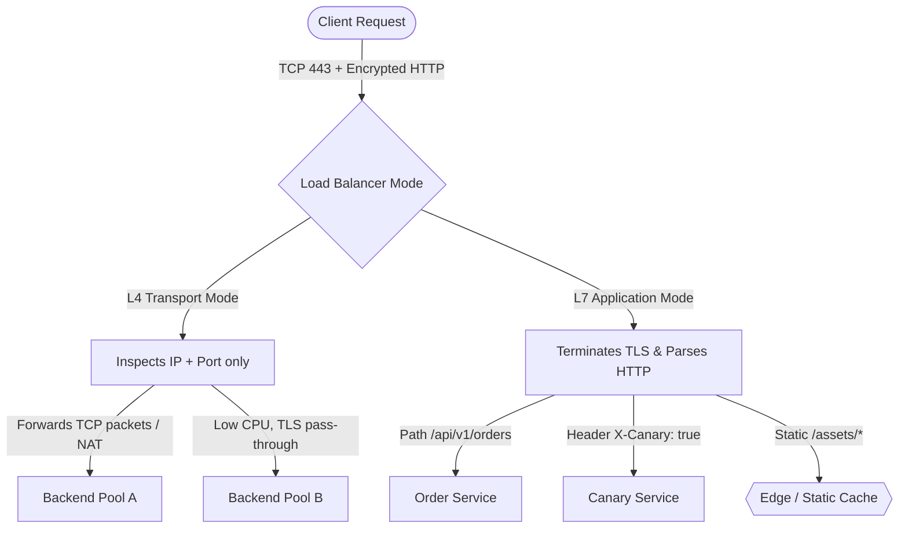

# 08 · Load Balancing & Traffic Routing

**Level:** Beginner → Intermediate · **Status:** Draft · **Prerequisites:** [07 · Edge Infrastructure: Reverse Proxies, CDNs & Gateways](07-proxies-cdn-gateway.md)

> **Slides & Visuals:** [Load Balancing Deck](../slides/08-load-balancing.md) · Diagram: [l4-vs-l7-routing.mmd](../diagrams/l4-vs-l7-routing.mmd) · Interactive visual: `sim-load-balancer` ([catalog](../animations-and-visuals.md))

## Learning objectives

By the end of this lesson, you should be able to:
- Contrast **Layer 4 (TCP/UDP)** vs. **Layer 7 (HTTP/gRPC)** load balancing and explain when production systems stack both.
- Select among **Round-Robin**, **Least-Connections**, **Weighted**, and **Power-of-Two-Choices (P2C) / Peak EWMA** routing policies.
- Prevent dropped user requests during deploys and node crashes using **active/passive health checks** and **graceful draining**.
- Spot the hidden traps of **long-lived HTTP/2 connections** and **stateful sticky sessions**.

---

## 1. The problem

You scale your API from `1` server to `6` identical servers behind a load balancer. Suddenly two strange incidents happen:
1. One backend node has a noisy neighbor on its VM host and slows down from `15 ms` to `800 ms` per request. Under **Round-Robin**, the load balancer keeps sending `1/6` of all traffic into that degraded box—its queue explodes while the other `5` healthy nodes sit half-idle.
2. During a rolling deploy, `0.5%` of active users receive `502 Bad Gateway` errors even though replacement containers are healthy.

A load balancer is not just a random coin flip; its **layer (`L4` vs `L7`)**, **routing algorithm**, **health checks**, and **drain lifecycle** decide whether a partial failure stays invisible or cascades.

---

## 2. Mental model

Think of load balancing like directing shoppers at a supermarket:
- **L4 Load Balancer (Door Guard):** Looks only at the envelope (**IP address + TCP/UDP port**). Cannot read what's inside the encrypted TLS package. Ultra-fast packet forwarding, low CPU, keeps the same TCP connection pinned to one cashier.
- **L7 Load Balancer (Customer Service Desk):** Opens the package (**terminates TLS**, reads HTTP URL path, headers, cookies, gRPC method). Can send `/images/*` to media servers and `/checkout` to payment servers—at the cost of higher CPU and memory.
- **Round-Robin vs. Least-Connections:** Round-Robin hands out customers `1, 2, 3, 4` blindly even if Cashier #3 is stuck doing a price check. **Least-Connections** checks which cashier currently has the shortest active line.

Key terms:
- **VIP (Virtual IP):** The single public/internal IP address exposed by the load balancer in front of a changing pool of backend instances.
- **Passive Health Check (Outlier Detection):** Watching live traffic for consecutive `5xx` errors or TCP resets and temporarily ejecting the bad backend without waiting for a periodic ping.
- **Graceful Draining:** Stopping *new* requests to a shutting-down node while allowing *in-flight* requests to finish cleanly before terminating the process.

---

## 3. How it works under the hood

Most large architectures combine **L4 at the outer edge** (absorbing millions of packets/sec with DSR or ECMP) and **L7 behind it** (routing HTTP/gRPC paths and balancing individual requests):

*(Source diagram: [l4-vs-l7-routing.mmd](../diagrams/l4-vs-l7-routing.mmd))*

### Comparing Routing Algorithms
1. **Round-Robin:** Cycles sequentially `0, 1, 2, ...`. Great only when every node has identical hardware and every request has uniform cost.
2. **Weighted Round-Robin:** Assigns capacity weights (e.g., `c7g.2xlarge` gets weight `2`, `c7g.large` gets weight `1`), useful during mixed-instance rollouts.
3. **Least-Connections:** Sends the next request to the backend with the fewest active open requests/connections. Naturally routes around slow nodes because slow nodes accumulate open connections!
4. **Power of Two Choices (P2C) + Peak EWMA:** Picks `2` backends at random and routes to whichever has fewer active requests or lower exponentially weighted moving-average latency. Used in Envoy/Linkerd because it avoids scanning `1,000+` nodes on every request and prevents "herd" spikes onto a newly recovered node.
5. **Consistent Hash / Ring Hash:** Hashes a `user_id` or `cache_key` so requests for the same key consistently hit the same backend (useful for stateful in-memory caches, *not* general stateless APIs).

### The HTTP/2 Connection Trap
Wait: why does **L4 load balancing** fail for **gRPC or HTTP/2** internal microservices?
Because HTTP/2 multiplexes **thousands of RPCs over a single long-lived TCP connection**. An L4 balancer only sees **one TCP connection**—so it pins that entire connection to **one single backend pod**! Even if you scale from `2` pods to `20` pods, existing clients stay stuck on the original `2` pods until they reconnect. To load-balance individual HTTP/2 or gRPC calls fairly, you need an **L7 load balancer** (like Envoy) or client-side L7 balancing.

---

## 4. Worked example & interactive visualization

Let's compare **Round-Robin** vs. **Least-Connections** when **1 of 4 backends degrades**:

Suppose `4` API servers (`S1, S2, S3, S4`) receive **`1,000 QPS`** total (`250 QPS` per node under Round-Robin).
- Healthy servers (`S1, S2, S3`) process requests in **`10 ms` (`0.010 s`)** and have a safe concurrency limit of **`25` active requests** (`max capacity = 2,500 QPS` each).
- Node **`S4`** hits a noisy-neighbor CPU throttle and slows to **`200 ms` (`0.200 s`)**, dropping its max throughput to **`125 QPS`**.

Now apply **Little's Law (`L = λW`)** to `S4`:
- **Under Round-Robin:** The LB keeps sending `250 QPS` to `S4`. Since `S4` only finishes `125 QPS`, its queue grows at `+125 req/s`, saturating its `25`-slot worker pool in `0.2 seconds`! Every `4th` user (`25%` of all traffic!) hits timeouts or `504` errors, even though `S1–S3` have `7,500 QPS` of spare capacity.
- **Under Least-Connections:** Each healthy node (`S1–S3`) holds `L ≈ 330 × 0.010 ≈ 3.3` active requests. Meanwhile `S4` already holds `~3` active requests at only `15 QPS` (`15 × 0.200 = 3.0`)! Least-Connections naturally throttles `S4` down to **~`15 QPS` (`1.5%` of traffic)** while `S1–S3` absorb `~328 QPS` each at `10 ms` latency—and passive outlier detection can eject `S4` completely if errors appear.

> **Interactive Simulation:** Try **`sim-load-balancer`** in the [Animations & Visuals Catalog](../animations-and-visuals.md) (and in [08 · Load Balancing Slides](../slides/08-load-balancing.md)). Toggle between `Round-Robin`, `Least-Connections`, and `Weighted`, then click **"Inject Slow Node"** to watch queue depth pile up under Round-Robin and drain away under Least-Connections.

---

## 5. Trade-offs and failure modes

| Choice | Benefit | Cost / Risk | Fails When |
|---|---|---|---|
| **L4 Load Balancing (IP/Port)** | Extremely low latency & CPU; supports non-HTTP TCP/UDP | Blind to HTTP paths/headers; pins long-lived HTTP/2 streams | Internal gRPC/HTTP/2 services scale out while clients keep old TCP connections |
| **L7 Load Balancing (HTTP/gRPC)** | Path/header routing, per-request HTTP/2 balancing, retries | Terminates TLS (higher CPU/RAM), adds `1–3 ms` hop | Ultra-high PPS DDoS absorption where L4/ECMP is needed first |
| **Sticky Sessions (Cookie Affinity)** | Lets legacy stateful apps keep session RAM local | Uneven load skew; user loses session on node crash/deploy | Stateless apps (externalize sessions to Redis/DB instead!) |
| **Aggressive Active Health Checks (`1s` interval)** | Detects dead nodes rapidly | Health-check storm across `N` LBs × `M` pods; shallow `/health` hides DB failure | Health endpoint queries DB directly and triggers cascading DB overload during blips |

### What changes at 10× and 100× scale?
- **At 10× scale:** Rolling deploys without **graceful draining** (`Connection: close` / HTTP/2 `GOAWAY` + `preStop` sleep `5–15 s` before `SIGTERM`) cause `502` bursts while DNS/LB health checks catch up. Also separate `/healthz` (**liveness**: is process stuck?) from `/readyz` (**readiness**: should LB send traffic here?).
- **At 100× scale:** A single load balancer becomes the bottleneck! Large clouds scale the load balancer tier horizontally using **Anycast / ECMP (Equal-Cost Multi-Path)** routers distributing packets across stateless L4 **Maglev/Katran** fleets, which in turn feed horizontally scaled **L7 Envoy** proxies—avoiding single-VIP limits completely.

---

## 6. Practical exercise

Design the **load-balancing and health-check contract** for a microservice running `12` containers behind an L7 load balancer:
1. Specify the exact difference between your `/live` and `/ready` endpoints (what does each check, and why shouldn't `/live` query the primary database?).
2. Write out the **4-step graceful shutdown sequence** (from orchestrator `SIGTERM` to LB deregistration to in-flight request drain) with concrete wait durations in seconds.
3. Explain why switching a gRPC service from `L4` to `L7` balancing immediately fixes uneven CPU across newly autoscaled pods.

---

## 7. Retrieval practice

1. Why does an **L4 load balancer** fail to balance individual requests over an **HTTP/2** connection?
2. How does **Least-Connections** automatically protect a slow backend server compared to **Round-Robin**?
3. What is the difference between **active** and **passive** health checks?
4. Why is **Direct Server Return (DSR)** or **ECMP** used at massive scale in L4 balancers?

Hints

1. L4 only distributes *new TCP connections*. HTTP/2 multiplexes many requests onto one persistent TCP socket, so all requests on that socket stay pinned to whichever backend won the initial TCP handshake.
2. Slow nodes hold onto open connections longer, raising their active connection count; Least-Connections steers new requests to faster nodes with shorter queues.
3. Active checks probe a `/ready` endpoint on a timer; passive checks (outlier ejection) inspect real user responses in flight and eject a backend after consecutive `5xx`/timeouts.
4. ECMP spreads packets across multiple stateless L4 LB machines using consistent flow hashing, removing a single load-balancer bottleneck; DSR lets backends send large response packets directly back to clients without bottlenecking the LB return path.

## Sources and further reading

- **Tier 2 · Official Docs:** [Envoy Proxy Architecture & Load Balancing](https://www.envoyproxy.io/docs/envoy/latest/intro/arch_overview/upstream/load_balancing/load_balancers) — P2C, Peak EWMA, Ring Hash, and Outlier Detection details.
- **Tier 4 · Engineering Paper / Blog:** [Google Maglev (NSDI 2016)](https://research.google/pubs/maglev-a-fast-and-reliable-software-network-load-balancer/) — how Google scales L4 load balancing horizontally with ECMP and consistent hashing.
- **Tier 4 · Engineering Blog:** [NGINX · Choosing an HTTP Load Balancing Algorithm](https://www.nginx.com/blog/choosing-nginx-plus-load-balancing-algorithms/) — Round-Robin vs. Least-Time vs. Least-Connections trade-offs.

## Next lesson

Continue to [09 · API Design & Communication Styles](09-api-contracts.md).
