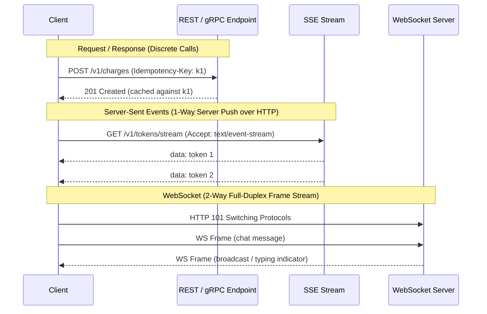

# 09 · API Design & Communication Styles

**Level:** Beginner → Intermediate · **Status:** Draft · **Prerequisites:** [08 · Load Balancing & Traffic Routing](08-load-balancing.md)

> **Slides & Visuals:** [API Contracts Deck](../slides/09-api-contracts.md) · Interactive visual: `anim-idempotency-retry` ([catalog](../animations-and-visuals.md)) · Lab: [Lab 03 · Building and Testing an Idempotent Payment API](../labs/03-api-idempotency.md)

## Learning objectives

By the end of this lesson, you should be able to:
- Match product communication needs to **REST**, **gRPC**, **GraphQL**, **SSE**, **WebSockets**, and **webhooks**.
- Replace fragile `OFFSET/LIMIT` pagination with **cursor (keyset) pagination** for large or fast-changing feeds.
- Protect mutating endpoints (`POST /charges`, `POST /orders`) against network-timeout retries using **idempotency keys**.
- Evolve API schemas with **backward compatibility** (additive changes, deprecation windows, explicit versions).

---

## 1. The problem

Your mobile app ships two features in the same quarter:
1. A **checkout endpoint** (`POST /v1/charges`) where users tap "Pay `$49.00`". On flaky 4G connections, the server processes the payment, **but the TCP packet carrying `201 Created` drops**. The client automatically retries—and charges the customer **`$98.00`**.
2. A **live order-status & AI-chat screen** where the client polls `GET /orders/123` every `1 second` across `200,000` active users, generating **`200,000 QPS`** of wasted empty checks when nothing changed.

Good API contracts solve both **what shape data takes** and **what happens when networks drop, duplicate, or stream updates**.

---

## 2. Mental model

Think of API communication styles as choosing the right **conversation pattern**:
- **REST (HTTP + JSON):** Standard postal service—clear nouns (`/v1/orders`), universal browser/CDN caching, human-readable payloads. Best default for **public APIs**.
- **gRPC (HTTP/2 + Protocol Buffers):** High-speed pneumatic tubes inside your data center—compact binary encoding, strict `.proto` contracts, streaming support. Best default for **internal service-to-service RPCs**.
- **GraphQL:** A custom-order counter—clients ask for *exact* fields across multiple entities in one round trip. Great for complex BFF/mobile screens; dangerous if unrestricted nested queries hit your DB.
- **SSE (Server-Sent Events):** A one-way radio broadcast over standard HTTP—server pushes live text/tokens (`LLM streaming`, live sports scores) to the client with built-in auto-reconnect.
- **WebSockets:** A two-way phone call—full-duplex persistent connection for **chat, multiplayer collaboration, or live cursors**.
- **Webhooks:** Server-to-server callback—*"Don't call us every second; give us your HTTPS URL and we'll `POST` when the payment clears."*

Key terms:
- **Idempotency:** Executing an operation multiple times with the same inputs produces the **same server state** as executing it once. (`GET`, `PUT`, `DELETE` are idempotent by HTTP spec; `POST` is *not* unless you add an `Idempotency-Key`.)
- **Cursor Pagination:** Passing an opaque token pointing to the last seen item (`after=cursor_9821`) instead of counting rows from row zero (`offset=50000`).

---

## 3. How it works under the hood

Notice how **Request/Response**, **Long-Polling**, **SSE**, and **WebSockets** manage connections differently:

### How Idempotency Keys Prevent Double Charges
1. Client generates a UUID v4 **`Idempotency-Key: 7f9c-...`** *once* per user checkout intent before the first attempt.
2. Server begins a DB transaction (or atomic Redis/DB lock):
   - **Key not seen:** Acquire `IN_PROGRESS` lock, debit ledger once, commit `(key, request_payload_hash, status=201, response_json)`, return `201 Created`.
   - **Key seen + matching payload hash:** Do **not** touch the ledger; immediately replay the stored `201` + `response_json`.
   - **Key seen + different payload hash:** Reject with `422 Unprocessable Content` (catches client bugs reusing old keys for new amounts).
   - **Key currently `IN_PROGRESS`:** Return `409 Conflict` with `Retry-After: 1` so two concurrent clicks don't race.

---

## 4. Worked example & interactive visualization

Let's compare **JSON vs. Protobuf payload size** and **Offset vs. Cursor pagination** with concrete numbers:

### Example A · REST JSON vs. gRPC Protobuf Bandwidth
Suppose an internal recommendation service returns a list of `20` item summaries at **`10,000 QPS`**:
- **JSON payload (with field names repeated 20 times):** `~2,400 bytes` per response → `10,000 × 2,400 B = 24 MB/s` (`192 Mbps`) uncompressed.
- **Protobuf binary payload (numeric field tags `1, 2, 3`):** `~720 bytes` per response (`~3.3×` smaller) → `10,000 × 720 B = 7.2 MB/s` (`57.6 Mbps`), plus ~`3×–5×` lower CPU for serialization/parsing.

### Example B · Why `OFFSET 100000` Breaks at Scale
Suppose a `10M`-row `orders` table handles `GET /v1/orders?limit=20&offset=100000`:
- **Offset pagination (`OFFSET 100000 LIMIT 20`):** The database must scan and discard **`100,000` index/heap rows** before returning `20` (`O(N)` per page). Worse, if `1` new order is inserted while the user moves from Page 1 to Page 2, **row #20 shifts down to #21 and appears twice!**
- **Cursor pagination (`WHERE (created_at, id) < ('2026-11-26T09:00:00Z', 88421) ORDER BY created_at DESC, id DESC LIMIT 20`):** Uses a B-Tree index seek straight to `(created_at, id)` in **`O(log N)`** time regardless of page depth, with **zero duplicate items** when new rows arrive.

> **Interactive Simulation:** Launch **`anim-idempotency-retry`** in the [Animations & Visuals Catalog](../animations-and-visuals.md) (and inside [09 · API Contracts Slides](../slides/09-api-contracts.md)). Drop the response packet while toggling `Idempotency-Key` OFF vs. ON to see double-billing happen vs. safe cached replay.

---

## 5. Trade-offs and failure modes

| Choice | Benefit | Cost / Risk | Fails When |
|---|---|---|---|
| **REST + JSON** | Browser-native, CDN-cacheable, easy debugging | Verbose text payloads, over/under-fetching across nested resources | High-QPS internal microservice meshes burning CPU on JSON parsing |
| **gRPC + Protobuf** | Compact binary, strict schemas, streaming, fast serialization | Not directly browser-native (needs gRPC-Web/Envoy), harder manual `curl` | Public third-party partner APIs expecting simple JSON/OpenAPI |
| **GraphQL** | Eliminates mobile over-fetching in one request | N+1 backend resolver explosions, complex HTTP caching | Exposed publicly without query depth/cost limits & DataLoader batching |
| **WebSockets** | Full-duplex low-latency push (`chat`, `collaboration`) | Stateful TCP connections complicate deploys, LBs, and horizontal scaling | Server-to-client-only feeds where simpler **SSE** works over plain HTTP |
| **Offset Pagination** | Easy random page jumping (`Page 7`) | `O(offset)` DB scans; duplicates/skips when rows insert/delete | Infinite scroll feeds, event logs, or tables over `100k` rows |

### What changes at 10× and 100× scale?
- **At 10× scale:** Naive polling (`1s` intervals) and large unpaginated responses saturate API workers. You switch feeds to **cursor pagination**, replace polling with **SSE / WebSockets** or **webhooks with exponential backoff + HMAC signatures**, and enforce **additive-only schema evolution** (never rename or drop fields while older mobile app versions exist in the wild).
- **At 100× scale:** Stateful WebSocket gateways are separated from stateless REST/gRPC APIs, idempotency stores use **TTL-expiring keys (`24–72 h`)** backed by partitioned Redis/DB tables so keys don't grow infinitely, and **API Gateways** enforce schema validation, rate limits, and version deprecation headers (`Sunset`, `Deprecation`) centrally.

---

## 6. Practical exercise

Complete **[Lab 03 · Building and Testing an Idempotent Payment API](../labs/03-api-idempotency.md)** to reproduce the duplicate-charge bug locally, implement `Idempotency-Key` + request-body SHA-256 verification, and verify fresh requests, safe retries, and `422` key-mismatch rejections via `curl`.

---

## 7. Retrieval practice

1. Why is `POST` *not* naturally idempotent, and what two values must a server store to make `POST /charges` safely retryable?
2. Why does `OFFSET` pagination return duplicate rows in an active social feed?
3. When should you pick **Server-Sent Events (SSE)** instead of **WebSockets**?
4. Why does GraphQL often trigger **N+1 database queries** unless mitigated?

Hints

1. Each `POST` normally creates a brand-new resource (`chg_1`, `chg_2`). Store the `Idempotency-Key` alongside a **hash of the request payload** (plus the cached status/response body) so mismatched retries are caught and matching retries replay safely.
2. Inserting a new item at the top shifts every older row's offset index down by 1, pushing the last item of Page 1 into the first slot of Page 2.
3. Whenever updates only flow **server → client** (LLM token streaming, live dashboards, notifications) and you want standard HTTP/2 multiplexing, proxies, and automatic browser reconnection without stateful WebSocket upgrades.
4. Fetching 20 posts and resolving `author` per post executes `1 + 20` queries unless resolvers batch IDs with DataLoader or joins.

## Sources and further reading

- **Tier 1 · Standard:** [RFC 9110 · Section 9.2.2 Idempotent Methods](https://www.rfc-editor.org/rfc/rfc9110#section-9.2.2) — formal HTTP semantics of safe and idempotent methods.
- **Tier 4 · First-Party Engineering:** [Stripe Docs · Idempotent Requests](https://stripe.com/docs/api/idempotent_requests) & [Designing Robust APIs with Idempotency](https://stripe.com/blog/idempotency) — production lock/replay/expiry semantics.
- **Tier 2 · Official Docs:** [gRPC Core Concepts](https://grpc.io/docs/what-is-grpc/core-concepts/) — Protobuf contracts, HTTP/2 framing, and streaming modes.
- **Tier 2 · Official Docs:** [MDN · Using Server-Sent Events](https://developer.mozilla.org/en-US/docs/Web/API/Server-sent_events/Using_server-sent_events) — `EventSource`, `Last-Event-ID`, and auto-reconnect.

## Next lesson

Continue to Module 02: [10 · Data Models & Database Selection](10-data-models.md).
