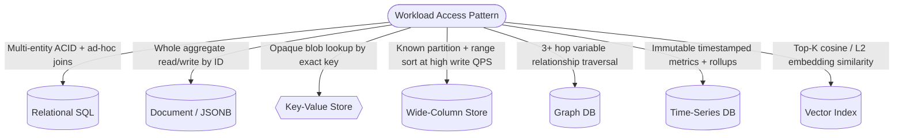

# 10 · Data Models & Database Selection

**Module 02 · Data Modeling & Storage Internals** | **Slides:** [10 · Data Models](../slides/10-data-models.md)

---

## 1. The Problem

Suppose you are launching a marketplace app where sellers list products, buyers place multi-item orders, an IoT warehouse tracker logs temperature readings every 5 seconds, and a search bar recommends visually similar items.

If you ask ten engineers which database to pick, you will get ten brand names—PostgreSQL, MongoDB, DynamoDB, Cassandra, Neo4j, TimescaleDB, Pinecone—before anyone asks **how the data is read and written**. Pick a document store for multi-item financial checkouts and you fight cross-document transactions; pick a relational join-heavy schema for 200,000 sensor writes/second and your B-Tree indexes choke; pick a graph database for simple 1-hop user profiles and you pay an operational tax for zero gain.

Database selection is not about brand loyalty. It is about matching **data shape + access patterns + consistency requirements** to the physical layout of a data model.

---

## 2. Mental Model

Think of a data model as **how you file paper folders in an office**:

- **Relational (SQL):** Normalized tables linked by foreign keys—like separate filing cabinets for Customers, Orders, and Line Items cross-referenced by ID numbers. Best when many different teams ask unpredictable questions and invariants must hold across records.
- **Document:** A self-contained JSON/BSON folder containing the whole order and its shipping address together. Fast when you always fetch and replace the whole folder by ID; painful when you update one line item across 10,000 folders.
- **Key-Value (KV):** A numbered coat-check ticket. Hand over `session:9f82a`, get back opaque bytes in sub-millisecond time. No querying by fields inside the coat pocket.
- **Wide-Column:** A giant sorted ledger keyed by `(partition_key, clustering_key)`—like a filing cabinet organized strictly by `(device_id, timestamp)`. Blazing fast for reading a device's last 100 events; helpless if you suddenly query by `sensor_firmware_version` without a separate table.
- **Graph:** Index-free adjacency—every node stores direct pointers to its neighbors (`User -[:FOLLOWS]-> User`), making 3-to-6-hop traversals constant-time per hop instead of repeated global table joins.
- **Time-Series:** Append-only, time-partitioned compressed columns optimized for immutable timestamped measurements and time-window rollups (`avg(temp)` per 5 minutes).
- **Vector:** High-dimensional float arrays (`float32[1536]`) indexed by approximate nearest-neighbor structures (HNSW/IVF) for semantic similarity rather than exact equality.

> **Impedance mismatch** is the friction between how objects live in application memory (nested trees or graphs) and how they are stored on disk (flat normalized rows). **Polyglot persistence** means deliberately using more than one database model when distinct workloads have genuinely incompatible access patterns.

---

## 3. How It Works Under the Hood

Choosing a data model works backward from **queries and invariants**, not forward from objects:

1. **Audit your access patterns first:** List the top 5 reads and top 5 writes, their QPS, and whether updates mutate whole records or tiny sub-fields.
2. **Check transactional boundaries:** If an invariant spans multiple entities (e.g., debit wallet A and credit wallet B atomically), favor a transactional **Relational** store.
3. **Check structural regularity and nesting:** If each entity is an independent tree with variable attributes (e.g., a product catalog where shoes have sizes and laptops have CPU specs) and 90% of reads load the whole aggregate by primary key, a **Document** store (or Relational `JSONB`) avoids sparse columns and multi-table joins.
4. **Check scale-out write throughput and fixed queries:** When write volume outgrows one primary node and every query knows the exact **partition key** ahead of time (e.g., `chat_id` + `message_ts`), **Wide-Column** stores route directly to the owning shard without scatter-gather joins.
5. **Check specialized traversal or similarity:** Deep multi-hop traversal (`friends-of-friends-of-friends` with cycle detection) belongs in **Graph** stores; high-rate immutable metrics belong in **Time-Series** engines; embedding similarity belongs in **Vector** indexes (`pgvector` for modest scale, dedicated vector stores for hundreds of millions of vectors).

*Diagram: `data-model-decision-flow` — mapping dominant access patterns to storage models.*

---

## 4. Worked Example & Interactive Visualization

> **Interactive Visual:** `anim-schema-access-patterns` — Compare a **Normalized Relational Join** (`users` ⋈ `orders` ⋈ `order_items`), a **Denormalized Document Read** (`orders/{id}`), and a **Wide-Column Partition Read** (`SELECT * FROM sensor_events WHERE device_id = ? AND ts >= ?`) side by side.

Suppose an e-commerce + telemetry platform serves **10 million DAU** with three distinct workloads:

1. **Checkout & Ledger (Relational):**
   - `2,000` peak checkout writes/sec. Each order touches `orders` (`180 bytes`), 3 `order_items` (`90 bytes` each), and 1 `inventory` row update.
   - Total logical write payload: `180 + (3 × 90) = 450 bytes/order`, or `900 KB/s` logical data. Strict foreign-key and balance invariants require single-database ACID transactions—a textbook Relational fit.
2. **Product Catalog Pages (Document / JSONB):**
   - `40,000` peak product-page reads/sec (`20:1` read-to-write ratio). Each product document is `4 KB` (`40,000 × 4 KB = 160 MB/s` read bandwidth before caching).
   - Storing camera specs, clothing sizes, and book ISBNs as one self-contained JSON document eliminates 6-way EAV (Entity-Attribute-Value) joins per page view.
3. **Warehouse IoT Sensors (Time-Series / Wide-Column):**
   - `100,000` sensors reporting a `120-byte` reading every `5 seconds` = `20,000 writes/sec` (`2.4 MB/s` raw, `207.4 GB/day` decimal).
   - Delta-of-delta timestamp + Gorilla float compression in a time-series engine shrinks `120 bytes` down to `~15–25 bytes/point` (`~26–43 GB/day`), cutting disk footprint by ~5–8× over uncompressed row storage.

Notice how one company does **not** need seven databases on day one: PostgreSQL cleanly handles Workload 1 (relational tables), Workload 2 (`JSONB` column with GIN index), and even modest Workload 3 (range-partitioned tables) until write throughput or compression demands a specialized engine.

---

## 5. Trade-Offs & Failure Modes

| Model | Benefit | Cost / Risk | Fails When |
|---|---|---|---|
| **Relational (SQL)** | Strong ACID, flexible ad-hoc joins, mature tooling | Harder horizontal write sharding; schema migrations need care | Write QPS exceeds one primary node and queries span shards |
| **Document** | Zero join overhead for aggregates; flexible per-record fields | Updating a sub-field rewrites the whole document; weak cross-doc joins | Workload shifts to many-to-many analytics or cross-entity invariants |
| **Key-Value** | Predictable `O(1)` lookup, sub-ms latency, trivial sharding | Zero secondary filtering unless you build manual index keys | Product asks for range filters, sorting, or ad-hoc reporting |
| **Wide-Column** | Linear horizontal write scaling; fast partition+range scans | Must duplicate data per query pattern ("query-first modeling") | New query pattern lacks a matching partition key (triggers full cluster scan) |
| **Graph** | Fast deep-hop traversals (`O(degree)` per hop, not table size) | Poor bulk analytical scans; challenging distributed partitioning | Supernodes (celebrity vertex with 50M edges) stall traversals |
| **Time-Series** | High append throughput, aggressive compression, automatic retention drops | Weak at random point updates or relational joins | Events arrive heavily out-of-order or require frequent historical mutations |
| **Vector** | Fast approximate semantic similarity (`ANN` via HNSW/IVF) | High RAM footprint for HNSW graphs (`~1.5–2×` raw vector bytes); recall vs latency trade-off | Exact predicate filtering wipes out 99% of candidates after ANN search |

### What changes at 10× and 100× scale?
- **1× (Startup):** Put everything in **one Relational DB** (using `JSONB` for flexible attributes and `pgvector` if needed). Avoid polyglot sync bugs.
- **10×:** Read replicas absorb analytical/catalog reads; high-churn telemetry (`sensor_events`) is peeled off into a Time-Series or Wide-Column store so vacuum/index bloat does not starve transactional checkouts.
- **100×:** Single-writer relational limits force horizontal sharding by tenant/entity key or moving high-volume append workloads to partitioned Wide-Column / log stores, connected via Change Data Capture (CDC) pipelines.

---

## 6. Practical Exercise

Audit an application you use daily (e.g., Spotify, Uber, or GitHub Issues). Pick **four distinct entities** and complete this table without naming vendor products first:

1. **Entity & approximate record size (bytes)**
2. **Read/write ratio & peak QPS assumption**
3. **Top 2 query predicates** (point lookup, range scan, multi-hop traversal, or similarity)
4. **Chosen data model** and the **one access pattern that would break it** if product requirements changed.

---

## 7. Retrieval Practice

1. Why does storing a 50 KB user profile as a single Document become expensive if a background job updates `last_active_at` 1,000 times/second?
2. What does "query-first modeling" mean in Wide-Column databases, and what happens if a new feature needs a filter not present in the partition key?
3. When should you keep semi-structured attributes in a Relational `JSONB` column instead of adopting a dedicated Document database?
4. Why can a celebrity account with 40 million followers cripple a Graph database traversal?

Hints

1. Many document engines rewrite the entire 50 KB document on disk/WAL for an 8-byte field change, creating severe write amplification and index churn. Split hot counters into a separate narrow table or KV store.
2. You design one denormalized table per query around its exact `(partition_key, clustering_key)`. Without the partition key, the coordinator must scatter-gather across every node in the cluster.
3. When semi-structured fields live alongside relational invariants (users, billing, permissions) and scale fits comfortably on a single primary + read replicas—avoiding distributed dual-writes.
4. Traversing edges from a supernode fans out to tens of millions of neighbors in a single hop, blowing up memory, network, and tail latency.

---

## Primary Sources

- [Designing Data-Intensive Applications, Ch. 2: Data Models and Query Languages (Kleppmann)](https://dataintensive.net/) — *Book (paid, not free full-text)*; foundational comparison of relational, document, and graph models.
- [PostgreSQL Docs · JSON Types (`jsonb`)](https://www.postgresql.org/docs/current/datatype-json.html) — Official documentation (checked current) covering `JSONB` storage and GIN indexing inside relational tables.
- [Cassandra Architecture · Data Model & Partitioning](https://cassandra.apache.org/doc/latest/cassandra/data_modeling/index.html) — Official Apache Cassandra guide on query-driven wide-column schema design.
- [Amazon DynamoDB Developer Guide · Core Components](https://docs.aws.amazon.com/amazondynamodb/latest/developerguide/HowItWorks.CoreComponents.html) — Official docs explaining partition keys, sort keys, and single-table key-value/wide-column access.

---

## Next

Continue to [11 · Storage Engine Internals: B+Trees vs LSM-Trees](11-storage-engines.md).
