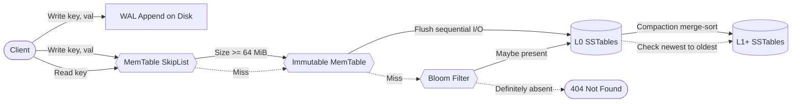

# 11 · Storage Engine Internals: B+Trees vs LSM-Trees

**Module 02 · Data Modeling & Storage Internals** | **Slides:** [11 · Storage Engines](../slides/11-storage-engines.md)

---

## 1. The Problem

Imagine your metrics pipeline ingests **80,000 events/second** keyed by random UUIDs. You deploy a standard B+Tree-backed relational table with a secondary index on `(metric_name, created_at)`. At 10 million rows everything flies—1 ms writes, 2 ms reads. Three months later at **2 billion rows** (~400 GiB of indexes on a server with 64 GiB RAM), write latency suddenly collapses from 1 ms to 45 ms, disk IOPS peg at 100%, and throughput drops by 5×.

Why did adding rows make *writes* 45× slower? Because **not all storage engines lay bytes down on disk the same way**. To predict when a database will hit an I/O wall, you need to look beneath SQL or NoSQL APIs at the two dominant storage engine architectures: **B+Trees** and **Log-Structured Merge-Trees (LSM-Trees)**.

---

## 2. Mental Model

Compare two ways of organizing a 1,000-page encyclopedia when new facts arrive every second:

- **B+Tree (Update-in-Place):** Keep the encyclopedia sorted in fixed 8 KiB binders on a shelf. To update or insert an entry, walk the table-of-contents pages down to the exact binder, pull it off the shelf, rewrite it *in place*, and put it back. If the binder is full, split it into two half-full binders and update the parent index. Reads are consistently fast (3–4 binder hops), but random inserts scatter across the whole shelf.
- **LSM-Tree (Append-Only + Background Merge):** Never rewrite an old binder in place. Scribble every incoming edit onto a fast notepad in memory (**MemTable**) while appending it sequentially to an audit tape (**WAL**) for crash safety. When the notepad reaches 64 MiB, freeze it and dump it to disk as a brand-new, immutable sorted booklet (**SSTable**). Later, a background clerk (**Compaction**) merges overlapping booklets and discards overwritten or deleted entries.

> **Write-Ahead Log (WAL):** An append-only disk log where every mutation is durably written (`fsync`) *before* acknowledging success, so the engine can replay lost in-memory state after a power outage.
>
> **Write Amplification:** The ratio of bytes physically written to disk (including WAL, page rewrites, and compaction) divided by logical bytes sent by the application.

---

## 3. How It Works Under the Hood

### Path A · B+Tree Internals (PostgreSQL, MySQL InnoDB)
1. **Fixed Pages & Buffer Pool:** Data lives in fixed-size pages (`8 KiB` in PostgreSQL, `16 KiB` in InnoDB). Hot pages are cached in RAM (the **Buffer Pool**).
2. **Traversal:** Lookups follow internal branch pages `(key -> child_page_id)` down to leaf pages containing sorted keys and row pointers (or full rows in a clustered index).
3. **Mutation & Crash Safety:** Updating a row dirties its page in RAM and appends a redo/undo record to the **WAL** sequentially. Background checkpoints flush dirty pages to random disk offsets. If a leaf page overflows, the engine performs a **page split**, allocating a new page and rewriting parent pointers.

### Path B · LSM-Tree Internals (RocksDB, LevelDB, Cassandra, Pebble)
See the standalone diagram source: [lsm-write-read-path.mmd](../diagrams/lsm-write-read-path.mmd).

1. **Writes:** Every write appends to the on-disk **WAL** and inserts into an in-memory **MemTable** (typically a lock-free SkipList). Zero random disk seeks occur on the write path!
2. **Flush:** Once the MemTable hits a threshold (e.g., `64 MiB`), it becomes immutable and flushes sequentially to disk as a Level-0 **SSTable** (Sorted String Table) with an index block and a **Bloom Filter**.
3. **Reads & Bloom Filters:** A point read checks `MemTable -> Immutable MemTable -> L0 SSTables (all of them, since key ranges overlap!) -> L1..Lk SSTables`. Because checking 10 SSTables on SSD would destroy read latency, each SSTable carries an in-memory **Bloom Filter**—a compact bit array that answers *"definitely not in this file"* with `0%` false negatives and `~1%` false positives.
4. **Deletes (Tombstones):** Since SSTables are immutable, deleting a key appends a special **tombstone** marker. Space is reclaimed only when compaction merges the tombstone with older SSTable levels.
5. **Compaction Strategies:**
   - **Size-Tiered Compaction (STCS):** Merges similarly sized SSTables into bigger ones. Lower write amplification (`~4–10×`), but temporarily needs **up to 50% free disk space** during major compactions and suffers higher read/space amplification.
   - **Leveled Compaction (LCS, RocksDB default):** Organizes levels (`L1 = 10× L0`, `L2 = 10× L1`, non-overlapping key ranges per level). Keeps read and space amplification low (`~10%` overhead), at the cost of higher write amplification (`~10–30×`).

---

## 4. Worked Example & Interactive Visualization

> **Interactive Visual:** `sim-btree-vs-lsm` — Insert sequential vs random keys and trigger point reads and compactions to watch B+Tree page splits vs MemTable flushes and SSTable level merges.

Let's quantify the **RUM Conjecture** (Read, Update/Write, Memory/Space amplification) on a **100M-key dataset** (`100 bytes/record` = `10 GB` logical data, `8 GiB` RAM, NVMe SSD):

1. **B+Tree Point Read vs Random Write:**
   - **Tree Height:** With `16 KiB` pages, `16-byte` keys + `8-byte` child pointers (`~500` fan-out at ~70% fill factor), `500³ = 125M` keys fit in **3 levels** (root + 1 internal level stay pinned in RAM -> **1 disk read** per cold leaf lookup).
   - **Random Write Cost:** Updating a single `100-byte` row on a cold leaf forces reading a `16 KiB` page (`16 KiB` read), writing a WAL record (`~16 KiB` on first touch after checkpoint for full-page-write crash safety), and later writing the dirty `16 KiB` page back to disk. Write amplification on random workloads can easily hit **`20×–100×`**! Worse, random page splits leave pages ~69% full on average (`~31%` internal fragmentation -> `~14.5 GB` on disk).
2. **LSM-Tree Point Read vs Bloom Filter Sizing:**
   - **Write Cost:** Appending `100 bytes` to WAL + sequential MemTable flush costs `~1–2×` upfront, plus Leveled Compaction across `L1 -> L2 -> L3` (`10×` fan-out per level) totaling **`~10–15×`** purely sequential I/O (which SSDs handle far faster and with less erase-block wear than random 16 KiB writes).
   - **Bloom Filter RAM Budget:** At **10 bits per key** (`~1%` false-positive rate), 100M keys require:
     `100,000,000 × 10 bits = 1,000,000,000 bits = 125 MB` (~`119 MiB`) in RAM.
   - That tiny `125 MB` filter eliminates ~99% of unnecessary SSTable disk reads for missing keys.

---

## 5. Trade-Offs & Failure Modes

| Dimension | B+Tree Engine | LSM-Tree Engine | Fails When |
|---|---|---|---|
| **Point & Range Reads** | Fast, predictable (`O(log_B N)`, 1 leaf I/O) | Must probe MemTable + L0 + levels (range scans bypass Bloom filters!) | LSM accumulates hundreds of uncompacted L0 files or heavy tombstone ranges |
| **Random Write Throughput** | Degrades sharply once working set > RAM (random page I/O) | High sustained sequential throughput (WAL + MemTable) | Compaction falls behind write rate -> **write stall** halts client writes |
| **Space Amplification** | ~30–40% fragmentation from page splits (needs `VACUUM`/rebuild) | Leveled: ~10%; Size-Tiered: up to **2×** temporary space during merge | Size-tiered disk hits >60% full and compaction fails with `ENOSPC` |
| **Latency Predictability** | Checkpoints can cause periodic I/O spikes | Compaction storms compete with user reads for SSD bandwidth & cache | Unthrottled background compaction blows up `p99` read latency |

### What changes at 10× and 100× scale?
- **1× (10 GB dataset):** Fits mostly in RAM (`shared_buffers` / OS page cache). B+Tree and LSM perform almost identically; pick B+Tree for simpler operations and rich SQL indexing.
- **10× (100 GB, exceeds RAM):** Random UUID writes on a B+Tree cause buffer pool thrashing; switching primary keys to monotonic IDs (`UUIDv7` / Snowflake) restores append locality in B+Trees, while LSM-Trees absorb random keys smoothly.
- **100× (1 TB+ per shard):** Compaction I/O and tombstone buildup dominate LSM ops (requiring rate-limited compaction and periodic tombstone TTL drops), while B+Trees require partitioning/sharding so active working-set indexes stay memory-resident.

---

## 6. Practical Exercise

Pick one write-heavy workload (e.g., an audit log ingesting 30,000 rows/sec with rare lookups) and one read-heavy workload (e.g., a user-profile store serving 50,000 range queries/sec with 500 writes/sec):
1. Estimate the **Bloom filter memory** required for 500 million keys at `10 bits/key` (`~1%` FPR) vs `14 bits/key` (`~0.1%` FPR).
2. Explain why a **range query** (`WHERE key BETWEEN 'a' AND 'z'`) cannot rely on a point Bloom filter in an LSM-Tree, and what **prefix Bloom filters** do instead.
3. Describe what happens in an LSM-Tree if a queue worker deletes 90% of rows in a table and then scans `LIMIT 10` active rows before compaction runs.

---

## 7. Retrieval Practice

1. Why does PostgreSQL write "full-page images" to the WAL on the first modification after a checkpoint, and how does that relate to write amplification?
2. Why does a B+Tree suffer on random UUIDv4 inserts once the index exceeds RAM, whereas an LSM-Tree stays fast?
3. How do tombstones degrade range-scan latency in an LSM-Tree?
4. When does an LSM-Tree trigger a **write stall**, and why is it dangerous for upstream services?

Hints

1. If the OS crashes mid-flush of an 8 KiB page (a "torn page" across 4 KiB sectors), the WAL needs the full original page image to recover safely—multiplying WAL bytes written for small row edits.
2. Random UUIDv4 keys force the B+Tree to read/dirty/split arbitrary leaf pages across the entire disk; LSM-Trees buffer all keys in RAM and flush sequentially.
3. A range scan must read and filter out potentially millions of tombstone markers stacked across L0–Ln before finding the next live key—until compaction purges them.
4. When incoming writes fill MemTables faster than background compaction can merge L0 into L1, L0 file count hits the hard limit and the engine throttles or pauses all foreground writes to protect read latency and disk space.

---

## Primary Sources

- [RocksDB Wiki · Overview & Architecture](https://github.com/facebook/rocksdb/wiki/RocksDB-Overview) — Official Meta/RocksDB docs detailing MemTables, SSTables, Bloom filters, and Leveled Compaction.
- [PostgreSQL Docs · Database Physical Storage](https://www.postgresql.org/docs/current/storage.html) — Official documentation on 8 KiB page layout, heap files, TOAST, and WAL recovery.
- [Designing Data-Intensive Applications, Ch. 3: Storage and Retrieval (Kleppmann)](https://dataintensive.net/) — *Book (paid, not free full-text)*; classic comparative analysis of B-Trees vs LSM-Trees.
- [Designing Access Methods: The RUM Conjecture (Athanassoulis et al., EDBT 2016)](https://stratos.seas.harvard.edu/publications/designing-access-methods-rum-conjecture) — Research paper formalizing Read, Update, and Memory amplification trade-offs.

---

## Next

Continue to [12 · Indexing, Query Plans & Schema Design](12-indexing-query-plans.md).
