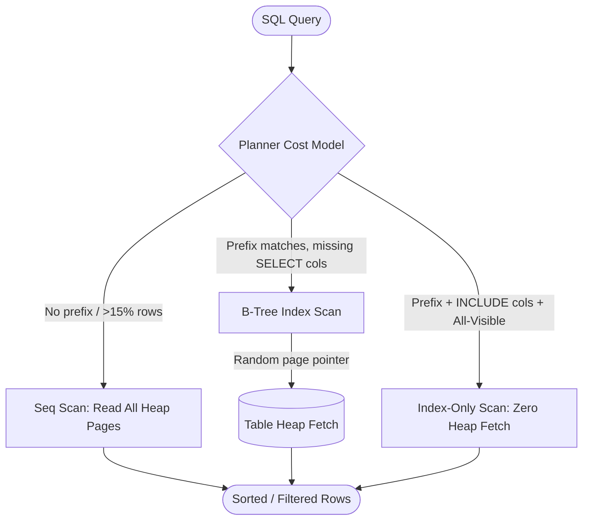

# 12 · Indexing, Query Plans & Schema Design

**Module 02 · Data Modeling & Storage Internals** | **Slides:** [12 · Indexing & Query Plans](../slides/12-indexing-query-plans.md)

---

## 1. The Problem

Your SaaS dashboard query `GET /tenants/{id}/invoices?status=overdue` takes **3.8 seconds** at 20 million rows. A developer adds three separate single-column indexes—one on `tenant_id`, one on `status`, and one on `created_at`—expecting the database to use all three magically. Instead, query latency stays at **2.1 seconds**, write throughput drops by 35%, and disk usage doubles.

Why did adding *three* indexes fail where **one well-ordered covering index** would return in **1.4 ms**? Because databases execute queries against physical B-Tree sort order, and an index in the wrong column order—or wrapped in an un-indexable SQL function—is dead weight on every `INSERT`.

---

## 2. Mental Model

Think of a database index like the **sorted index at the back of a textbook**:

- **Clustered Index (Table Organized by Key):** The pages of the book themselves are physically bound in alphabetical order (e.g., MySQL InnoDB stores full rows inside the primary-key B+Tree leaf pages). Range scans on the clustered key read contiguous pages cleanly.
- **Secondary (Non-Clustered) Index:** A separate card catalog sorted by `email` or `(tenant_id, created_at)`. Each leaf entry stores the indexed columns plus a pointer (`ctid` physical page offset in PostgreSQL, or Primary Key in InnoDB) back to the main table (**heap**).
- **Composite Index `(a, b, c)`:** Sorted first by `a`, then by `b` within equal `a`, then by `c` within equal `(a, b)`—just like a phone book sorted by `(LastName, FirstName)`. You can look up `"Smith, Alice"` or `"Smith"`, **but you cannot jump directly to `"Alice"` without scanning every last name** (**Leftmost-Prefix Rule**).
- **Covering Index:** The card catalog writes the `total_cents` right onto the index card (`INCLUDE (total_cents)`), so you read the answer straight from the index without walking back to the main bookshelf (**Index-Only Scan**).

> **Selectivity:** How narrowly a predicate filters the table (`distinct_values / total_rows`). A UUID has selectivity `~1.0` (high); a boolean `is_active` has selectivity `2 / 10,000,000` (very low).

---

## 3. How It Works Under the Hood

When a query arrives, the query planner estimates row counts using column statistics (histograms and most-common values) and chooses a physical execution strategy:

1. **Sequential Scan (`Seq Scan`):** Reads every table page sequentially. Fastest when returning `> 10–15%` of the table (sequential disk I/O beats thousands of random page seeks) or when no matching index prefix exists.
2. **Index Scan (`Index Scan`):** Traverses the B+Tree by the leftmost prefix, retrieves row pointers, and fetches each matching row from the table heap (random I/O if rows are scattered across pages).
3. **Bitmap Index + Heap Scan:** Collects all matching row pointers from one or more indexes into an in-memory bitmap sorted by physical page number, then visits each heap page *once* in physical order—bridging the gap between a single Index Scan and a Seq Scan.
4. **Index-Only Scan (Covering Index):** If every column in `SELECT`, `WHERE`, and `ORDER BY` lives inside the index **and** the table's **visibility map** confirms the heap page contains only committed tuples visible to all transactions (maintained by `VACUUM`), PostgreSQL skips the heap completely!



*Diagram: `index-scan-vs-seq-scan` — how covering indexes eliminate random heap lookups.*

### The Golden Rule for Composite Indexes: Equality → Sort → Range
Order composite columns as **`(Equality columns first, Sort column next, Range column last)`**:
- Equality (`WHERE tenant_id = 42 AND status = 'paid'`) narrows the B-Tree slice to one contiguous sub-range.
- Putting `ORDER BY created_at DESC` next lets the engine read rows **already sorted**, avoiding an expensive in-memory or on-disk `Sort` node.
- Putting a range column (`created_at > '2026-01-01'`) *before* an equality column (`status = 'paid'`) breaks contiguous ordering for `status`, forcing the engine to scan every `status` inside the date range.

---

## 4. Worked Example & Interactive Visualization

> **Interactive Visual:** `anim-composite-index` — Toggle query predicates (`a`, `b`, `c`, range vs equality, `LIKE '%foo'`) on an `(a, b, c)` B+Tree to see when the index narrows cleanly vs falls back to a full scan.

Consider a **50-million-row `invoices` table** (`200 bytes/row` = `10 GB` heap, `8 KiB` pages = `1.25M` pages). Target query:
```sql
SELECT id, created_at, total_cents
FROM invoices
WHERE tenant_id = 8812 AND status = 'overdue'
ORDER BY created_at DESC
LIMIT 20;
```

Compare three execution plans:

1. **No Index (`Seq Scan`):**
   - Reads `1,250,000` heap pages (`10 GB`) + top-20 heap sort.
   - At `2.5 GB/s` SSD/cache scan bandwidth, this burns **`~4,000 ms`** (`4s`) and saturates I/O.
2. **Secondary Index `(tenant_id, status, created_at DESC)` (`Index Scan`):**
   - B+Tree depth = 4 (`~32 KB` pages traversed in RAM), finds 20 pointers in `0.2 ms`.
   - Suppose those 20 invoices were inserted over 2 years across 20 different heap pages (`20 × 8 KiB = 160 KiB` random reads). On cold NVMe SSD (`~0.15 ms` per random read), 20 heap fetches add `~3 ms` (`p95 ~4–8 ms`). At 5,000 QPS, that's `100,000` random heap page reads/sec!
3. **Covering Index `(tenant_id, status, created_at DESC) INCLUDE (id, total_cents)` (`Index-Only Scan`):**
   - Index entry size grows by `8 + 4 = 12 bytes` (`~40 bytes` total/entry -> `~2.0 GB` index).
   - After `VACUUM` marks pages `all-visible`, `Heap Fetches: 0`. The query reads **3–4 index pages** (`32 KiB` total, cached in `shared_buffers`), completing in **`~0.4 ms p95`**—a **10,000× speedup** over Seq Scan and **10× fewer buffer touches** than an uncovered Index Scan.

---

## 5. Trade-Offs & Failure Modes

| Design Choice | Benefit | Cost / Risk | Fails When |
|---|---|---|---|
| **Single-Column Indexes Everywhere** | Easy to add ad-hoc | High write amplification; bitmap merges burn CPU | Queries filter on 2+ columns + `ORDER BY ... LIMIT` |
| **Covering Index (`INCLUDE`)** | Eliminates heap fetches (`Index-Only Scan`) | Larger index RAM footprint; slows `INSERT`/`UPDATE` | Table is write-heavy and rarely `VACUUM`ed (stale visibility map) |
| **Partial Index (`WHERE status = 'overdue'`)** | Tiny index (e.g., 2% of rows), stays in RAM | Planner skips it unless query `WHERE` matches predicate | Ad-hoc queries omit `status = 'overdue'` |
| **Denormalization / Materialized View** | Pre-computes expensive multi-table joins for `O(1)` reads | Write fan-out or refresh lag; stale copies if updates drift | Source data updates rapidly and consumers require strict real-time consistency |
| **Offset Pagination (`OFFSET 100000`)** | Simple API (`page=5000`) | Engine still scans & discards 100,000 rows (`O(N)`) | Deep pagination -> replace with **keyset/cursor pagination** (`WHERE (created_at, id) < ($1, $2)`) |

### What changes at 10× and 100× scale?
- **1× (1M rows, ~200 MB):** Entire table and indexes fit in RAM; bad indexes hide behind OS page cache.
- **10× (10M–50M rows, ~10 GB):** Indexes compete for `shared_buffers`. Missing leftmost prefixes trigger I/O cliffs; `OFFSET` pagination and non-sargable predicates (`WHERE LOWER(email) = ...` without an expression index) cause production outages.
- **100× (500M+ rows, ~100+ GB):** Even well-designed global B-Trees exceed RAM and vacuum windows stretch for hours. Teams introduce **time/tenant table partitioning** (keeping hot partitions small enough for RAM) or precomputed read models.

---

## 6. Practical Exercise

Complete **[Lab 04 · Indexing & `EXPLAIN ANALYZE`](../labs/04-index-and-explain.md)** on a 1,000,000-row local PostgreSQL `orders` table:
- Measure buffer reads and latency across `Seq Scan`, bad-order composite index, proper `(customer_id, status, created_at DESC)`, and `INCLUDE` covering index.
- Observe how skipping `VACUUM` breaks `Heap Fetches: 0` and how wrapping a column in `date_trunc(...)` disables index seeks.

---

## 7. Retrieval Practice

1. Why can a composite index on `(a, b, c)` satisfy `WHERE a = 5 ORDER BY b` but **not** `WHERE b = 10 ORDER BY c`?
2. Why does PostgreSQL sometimes choose a `Seq Scan` even when a valid index exists on the filtered column?
3. What causes `Index Only Scan` in PostgreSQL to still report `Heap Fetches > 0` in `EXPLAIN ANALYZE`?
4. Why is keyset pagination (`WHERE id < last_seen_id LIMIT 20`) orders of magnitude faster than `OFFSET 100000 LIMIT 20`?

<details><summary>Hints</summary>

1. The B+Tree is sorted lexicographically by `a` first. Without constraining `a`, matching `b = 10` entries are scattered across every `a` subtree (unless a rare skip-scan optimization applies).
2. When the planner estimates >10–15% of rows match (low selectivity, e.g., `status = 'delivered'`) or the table is tiny, sequential I/O is cheaper than jumping randomly between index and heap pages.
3. PostgreSQL indexes do not store transaction visibility (`xmin`/`xmax`). If the heap page's visibility map bit isn't set (`VACUUM` hasn't marked it `all-visible` since recent writes), it must visit the heap to check visibility.
4. `OFFSET 100000` forces the engine to walk and discard 100,000 index/heap entries before emitting row 100,001; keyset pagination seeks straight to `last_seen_id` in `O(log N)` time.

</details>

---

## Primary Sources

- [PostgreSQL Docs · Indexes & Index Types](https://www.postgresql.org/docs/current/indexes.html) — Official reference on B-Tree, GIN, GiST, partial, expression, and covering (`INCLUDE`) indexes.
- [PostgreSQL Docs · Index-Only Scans and Covering Indexes](https://www.postgresql.org/docs/current/indexes-index-only-scans.html) — Official explanation of visibility map requirements (`VACUUM`) for zero heap fetches.
- [PostgreSQL Docs · Using EXPLAIN](https://www.postgresql.org/docs/current/using-explain.html) — Official guide to reading query cost estimates, actual rows, and `BUFFERS`.
- [Use The Index, Luke (Markus Winand)](https://use-the-index-luke.com/) — Deep vendor-neutral guide on B-Tree traversal, composite indexes, sargability, and keyset pagination.

---

## Next

Continue to [13 · Transactions, ACID, MVCC & Isolation Levels](13-transactions-isolation.md).
