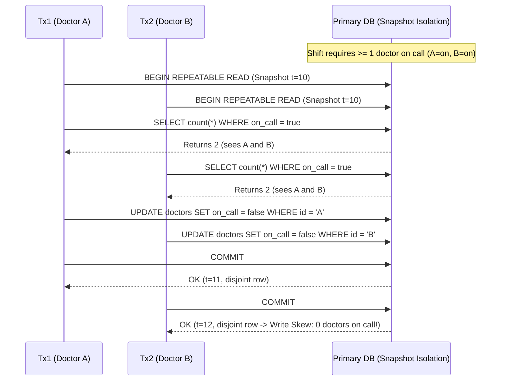

# 13 · Transactions, ACID, MVCC & Isolation Levels

**Module 02 · Data Modeling & Storage Internals** | **Slides:** [13 · Transactions & Isolation](../slides/13-transactions-isolation.md)

---

## 1. The Problem

Your hospital scheduling app enforces one critical rule: **at least one doctor must remain on call for every shift**. Currently Alice and Bob are both on call (`count = 2`). At 09:00:00.012, Alice and Bob both click *"Request Time Off"* at the exact same millisecond.

Both API handlers open a transaction under PostgreSQL's `REPEATABLE READ` (Snapshot Isolation), run `SELECT count(*) FROM doctors WHERE on_call = true`, see `2` (safe!), and update *their own separate row* (`SET on_call = false WHERE id = 'Alice'` and `WHERE id = 'Bob'`). Both transactions commit with `200 OK`—and now **zero doctors are on call**.

Why did `REPEATABLE READ`—a supposedly strict isolation level—let this slip through? Because understanding isolation levels is not memorizing four buzzwords; it is understanding **snapshots, locks, and write skew**.

---

## 2. Mental Model

Consider **two ways to manage concurrent edits to a shared spreadsheet**:

- **Pessimistic Locking (2PL — Two-Phase Locking):** Before reading or editing a cell, put a physical lock on it. Readers block writers and writers block readers. Simple to reason about, but long reports stall checkout writes.
- **MVCC (Multi-Version Concurrency Control):** Instead of overwriting a cell in place, every edit stamps a new version with a transaction ID (`xmin`/`xmax`). When you open a transaction, the database hands you a **point-in-time snapshot**—you see only committed versions created *before* your snapshot started. **Readers never block writers, and writers never block readers.**

> **ACID:** **A**tomicity (all-or-nothing rollback on abort/crash), **C**onsistency (application invariants preserved—actually a shared responsibility with schema constraints and app logic), **I**solation (concurrent transactions behave as if isolated to the degree configured), **D**urability (committed bytes survive power loss via WAL `fsync`).
>
> **Write Skew:** An anomaly where two concurrent transactions read an overlapping condition from the same snapshot, modify *disjoint* rows, and both commit—violating an invariant that spans multiple rows.

---

## 3. How It Works Under the Hood

### MVCC Version Visibility
In PostgreSQL, updating a row does not overwrite it in place: it marks the old tuple's `xmax = current_tx_id` and inserts a new tuple with `xmin = current_tx_id`. (MySQL InnoDB updates in place and keeps older versions in an **Undo Log**.) Each transaction checks a visibility rule: a row version is visible if its `xmin` committed before my snapshot and its `xmax` is empty or uncommitted/after my snapshot. Dead old tuples are later reclaimed by `VACUUM`.

### Isolation Levels & Anomalies
| Isolation Level | Dirty Read | Non-Repeatable Read | Phantom Read | Lost Update | Write Skew | Typical Implementation |
|---|---|---|---|---|---|---|
| **Read Committed** (Postgres default) | Prevented | **Possible** | **Possible** | **Possible** (read-modify-write) | **Possible** | Fresh snapshot per *statement* |
| **Repeatable Read / Snapshot Isolation** | Prevented | Prevented | Prevented (in MVCC snapshot) | Prevented (Postgres aborts 2nd writer on *same* row) | **Possible** | One snapshot for whole *transaction* |
| **Serializable** | Prevented | Prevented | Prevented | Prevented | **Prevented** | `SSI` (Postgres) or `2PL + Gap Locks` (InnoDB) |

*Note:* Under SQL standard definitions, Repeatable Read technically permits phantoms, though MVCC Snapshot Isolation (PostgreSQL `REPEATABLE READ`) prevents phantom reads by freezing one snapshot per transaction—while **still permitting Write Skew**.

### Tracing Write Skew Under Snapshot Isolation
See the standalone diagram source: [mvcc-concurrency-timeline.mmd](../diagrams/mvcc-concurrency-timeline.mmd).

### How Serializable (`SSI`) Stops It
PostgreSQL's **Serializable Snapshot Isolation (SSI)** tracks **SIREAD predicate locks** on ranges and rows read during the transaction. When `Tx1` reads `WHERE on_call = true` and `Tx2` writes a row matching that predicate (and vice versa—a dangerous read/write dependency cycle), SSI aborts one transaction with `SQLSTATE 40001 (serialization_failure)` so the app can safely retry.

---

## 4. Worked Example & Interactive Visualization

> **Interactive Visual:** `anim-isolation-anomalies` — Step two concurrent transactions across `Read Committed`, `Repeatable Read`, and `Serializable` to observe lost updates, phantom rows, and write skew.

Let's compare concurrency fixes for a **5,000 QPS seat/inventory booking workload** (`12 ms` p95 transaction duration, 1% hot-item contention):

1. **Broken Read-Modify-Write (`Read Committed`):**
   - `SELECT qty FROM inventory WHERE id = 42;` -> reads `10`
   - App computes `9`, runs `UPDATE inventory SET qty = 9 WHERE id = 42;`
   - If 2 requests overlap (`12 ms` window × `50` hot QPS = ~`0.6` concurrent collisions), both write `9`—**1 unit silently vanishes (Lost Update)**!
2. **Atomic Conditional Update (`Read Committed`, 0 retries):**
   - `UPDATE inventory SET qty = qty - 1 WHERE id = 42 AND qty >= 1 RETURNING qty;`
   - PostgreSQL acquires a row-level write lock for ~`1–2 ms` and re-evaluates the `WHERE` predicate against the latest committed row. Zero lost updates, throughput scales to ~`500–1,000` updates/sec on a single hot row.
3. **Explicit Pessimistic Lock (`SELECT ... FOR UPDATE`) vs Optimistic (`version` / `SSI`):**
   - Locking a parent `shifts` row (`SELECT * FROM shifts WHERE id = 7 FOR UPDATE`) serializes only doctors on Shift 7 (`~1 ms` lock hold) without global SSI retry overhead.
   - Under `SERIALIZABLE` (`SSI`), expect **1–5% `40001` retry rates** under contention—your application **must** include bounded retry logic with jitter!

---

## 5. Trade-Offs & Failure Modes

| Mechanism | Benefit | Cost / Risk | Fails When |
|---|---|---|---|
| **Read Committed (Default)** | Minimal lock waits, high concurrency | Non-repeatable reads & lost updates on read-modify-write | App computes new state in memory (`qty - 1`) instead of SQL atomic updates |
| **Optimistic Locking (`version` column)** | Zero long-held DB locks; works across HTTP steps | Caller gets `409 Conflict` / 0 rows updated and must retry | Hot row sees >20% concurrent writes -> retry storm |
| **Pessimistic (`SELECT ... FOR UPDATE`)** | Guarantees immediate turn-taking without rollbacks | Holds row lock across transaction; **deadlock** risk if lock order varies | App makes slow external HTTP calls *inside* the DB transaction! |
| **MVCC (`REPEATABLE READ`)** | Consistent multi-statement reports; zero reader blocking | Vulnerable to **write skew**; long open transactions block `VACUUM` | Long-running analytics tx holds snapshot open for hours -> **table bloat** |
| **Serializable (`SSI`)** | Prevents all anomalies including write skew without blocking reads | Memory overhead for SIREAD locks; `40001` serialization aborts | App lacks automatic retry loop on `SQLSTATE 40001` |

### What changes at 10× and 100× scale?
- **1×:** Single-database `Read Committed` + atomic `UPDATE` + `SELECT ... FOR UPDATE` handles almost all invariants cleanly.
- **10×:** Long transactions holding MVCC snapshots (`idle in transaction`) prevent `VACUUM` from cleaning dead tuples, inflating table size by 5× and tanking cache hit ratios—enforce strict `idle_in_transaction_session_timeout` and `statement_timeout`.
- **100×:** Single-row lock contention on flash-sale items or ledgers hits the ~`1,000–2,000` updates/sec ceiling per row; teams shard inventory counters across `K` sub-buckets (e.g., `item:42:slot_0..9`) or serialize writes via a single-writer partitioned queue.

---

## 6. Practical Exercise

Write the SQL (and retry pseudocode) to fix **both** scenarios safely:
1. **Lost Update:** Deduct `$25` from `accounts(id, balance_cents)` without ever allowing negative balances or lost concurrent deductions under `Read Committed`.
2. **Write Skew:** Prevent Alice and Bob from both leaving the on-call shift empty (`doctors(id, shift_id, on_call)`) using **(a)** `SELECT ... FOR UPDATE` on a parent `shifts` row, and **(b)** `SERIALIZABLE` with `40001` retry handling. State which one fails less under high contention on different shifts.

---

## 7. Retrieval Practice

1. Why does MVCC let a 10-second analytical `SELECT` run concurrently with `UPDATE`s without blocking either side?
2. What is the exact difference between a **Lost Update** and **Write Skew**?
3. Why is calling an external payment API *inside* an open `BEGIN ... COMMIT` transaction one of the worst production anti-patterns?
4. How can a forgotten `idle in transaction` session degrade performance for *other* unrelated queries in PostgreSQL?

Hints

1. Readers inspect older committed tuple versions visible as of their snapshot timestamp (`xmin`/`xmax` or undo log) while writers append new tuple versions—neither needs a shared/exclusive lock on the same physical slot.
2. A **Lost Update** happens when two transactions read and overwrite the *same* row (`qty = 10 -> 9`); **Write Skew** happens when two transactions read an overlapping set and update *disjoint* rows (`Alice` and `Bob`), breaking a multi-row invariant.
3. Holding a DB connection and row locks during a 500 ms–10 s network call exhausts the connection pool and stalls every other writer waiting on that row.
4. PostgreSQL cannot `VACUUM` dead tuples created after the oldest open snapshot; dead tuples accumulate on pages, bloating tables/indexes and slowing sequential and index scans.

---

## Primary Sources

- [PostgreSQL Docs · Transaction Isolation](https://www.postgresql.org/docs/current/transaction-iso.html) — Official documentation detailing `Read Committed`, `Repeatable Read` (Snapshot Isolation), and `Serializable` (`SSI`) behaviors.
- [MySQL Docs · InnoDB Transaction Model & Locking](https://dev.mysql.com/doc/refman/8.4/en/innodb-transaction-isolation-levels.html) — Contrasts InnoDB's locking `REPEATABLE READ` (next-key locks) with PostgreSQL's SSI approach.
- [Jepsen · Consistency Models](https://jepsen.io/consistency) — Reference hierarchy distinguishing Read Committed, Snapshot Isolation, Serializable, and Strict Serializable.
- [Serializable Isolation for Snapshot Databases (Cahill et al., SIGMOD 2008)](https://dl.acm.org/doi/10.1145/1376616.1376690) — Foundational paper behind PostgreSQL's SSI implementation.

---

## Next

Continue to [14 · Object, Media & Blob Storage](14-object-storage.md).
