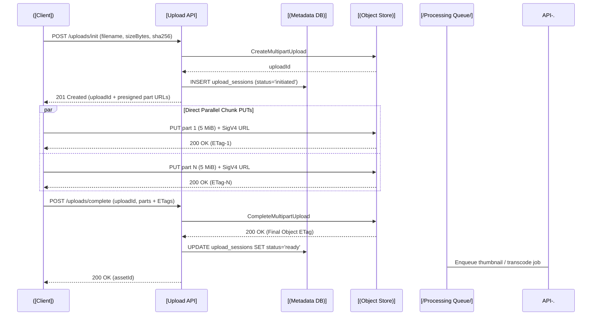

# 14 · Object, Media & Blob Storage

**Module 02 · Data Modeling & Storage Internals** | **Slides:** [14 · Object Storage](../slides/14-object-storage.md)

---

## 1. The Problem

You launch a video-review product where users upload 2 GiB screen recordings. In v1, the browser `POST`s the file to your Node/Go API server, which buffers or streams it into a `BYTEA` column in PostgreSQL (or writes it to a single server's local EBS disk).

Within a week, three things break simultaneously:
1. **Ten concurrent 2 GiB uploads exhaust API server RAM and NIC bandwidth**, causing `502 Bad Gateway` for normal login requests.
2. **A Wi-Fi drop at 92% forces the user to restart from 0%**, wasting 1.84 GiB of bandwidth.
3. **Database backups balloon to multi-terabyte snapshots**, taking 9 hours and locking storage I/O.

Never push multi-megabyte binary payloads through your API servers or store them inside an OLTP database.

---

## 2. Mental Model

Split the world into **Coat-Check Ticket (Control Plane)** and **Coat Warehouse (Data Plane)**:

- **Control Plane (Metadata DB):** Tiny, structured, queryable rows (`asset_id`, `owner_id`, `status`, `size_bytes`, `sha256`, `object_key`) stored in PostgreSQL/DynamoDB. Needs transactions, indexes, and permissions.
- **Data Plane (Object Storage — e.g., Amazon S3, GCS, Cloudflare R2, MinIO):** An immutable, flat key-value warehouse (`bucket/key -> blob + metadata`) accessible over HTTPS. You cannot append 10 bytes to the middle of an object; you `PUT`, `GET` (with HTTP `Range` byte offsets), or `DELETE` whole objects or multipart chunks.

> **Presigned URL:** A time-limited, cryptographically signed HTTPS URL (using HMAC/AWS SigV4) issued by your API server that grants one client temporary permission to `PUT` or `GET` a specific object key directly against the object store—without exposing secret storage credentials.
>
> **Multipart Upload:** Splitting a large file into fixed chunks (`>= 5 MiB` each in S3, up to 10,000 parts), uploading chunks in parallel directly to the object store, and committing the manifest once all `ETag` checksums verify.

---

## 3. How It Works Under the Hood

### Direct Presigned Multipart Upload Flow
See the standalone diagram source: [presigned-multipart-upload.mmd](../diagrams/presigned-multipart-upload.mmd).

1. **Initiate (`POST /uploads/init`):** The API authenticates the user, enforces quota/MIME rules, calls `CreateMultipartUpload`, records a row (`status = 'initiated'`) in the metadata DB, and returns `uploadId` plus short-lived presigned URLs (e.g., 15-minute expiry) for parts `1..N`.
2. **Direct Parallel Transfer:** The browser/mobile app `PUT`s chunks (e.g., 4–6 parallel connections, `8–16 MiB` per chunk) directly to the object store. **Zero binary bytes touch the API server.** If part #14 drops, the client retries *only* part #14.
3. **Complete & Verify:** The client sends `[(partNumber, ETag), ...]` to `POST /uploads/complete`. The API calls `CompleteMultipartUpload` (object store stitches parts server-side in milliseconds without copying bytes over the wire), updates the DB to `ready`, and enqueues async virus-scanning/transcoding.
4. **Durability & Lifecycle Tiering:** Under the hood, cloud object stores spread erasure-coded shards across multiple Availability Zones (`11 nines` = `99.999999999%` annual durability—much cheaper per TB than `3×` raw replication). Lifecycle rules automatically transition cold objects from **Standard** -> **Infrequent Access** (after 30 days) -> **Archive/Glacier** (after 90+ days) and clean up **aborted/incomplete multipart uploads** after 7 days.

---

## 4. Worked Example & Interactive Visualization

> **Interactive Visual:** `anim-presigned-upload` — Toggle between **API Server Proxy** (watch API RAM & NIC saturate) and **Direct Presigned Multipart** (watch parallel chunks bypass the API tier straight to object storage).

Let's size an educational video platform handling **50,000 uploads/day**, average size **500 MB** (decimal):

1. **Daily Ingress & Storage Growth:**
   - Daily new data = `50,000 × 500 MB = 25 TB/day` (decimal), or **`~750 TB/month`**, **`~9.125 PB/year`** before transcoding variants (720p/1080p) and deletes.
2. **Why API Proxying Fails at Peak:**
   - Suppose peak upload rate is `3×` average: `(50,000 ÷ 86,400) × 3 ≈ 1.74 uploads/sec` starting, each averaging `500 MB` over a `50 Mbps` (`6.25 MB/s`) user uplink = `80 seconds` upload time.
   - By Little's Law (`L = λW`): `1.74 × 80 ≈ 139` concurrent uploads in flight, pushing `139 × 6.25 MB/s ≈ 869 MB/s` (`~7 Gbps`) continuously! Proxying through API servers forces double bandwidth billing (ingress + egress to S3) and large reverse-proxy buffers. Direct presigned uploads reduce API traffic to **< 2 KB per init/complete JSON call** (`~3.5 KB/s` total!).
3. **Multipart Chunk Sizing:**
   - For a **4 GiB** (`4,096 MiB`) max video with `16 MiB` parts: `4,096 ÷ 16 = 256 parts` (well inside S3's `10,000`-part ceiling and above the `5 MiB` minimum part size).
4. **Lifecycle Tiering Savings (Hypothetical Cloud Pricing Example):**
   - Assume Standard tier costs `$23/TB-month` vs Glacier Instant/Archive at `$4/TB-month`. Moving 80% of cold 90-day+ raw source files to Archive cuts `1 PB` monthly storage cost from `$23,000/mo` to `~$7,800/mo`—just watch out for minimum storage duration fees (e.g., 90 days) and per-GB retrieval fees if users frequently re-download cold masters.

---

## 5. Trade-Offs & Failure Modes

| Choice | Benefit | Cost / Risk | Fails When |
|---|---|---|---|
| **Direct Presigned Multipart** | Zero API bandwidth/RAM bottleneck; resumable chunk retries | Client needs CORS configured; URLs expire mid-slow upload | Client upload exceeds `ExpiresIn` and lacks a `/refresh-url` endpoint |
| **API-Proxied Upload** | Simple client contract; inline streaming virus scan before disk | Doubles network egress; pins API workers & RAM | Payloads exceed ~5–10 MB or concurrent uploads spike |
| **Immutable Content-Addressed Keys (`sha256`)** | Automatic deduplication; safe aggressive CDN caching (`immutable`) | Deleting one user's link needs reference counting before blob delete | Mutable keys (`avatars/u1.png`) overwritten in place -> stale CDN caches |
| **Cold / Archive Tiers** | 50–80% cheaper per TB-month | Higher retrieval latency (minutes–hours in deep archive) + restore fees | App moves actively watched thumbnails/files to cold tier prematurely |

### What changes at 10× and 100× scale?
- **1× (GBs/month):** Simple single-PUT presigned URLs work fine for files under ~100 MB.
- **10× (TBs/month):** Multipart uploads + `AbortIncompleteMultipartUpload` bucket lifecycle rules become mandatory to prevent silent orphan part bills; put a **CDN** in front of `GET` reads so origin object-store egress doesn't dominate your cloud bill.
- **100× (PBs/month):** Use Transfer Acceleration / multi-region upload buckets close to users, async content deduplication, and strict lifecycle tiering + object-lock (WORM) compliance for audit/backup buckets.

---

## 6. Practical Exercise

Complete **[Lab 05 · Presigned Multipart Uploads](../labs/05-presigned-multipart-upload.md)** using local MinIO + Python (`boto3`):
- Upload a 50 MiB file in 5 MiB presigned chunks while verifying the API control-plane RSS stays flat (`< 40 MiB`).
- Simulate a mid-upload failure after part 6 and resume via `list_parts` without re-uploading parts 1–6.
- Audit incomplete orphaned multipart uploads with `list_multipart_uploads`.

Then test your Module 01–02 mastery with **[Assessment 02 · Storage Internals, Transactions & Media Delivery](../assessments/checkpoint-02.md)**.

---

## 7. Retrieval Practice

1. Why must object keys for user uploads use opaque UUIDs or content hashes (e.g., `uploads/{uuid}`) rather than raw user filenames (`../etc/passwd` or `avatar.png`)?
2. What happens to your cloud bill if clients abandon 10,000 multipart uploads at 80% completion without a lifecycle cleanup policy?
3. Why does S3/MinIO enforce a **5 MiB minimum part size** on all multipart chunks except the last part?
4. When a user updates their profile photo, why is storing a new key (`avatars/u42-v2.webp`) better than overwriting `avatars/u42.webp`?

Hints

1. User filenames create path-traversal/encoding bugs, filename collisions, and stale CDN caches on overwrites; store the display filename in the metadata DB and use an immutable UUID/hash as the object key.
2. Uncompleted parts remain stored in hidden staging storage and are billed at standard GB-month rates forever until explicitly aborted via `AbortIncompleteMultipartUpload` lifecycle rules.
3. Limiting chunk granularity caps server-side manifest metadata and shard fan-out (avoiding billions of tiny 10 KB fragments per object).
4. Immutable keys allow `Cache-Control: public, max-age=31536000, immutable` on CDNs with zero cache-invalidation lag—just update the URL pointer in the metadata DB.

---

## Primary Sources

- [AWS S3 User Guide · Multipart Upload Overview](https://docs.aws.amazon.com/AmazonS3/latest/userguide/mpuoverview.html) — Official docs on `CreateMultipartUpload`, `UploadPart`, `CompleteMultipartUpload`, and part limits.
- [AWS S3 User Guide · Sharing Objects with Presigned URLs](https://docs.aws.amazon.com/AmazonS3/latest/userguide/ShareObjectPreSignedURL.html) — Official SigV4 presigned URL mechanics and expiration constraints.
- [AWS S3 · Storage Classes & Lifecycle Management](https://docs.aws.amazon.com/AmazonS3/latest/userguide/object-lifecycle-mgmt.html) — Official rules for Standard/IA/Glacier transitions and `AbortIncompleteMultipartUpload`.

---

## Next

Continue to Module 03: [15 · Caching Topologies & Write Policies](15-caching-patterns.md).
