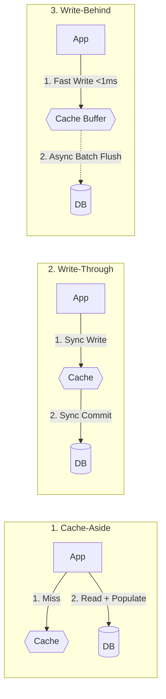

# 15 · Caching Topologies & Write Policies

**Module 03 · Caching & Stateless Compute** | **Slides:** [15 · Caching Patterns](../slides/15-caching-patterns.md)

---

## 1. The Problem

Your e-commerce product detail page receives **30,000 requests/second** during a weekend sale. Each product page requires assembling pricing, seller rating, and description from three relational tables—taking **18 ms** on PostgreSQL and saturating all 16 primary DB vCPUs at just 2,200 QPS.

You spin up Redis in front of PostgreSQL, and DB CPU drops from 98% to 12%. Two hours later, a merchant updates a jacket's price from `$199` to `$249`, yet checkout charges `$249` while the product page still displays `$199` for 15 minutes. Worse, when a Redis node restarts overnight, your inventory-view counter loses the last 40,000 clicks because someone enabled **write-behind** without understanding its durability contract.

Caching is never "just add Redis." Every caching topology trades **read latency**, **write latency**, **staleness window**, and **crash durability** differently.

---

## 2. Mental Model

Think of a cache as **a sticky note on your desk** vs **the locked filing cabinet down the hall (the Database)**:

- **Cache-Aside (Lazy Loading):** *You* look at your desk first. If the sticky note is missing, *you* walk to the filing cabinet, photocopy the file, and stick a copy on your desk. When a file changes, you tear off the sticky note (`DELETE` from cache).
- **Read-Through:** A research assistant stands between you and the filing cabinet. You always ask the assistant; on a miss, the assistant fetches from the cabinet, caches a copy, and hands it to you. Your app code only talks to one interface.
- **Write-Through:** Every edit goes synchronously through the assistant, who updates *both* the sticky note and the locked cabinet before saying "Done." Reads are always fresh, but writes pay two network hops.
- **Write-Behind (Write-Back):** You scribble updates onto the desk sticky note and immediately return `"200 OK"` in `< 1 ms`. Every few seconds, an assistant batches those sticky notes into the cabinet asynchronously. Blazing fast writes—until a power outage wipes the desk before the assistant flushes!
- **Refresh-Ahead:** The assistant notices a popular sticky note is 80% through its expiration timer and quietly refreshes it in the background *before* any user hits a miss.

> **Cache Hit Ratio (`H`):** Fraction of reads served from cache (`Hits / Total Reads`). Because cache misses hit the DB, raising hit ratio from `90%` to `99%` cuts origin DB read QPS by **10×** (`10%` miss rate -> `1%` miss rate).

---

## 3. How It Works Under the Hood

### Read & Write Topologies Compared
1. **Cache-Aside (Application-Managed):**
   - **Read:** `val = cache.get(k)`. On miss -> `val = db.query(k)` -> `cache.set(k, val, ttl)` -> return `val`.
   - **Write:** `db.update(k, new_val)` -> `cache.delete(k)` (prefer **delete** over `set`, because concurrent writes racing to `cache.set` can overwrite newer state with older values).
2. **Read-Through / Write-Through (Cache-as-Proxy):**
   - The cache provider (e.g., DynamoDB DAX, NCache, or a custom library) owns the DB loader/writer plugin.
   - Guarantees consistent cache population and avoids cold misses after writes under **Write-Through**, though unused written keys still consume cache RAM unless paired with a short TTL.
3. **Write-Behind (Async Batching):**
   - Cache acknowledges writes immediately in RAM and enqueues dirty keys into an async batch flusher (`FLUSH` every `N` ms or `M` keys, coalescing 500 counter increments on `video:99:views` into **1** `UPDATE` statement!).
4. **Multi-Tier (`L1` In-Process + `L2` Redis + `DB`):**
   - `L1` (tiny in-memory LRU per app pod, `5–30s` TTL) serves hot keys in **`~0.01 ms`** with zero network hops; `L2` (shared Redis cluster) serves the broader working set in **`~0.5–1.5 ms`**; `DB` serves misses in **`~10–25 ms`**.

*Diagram: `cache-write-policies` — synchronous vs asynchronous coupling between cache and durable storage.*

---

## 4. Worked Example & Interactive Visualization

> **Interactive Visual:** `anim-cache-aside-vs-through` — Watch request packets traverse `App`, `Cache`, and `DB` across Cache-Aside, Write-Through, and Write-Behind, including a simulated cache crash during Write-Behind.

Suppose a product catalog receives **50,000 reads/sec** and **500 writes/sec** (`100:1` read/write ratio). Average object size is **2 KB**. Cache hit latency = `0.8 ms`, DB read latency = `15 ms`, DB write latency = `12 ms`.

1. **Why Hit Ratio Jumps Matter Nonlinearly:**
   - At `H = 80%`: Miss rate = `20%` -> **`10,000` DB reads/sec**. Average read latency = `(0.80 × 0.8) + (0.20 × 15) = 3.64 ms`, and `p99` is `15+ ms` because 20% of users miss!
   - At `H = 98%`: Miss rate = `2%` -> **`1,000` DB reads/sec** (**10× lower DB load**). Average read latency = `(0.98 × 0.8) + (0.02 × 15) = 1.08 ms`, and `p95` is `~1 ms` (only `p99` hits the DB!).
2. **Write-Through vs Write-Behind Write Latency:**
   - **Write-Through:** Every write pays cache (`0.8 ms`) + DB (`12 ms`) = **`12.8 ms`** synchronous write latency, `500` DB writes/sec, **0 bytes lost** on cache crash.
   - **Write-Behind (5-second flush window):** App writes complete in **`0.8 ms`**. If all `500 writes/sec` target 50 hot view counters, coalescing shrinks `500 × 5 = 2,500` writes down to just **`50` batched DB writes every 5s** (`10 writes/sec`—a **50× write reduction**!).
   - **Blast Radius of Crash:** If the Redis primary fails without AOF `always` replication before the 5-second flush completes, **up to `5s × 500 writes/sec = 2,500` acknowledged writes are permanently lost**.

---

## 5. Trade-Offs & Failure Modes

| Topology | Benefit | Cost / Risk | Fails When |
|---|---|---|---|
| **Cache-Aside** | Simple; resilient (if cache dies, app degrades to DB); caches only read keys | First request after write/expiry misses; brief stale race window | DB cannot survive cold cache miss rate during cache outage |
| **Read-Through** | Cleaner app code; easier request coalescing in proxy layer | Tighter coupling to cache provider plugin | Custom multi-table joins or per-user authorization vary by caller |
| **Write-Through** | Cache stays warm & consistent with DB on every write | Higher write latency (2 serial hops); pollutes RAM with write-once keys | Write-heavy workload fills cache with items nobody reads |
| **Write-Behind** | Lowest write latency (`<1 ms`); absorbs bursty counter coalescing | **Data loss window** on cache crash; out-of-order flush bugs | Used for financial balances, orders, or data where loss is unacceptable |
| **Refresh-Ahead** | Hides miss latency (`p99` stays flat) for predictable hot keys | Wastes DB queries refreshing keys that stop receiving traffic | Key popularity shifts unpredictably (long-tail catalog) |

### What changes at 10× and 100× scale?
- **1× (1k–5k QPS):** Single Redis primary + Cache-Aside with reasonable TTLs (`60–300s`) is simple and rock-solid.
- **10× (50k QPS):** Cache-Aside cold misses on deploys or restarts can overwhelm the DB; add read replicas, pre-warm top keys, and enforce strict DB timeouts/fallbacks.
- **100× (500k+ QPS):** Distributed `L2` Redis shards hit per-shard CPU/network limits on hot keys (`>100k` req/s to one key). Teams introduce an **`L1` in-process cache** (`5–15s` TTL) inside each API pod so 95%+ of hot reads never even cross the network to Redis!

---

## 6. Practical Exercise

You are designing a feature-flag service (`100,000` reads/sec across 50 API pods, `2` flag updates/minute, flags must propagate within `10 seconds` max, and zero downtime if Redis restarts):
1. Choose a caching topology (combine `L1` + `L2` or `Cache-Aside` + polling/pub-sub) and justify why **Write-Behind** is unnecessary here.
2. Calculate Redis QPS **with** vs **without** a `5-second` in-process `L1` cache across 50 pods for 200 active flags.
3. Explain what happens when an engineer flips a kill-switch flag at `t=0`—what is the worst-case propagation delay across all 50 pods?

---

## 7. Retrieval Practice

1. In Cache-Aside, why should a write handler **delete** the cache key after updating the DB rather than calling `cache.set(key, newValue)`?
2. Why does raising a cache hit ratio from `95%` to `99%` reduce origin database load by **5×** instead of ~4%?
3. Name one workload where **Write-Behind** is genuinely appropriate and one where it is dangerous.
4. What problem does **Write-Through** cause if 90% of created records are never read within an hour?

Hints

1. If Thread A writes `v1` to DB and Thread B writes `v2` to DB, Thread A might be delayed and execute `cache.set(v1)` *after* Thread B's `cache.set(v2)`—leaving `v1` stuck in cache until TTL expires. Deleting avoids injecting stale values from slower writers (though a read-miss race still needs handling—covered in Lesson 16).
2. Origin DB handles the **miss rate** (`1 - H`), not the hit rate. Dropping miss rate from `5%` (`1 - 0.95`) to `1%` (`1 - 0.99`) cuts DB traffic to one-fifth (`5% / 1% = 5×`).
3. Appropriate: view counts, video playback heartbeats, ephemeral telemetry counters where losing a few seconds on crash is tolerable. Dangerous: bank transfers, inventory reservations, or billing records.
4. Cache pollution—write-once records evict genuinely hot read keys from RAM unless paired with short TTLs or admission filtering.

---

## Primary Sources

- [AWS Whitepaper · Database Caching Strategies Using Redis](https://docs.aws.amazon.com/whitepapers/latest/database-caching-strategies-using-redis/) — Official guide detailing Cache-Aside, Write-Through, Write-Behind, and Redis clustering patterns.
- [Redis Docs · Caching & Eviction Concepts](https://redis.io/docs/latest/) — Official Redis documentation covering memory management, persistence (RDB/AOF), and TTL behavior.
- [Scaling Memcache at Facebook (Nishtala et al., NSDI 2013)](https://research.facebook.com/publications/scaling-memcache-at-facebook/) — Landmark paper explaining demand-filled look-aside caching, leases, and multi-tier scaling.

---

## Next

Continue to [16 · Eviction, Expiration & Cache Invalidation](16-eviction-invalidation.md).
