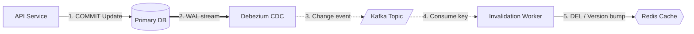

# 16 · Eviction, Expiration & Cache Invalidation

**Module 03 · Caching & Stateless Compute** | **Slides:** [16 · Eviction & Invalidation](../slides/16-eviction-invalidation.md)

---

## 1. The Problem

You allocate a **32 GiB** Redis cluster with `LRU` eviction and a 1-hour TTL for your catalog API (`96%` hit ratio). Every night at 02:00 UTC, an internal batch exporter pages through **500,000 old archived products** once. Within 4 minutes, your hit ratio plunges from `96%` to `54%`, database CPU spikes to 95%, and mobile users wait 400 ms for pages that normally load in 15 ms.

Meanwhile, during peak daytime writes, a user updates their shipping address and immediately refreshes the page—only to see their **old** address stuck in cache for the next 55 minutes, even though your write handler ran `redis.del(key)`!

Both failures come from treating cache memory management and invalidation as afterthoughts.

---

## 2. Mental Model

Think of a cache with finite RAM as **a small café bookshelf holding only 100 books**:

- **Eviction (Making Room):** When the 101st book arrives, which book gets tossed?
  - **FIFO:** Toss the oldest book placed on the shelf, even if 50 people read it every hour.
  - **LRU (Least Recently Used):** Toss the book nobody touched recently. Great for shifting trends—**until a single visitor flips through 100 obscure archive books once (scan pollution)** and kicks every bestseller off the shelf!
  - **LFU (Least Frequently Used):** Track read counts and toss the least-read book. Protects bestsellers from one-hit scans, **but an old viral hit from last month (`1,000,000` reads) hogs a slot forever** even after nobody cares anymore.
  - **Window-TinyLFU (Caffeine / modern caches):** Gives new arrivals a tiny `1%` probation shelf (**Window LRU**), and only admits a book into the main `99%` shelf (**Segmented LRU**) if a compact frequency sketch (**Count-Min Sketch**, periodic halving for aging!) proves it is hotter than the victim it replaces.
- **Invalidation (Stale Books):** Throwing a stale book away (`TTL` expiration) vs having an automated courier watch the master printing press (**WAL / CDC**) and pull outdated editions off every shelf reliably.

> **Scan Pollution:** When a sequential scan or batch job inserts thousands of once-read cold keys, evicting the hot working set from an LRU cache.

---

## 3. How It Works Under the Hood

### Part A · Why Cache-Aside `DELETE` Still Goes Stale (The Read-Miss Race)
Even if your write path executes `UPDATE db ...` followed by `redis.del(key)`, concurrency creates a subtle race:
1. **Reader A** misses cache (`GET user:7 -> nil`) and queries DB, receiving old value `V1`.
2. Before Reader A calls `SET`, **Writer B** updates DB to `V2` and runs `DEL user:7` (which deletes nothing—key isn't set yet!).
3. **Reader A** finally wakes up and executes `SET user:7 V1 TTL=3600`—**poisoning the cache with stale `V1` for 1 full hour!**

**Defenses:**
- **Short TTL + Jitter** caps blast radius (`TTL = base + random(0, jitter)`).
- **Monotonic Version / Lease Tokens:** Store `(value, version)` and use a Redis Lua script (`if incoming_ver > current_ver then set`) or Memcache-style leases so older readers cannot overwrite newer versions.
- **WAL / CDC-Driven Invalidation:** Instead of trusting every microservice and admin script to remember `redis.del()`, stream committed database changes from the Write-Ahead Log via **Debezium -> Kafka -> Invalidation Worker -> Cache `DEL`**.

*Diagram: `cdc-cache-invalidation` — decoupling cache invalidation from application write paths via WAL/CDC.*

### Part B · Versioned Keys (Zero-Invalidation Pattern)
For immutable or semi-static bundles (CSS/JS assets, user avatars, config snapshots), bake the version into the key itself: `config:tenant_42:v18`. Publishing `v19` simply updates the pointer in the metadata DB/header—old `v18` keys expire naturally with zero `DEL` race conditions and zero thundering-herd invalidations!

### Part C · Active vs Lazy Expiration in Redis
Redis does **not** run a timer per key. It expires keys using two mechanisms:
1. **Lazy expiration:** Checked when a client actually reads the key (`GET`); if `now > expires_at`, delete and return `nil`.
2. **Active random sampling:** Every 100 ms (default `hz 10`), Redis samples 20 random keys with TTLs, deletes expired ones, and repeats if `>25%` were expired. Beware: **millions of expired unread keys can linger until sampled**, consuming RAM if too many keys expire at once or sampling falls behind.

---

## 4. Worked Example & Interactive Visualization

> **Interactive Visual:** `sim-eviction-policies` — Stream a Zipfian (`80/20`) hot workload mixed with a one-time sequential scan across **FIFO**, **LRU**, **LFU**, and **Window-TinyLFU** to compare live cache hit ratios.

Let's size a Redis cache for **50M total users**, where **10% (5M active users)** generate **90% of daily reads** (Zipfian skew):

1. **Entry Footprint Calculation (Redis / jemalloc overhead):**
   - Suppose each cached JSON user summary is `400 bytes`, key is `user:{uuid}` (`41 bytes`).
   - In Redis, each key-value entry carries dict entry + `robj` + SDS metadata + jemalloc rounding overhead (`~80–100 bytes/entry`).
   - Total per entry ≈ `400 + 41 + 90 ≈ 531 bytes`.
2. **RAM Needed for the 5M Hot Working Set:**
   - `5,000,000 × 531 bytes ≈ 2.655 GB` (decimal) ≈ `2.47 GiB`.
   - Add `~30%` headroom for fragmentation, replication output buffers, and fork copy-on-write during RDB snapshots -> provision **`~4 GiB` usable cache RAM** (e.g., 1 shard with `maxmemory 3.2 GiB` and `allkeys-lfu`).
3. **Why `allkeys-lfu` Beats `allkeys-lru` Under Batch Scans:**
   - Under `LRU`, a batch job scanning 3M inactive users (`~1.6 GiB`) evicts ~50% of the 5M hot working set, dropping hit rate from `90%` to `~45%` and **5.5×-ing DB QPS**!
   - Under **LFU** (Redis `allkeys-lfu`, which uses a 24-bit logarithmic Morris counter + decay period `lfu-decay-time`), one-time scanned keys start with frequency `5` and are evicted immediately before touching hot keys with high counters.

---

## 5. Trade-Offs & Failure Modes

| Mechanism | Benefit | Cost / Risk | Fails When |
|---|---|---|---|
| **LRU** | `O(1)` doubly-linked list; adapts quickly to shifting popularity | Vulnerable to **scan pollution** from batch/crawler reads | Sequential scans > cache size wipe hot keys |
| **LFU (Morris Counter + Decay)** | High scan resistance; great for Zipfian static hot sets | Slow to evict formerly viral keys if decay is tuned too high | Workload shifts rapidly (news/breaking events) |
| **Window-TinyLFU** | Best-of-both-worlds hit ratio; tiny admission sketch (`~8 bytes/key`) | Slightly more complex implementation (standard in JVM Caffeine, Ristretto) | Cache is larger than working set anyway (all policies tie at ~100%) |
| **Pub/Sub Invalidation (`L1` Pods)** | Invalidates in-process `L1` caches within `< 5 ms` | Fire-and-forget Pub/Sub drops messages on reconnect -> stale `L1` | Network blip disconnects pod from Redis Pub/Sub -> needs short `L1` TTL fallback |
| **WAL / CDC Invalidation** | Catches writes from *any* service, migration, or SQL console | Adds pipeline complexity + `50–500 ms` async replication lag | App requires strict **read-your-own-writes** immediately after `POST` |

### What changes at 10× and 100× scale?
- **1× (4 GiB cache):** `allkeys-lru` or `allkeys-lfu` with jittered TTLs + Cache-Aside `DEL` works cleanly.
- **10× (40 GiB across multiple shards):** Manual `DEL` calls scattered across 8 microservices start drifting out of sync; teams centralize invalidation via **CDC (`Debezium -> Kafka`)** and adopt **versioned keys** wherever possible.
- **100× (400+ GiB, multi-region):** Cross-region invalidation lag reaches hundreds of milliseconds; Meta's Memcache architecture solves stale-set races with **regional invalidation pipelines (Mcrouter/gutter pools)** and **cache leases** that reject out-of-order writes.

---

## 6. Practical Exercise

1. Trace the 5-step **Read-Miss vs Write Stale-Set Race** in your own words, then write a 6-line Redis Lua pseudocode check using a monotonic `updated_at_ms` or `version` field that prevents Reader A from overwriting Writer B's newer state.
2. Suppose you store 1,000,000 items in Redis with `TTL = 3600s` all loaded at 00:00 UTC by a cron job. Explain what happens at 01:00 UTC and write the exact formula for adding `±20%` jitter.

---

## 7. Retrieval Practice

1. Why does Redis use a **probabilistic logarithmic counter** (Morris counter) instead of an exact 64-bit integer for LFU access counts?
2. How does **Window-TinyLFU** protect hot items from scan pollution while still allowing newly published viral items to enter the cache?
3. Why does **versioned key naming** (`item:42:v19`) eliminate the read-miss stale-set race condition completely?
4. When using **CDC-driven cache invalidation**, why must the application still handle a `100–300 ms` staleness window for the user who just clicked "Save"?

Hints

1. Storing an exact 64-bit counter + 64-bit timestamp per key wastes 16 bytes per entry. Redis packs both a 16-bit last-decrement timestamp and an 8-bit probabilistic counter into its existing 24-bit `lru` object field (`0` extra memory!).
2. New keys enter a small `1%` Window LRU first; if accessed even a couple of times before leaving the window, their Count-Min Sketch frequency beats the cold Main SLRU victim and earns promotion.
3. Because `v19` is an immutable new key name—old readers reading `v18` can only ever populate `cache["item:42:v18"]`, never `cache["item:42:v19"]`.
4. Reading the DB WAL, publishing to Kafka, and deleting from Redis is asynchronous; a fast immediate `GET` after `POST` can read the pre-invalidation value unless that user's session bypasses cache or reads their own write directly.

---

## Primary Sources

- [Redis Docs · Key Eviction (`maxmemory-policy`)](https://redis.io/docs/latest/develop/reference/eviction/) — Official docs explaining approximated LRU, LFU Morris counters (`lfu-log-factor`, `lfu-decay-time`), and active expiration.
- [TinyLFU: A Highly Efficient Cache Admission Policy (Einziger et al., ACM TOS 2017)](https://dl.acm.org/doi/10.1145/3149371) — Paper introducing Count-Min Sketch admission + W-TinyLFU (used by Caffeine and Ristretto).
- [Scaling Memcache at Facebook (Nishtala et al., NSDI 2013)](https://research.facebook.com/publications/scaling-memcache-at-facebook/) — Details cache leases for stale-set prevention and Mcrouter invalidation pipelines.

---

## Next

Continue to [17 · Cache Stampedes, Hot Keys & Penetration](17-cache-failure-modes.md).
