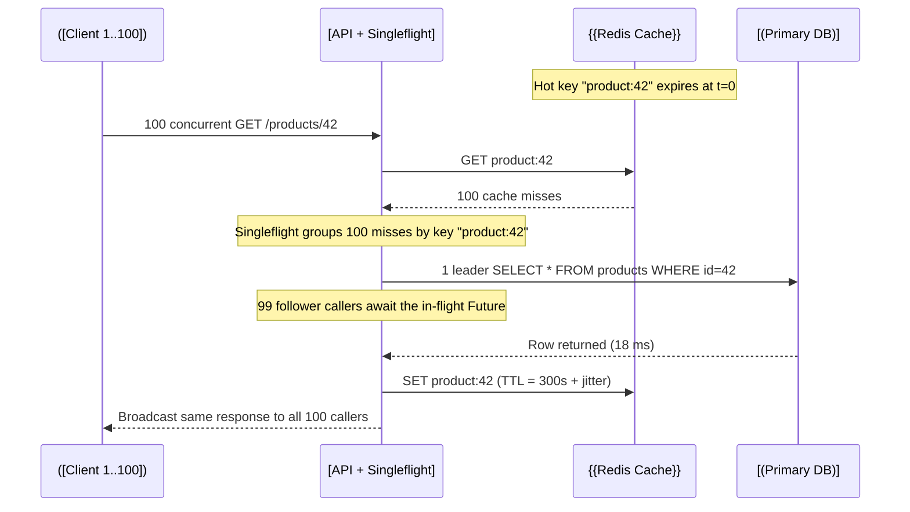

# 17 · Cache Stampedes, Hot Keys & Penetration

**Module 03 · Caching & Stateless Compute** | **Slides:** [17 · Cache Failure Modes](../slides/17-cache-failure-modes.md)

---

## 1. The Problem

Your flash-sale homepage serves **12,000 requests/second** from a single cached JSON key `homepage:featured` with a 60-second TTL. Every minute on the dot, that key expires. During the **150 ms** it takes one database query to rebuild `homepage:featured`, **1,800 concurrent requests** (`12,000 × 0.15s`) see a cache miss and all 1,800 fire the exact same heavy `SELECT` against PostgreSQL at once.

Your DB connection pool (capped at 100) instantly saturates, queries slow from 150 ms to 4 seconds, the cache stays empty because DB queries keep timing out, and the entire site collapses into a **503 cascading outage**.

Caching doesn't just make systems faster—it creates **load cliffs** where a healthy database suddenly sees 100× normal traffic in 100 milliseconds.

---

## 2. Mental Model

Four distinct failure modes look similar on a CPU graph but require completely different fixes:

1. **Cache Stampede (Thundering Herd):** *One* ultra-hot valid key expires, and thousands of concurrent requests race to recompute it simultaneously. **Fix:** Let **one** runner fetch it while everyone else waits in the lobby (**Singleflight**), or quietly refresh it *before* it expires (**XFetch**).
2. **Cache Penetration:** Attackers (or broken crawlers) request keys that **do not exist anywhere** (`GET /users/-999999`). Every request misses the cache *and* hits the DB returning `0` rows—so nothing ever gets cached! **Fix:** Bouncer at the door (**Bloom Filter** + **Negative Caching**).
3. **Cache Avalanche:** *Millions* of keys expire at the exact same second (or an entire Redis cluster restarts cold), flooding the DB with all traffic at once. **Fix:** **TTL Jitter** + circuit breakers + warm standbys.
4. **Hot Key:** One celebrity key (`live_stream:worldcup`) doesn't expire, yet receives `300,000` QPS—saturating the single Redis shard's CPU core or NIC (`10 Gbps`) even at a 100% cache hit rate! **Fix:** **L1 in-process micro-cache** or **salted key replicas** (`key#0..key#9`).

> **Singleflight (Request Coalescing):** Grouping concurrent identical in-flight misses by key inside an API process or proxy so only **one** leader hits the origin DB and broadcasts the resolved value (or error) to all waiting followers.

---

## 3. How It Works Under the Hood

### Defense 1 · Singleflight Request Coalescing
See the standalone diagram source: [singleflight-coalescing.mmd](../diagrams/singleflight-coalescing.mmd).

*Important nuance:* In-process `singleflight` reduces `10,000` concurrent misses down to **at most 1 DB query per API pod** (`N` pods = `N` queries). If `N = 500` pods, pair per-pod singleflight with **Probabilistic Early Expiration (XFetch)** or **stale-while-revalidate**!

### Defense 2 · Probabilistic Early Expiration (`XFetch`)
Instead of waiting for hard TTL expiry at `t = expiry`, each reader probabilistically decides to refresh slightly early based on how expensive the DB recomputation (`delta`) was:
`if (now - delta * beta * ln(rand(0, 1))) >= expiry -> recompute now`
As `now` approaches `expiry`, the probability climbs smoothly so **one** lucky caller refreshes the key a few hundred milliseconds early while other callers keep reading the still-valid cached value with zero wait!

### Defense 3 · Penetration & Hot Key Mitigations
- **Cache Penetration:** Store a sentinel (`"__NULL__"`) with a short `30–60s` TTL for missing IDs, **and/or** place an in-memory **Bloom Filter** containing all valid IDs before the DB query (memory-safe against random-UUID DDoS sweeps that would otherwise bloat Redis with millions of negative-cache keys!).
- **Hot Key Saturation:** Because Redis processes commands for a given shard on a single main thread, one shard maxes out around `~80,000–120,000` ops/sec. Cache hot keys in an **in-process `L1` cache for `1–5s`** (eliminating 99% of Redis calls) or replicate the key across `K` shards (`hot:42#0 .. hot:42#7`) and read a random suffix.

---

## 4. Worked Example & Interactive Visualization

> **Interactive Visual:** `sim-cache-stampede` — Trigger a key expiry under **2,000 QPS** and toggle **Singleflight** and **TTL Jitter** ON/OFF to watch DB QPS spike past pool capacity vs stay flat at `1` query.

Let's quantify the math on an endpoint serving **4,000 QPS** for `product:42`, where DB recomputation takes **150 ms** (`0.15s`) and the DB pool holds **30 connections**:

1. **Unprotected Stampede:**
   - By Little's Law (`L = λW`): `4,000 req/s × 0.15s = 600` concurrent requests miss before the first DB query finishes!
   - `600` queries hit a `30`-connection pool -> **570 requests queue or fail with `503 PoolExhausted`**, and queue wait balloons DB response time from 150 ms to `> 3,000 ms` (`20×` tail amplification).
2. **With In-Process Singleflight (across 20 API pods):**
   - Each pod collapses `4,000 ÷ 20 = 200 req/s` (`30` concurrent misses per pod) into **1 DB call**.
   - Total DB queries across the cluster = **`20` queries** (fits inside the 30-connection pool!).
   - With a distributed coalescing proxy (e.g., Envoy/Pingora/Nginx `proxy_cache_lock`) or **XFetch** (`delta = 0.15s`, `beta = 1.0`), total DB queries drop to **`1` query**!
3. **Penetration Bloom Filter Sizing (10M valid product IDs, `1%` FPR):**
   - Formula: `m ≈ -n * ln(p) / (ln 2)^2 ≈ 9.58 bits/key` -> `~10 bits/key`.
   - `10,000,000 × 10 bits = 100,000,000 bits = 12.5 MB` (~`11.9 MiB`) in RAM per pod—blocking `99%` of invalid-ID probes with zero Redis/DB hits.

---

## 5. Trade-Offs & Failure Modes

| Mitigation | Benefit | Cost / Risk | Fails When |
|---|---|---|---|
| **Singleflight (Per-Pod)** | Zero extra infra; collapses intra-pod stampede to 1 DB call | If the leader fails/hangs, all waiting followers fail together | 1,000 pods × 1 leader = still 1,000 DB calls unless paired with XFetch |
| **XFetch (Early Refresh)** | Zero follower blocking; spreads refresh across cluster | Needs stored recompute time `delta`; refreshes slightly more often | Very short TTLs (`< 2s`) or unpredictable multi-second `delta` spikes |
| **Negative Caching (`__NULL__`)** | Simple; stops repeated hits for a single missing ID | Random-ID penetration attack fills Redis RAM & evicts hot keys! | Adversary sends millions of distinct fake IDs -> pair with Bloom filter |
| **Bloom Filter** | Constant `O(1)` RAM (`~1.2 bytes/key`); stops random fake-ID attacks | Cannot delete keys cleanly without rebuild (use Counting/Cuckoo or periodic rebuild) | High-churn writes require syncing Bloom filter additions cleanly |
| **TTL Jitter (`base + rand`)** | Prevents synchronized avalanche on batch warmups | Slightly uneven staleness across keys | Only mitigates mass expiry, not a single expired celebrity key |

### What changes at 10× and 100× scale?
- **1×:** `TTL jitter` + per-pod `singleflight` + negative caching (`30s`) handles 95% of real-world workloads.
- **10×:** Add `XFetch` / `stale-while-revalidate` on expensive aggregate keys so `p99` latency never even pauses for the 150 ms leader DB query.
- **100×:** Singleflight fails open on long leader timeouts (`context.WithTimeout` + fallback to stale copy); hot keys move to **in-process `L1` caches** + **adaptive hot-key detection** (auto-promoting keys exceeding `>5k QPS` into L1/replicated shards), and Bloom filters front public unauthenticated lookup endpoints.

---

## 6. Practical Exercise

Complete **[Lab 06 · Cache Stampedes, Singleflight & Penetration](../labs/06-cache-stampede.md)**:
- Reproduce a 150-coroutine thundering herd exhausting a 10-connection DB semaphore.
- Implement an `asyncio` `singleflight` wrapper (making sure `try ... finally` clears the in-flight entry even on DB exceptions!) and verify `db_queries` drops from `150` to `1`.
- Benchmark TTL jitter on 500 expiring keys and add a Bloom filter + negative cache against 200 fake-ID penetration probes.

---

## 7. Retrieval Practice

1. Why does naive **negative caching** (`SET product:fake "__NULL__"`) make a random-ID penetration attack *worse* if you have an LRU cache?
2. What happens if a `singleflight` leader coroutine crashes or forgets to delete the key from the `inflight` map in a `finally` block?
3. Explain the difference between a **Cache Avalanche** and a **Hot Key** outage, and why adding TTL jitter fixes one but not the other.
4. Why might you combine **per-pod Singleflight** with **L1 local micro-caching (2s TTL)** for a viral World Cup live-score key?

Hints

1. Millions of distinct fake IDs populate millions of useless `__NULL__` entries in Redis, evicting real hot products and tanking your legitimate cache hit rate. Pair with a Bloom filter or cap negative-cache memory.
2. Either every subsequent request awaits a dead/rejected Future forever (deadlock), or callers repeatedly attach to a stale failed entry instead of retrying fresh. Always clean up in `finally:` and enforce strict timeouts.
3. **Avalanche** is simultaneous expiry/restart of *many* keys (fixed by staggered TTL jitter + cold-start rate limiting); **Hot Key** is extreme QPS hitting *one* valid key on a single Redis shard (still saturates that shard even with infinite TTL!).
4. Singleflight only protects during cache *misses*; L1 micro-caching absorbs repeated *hits* in local pod RAM so 100k+ QPS never hits a single Redis shard's network/CPU loop.

---

## Primary Sources

- [Go `golang.org/x/sync/singleflight` Source & Docs](https://pkg.go.dev/golang.org/x/sync/singleflight) — Canonical reference implementation of duplicate function call suppression.
- [Optimal Probabilistic Cache Stampede Prevention (Vattani, Chierichetti, Lowenstein · VLDB 2015)](https://cseweb.ucsd.edu/~avattani/papers/cache_stampede.pdf) — Paper deriving the `XFetch` probabilistic early-recomputation formula.
- [Cloudflare Blog · How We Built Pingora & Request Coalescing](https://blog.cloudflare.com/) — Engineering lessons on request collapsing, lock timeouts, and hot-key protection at edge scale.

---

## Next

Continue to [18 · Stateless Services, Concurrency & Connection Pools](18-stateless-concurrency.md).
