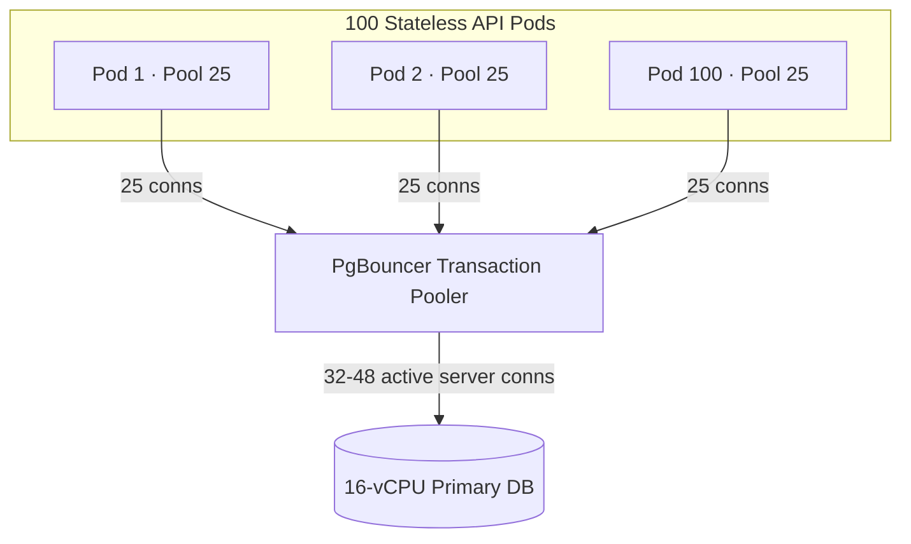

# 18 · Stateless Services, Concurrency & Connection Pools

**Module 03 · Caching & Stateless Compute** | **Slides:** [18 · Stateless Concurrency](../slides/18-stateless-concurrency.md)

---

## 1. The Problem

Your team prepares for a big launch by autoscaling your stateless API service from **10 pods to 120 pods** behind a load balancer. Each pod boots with a default HikariCP / SQLAlchemy connection pool of **30 DB connections**.

The moment traffic rises, `120 × 30 = 3,600` connections slam your 16-vCPU PostgreSQL primary (`max_connections = 500`). Three thousand connections immediately fail with `FATAL: sorry, too many clients already`. You bump `max_connections = 4000`—and now PostgreSQL slows to a crawl from **context switching and spinlock contention**, dropping throughput by **4×** while users get randomly logged out whenever autoscaling replaces a pod that stored sessions in local RAM!

Scaling stateless compute is easy **only** when state is externalized *and* downstream connection concurrency is bounded.

---

## 2. Mental Model

Picture a busy restaurant with **waiters (API pods)** and **16 stoves (Database CPU cores)**:

- **Stateful vs Stateless Waiters:** If Waiter #3 remembers your order only in their head (local server RAM), Waiter #4 cannot help you when Waiter #3 goes on break (autoscaling/deploy). Write orders onto a **shared kitchen ticket board (Redis / Signed Cookie / DB)** so *any* waiter can serve *any* table (**Stateless Compute**).
- **Thread-per-Request vs Event Loop:**
  - **Thread-per-Request:** Hire 500 waiters who each stand idle at the kitchen window waiting 40 ms for a steak to grill (`blocking I/O`). Easy to write, but 500 waiters eat huge memory (`~1–2 MB` stack per OS thread) and spend half their time bumping into each other (**OS context switching**).
  - **Non-Blocking Event Loop:** One ultra-fast coordinator (`epoll`/`kqueue`) takes an order, drops it at the kitchen, and immediately helps the next table while the steak grills (`async/await`). Works magically for I/O-bound work—**until one CPU-heavy calculation (bcrypt hashing or 50 MB JSON parsing) freezes the single coordinator for everyone!**
- **Connection Pooler (`PgBouncer`):** Even if 200 waiters take orders, only **32 dishes** can cook efficiently on 16 stoves at once. A pooler queues waiting transactions cleanly in memory instead of building 2,000 extra stoves.

> **Stateless Service:** A compute process that stores zero durable or session-affinity state in local RAM/disk between requests; any healthy replica can handle any request identically.

---

## 3. How It Works Under the Hood

### Part A · Externalizing Session State
- **Server-Side Session Store (Redis):** Client holds an opaque random `session_id` cookie (`128+ bits`). API validates it against Redis (`~0.8 ms`). Supports **instant server-side revocation** (logout all devices, ban compromised account), at the cost of 1 Redis hop per authenticated request.
- **Stateless Signed/Encrypted Token (JWT):** Payload (`user_id`, `role`, `exp`) signed with HMAC/EdDSA. Zero Redis lookups on validation—**but cannot be revoked before `exp`** without keeping a revocation list (which brings state back!). Best kept short-lived (`5–15 min` access token + revocable refresh token in Redis/DB).

### Part B · Connection Pool Exhaustion & PgBouncer Multiplexing
Every PostgreSQL backend connection forks/runs a separate OS process (`~5–10 MB` RAM each plus shared snapshot/lock array overhead). When `active_connections >> CPU_cores`:
1. OS scheduler thrashes context-switching across hundreds of runnable processes.
2. CPU caches (L1/L2) flush constantly.
3. Internal lightweight locks (`ProcArrayLock`, buffer locks) serialize all cores.

*Diagram: `connection-pool-exhaustion` — collapsing 2,500 idle client connections into ~32 active DB backends via PgBouncer.*

**Why Transaction Pooling Works:** Most API connections sit **idle 90% of the time** between HTTP requests or while waiting on app logic. In PgBouncer **transaction mode**, a client holds a real DB backend connection *only* during `BEGIN ... COMMIT` (e.g., `5 ms`), then returns it to the pool immediately for another pod to reuse! *(Caveat: session-level features like `PREPARE` statements or `LISTEN/NOTIFY` require care or `max_prepared_statements` support in modern PgBouncer.)*

### Part C · The HikariCP Pool Sizing Formula
For an SSD-backed database with `N` physical/vCPU cores, optimal *active* concurrent connections are shockingly small:
`connections ≈ (core_count × 2) + effective_spindle_count`
On a **16-core SSD primary** (`effective_spindle_count ≈ 1` or small I/O queue factor), peak throughput usually occurs around **`32–64` active connections**—*not* 2,000!

---

## 4. Worked Example & Interactive Visualization

> **Interactive Visual:** `anim-thread-vs-eventloop` — Inject slow 80 ms DB queries vs 20 ms CPU JSON parsing into a **Thread-Per-Request Pool** and a **Single-Threaded Event Loop** to see thread starvation vs event-loop blocking.

Let's size concurrency and DB pools for **10,000 QPS** across **80 stateless API pods**:

1. **Pod Concurrency (Little's Law `L = λW`):**
   - Each pod handles `10,000 ÷ 80 = 125 QPS`.
   - Average request latency `W = 40 ms` (`0.04s`, comprising `5 ms` CPU/JSON + `35 ms` waiting on Redis/DB I/O).
   - Average in-flight requests per pod: `L = 125 × 0.04 = 5` concurrent requests (`~15–25` at 3–5× burst).
   - **Thread-per-request** (e.g., Java/Python WSGI) needs ~30–50 threads per pod (`~60 MB` stack RAM); **Event loop** (Node/Go goroutines/Rust Tokio) handles 125 QPS effortlessly on 1–2 cores as long as CPU work stays `< 5 ms` per request.
2. **Database Connection Math:**
   - Each request spends **8 ms** (`0.008s`) inside a PostgreSQL transaction.
   - Total active DB connections needed cluster-wide at average `10,000 QPS`:
     `L_db = 10,000 × 0.008 = 80` active connections (`~40–50` if queries average `4 ms`, or split across 1 Primary + 1 Read Replica!).
   - Without PgBouncer: `80 pods × 20 min-pool = 1,600` idle+active Postgres backends (`~12.8 GiB` wasted connection RAM + severe context-switch overhead).
   - **With PgBouncer (Transaction Mode):** 80 pods connect freely (`max_client_conn = 5000`), while PgBouncer caps **`default_pool_size = 40`** to the Primary (`16 vCPU`) and **`40`** to the Read Replica.

---

## 5. Trade-Offs & Failure Modes

| Choice | Benefit | Cost / Risk | Fails When |
|---|---|---|---|
| **Redis External Sessions** | Instant revocation/logout; tiny cookie size (`32 B`) | Adds `~1 ms` network dependency to every auth call | Redis outage logs everyone out unless backed by DB fallback |
| **Stateless JWT Access Tokens** | Zero DB/Redis read on verification; scales across edge PoPs | Cannot revoke immediately before `exp` without a deny-list | Long-lived `exp` (`30 days`) leaks -> stolen tokens stay valid |
| **Thread-Per-Request** | Simple blocking code; single slow CPU call only hurts 1 thread | High RAM per thread; pool exhaustion under slow downstream I/O | Downstream API hangs for 10s -> all worker threads stall |
| **Async Event Loop** | Huge I/O concurrency (`10k+` open sockets) in minimal RAM | One synchronous CPU loop or blocking driver stalls *all* requests | Developer runs `bcrypt` or large `JSON.parse` synchronously on main loop |
| **PgBouncer Transaction Pooling** | Multiplexes 5,000 pod sockets onto 40 DB backends cleanly | Breaks session-scoped state (`SET LOCAL` ok, session `SET`/temp tables unsafe) | Legacy ORM relies on session-level temp tables or advisory locks |

### What changes at 10× and 100× scale?
- **1× (10 pods):** Direct app pool (`5–10` connections/pod = `50–100` total) needs no PgBouncer yet.
- **10× (80–200 pods):** Connection explosion forces **PgBouncer** in transaction mode + strict **pool acquire timeouts** (`200 ms` fail-fast instead of queuing unboundedly).
- **100× (1,000+ pods):** Even PgBouncer hits single-instance socket limits; deploy PgBouncer as a **sidecar or per-AZ tier**, isolate heavy CPU tasks (`PDF/image resize`, `bcrypt`) into separate worker pools, and enforce **read replicas / sharding** (Module 04) before the single primary DB CPU saturates.

---

## 6. Practical Exercise

You have now completed **Module 00 through Module 03**! Apply everything from Lessons 01–18 in **[Case Study 01 · URL Shortener](../case-studies/01-url-shortener.md)**:
- Produce capacity estimates (`QPS`, storage, bandwidth).
- Choose data models & composite/covering indexes for links and analytics.
- Design the Cache-Aside + Singleflight + Hot-Key strategy for `GET /{code}`.
- Size the stateless Redirect API pods and PgBouncer connection pool for `10,000` peak redirects/sec.

---

## 7. Retrieval Practice

1. Why does increasing PostgreSQL `max_connections` from `200` to `4,000` usually make overload **worse** instead of better?
2. How does **PgBouncer transaction pooling** allow 200 API pods to share 40 PostgreSQL connections safely?
3. Why does a single 200 ms synchronous `bcrypt` password hash freeze thousands of unrelated `GET /health` requests on a Node.js event loop, whereas a 32-thread Go/Java pool handles it better?
4. When building stateless authentication, how do you get both **fast stateless verification** and **prompt user revocation**?

Hints

1. Each Postgres connection spawns an OS backend process (`~5–10 MB` RAM) and competes for CPU cores, cache lines, and `ProcArray` snapshot locks; 4,000 active backends spend most CPU time context-switching instead of executing queries.
2. Client connections hold a server backend *only* for the `2–10 ms` duration of an active SQL transaction (`BEGIN ... COMMIT`), then immediately release it back to PgBouncer while idle between HTTP calls.
3. A single-threaded event loop cannot preempt a synchronous CPU-bound function; all other queued I/O callbacks wait behind that 200 ms CPU stall. Offload heavy CPU work to a separate worker thread pool.
4. Issue short-lived stateless JWT access tokens (`5–15 min` TTL) paired with opaque revocable refresh tokens stored in Redis/Postgres.

---

## Primary Sources

- [HikariCP Wiki · About Pool Sizing](https://github.com/brettwooldridge/HikariCP/wiki/About-Pool-Sizing) — Classic breakdown of CPU cores, disk queues, context switching, and `(cores * 2) + spindles`.
- [PgBouncer Documentation · Pooling Modes](https://www.pgbouncer.org/features.html) — Official documentation comparing Session, Transaction, and Statement pooling modes.
- [The Twelve-Factor App · VI. Processes](https://12factor.net/processes) — Foundational principles for stateless, share-nothing compute processes.
- [PostgreSQL Docs · `max_connections` & Resource Consumption](https://www.postgresql.org/docs/current/runtime-config-connection.html) — Official connection tuning guidance.

---

## Next

Proceed to Stage 1 Project **[Case Study 01 · URL Shortener](../case-studies/01-url-shortener.md)**, then continue to Module 04: [19 · Data Replication Strategies & Replication Lag](19-replication.md).
