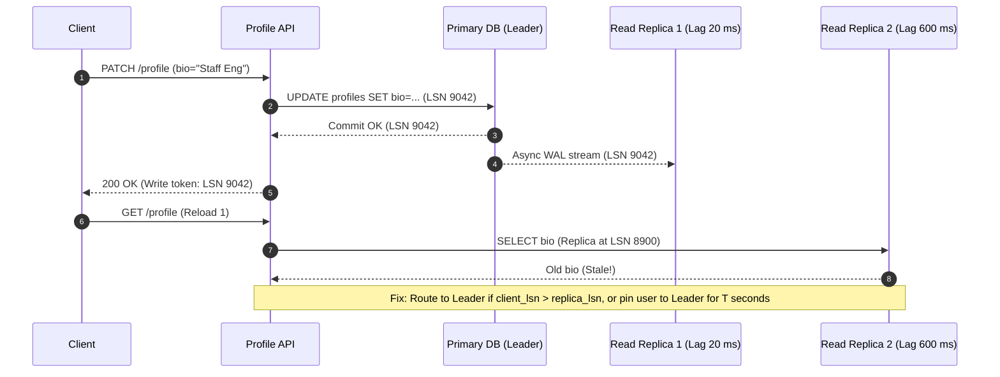

# 19 · Data Replication Strategies & Replication Lag

**Level:** Intermediate → Advanced · **Status:** Draft · **Module:** 04 · Scaling Data: Replication & Sharding

## Learning objectives
- Contrast single-leader, multi-leader, and leaderless replication topologies.
- Explain why synchronous replication trades write latency and availability for zero data loss (`RPO = 0`).
- Prevent read-your-own-writes, monotonic read, and consistent-prefix anomalies caused by replication lag.
- Estimate WAL shipping bandwidth and failover recovery windows with explicit units.

---

## 1. The Problem: Why did my saved profile disappear?

Suppose you operate a developer Q&A site with **18,000 reads/s** and **450 writes/s**. A single PostgreSQL server handles the `450 writes/s` easily, but `18,000 reads/s` saturates its CPU and NVMe IOPS. You add three read replicas behind a round-robin read pool.

Ten minutes later, support tickets arrive: a user updates their account bio, sees `HTTP 200 OK`, refreshes the page, and sees their *old* bio. They refresh again and see the *new* bio. A third refresh shows the *old* bio again. Nothing crashed—yet the product feels broken.

Replication solves three different problems—**read scaling**, **high availability (failover)**, and **geographic proximity**—and introduces a subtle fourth problem: **replicas are not guaranteed to agree at the exact same millisecond**.

---

## 2. Mental Model: One editor, many printing presses

Think of **single-leader replication** like a newspaper:
1. All breaking edits go to **one managing editor (the Leader / Primary)**.
2. The editor writes every approved change in sequence into an append-only ledger (**Write-Ahead Log, or WAL**).
3. **Printing presses (Followers / Read Replicas)** subscribe to that ledger stream and apply each edit in the exact same order.

Now imagine three delivery modes:
- **Asynchronous replication:** The editor publishes immediately after saving locally and ships copies on a truck. Fast for the editor, but a reader visiting a distant newsstand (`Replica B`) might read yesterday's edition (**replication lag**). If the editor's office burns down before the truck leaves, recent edits are lost (**non-zero RPO**).
- **Synchronous replication:** The editor holds every press release until *all* presses confirm receipt. Readers never see stale news, but if a single press goes offline or suffers a `120 ms` WAN spike, the editor stalls for everyone.
- **Semi-synchronous replication:** The editor waits for **at least one** healthy follower to flush the WAL entry to disk before acknowledging the client, while remaining followers replicate asynchronously. This bounds data loss (`RPO = 0` for single-node failure) without letting one dead follower halt writes.

Key terms:
- **Replication lag:** The time or byte/LSN offset between a commit on the leader and its application on a follower.
- **RPO (Recovery Point Objective):** Maximum acceptable data loss measured in time or transactions after an unplanned failure.
- **RTO (Recovery Time Objective):** Maximum acceptable downtime until service recovers after failure.
- **LSN (Log Sequence Number):** Monotonic byte offset in a database WAL identifying an exact point in commit history.

---

## 3. How It Works Under the Hood

### Topology 1: Single-Leader Replication & Lag Anomalies

In single-leader replication (PostgreSQL streaming replication, MySQL binlog, MongoDB replica sets), all writes hit the **Leader**. Reads scale horizontally across **Followers**.

When replication is asynchronous, two classic anomalies emerge:
1. **Read-Your-Own-Writes (RYOW) Violation:** A user writes `bio = "Staff Eng"` to the Leader and immediately refreshes; the load balancer sends the `GET` to Replica 1, which lags by `250 ms` and returns the old bio.
2. **Monotonic Read Violation (Time Travel):** The user's first `GET` hits Replica 1 (lag `10 ms`, sees new bio). Their second `GET` hits Replica 2 (lag `600 ms`, sees old bio). Time appears to run backward.

**Three production fixes for RYOW and monotonic reads:**
- **Pin mutable-owner reads to the Leader:** Route reads of *your own* editable resources (profile, checkout cart, newly posted comment) to the Leader, or route *all* reads for a user to the Leader for `T = 5 s` after they perform a write (stored in a short-lived cookie/Redis flag).
- **Monotonic LSN / version tokens:** On write commit, return `min_lsn = 9042` in a session cookie. On subsequent reads, either route to a replica with `replayed_lsn >= 9042` (or wait up to `50 ms`), falling back to the Leader if no replica has caught up.
- **Consistent-hashing session affinity:** Pin a given `user_id` to the same healthy replica so they never bounce from a fresh replica to a lagging one (fixes monotonic reads, though not RYOW unless combined with leader routing).

### Topology 2: Multi-Leader Replication

Every region has its own Leader accepting local writes at `10–25 ms` p95, and leaders asynchronously ship changes to each other.
- **Why use it:** Multi-region write latency (`20 ms` local vs `150 ms` cross-ocean) and tolerance of entire-region outages.
- **Hard problem:** **Write conflicts.** Two users edit the same row in `us-east` and `eu-west` concurrently before replication arrives.
- **Conflict resolution options:**
  - **Last-Write-Wins (LWW):** Attach a timestamp and drop the older write. *Dangerous:* NTP clock skew silently drops valid updates.
  - **Conflict-Free Replicated Data Types (CRDTs):** Counters, sets, or registers with mathematically associative/commutative merge functions.
  - **Custom merge / application resolution:** Store both sibling versions and merge on read or surface a conflict UI (e.g., collaborative docs, Dynamo-style shopping carts).

### Topology 3: Leaderless Replication (Dynamo-Style)

Clients (or a coordinator node) send writes directly to `W` out of `N` replicas and reads to `R` out of `N` replicas, with no single leader. If `R + W > N`, read and write quorums overlap on at least one up-to-date node (covered deeply in Module 06). Divergence is healed via **read repair** on read and **anti-entropy Merkle trees** in the background.

---

## 4. Worked Example & Interactive Visualization

Let's size replication bandwidth and failover risk for our Q&A platform:

**Baseline workload:**
- Peak writes: `1,200 writes/s` (3× burst over `400/s` avg)
- Average row mutation + WAL header + index updates: `1,800 bytes/write`
- Replication factor: `1` Leader + `3` Read Replicas (`1` semi-sync in another AZ, `2` async)
- Intra-region AZ round-trip (`RTT`): `1.2 ms` (`p99` `4 ms`); Cross-region DR replica RTT: `75 ms`

**Calculations:**
1. **WAL generation rate:**
   `1,200 writes/s × 1,800 bytes = 2,160,000 bytes/s ≈ 2.16 MB/s` (`~17.3 Mbps`).
2. **Leader outbound replication egress (to 3 replicas):**
   `3 × 2.16 MB/s = 6.48 MB/s` (`~51.8 Mbps`). Under a bulk backfill or index rebuild generating `80 MB/s` of WAL, outbound NIC egress hits `240 MB/s` (`1.92 Gbps`), enough to saturate a `1 Gbps` link and cause artificial lag spikes.
3. **Sync vs. Semi-sync write latency impact:**
   - Async commit: `~1.5 ms` local NVMe `fsync` (`p95 ~3 ms`).
   - Semi-sync intra-AZ (`1.2 ms` RTT + `1.5 ms` follower WAL flush): `~2.7 ms` (`p95 ~6 ms`).
   - Sync cross-region (`75 ms` RTT): `~76.5 ms` minimum per write—raising write `p95` by `> 25×`!
4. **Data loss bound (`RPO`) under failure:**
   If the async cross-region replica lags by `400 ms` during a burst, an ungraceful primary region crash loses up to `1,200 × 0.4 = 480` committed writes.

**Interactive Visualization (`anim-replication-lag`):**
In the accompanying slide deck and web interactive (`anim-replication-lag`), toggle between **Async**, **Semi-Sync**, and **LSN-Pinned Read Routing** to watch write LSNs propagate down the WAL pipeline and see the exact millisecond window where stale reads occur when a replica falls behind.

---

## 5. Trade-Offs & Failure Modes

| Choice | Benefit | Cost / Risk | Fails When |
|---|---|---|---|
| **Single-Leader Async** | Fast writes (`1–3 ms`), simple serializable order, easy read scaling | Replication lag causes stale reads; data loss (`RPO > 0`) on leader crash | Financial ledgers or auth tokens requiring zero lost commits |
| **Single-Leader Semi-Sync** | `RPO = 0` across 1-node/1-AZ failure; bounded tail impact (`+2–5 ms`) | If all sync followers die, leader either stalls writes or degrades to async | Cross-region WAN RTT (`70–150 ms`) makes sync commit too slow |
| **Multi-Leader** | Low local write latency across regions; survives region isolation | Write-write conflicts, LWW silent data loss, complex uniqueness checks | Strict global uniqueness (usernames, inventory counts) without coordination |
| **Leaderless (`N, R, W`)** | High write availability; no single failover pause (`RTO ~0` for writes) | Stale reads if `R+W <= N`; sibling reconciliation; no multi-key ACID transactions | Relational joins, foreign keys, and strict serial transactions |

### Failure Modes to Watch
- **Split-brain after network partition:** If an old leader is partitioned rather than dead and keeps accepting writes while a follower is promoted, you have two leaders diverging silently. *Mitigation:* Fencing tokens, quorum-based promotion (Patroni + etcd/Raft), and `STONITH` / storage-level lease fencing.
- **Replication lag feedback loop:** A slow analytics query on Replica 2 holds an MVCC snapshot or disk I/O busy, causing WAL replay to fall behind by 30 seconds; health checks mark Replica 2 unhealthy and dump all read traffic onto Replica 1, cascading the outage. *Mitigation:* Separate OLAP/reporting replicas from user-facing OLTP replicas and enforce `max_standby_streaming_delay` / query timeouts.

### What changes at 10× and 100× scale?
- **At 10× (`12,000 writes/s`, `~21.6 MB/s` WAL):** Outbound leader WAL fan-out to 10 replicas reaches `216 MB/s` (`~1.7 Gbps`). You switch from direct star-topology WAL shipping to **cascading replication** (Leader → 2 relay replicas → leaf replicas) or shared distributed storage (e.g., Aurora/Neon page-log separation).
- **At 100× (`120,000 writes/s`, `~216 MB/s` WAL):** A single leader's CPU, locks, and disk `fsync` saturate regardless of how many read replicas you add. **Replication no longer scales writes—you must partition (shard) the dataset**, which is the focus of the next lesson.

---

## 6. Practical Exercise

Pick a Postgres or MySQL application you know (or sketch an e-commerce checkout + order-history service):
1. Classify **5 read endpoints** into: *Requires Linearizable/Leader Read*, *Requires Read-Your-Own-Writes*, or *Tolerates `1–5 s` Eventual Consistency*.
2. Design a `write_lsn` cookie or Redis `last_write_ts` guard for the RYOW endpoints and trace what happens when all 3 replicas lag by `2 seconds`.
3. Calculate the WAL network egress (`MB/s` and `Mbps`) if peak write throughput is `3,500 writes/s` at `2.5 KB` WAL per write across `4` replicas.

---

## 7. Retrieval Practice & Primary Sources

1. Why does adding 10 read replicas fail to increase write throughput in a single-leader system?
2. Give a concrete scenario where **monotonic reads** are violated even when a user never writes anything.
3. Why is **semi-synchronous** replication to 1 intra-AZ follower preferred over full synchronous replication to 3 followers?
4. What happens to **read-your-own-writes** guarantees during a failover where the new leader was lagging by `500 ms` asynchronously?

Hints

1. Every write still executes on the single Leader, and every replica must replay all `100%` of the write WAL stream too—replicas only offload reads.
2. User makes two consecutive `GET` requests: Request 1 hits a replica with `10 ms` lag (sees a new comment); Request 2 hits a replica with `5 s` lag (comment vanishes).
3. Full sync halts all writes if *any* 1 of the 3 followers hangs or reboots. Semi-sync needs only 1 healthy ack, preserving `RPO = 0` while tolerating `N - 1` slow/dead followers.
4. Any writes acknowledged on the old leader in the last `500 ms` that didn't reach the promoted follower are lost (unless the old leader rejoins and conflicts are reconciled/discarded).

### Primary Sources
- **Book (paid/not free full-text):** Martin Kleppmann, *Designing Data-Intensive Applications*, Chapter 5: Replication ([dataintensive.net](https://dataintensive.net/)).
- **Official Docs:** [PostgreSQL Documentation · High Availability, Load Balancing, and Replication](https://www.postgresql.org/docs/current/high-availability.html) (streaming replication, synchronous commit levels, replication slots).
- **Research Paper:** Diego Ongaro & John Ousterhout, *In Search of an Understandable Consensus Algorithm (Raft)* ([raft.github.io/raft.pdf](https://raft.github.io/raft.pdf)) — how replicated logs elect a single leader safely without split-brain.
- **Engineering Blog:** [GitHub Engineering · MySQL High Availability (Orchestrator & Semi-Sync)](https://github.blog/engineering/) — automated failover and replication lag protection in production.

---

## Next
Continue to [20 · Partitioning, Sharding & Consistent Hashing](20-sharding-hashing.md).
