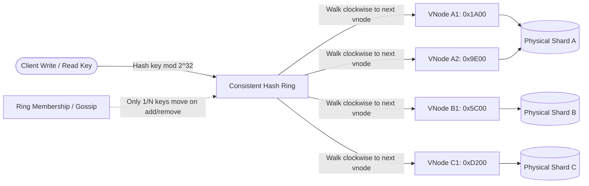

# 20 · Partitioning, Sharding & Consistent Hashing

**Level:** Intermediate → Advanced · **Status:** Draft · **Module:** 04 · Scaling Data: Replication & Sharding

## Learning objectives
- Identify write-throughput, storage-footprint, and index-working-set limits that force horizontal sharding.
- Compare range partitioning, modulo hash partitioning, directory routing, and consistent hashing.
- Explain how **virtual nodes (`vnodes`)** eliminate ring imbalance and preserve `~1/N` key movement on scaling.
- Evaluate global vs. local secondary indexes and cross-shard scatter-gather latency.

---

## 1. The Problem: When one primary database hits a wall

Your multi-tenant telemetry SaaS now stores **14 TB** of active data and processes **65,000 writes/s**. You already added read replicas in Lesson 19, yet write latency (`p99`) just climbed from `12 ms` to `420 ms`:
- Every replica must still execute all `65,000 writes/s`, so read replicas don't scale writes.
- The B+Tree indexes (`2.2 TB`) no longer fit in the largest cloud instance's RAM (`512 GiB`), causing constant NVMe page thrashing on every insert.
- Restoring a `14 TB` snapshot during disaster recovery takes **6+ hours**, violating your `15-minute` RTO.

To scale writes, working-set RAM, and recovery speed, you must split the dataset into independent slices—**partitions (shards)**—so each machine owns only a fraction of the keys.

---

## 2. Mental Model: Splitting the library by call number vs. hash

Imagine a library with **10 million books** that no longer fits inside one building:
- **Range partitioning** puts `A–C` in Building 1, `D–F` in Building 2, and so on. Finding all authors starting with `Sm` is fast (visit Building 7), *unless* 40% of new books start with `S`, overloading Building 7.
- **Modulo hash partitioning** computes `hash(book_id) % 8` and sends each book to Building `0..7`. All 8 buildings stay balanced, *but* the day you open Building 9, `hash(book_id) % 9` forces you to move **nearly 89% of all 10 million books** to new buildings!
- **Consistent hashing** arranges buildings on a circular clock (`0` to `2^32 - 1`). Each book hashes onto the clock and walks clockwise to the first building it meets. When Building 9 joins the clock, it only steals books from the single neighbor slice directly behind it—roughly **1/9 (`11.1%`)** of the library.

Key terms:
- **Partition / Shard:** A self-contained subset of data (often replicated itself across 1 leader + 2 followers for durability).
- **Shard Key (Partition Key):** The attribute(s) used to route a record to its owning shard.
- **Consistent Hashing:** A ring-based partitioning scheme that remaps only `~K/N` keys when adding or removing one of `N` nodes (for `K` total keys).
- **Virtual Nodes (`vnodes`):** Multiple tokens per physical node scattered around the hash ring so load stays balanced even with few physical machines or heterogeneous hardware.
- **Scatter-Gather:** A query without a shard key that fans out to *every* shard and merges the results in a coordinator.

---

## 3. How It Works Under the Hood

### Comparing Partitioning Schemes

1. **Range Partitioning:**
   - Keys sorted lexicographically; contiguous `[min_key, max_key)` intervals assigned to shards (used by HBase, CockroachDB, Spanner, Vitess).
   - **Pro:** Fast range scans (`WHERE user_id = 42 AND ts BETWEEN t1 AND t2`).
   - **Con:** Monotonic keys (`created_at`, auto-increment `id`) send 100% of new writes to the rightmost shard.

2. **Hash + Directory Lookup:**
   - A routing table in etcd/ZooKeeper or a config DB maps `hash_bucket -> shard_id` (or `tenant_id -> shard_id`).
   - **Pro:** Arbitrary placement (can pin huge enterprise tenants to dedicated shards).
   - **Con:** Every request depends on a cached routing map (stale map = misrouted read/write).

3. **Consistent Hashing with Virtual Nodes (`vnodes`):**
   - Hash space `[0, 2^32 - 1]` wraps around as a ring.
   - Each physical shard `S` registers `V` tokens (e.g., `V = 150`) via `hash("shardA#0") .. hash("shardA#149")`.
   - To locate `key`, compute `pos = hash(key)` and binary-search the sorted token array (`O(log(N × V))`) for the first token `>= pos` (wrapping to index `0` past the max token).

*(Source diagram: [consistent-hash-ring.mmd](../diagrams/consistent-hash-ring.mmd))*

**Replication on the Ring:** For replication factor `RF = 3`, walk clockwise from `hash(key)` and select the **first 3 distinct physical nodes** (skipping consecutive vnodes owned by the same physical machine or same availability zone!).

### Secondary Indexes Across Shards

If `orders` is sharded by `order_id`, how do you query `WHERE customer_id = 789`?
- **Local Secondary Index (Document-Partitioned):** Each shard indexes only its own rows. Writes are fast (single-shard), *but* `WHERE customer_id = 789` must **scatter-gather** to all `N` shards. Tail latency becomes `max(shard_1..shard_N)`.
- **Global Secondary Index (Term-Partitioned):** The index `customer_id -> order_ids` is *itself* sharded by `customer_id`. Reads hit a single index shard, *but* writes must update both the base shard and the remote index shard asynchronously (eventual consistency) or via distributed transactions.

---

## 4. Worked Example & Interactive Visualization

Let's quantify the math of **modulo hashing vs. consistent hashing** and **scatter-gather tail amplification** on a distributed cache/KV cluster:

**Setup:**
- Total keys: `K = 10,000,000` objects × `4 KB` avg = `40 GB` (decimal)
- Cluster size scales from `N = 8` shards to `N = 9` shards
- Per-shard read `p99` latency: `4 ms`

**1. Key movement during scale-out (`8 -> 9` shards):**
- **Naive `hash(key) % N`:** A key stays on the same shard only when `h % 8 == h % 9`, which happens for `1 / lcm(8,9) = 1/72`... wait, more simply for keys `< 72` and aligned residues—empirically `~1 / 9 = 11.1%` stay and **`8 / 9 = 88.9%` (~8.89 million keys, `35.6 GB`) move!**
- **Consistent Hashing:** The 9th shard takes `1/9` of the ring arc across its vnodes: **`~11.1%` (~1.11 million keys, `4.44 GB`) move.** That is an **8× reduction** in cache misses and network copy traffic.

**2. Virtual nodes (`vnodes`) metadata & skew:**
- At `V = 1` vnode/node across `8` nodes, worst-case shard imbalance routinely exceeds `2.5×–4×` the mean (`12.5%`).
- At `V = 150` vnodes/node (`8 × 150 = 1,200` ring entries), key distribution standard deviation drops below `~8%`, and storing `1,200 × 16 bytes` takes `< 20 KB` of router RAM—binary search takes `< 0.5 µs`.

**3. Scatter-gather `p99` penalty at `32` shards:**
- Single-shard query `p99`: `4 ms`.
- If a query lacks a shard key and fans out in parallel to all `32` shards (`p = 0.01` chance each shard hits its `p99` or slower), the probability that *at least one* shard is slow is:
  `1 - (1 - 0.01)^32 = 1 - 0.725 = 27.5%`! Over a quarter of scatter-gather queries now suffer `p99+` tail latency.

**Interactive Simulation (`sim-consistent-hashing`):**
Use the `sim-consistent-hashing` widget in the slides to add/remove shards and sweep `vnodes` from `1` to `100` while watching ring arc variance and exact `% keys remapped` update live.

---

## 5. Trade-Offs & Failure Modes

| Choice | Benefit | Cost / Risk | Fails When |
|---|---|---|---|
| **Hash / Consistent Hash Sharding** | Near-uniform write distribution; `~1/N` rebalance churn | No efficient cross-key range scans; scatter-gather on non-shard-key predicates | Workloads needing `ORDER BY created_at` across many tenants |
| **Range Sharding** | Fast range queries and prefix scans (`BETWEEN`) | Monotonic keys create hot write shards; manual/auto split complexity | High-ingest time-series without composite/salted prefix |
| **Directory / Lookup Routing** | Total flexibility (move single tenants, handle custom tiers) | Extra network hop or stale routing cache; directory service is critical SPOF | Extreme ultra-low-latency KV (`< 1 ms`) with millions of dynamic keys |
| **Consistent Hash (`vnodes = 150`)** | Low skew (`< 10%`) + easy heterogeneous node weighting | Larger ring gossip state; replication must skip duplicate physical nodes | Clusters with `10,000+` nodes (where `10k × 150 = 1.5M` tokens bloat gossip; use **Rendezvous / Jump Consistent Hash** or fixed slot tables like Redis `16,384` slots) |

### What changes at 10× and 100× scale?
- **At 10× (`650k writes/s`, `140 TB` across `64–128` shards):** Cross-shard joins and 2-phase commit (`2PC`) distributed transactions become huge availability hazards. You denormalize data along the shard key (e.g., shard both `orders` and `order_items` by `merchant_id`) so core transactions remain **single-shard ACID**.
- **At 100× (`6.5M writes/s`, `1.4 PB` across `1,000+` shards):** `N × 150` vnodes (`150,000+` ring entries) slows gossip convergence and risks split views of the ring. Large systems switch to **fixed logical partitions (virtual buckets)**—for example, `4,096` or `16,384` fixed hash slots mapped via a compact cluster slot table (Redis Cluster, Cassandra tokens, DynamoDB partitions)—decoupling logical hashing from physical machine count.

---

## 6. Practical Exercise

Complete **[Lab 07 · Consistent Hashing Ring & Virtual Node Skew](../labs/07-consistent-hashing.md)**:
- Implement both `hash(key) % N` and a 32-bit Consistent Hash Ring in Python or Go for `1,000,000` keys across `8` shards.
- Benchmark `vnodes = 1`, `10`, and `150` and verify that scaling `8 -> 9` shards moves `~88.9%` under modulo hashing vs `~11.1%` under consistent hashing.

---

## 7. Retrieval Practice & Primary Sources

1. Why does `hash(key) % N` cause a cache stampede during cluster scale-out, and why does consistent hashing avoid it?
2. What problem do virtual nodes (`vnodes`) solve, and what new bug can occur if a replica placement loop forgets to check physical host identity?
3. When should you pick a **Global Secondary Index** over a **Local Secondary Index**, and what consistency trade-off do you accept?
4. Why does a system with 1,000 physical shards often prefer **fixed hash slots** (like `16,384` slots) over `150` random vnodes per node?

Hints

1. Modulo remaps `~(N-1)/N` (`89%` at `N=8->9`) of keys simultaneously, flooding the origin DB with cache misses. Consistent hashing only moves `~1/N` (`~11%`) adjacent to new tokens.
2. `vnodes` reduce uneven load skew across few physical nodes and support weighted node sizes. Bug: walking clockwise might place 2 replicas on 2 vnodes belonging to the *same* physical server, destroying fault tolerance.
3. Choose Global when query predicates don't contain the primary shard key and scatter-gather across all shards is too slow/expensive; you accept async index lag (or costly distributed writes).
4. Fixed slots keep routing metadata `O(slots)` (`16,384` entries) regardless of node count, simplify atomic slot migration between nodes, and avoid gossiping hundreds of thousands of dynamic vnode tokens.

### Primary Sources
- **Research Paper:** Giuseppe DeCandia et al., *Dynamo: Amazon's Highly Available Key-Value Store* (SOSP 2007) ([PDF](https://www.allthingsdistributed.com/files/amazon-dynamo-sosp2007.pdf)) — consistent hashing, virtual nodes, and Dynamo's shift from random tokens to fixed equal-sized partitions (`Strategy 3`).
- **Research Paper:** David Karger et al., *Consistent Hashing and Random Trees* (STOC 1997) ([ACM](https://dl.acm.org/doi/10.1145/258533.258660)) — original algorithmic proof of `O(K/N)` key movement.
- **Official Docs:** [Redis Cluster Specification · Hash Slots](https://redis.io/docs/latest/operate/oss_and_stack/reference/cluster-spec/) — why `CRC16(key) % 16384` fixed slots beat dynamic ring tokens in Redis.
- **Book (paid/not free full-text):** Martin Kleppmann, *Designing Data-Intensive Applications*, Chapter 6: Partitioning ([dataintensive.net](https://dataintensive.net/)).

---

## Next
Continue to [21 · Hot Partitions, Rebalancing & Zero-Downtime Migrations](21-hot-shards-migrations.md).
