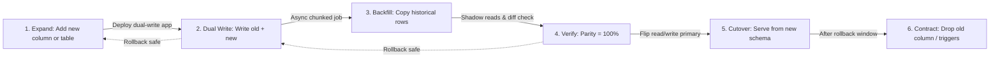

# 21 · Hot Partitions, Rebalancing & Zero-Downtime Migrations

**Level:** Intermediate → Advanced · **Status:** Draft · **Module:** 04 · Scaling Data: Replication & Sharding

## Learning objectives
- Break apart single-key hotspots using **key salting** and selective hot-key directories.
- Rebalance partitions online without starving foreground user traffic.
- Execute **Expand-Contract + Dual-Write + Shadow-Read** migrations with zero downtime and instant rollback.
- Guard against backfill race conditions where older historical rows overwrite newer live writes.

---

## 1. The Problem: One celebrity breaks a 64-shard cluster

You partitioned your social-commerce platform across **64 shards** by `creator_id`. Average cluster load is a calm 15% CPU. Then a celebrity creator launches a flash sneaker drop: `creator_99` receives **48,000 writes/s** (orders, likes, inventory locks) and **320,000 reads/s**.

Every hash function—even perfect SHA-256 consistent hashing—maps `creator_99` to **one single shard** (`Shard 17`). Shard 17 hits 100% CPU, connection pools back up, and timeouts ripple into shared API workers—while the other 63 shards sit idle at 12% CPU.

A second nightmare strikes six months later: you realize `creator_id` was the wrong shard key for buyer order history, or you must change a `4 TB` table schema without taking a maintenance window. How do you split traffic and re-shard live data without dropping a single order?

---

## 2. Mental Model: Opening 16 checkout lanes for one blockbuster item

Hash partitioning assumes traffic spreads across many keys. When **one key** generates 80% of all traffic:
- **Key Salting (Write Splitting):** Instead of sending every checkout for `creator_99` to lane `creator_99`, attach a random or round-robin suffix `#0` through `#15` (`creator_99#0` ... `creator_99#15`). Now `16` different shards each take `1/16` of the writes. The trade-off? A reader asking *"show all orders for `creator_99`"* must check all `16` lanes and combine the results.
- **Expand-Contract Migration:** Think of replacing a bridge without closing traffic. You don't demolish the old bridge first. You **build the new bridge beside it (Expand)**, send cars onto both (**Dual-Write**), move parked cars across (**Backfill**), check that both sides match (**Shadow Read**), switch drivers to the new bridge (**Cutover**), and only after a safe soak period tear down the old bridge (**Contract**).

Key terms:
- **Hot Partition (Hot Key):** A shard overloaded because a single key or narrow key range receives disproportionate traffic.
- **Key Salting:** Appending a bounded suffix `0..K-1` to a hot partition key to fan writes across `K` partitions.
- **Expand-Contract:** A multi-phase, backward-compatible migration pattern permitting safe online cutover and rollback.
- **Shadow Read (Dark Read):** Reading from both old and new data stores asynchronously or synchronously to verify data parity before cutover.

---

## 3. How It Works Under the Hood

### Mitigating Hot Keys Without Wrecking Cold Keys

Salting *every* key to `K = 16` partitions forces *every* read in your system to do a 16-way scatter-gather! Production systems avoid that penalty in two ways:
1. **Selective (Adaptive) Salting:** Track per-key QPS via a lightweight Count-Min Sketch or rate counter. Normal keys stay unsalted (`creator_104 -> 1 shard`). Only keys marked `hot = true` in a config/directory cache are salted to `0..K-1`.
2. **Read vs. Write Asymmetry:**
   - **Hot reads** (`320k reads/s`): Do *not* salt the DB unless needed; absorb reads in **L1/L2 caches, CDNs, or replicated read-replicas** with singleflight coalescing.
   - **Hot writes** (`48k writes/s` likes/counters/logs): Salt writes into `K` shards (or buffer/aggregate increments in memory/stream for `100 ms` windows before flushing `1` aggregated write per shard).

### Online Shard Splitting & Rebalancing

When a partition grows too large in bytes or IOPS:
1. **Split metadata:** Partition the key range `[0x0000, 0xFFFF)` into `[0x0000, 0x8000)` and `[0x8000, 0xFFFF)`.
2. **Snapshot + CDC catch-up:** Copy a consistent point-in-time snapshot (`LSN_0`) of the upper half to the new shard, then stream WAL/CDC changes from `LSN_0` onward until lag is `< 10 ms`.
3. **Brief atomic routing flip:** Pause or queue writes for that half-range for `10–50 ms`, drain final WAL bytes, atomically update the shard map, and resume traffic.

### Zero-Downtime Expand-Contract + Dual-Write Migration

*(Source diagram: [expand-contract-migration.mmd](../diagrams/expand-contract-migration.mmd))*

**The Backfill Overwrite Race Condition (Critical Bug):**
Suppose at `t = 10:00:01`, the backfill worker reads `row 42 (status = "pending", updated_at = 09:00)` from `old`. At `t = 10:00:02`, a live user updates `row 42` via Dual-Write to `(status = "paid", updated_at = 10:00:02)` in both `old` and `new`. At `t = 10:00:03`, the slow backfill batch writes its stale snapshot `"pending"` into `new`—**silently reverting a paid order!**
- **Fix:** Backfill writes must *never* overwrite newer rows. Use a conditional upsert:
  `ON CONFLICT (id) DO UPDATE SET ... WHERE new.version < EXCLUDED.version` (or `INSERT ... ON CONFLICT DO NOTHING` when rows are immutable, or stream backfill via CDC ordered before/after a fence).

---

## 4. Worked Example & Interactive Visualization

Let's size **hot-key salting** and a **live backfill** for our flash-drop scenario:

**1. Hot-Key Salting Math:**
- Peak writes on `creator_99`: `48,000 writes/s`
- Single PostgreSQL shard sustainable write ceiling (with durability `fsync`): `4,000 writes/s`
- Minimum salt factor `K`: `48,000 ÷ 4,000 = 12` shards. To leave 25% headroom for bursts and replication replay, pick **`K = 16`**.
- **Per-shard load after salting:** `48,000 ÷ 16 = 3,000 writes/s` per shard (safe headroom!).
- **Read cost for `creator_99` dashboard:** Must query `16` buckets (`creator_99#0..#15`) and perform a `16`-way top-K merge sort. Keep `K` as small as possible and apply salting *only* to flagged hot keys.

**2. Zero-Downtime Backfill Math (`300 million rows`, `150 GB` decimal):**
- Live workload: `2,500 writes/s` + `12,000 reads/s`.
- Suppose the cluster can absorb an extra `15,000 rows/s` of throttled backfill writes without pushing user `p95` latency above `25 ms` or replica lag above `200 ms`.
- **Backfill rate:** Batch size `1,500 rows` every `100 ms` = `15,000 rows/s`.
- **Total backfill duration:** `300,000,000 ÷ 15,000 = 20,000 seconds ≈ 5.56 hours`.
- **Why throttle?** Running unthrottled (`150,000 rows/s`) saturates WAL shipping, spikes replica lag to minutes, and triggers cascading read timeouts across production traffic.

**Interactive Visualization (`anim-key-salting`):**
In the accompanying deck (`anim-key-salting`), toggle **Key Salting (`K = 1` vs `K = 8` vs `K = 16`)** on a skewed Zipf workload to see Shard 17's saturated red load bar flatten evenly across `K` partitions—and observe the trade-off in read fan-out count.

---

## 5. Trade-Offs & Failure Modes

| Choice | Benefit | Cost / Risk | Fails When |
|---|---|---|---|
| **Uniform Key Salting (`K = 16` all keys)** | Zero hotspot detection logic needed; simple hash function | `16×` read amplification for *every* user, ruining read `p99` | Read-heavy products with millions of normal cold keys |
| **Adaptive / Directory Salting** | Cold keys read in `1` hop; hot keys split across `K` shards | Requires hot-key detector + config propagation; existing unsalted rows stay on old shard until merged | Sudden `0 -> 50k writes/s` spike faster than detector TTL (`> 5 s`) |
| **Synchronous Dual-Write in App** | Easy to code; immediate `v2` freshness | Doubles write latency (`p99` of both stores); **partial failure split** if `v1` commits and `v2` times out | Cross-DB writes without distributed transactions or retry reconciliation |
| **CDC-Driven Migration (Outbox / Debezium)** | Zero extra latency on user write path; ordered WAL capture | Operational overhead of CDC connectors; still requires historical snapshot + parity verifier | Teams lacking WAL/CDC infra or needing instant cross-schema validation |

### What changes at 10× and 100× scale?
- **At 10× (`500k writes/s` on one hot key):** Even `K = 16` shards see `31k writes/s` each, and reading `128` salted shards on every query collapses read latency. You decouple writes from synchronous DB updates entirely: ingest events into a partitioned log (Kafka), **pre-aggregate counts in streaming windows** (`1 s` micro-batches), and flush summarized deltas to storage.
- **At 100× (`30 billion rows`, `15 TB` migration):** A `5.5-hour` backfill becomes a `23-day` backfill on a single worker. You must run **parallel key-range backfill workers** (one worker per source shard, throttled dynamically by replica WAL lag and DB CPU utilization) and use online table-swap tools (`gh-ost`, Vitess VReplication) rather than bespoke one-off scripts.

---

## 6. Practical Exercise

Complete **[Lab 08 · Zero-Downtime Expand-Contract Schema & Shard Migration](../labs/08-zero-downtime-migration.md)**:
- Run continuous `200 writes/s` and `800 reads/s` against `orders_v1` (`100,000` rows).
- Execute Expand → Dual-Write → Throttled Keyset Backfill (with `updated_at` overwrite guard) → 10% Shadow-Read Parity → Cutover → Contract, proving `0` mismatched rows and `0` dropped writes.

---

## 7. Retrieval Practice & Primary Sources

1. Why does key salting fix hot *write* keys, and why is caching usually a better first tool for hot *read* keys?
2. What exact race condition occurs if a throttled backfill script runs `INSERT ... ON CONFLICT DO UPDATE` without checking row timestamps or versions?
3. Why must you use **keyset pagination** (`WHERE id > last_id ORDER BY id LIMIT 1000`) instead of `OFFSET/LIMIT` when backfilling 300 million rows?
4. During an Expand-Contract migration, why should you keep reverse dual-writing (or CDC sync from new → old) briefly *after* flipping primary reads to the new store?

Hints

1. Every write must still hit durable storage, so salting distributes write IOPS across `K` partitions. Hot reads return identical immutable/cacheable data that L1/Redis/CDN caches can absorb in RAM without multiplying DB read fan-out.
2. Backfill reads an older value (`T1`), a live dual-write updates the new table to a newer value (`T2`), and the delayed backfill overwrites `T2` with `T1`.
3. `OFFSET 100000000` forces the DB to scan and discard 100M rows on every batch (`O(N^2)` total work); keyset pagination uses the primary index in `O(1)` seek per batch.
4. If an unforeseen bug or latency regression forces an immediate rollback to the old store 10 minutes after cutover, any writes created during those 10 minutes would otherwise be missing in the old store.

### Primary Sources
- **Engineering Blog:** [Stripe Engineering · Online Migrations at Scale](https://stripe.com/blog/online-migrations) — four-step dual-write, backfill, shadow-read verification, and cutover pattern.
- **Engineering Blog / OSS:** [GitHub Engineering · gh-ost (GitHub's Online Schema Migration)](https://github.com/github/gh-ost) — binlog-based throttling driven by replica lag and latency metrics.
- **Official Docs:** [Vitess Documentation · VReplication & Resharding](https://vitess.io/docs/concepts/vreplication/) — production online shard splitting for MySQL.
- **Official Docs:** [AWS DynamoDB · Designing Partition Keys for Even Distribution](https://docs.aws.amazon.com/amazondynamodb/latest/developerguide/bp-partition-key-design.html) — write sharding / salting patterns and adaptive capacity limits.

---

## Next
Continue to [22 · Distributed ID Generation & Sequencing](22-distributed-ids.md).
