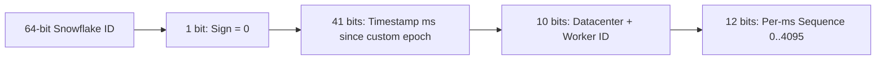

# 22 · Distributed ID Generation & Sequencing

**Level:** Intermediate → Advanced · **Status:** Draft · **Module:** 04 · Scaling Data: Replication & Sharding

## Learning objectives
- Diagnose why auto-increment IDs bottleneck horizontal sharding and leak business volume.
- Explain why random **UUIDv4** keys cause severe B+Tree page splits and buffer-pool cache misses.
- Compare **64-bit Snowflake IDs**, **ULID**, and **UUIDv7 (RFC 9562)** across bit layout, sortability, index size, and coordination overhead.
- Handle NTP backward clock jumps safely without emitting duplicate IDs.

---

## 1. The Problem: Random UUIDs just doubled our disk IOPS

You split your `messages` table across **16 PostgreSQL/MySQL shards** and switched primary keys from `BIGSERIAL` (auto-increment) to random `UUIDv4` so application pods can generate IDs offline without coordinating with a central database.

At **50 million rows**, everything ran smoothly because the entire primary key index fit in RAM. At **600 million rows**, write `p99` jumped **4×** and disk write IOPS tripled—even though QPS didn't change! Every random `UUIDv4` lands on an arbitrary leaf page across the B+Tree, forcing the engine to load cold `16 KB` pages from disk, dirty them, split full pages (`50%` empty slack), and flush huge volumes of random page writes.

We want IDs that are **globally unique across shards**, **fast to generate without a central bottleneck**, **roughly time-ordered (so B+Tree inserts stay sequential)**, and **compact**.

---

## 2. Mental Model: Filing invoices by timestamp vs. blindfolding the clerk

Think of a B+Tree primary index like a warehouse of filing cabinets:
- **Auto-increment / Timestamp-prefixed IDs (Snowflake, UUIDv7, ULID):** Every new invoice has a higher number than the last, so the clerk always appends to the **very last drawer**—which stays warm on their desk (RAM buffer pool).
- **Random UUIDv4:** Every invoice gets a random 128-bit number. The clerk runs across the entire warehouse for every insert, pulling cold drawers off distant shelves (`disk reads`), stuffing one sheet in, and splitting overflowing drawers in half (`page splits` and `write amplification`).

Key terms:
- **B+Tree Write Amplification:** Extra disk writes caused when a single logical row insert dirties or splits an entire `8–16 KB` page plus WAL full-page images.
- **UUIDv4:** 128-bit identifier with `122` cryptographic/pseudo-random bits (completely unsorted).
- **UUIDv7 (RFC 9562):** Modern 128-bit UUID embedding a **48-bit Unix millisecond timestamp** in the most significant bits, followed by version/variant bits and **74 random bits**.
- **Snowflake ID:** Compact **64-bit integer** (`8 bytes`) combining a millisecond timestamp, worker/machine ID, and per-millisecond sequence counter.

---

## 3. How It Works Under the Hood

### Comparing Distributed ID Strategies

1. **Central Auto-Increment / Ticket Server (Flicker / DB Sequence):**
   - One DB (`auto_increment_increment = 2`, offsets `1` and `2` on two servers) or a **Hi/Lo range allocator** (app reserves blocks of `10,000` IDs in one DB call, assigns locally in RAM).
   - **Pro:** Compact `64-bit` ints; Hi/Lo removes per-request DB round-trips.
   - **Con:** Single DB sequence becomes a bottleneck; Hi/Lo jumps ID gaps on pod restarts; leaks exact daily growth rate if sequential.

2. **UUIDv4 (128-bit random):**
   - `2^122 ≈ 5.3 × 10^36` possibilities—zero coordination needed, collision probability negligible.
   - **Con:** `16 bytes` raw (`36 bytes` if naively stored as `VARCHAR(36)`!); destroys B+Tree locality once index exceeds RAM; no chronological ordering.

3. **UUIDv7 (RFC 9562) & ULID (128-bit time-ordered):**
   - **UUIDv7:** `[48-bit Unix ms timestamp][4-bit ver=0111][12-bit rand_a / sub-ms seq][2-bit var=10][62-bit rand_b]`.
   - **ULID:** `48-bit ms timestamp + 80-bit randomness`, encoded as 26-char Crockford Base32 (`01ARZ3NDEKTSV4RRFFQ69G5FAV`).
   - **Pro:** Drop-in `UUID` column compatibility, monotonic B+Tree append locality, **zero worker-ID coordination**.
   - **Con:** `128 bits` (`16 bytes`)—double the index footprint of 64-bit IDs.

4. **64-bit Snowflake ID (Twitter / Discord / Instagram style):**

- **Bit budget (`1 + 41 + 10 + 12 = 64 bits`):**
  - `1 bit`: Always `0` so the value stays positive in signed 64-bit databases (`BIGINT`).
  - `41 bits`: Milliseconds since custom epoch (`2^41 ms ≈ 69.7 years`).
  - `10 bits`: Up to `1,024` concurrent generator workers (`5-bit DC + 5-bit worker`, or assigned via ZooKeeper/etcd lease).
  - `12 bits`: Up to **`4,096` IDs per millisecond per worker** (`4,096,000 IDs/sec/worker`).
- **What happens if NTP steps the system clock backward?**
  - If the clock moves back by `5 ms`, a naive generator reuses an earlier timestamp and risks **duplicate IDs**!
  - **Defenses:** (1) Wait out small backward drifts (`< 5–10 ms`) before emitting; (2) Fail closed (`503`) or rotate to a spare worker ID on larger jumps; (3) Use a **monotonic clock** (`CLOCK_MONOTONIC`) anchored to startup wall-clock, or embed logical sequence overflow.

---

## 4. Worked Example & Interactive Visualization

Let's calculate **index memory footprint** and **throughput capacity** at **1 billion rows** (`10^9` rows) across `UUIDv4`, `UUIDv7`, and `Snowflake`:

**1. Primary Key Index Size (`1,000,000,000` rows):**
- **64-bit Snowflake (`BIGINT`, 8 bytes + ~8 bytes tuple/pointer overhead):**
  Raw key bytes = `10^9 × 8 bytes = 8 GB` (decimal). With B+Tree internal pages and `~30%` page fill overhead, total PK index ≈ **`~20–24 GB`**.
- **128-bit UUIDv7 (`UUID`, 16 bytes + pointer overhead):**
  Raw key bytes = `10^9 × 16 bytes = 16 GB`. Total PK index ≈ **`~32–36 GB`** (`~50%` larger, and every secondary index in InnoDB/clustered B+Trees stores the PK too—doubling PK overhead in every secondary index!).
- **Naive `VARCHAR(36)` UUID string:**
  `36 bytes/key × 10^9 = 36 GB` raw keys → **`~60+ GB`** index! *Never store UUIDs as `CHAR(36)/VARCHAR(36)` in high-scale tables; use native binary `UUID` (`16 B`).*

**2. Snowflake Cluster Throughput Ceiling:**
- Per worker: `2^12 = 4,096 IDs/ms = 4,096,000 IDs/s`.
- Across `1,024` workers (`10-bit` worker field): `1,024 × 4.096M ≈ 4.19 billion IDs/s` theoretical peak.
- **Custom epoch lifetime:** `2^41 ms = 2,199,023,255,552 ms ÷ 86,400,000 ms/day ÷ 365.25 = 69.68 years`. Setting `epoch = 2025-01-01` keeps IDs valid until **year 2094**.

**3. Time-based Shard Hot-Spotting Caution:**
Because Snowflake and UUIDv7 sort by time, **never use the raw ID for *range* sharding**—otherwise 100% of new writes hit the latest range shard! **Hash** the Snowflake/UUIDv7 ID (or shard by `tenant_id` / `user_id`) so writes distribute across shards *while each shard's local B+Tree gets sequential inserts*.

**Interactive Visualization (`anim-uuid4-vs-uuid7-btree`):**
In the lesson visualization (`anim-uuid4-vs-uuid7-btree`), watch 500 inserts land into a B+Tree under **UUIDv4** (pages light up across the whole tree, triggering red page splits) vs. **UUIDv7 / Snowflake** (inserts append smoothly into the rightmost hot leaf page).

---

## 5. Trade-Offs & Failure Modes

| Choice | Benefit | Cost / Risk | Fails When |
|---|---|---|---|
| **DB Auto-Increment / Hi-Lo** | Smallest (`8 B`); strictly sequential; zero clock dependence | Central coordinator (single DB); leaks exact row count; gaps on crash | Multi-region active-active writes or ultra-high ID QPS without central DB |
| **UUIDv4 (128-bit random)** | Zero coordination; reveals zero timestamp/volume info | Random B+Tree inserts cause page splits & IOPS thrash; `16 B` size | High-insert tables whose index outgrows RAM buffer pool |
| **UUIDv7 (RFC 9562)** | Sequential B+Tree locality; zero worker-ID coordination; standard `UUID` type | `16 B` (`2×` Snowflake); leaks millisecond creation time | Ultra-compact `8 B` integer/JS-safe IDs or privacy against creation-time leakage |
| **Snowflake (64-bit)** | Compact `8 B` index; embeds shard/DC provenance; monotonic per worker | Requires worker-ID lease (`etcd`/ZK); NTP backward clock-jump hazard; exceeds JS `Number.MAX_SAFE_INTEGER` (`2^53 - 1`) in browsers | Frontend JSON APIs without string serialization (`"id": "18293..."`), or teams unwilling to manage worker IDs |

### What changes at 10× and 100× scale?
- **At 10× (`500,000 IDs/s` across `100` pods):** If using Snowflake, ephemeral Kubernetes pods spinning up/down rapidly can exhaust a naive static worker-ID config. Lease worker IDs dynamically from `etcd` / Redis with TTLs, or encode a hash/pod-slot cleanly—or adopt **UUIDv7**, which eliminates worker-ID coordination completely while keeping B+Tree locality.
- **At 100× (`5,000,000 IDs/s`, `100B+` rows, multi-region):** Cross-region clock skew between data centers can reorder Snowflake IDs by `10–50 ms`. Do **not** rely on Snowflake or UUIDv7 timestamps for strict causal or transactional ordering across nodes (Module 06 covers Lamport clocks and TrueTime). Also remember **JavaScript `53-bit` precision loss**: serialize 64-bit Snowflakes as JSON strings (`"id": "738291038..."`) on public APIs.

---

## 6. Practical Exercise & Module Checkpoint

1. **ID Design Drill:** Design a primary key for a global IoT sensor table ingesting `250,000 events/s` across `4` regions (`10 KB` payloads, `3-year` retention). Would you pick Snowflake, UUIDv7, or a composite `(device_id, bucket_day, event_id)` key? Justify index size, shard distribution, and clock-skew behavior.
2. **Module 03–04 Checkpoint:** Complete **[Assessment 03 · Caching, Replication & Sharding](../assessments/checkpoint-03.md)** before moving into Module 05.

---

## 7. Retrieval Practice & Primary Sources

1. Why does switching a `600M`-row table from `UUIDv4` to `UUIDv7` cut disk write IOPS dramatically?
2. How many IDs per second can a single Snowflake worker generate with a `12-bit` sequence field, and how many years does a `41-bit` millisecond timestamp last?
3. What subtle bug happens when a backend returns raw 64-bit Snowflake integers inside JSON (`{"id": 729183910293847193}`) to a browser or TypeScript client?
4. Why is using raw UUIDv7/Snowflake IDs for *range-based* sharding an anti-pattern, whereas *hash-based* sharding with UUIDv7 works well?

Hints

1. `UUIDv4` inserts hit random cold leaf pages across the entire B+Tree, causing constant disk page reads, dirty-page flushes, and page splits; `UUIDv7` appends sequentially to the rightmost warm leaf pages in RAM.
2. `2^12 = 4,096` IDs/ms = `4,096,000` IDs/sec per worker. `2^41` ms ≈ `69.7` years.
3. IEEE 754 `Number` in JavaScript only represents integers accurately up to `2^53 - 1` (`9,007,199,254,740,991`); 64-bit IDs get silently rounded (`...7193` becomes `...7200`), breaking lookups!
4. Time-prefixed IDs make all new inserts monotonically increasing; range sharding sends 100% of writes to the single newest shard. Hashing the ID spreads writes across all shards while each shard's local B+Tree still enjoys sequential appends.

### Primary Sources
- **Standard / RFC:** [RFC 9562 · Universally Unique IDentifiers (UUIDs)](https://www.rfc-editor.org/rfc/rfc9562) — Section 5.7 (UUIDv7 bit layout, monotonicity, and security considerations).
- **Engineering Blog:** [Twitter Engineering · Announcing Snowflake](https://blog.x.com/engineering/en_us/a/2010/announcing-snowflake) — original 64-bit distributed ID service design.
- **Engineering Blog:** [Instagram Engineering · Sharding & IDs at Instagram](https://instagram-engineering.com/sharding-ids-at-instagram-1cf5a71e5a5c) — PostgreSQL PL/pgSQL 64-bit ID generation inside logical shards without a separate ID service.
- **Database Internals:** [PostgreSQL Documentation · UUIDv7 / B-Tree Index Locality](https://www.postgresql.org/docs/current/indexes-types.html) & [Percona · UUID Performance in InnoDB](https://www.percona.com/blog/store-uuid-optimized-way/).

---

## Next
Continue to Module 05: [23 · Message Queues vs Event Streams](23-queues-vs-streams.md).
