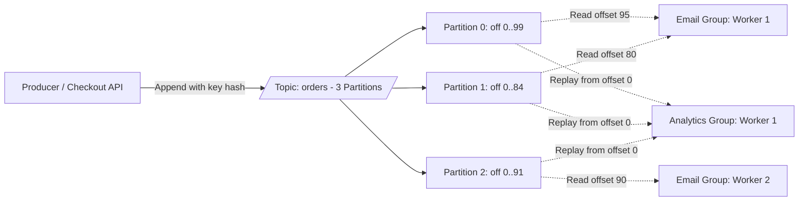

# 23 · Message Queues vs Event Streams

**Level:** Intermediate → Advanced · **Status:** Draft · **Module:** 05 · Asynchronous Systems, Streaming & Search

## Learning objectives
- Distinguish **message queues** (ephemeral task delivery, delete-on-ACK) from **event streams** (durable partitioned logs, offset tracking).
- Explain how **partitions** and **consumer groups** provide both parallel scale-out and independent multi-subscriber replay.
- Avoid consumer-group underutilization and consumer-lag spirals caused by bad partition counts or rebalancing storms.
- Size broker retention storage and partition throughput with explicit units.

---

## 1. The Problem: Why did adding a second subscriber break our notifications?

When a user places an order on your marketplace, the Checkout API pushes an `OrderPlaced` message onto a queue. An Email Worker pulls the message, sends a receipt, and sends `ACK`. The broker deletes the message.

Three months later, the Analytics team wants every `OrderPlaced` event to update real-time revenue dashboards, and the Fraud team wants to score every order asynchronously. With a single shared queue, adding Analytics workers *steals* messages from Email workers! To fix that, you clone the message into three separate queues—until Analytics hits a bug, drops 4 hours of events, and realizes **once a queue deletes an ACKed message, you can never replay Tuesday's events**.

Choosing between a **message queue** (SQS, RabbitMQ) and an **event stream** (Kafka, Redpanda, Pulsar, Kinesis) depends on whether you need **per-message task completion** or a **durable, replayable history for multiple independent readers**.

---

## 2. Mental Model: A shared inbox vs. a numbered newspaper archive

- **Message Queue (Competing Consumers):** Think of a customer support **task inbox**. Ten agents grab tickets from the same pile, lock each ticket briefly (**visibility timeout**), resolve it, and shred it (**ACK / delete**). You can scale to 100 agents effortlessly, and individual slow tickets don't block other agents—*but* once shredded, no new team can read yesterday's tickets.
- **Event Stream (Partitioned Append-Only Log):** Think of a **bound ledger book** where every page is numbered (`offset 0, 1, 2...`). Writing appends to the end; reading never deletes anything. Team A (Email) keeps a bookmark at `offset 10,450`, while Team B (Analytics) reads at `offset 9,800` and can rewind its bookmark back to `offset 0` at any time. To go faster, you split the ledger into `P` independent volumes (**partitions**).

Key terms:
- **Competing Consumers:** Multiple workers reading from one queue where each message is processed by only one worker.
- **Visibility Timeout:** Duration a queue hides an in-flight message before making it visible again if the worker crashes without `ACK`.
- **Partition:** An ordered, immutable, append-only shard of a stream topic stored on a broker disk.
- **Offset:** Sequential integer position (`0, 1, 2...`) of a record within a partition.
- **Consumer Group:** A named set of consumers sharing a topic so each partition is assigned to **exactly one** consumer in that group at a time.

---

## 3. How It Works Under the Hood

### Queue vs. Partitioned Log Architecture

Notice two crucial mechanical constraints of partitioned streams (like Kafka):
1. **Per-key ordering, not global ordering:** A single partition is strictly FIFO. To keep all events for `order_42` ordered, set `partition_key = order_42` (`hash(key) % num_partitions`). Events across *different* partitions have no global ordering guarantee.
2. **Parallelism ceiling = Partition Count (`P`):** Because each partition is owned by at most **one** consumer inside a consumer group (to preserve partition order), **having 20 consumers on a 6-partition topic leaves 14 consumers completely idle!**
3. **Queue head-of-line vs. fast-worker scaling:** A classic message queue (SQS/RabbitMQ) does *not* bind messages to fixed partitions, so you can scale from `5` to `500` workers dynamically when one message takes `30 seconds` (e.g., video transcoding) without being capped by partition count.

### Why Partition Rebalancing Can Cause Outages

When a consumer joins, crashes, or misses a heartbeat (`session.timeout.ms`), the group coordinator triggers a **rebalance** to reassign partitions:
- **Eager (Stop-the-World) Rebalance:** All consumers pause reading, revoke all partitions, reassign, and resume—creating latency spikes and duplicate reprocessing of uncommitted offsets.
- **Cooperative Sticky Rebalance:** Only partitions moving to new owners are revoked while unaffected partitions keep streaming continuously.

---

## 4. Worked Example & Interactive Visualization

Let's size a **Kafka-style event stream** for an order and telemetry pipeline:

**Workload assumptions:**
- Peak ingestion rate: `25,000 events/s`
- Average serialized event payload (JSON/Protobuf + headers): `1,200 bytes` (`1.2 KB`)
- Retention window: `7 days` (`604,800 seconds`), Replication factor `RF = 3`
- Per-consumer processing time: `4 ms` per event (single-threaded per partition, or `250 events/s` per consumer if unbatched; `2,500 events/s` with batches of `10`!)

**Calculations:**
1. **Ingress & Replication Bandwidth:**
   - Producer ingress = `25,000 × 1,200 bytes = 30 MB/s` (`240 Mbps`).
   - With `RF = 3`, intra-cluster replication adds `2 × 30 MB/s = 60 MB/s`, and `2` independent consumer groups read `2 × 30 MB/s = 60 MB/s`. Total broker NIC throughput = **`150 MB/s` (`1.2 Gbps`)**.
2. **7-Day Disk Retention Footprint:**
   - Raw daily volume = `30 MB/s × 86,400 s/day = 2,592,000 MB/day = 2.592 TB/day` (decimal).
   - 7 days × `RF = 3` = `2.592 TB × 7 × 3 = 54.43 TB` cluster-wide (roughly `50 TiB` binary), before compression (Snappy/Zstd typically compresses JSON `3–4×`, dropping disk to `~15 TB`).
3. **Choosing Partition Count (`P`):**
   - Suppose each consumer thread processes `2,000 events/s` comfortably (with batching).
   - Minimum consumers needed at peak = `25,000 ÷ 2,000 = 12.5` → at least `13` partitions.
   - To allow future `2×` traffic growth without re-partitioning (which breaks `hash(key) % P` key affinity!), pick **`P = 32` partitions** (`~781 events/s` per partition at current peak).

**Interactive Simulation (`sim-consumer-group`):**
Use `sim-consumer-group` in the slide deck to add/kill consumers on a 6-partition topic, observe idle consumers when `consumers > partitions`, and watch lag accumulate when one consumer stalls.

---

## 5. Trade-Offs & Failure Modes

| Choice | Benefit | Cost / Risk | Fails When |
|---|---|---|---|
| **Message Queue (SQS / RabbitMQ)** | Elastic worker scaling (`1..1,000+` workers); per-message ACK & visibility timeout | No multi-consumer replay; weak/non-existent strict ordering at scale | Multiple downstream services need the same historical event stream |
| **Partitioned Log (Kafka / Redpanda)** | High sequential disk throughput; independent consumer groups; time-travel replay | Parallelism capped by partition count `P`; head-of-line blocking per partition | Long-running variable jobs (`30 s` PDF renders) where one slow message stalls a partition |
| **Many Partitions (`P = 500` per topic)** | High max consumer concurrency; smooth skew spread | Higher broker open-file descriptors, leader-election latency, and metadata overhead | Small clusters or hundreds of topics (`1,000 topics × 500 partitions` = broker overload) |
| **Too Few Partitions (`P = 2`)** | Minimal metadata & trivial strict ordering | Max `2` active workers per group; hot partition bottlenecks entire pipeline | Traffic grows `10×` and re-partitioning changes key-to-partition mapping |

### What changes at 10× and 100× scale?
- **At 10× (`250,000 events/s`, `300 MB/s` ingress):** Uncompressed 7-day retention hits `~544 TB`. Enable **Zstd batch compression** at the producer (`3–4×` savings) and use **tiered storage** (keep last 4–12 hours on local NVMe for tailing consumers, offload older log segments to S3/Object Storage for cheap replay).
- **At 100× (`2.5M events/s`, `3 GB/s` ingress):** A single Kafka cluster hits cross-AZ network egress bills and metadata scaling limits. Partition across regional/domain clusters, enforce **Protobuf/Avro Schema Registry** contracts to prevent bad producers from breaking dozens of downstream groups, and monitor **Consumer Lag** (records behind tip + estimated seconds behind) as a tier-1 SLO alert.

---

## 6. Practical Exercise

Suppose you are designing the backend for a **ride-hailing driver telemetry** pipeline (`1,000,000` active drivers sending GPS pings every `5 seconds`, `200 bytes` per ping):
1. Calculate average ingress (`events/s` and `MB/s`) and 14-day retention with `RF = 3` (assume `2.5×` Snappy compression).
2. Choose **Message Queue** vs **Partitioned Log**, justify your partition key (`driver_id` vs `city_id`), and pick a partition count `P` assuming each consumer worker handles `5,000 pings/s`.
3. Explain what breaks if you accidentally choose `partition_key = city_id` and New York accounts for 35% of all drivers.

---

## 7. Retrieval Practice & Primary Sources

1. Why can a new Analytics service read last Tuesday's events from Kafka, whereas an SQS worker cannot?
2. You have a Kafka topic with `8` partitions and scale your Consumer Group from `8` pods to `16` pods during a traffic spike. What happens to throughput, and why?
3. Why is a standard message queue (like SQS Standard or RabbitMQ) often a better fit than Kafka for a `30-second`-per-job video transcoding pipeline?
4. What breaks if you increase a Kafka topic's partition count from `8` to `16` for a stateful stream processor keyed by `user_id`?

Hints

1. SQS deletes messages upon `ACK`; Kafka retains immutable log segments for a configured time/byte TTL (`7 days`) and tracks per-group offsets independently.
2. Throughput stays flat—the extra `8` pods sit completely idle because each partition can only be assigned to one consumer instance within a single consumer group.
3. Video transcoding has high variance per item (`5 s` to `10 min`) and doesn't need strict FIFO ordering or replay; per-message ACK lets `500` workers pull jobs dynamically without head-of-line partition blocking.
4. `hash(user_id) % 8` vs `hash(user_id) % 16` routes existing users to *different* partitions, breaking per-user event ordering during the transition and scattering local RocksDB state stores.

### Primary Sources
- **Official Docs:** [Apache Kafka Documentation · Introduction & Design](https://kafka.apache.org/documentation/#design) — log storage, zero-copy `sendfile`, consumer groups, and partition semantics.
- **Official Docs:** [Amazon SQS · Standard vs FIFO Queues & Visibility Timeout](https://docs.aws.amazon.com/AWSSimpleQueueService/latest/SQSDeveloperGuide/sqs-visibility-timeout.html) — competing consumer locking and queue semantics.
- **Engineering Paper:** Jay Kreps et al., *Kafka: a Distributed Messaging System for Log Processing* (NetDB 2011) ([PDF](https://notes.stephenholiday.com/Kafka.pdf)).
- **Book (paid/not free full-text):** Martin Kleppmann, *Designing Data-Intensive Applications*, Chapter 11: Stream Processing ([dataintensive.net](https://dataintensive.net/)).

---

## Next
Continue to [24 · Delivery Semantics, Ordering & Idempotent Consumers](24-delivery-semantics.md).
