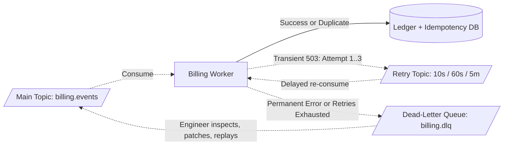

# 24 · Delivery Semantics, Ordering & Idempotent Consumers

**Level:** Intermediate → Advanced · **Status:** Draft · **Module:** 05 · Asynchronous Systems, Streaming & Search

## Learning objectives
- Explain why "exactly-once network delivery" is physically impossible, and how **at-least-once + idempotent consumer = effectively-once** works.
- Trace crash-before-ACK vs. crash-after-ACK windows in message consumers.
- Quarantine **poison-pill messages** into Dead-Letter Queues (DLQs) without stalling a partition.
- Design non-blocking delayed retry pipelines with safe replay workflows.

---

## 1. The Problem: Why did one failed JSON parse stop 100,000 orders?

Your billing worker reads `InvoicePaid` events from Partition 3. Today, two outages happen back-to-back:
1. **Double-crediting:** A worker credits `$50` to a user's wallet in PostgreSQL, then crashes before committing its Kafka offset (`ACK`). A restarted worker reads the same offset again and credits `$50` a second time.
2. **Poison-pill deadlock:** A producer accidentally emits a malformed event (`amount_cents: null`). The worker throws a `NullPointerException`, restarts, reads the exact same offset again, crashes again—repeating infinitely while **100,000 valid invoices pile up behind that single message**.

Reliable messaging isn't about hoping the network never drops a packet or a worker never crashes. It's about making **retries safe** and **permanent failures isolated**.

---

## 2. Mental Model: Idempotency is like a numbered check

Imagine mailing a **$100 check (#4092)** to a contractor:
- **At-most-once (Auto-ACK before work):** The contractor marks check `#4092` deposited *before* walking to the bank. If they drop it in the rain on the way, nobody ever re-sends it (**data loss**).
- **At-least-once (ACK after work):** You keep re-mailing copies of check `#4092` until the contractor texts *"Got it!"*. If the text message gets lost, you mail a second copy.
- **Effectively-once (At-least-once + Idempotent Bank):** The bank tracks deposited check numbers in the **same ledger transaction** as the account balance. When copy #2 of check `#4092` arrives, the bank sees `#4092` already cleared and says *"OK, already done"* without adding another `$100`.

Key terms:
- **Idempotency:** An operation where applying the same input `f(x)` multiple times produces the same final state as applying it once.
- **At-Most-Once:** Commit offset / ACK *before* processing; never duplicates, can lose messages on crash.
- **At-Least-Once:** Commit offset / ACK *after* processing; never loses messages, can deliver duplicates on crash/timeout.
- **Poison Pill:** A malformed or unprocessable message that deterministically crashes or fails every consumer attempt.
- **Dead-Letter Queue (DLQ):** A quarantine queue/topic where messages are moved after exhausting bounded retries, unblocking the main stream.

---

## 3. How It Works Under the Hood

### Why "Exactly-Once Delivery" Is a Myth (and What Replaces It)

Because the Two Generals' Problem prevents two machines over an asynchronous network from agreeing simultaneously on state without failure windows, a broker can never guarantee a message crosses the wire *once and only once*.
- Even **Kafka's "Exactly-Once Semantics (EOS)"** only works **inside Kafka** (read from Kafka → transform → write to Kafka topic + commit consumer offset atomically via a coordinator).
- The moment your consumer writes to an **external database, payment gateway, or email API**, you must build **idempotent side effects** using **at-least-once delivery + deduplication**.

### The Atomic Idempotency Pattern (No Two-Store Race!)

Never put the idempotency check in Redis and the business write in PostgreSQL! If Postgres commits and Redis times out (or vice versa), they diverge. Instead, keep the `processed_events` table **in the same ACID database** as the business state:

```sql
BEGIN;
  INSERT INTO processed_events (event_id, processed_at)
  VALUES ($1, NOW())
  ON CONFLICT (event_id) DO NOTHING;

  -- Check rows_affected: if 0, ROLLBACK/COMMIT early and ACK!
  UPDATE wallets SET balance_cents = balance_cents + $2 WHERE user_id = $3;
COMMIT;
```

### Non-Blocking Retry & DLQ Pipeline

If a downstream API returns `503 Service Unavailable`, sleeping for `30 seconds` inside a Kafka consumer stalls the entire partition and risks a `max.poll.interval.ms` rebalance storm! Production pipelines separate **main**, **delayed retry**, and **DLQ** topics:



- **Permanent errors (400 Bad Request, Schema error, Null field):** Skip retries completely—send straight to **DLQ** on attempt 1!
- **Transient errors (503, DB timeout):** Route to tiered retry topics (`retry-10s` → `retry-60s` → `retry-5m`) with jitter, then DLQ.
- **Ordering trade-off:** Moving a failed message for `order_42` to a retry topic preserves throughput for `order_43..999`, *but* lets a newer event for `order_42` overtake the failed one! If strict per-key order is mandatory, include a monotonic `entity_version` (`WHERE version < new_version`) so out-of-order stale events are safely ignored, or pause only that key's state machine.

---

## 4. Worked Example & Interactive Visualization

Let's size a **DLQ, retry overhead, and idempotency table** for a billing consumer:

**Workload assumptions:**
- Steady stream: `4,000 events/s` (`345,600,000 events/day`)
- Duplicate rate from network timeouts / rebalances: `0.5%` (`20 duplicates/s`)
- Transient downstream failure rate: `1%` (`40 events/s` retry once, `4 events/s` retry twice)
- Permanent poison-pill rate: `0.001%` (`~3,456 events/day`)
- Idempotency row size (`UUID event_id + timestamp + index overhead`): `64 bytes/row`
- Idempotency retention window: `30 days` (via daily time-partitioned table drops!)

**Calculations:**
1. **Effective consumer throughput needed:**
   `4,000` primary + `20` dupes + `44` retries = **`4,064 deliveries/s`** (`1.6%` overhead).
2. **Idempotency table storage over 30 days:**
   `345,600,000 rows/day × 30 days = 10.368 billion rows`.
   `10.368B × 64 bytes ≈ 663.5 GB` (decimal)!
   - *Key operational insight:* An unbounded `processed_events` table will bankrupt your SSD IOPS via index bloat. **Partition `processed_events` by day** (`processed_events_2026_11_26`) and `DROP TABLE` partitions older than 30 days instantly with zero `VACUUM` overhead—and reject/DLQ any incoming event older than 30 days!
3. **DLQ sizing & alerting:**
   `~3,456` poison pills/day is small enough (`~4 MB/day`) to retain indefinitely for debugging, and any spike `> 10 DLQ msgs/min` pages on-call immediately.

**Interactive Visualization (`anim-delivery-semantics`):**
Step through `anim-delivery-semantics` in the deck to watch what happens when a worker crashes **(a) before DB commit**, **(b) between DB commit and broker ACK**, and **(c) with an atomic `processed_events` table** guarding the retry.

---

## 5. Trade-Offs & Failure Modes

| Choice | Benefit | Cost / Risk | Fails When |
|---|---|---|---|
| **At-Most-Once (ACK before process)** | Lowest latency; zero duplicate side effects | Silent message loss whenever a worker crashes mid-flight | Billing, orders, webhooks, audit logs (only OK for lossy metrics/logs) |
| **At-Least-Once + Atomic SQL Idempotency** | Zero lost messages; exact ledger accuracy; survives crashes | Requires unique `event_id` + storage/cleanup of idempotency keys | External side effects (sending an SMS/email) lacking a provider idempotency API |
| **In-Place Blocking Retry** | Preserves strict partition FIFO order | One bad/slow message freezes the whole partition and triggers consumer rebalances | High-throughput streams with external HTTP dependencies |
| **Non-Blocking Retry Topics + DLQ** | Healthy messages flow at full speed; isolates poison pills cleanly | Breaks strict ordering for the retried key relative to newer events for that key | Unversioned state transitions (`Created` retried *after* `Cancelled` arrives) |

### What changes at 10× and 100× scale?
- **At 10× (`40,000 events/s`):** A single PostgreSQL `processed_events` primary cannot absorb `40k` random UUID inserts/s cleanly. Shard the consumer's state store by `partition_key` (or use `UUIDv7` `event_id`s for sequential B+Tree inserts!), and prune daily partitions aggressively.
- **At 100× (`400,000 events/s`):** Cross-partition idempotency tables become too expensive for high-volume clickstreams or telemetry. Use **natural idempotency** (`SET status = 'SHIPPED' WHERE version < 5` or `PUT /object/{hash}`), **time-windowed Bloom filters + exact fallback**, or stream-native stateful deduplication (Flink RocksDB state checkpoints with TTL).

---

## 6. Practical Exercise

Complete **[Lab 09 · Idempotent Consumer & Dead-Letter Queue Worker](../labs/09-idempotent-dlq-worker.md)**:
- Feed `1,000` events (`15%` duplicates, `2%` poison pills, `10%` transient `503` faults) into a naive consumer vs. an atomic SQLite/Postgres idempotent consumer.
- Verify exact balance conservation (`0` double-charges), non-blocking exponential backoff with jitter, DLQ quarantine, and safe DLQ replay.

---

## 7. Retrieval Practice & Primary Sources

1. Why is putting an `event_id` check in Redis *before* updating PostgreSQL still vulnerable to duplicate processing?
2. What is the difference between a **transient** error and a **poison pill**, and why shouldn't a poison pill go through 5 exponential retries?
3. How can a non-blocking retry topic cause a **state-regression bug** (e.g., `OrderCreated` overwriting `OrderCancelled`), and how do you prevent it?
4. Why should `processed_events` tables always be time-partitioned with a bounded TTL?

<details><summary>Hints</summary>
1. If PostgreSQL commits and the process crashes (or Redis fails) before writing `event_id` to Redis, the retry sees a Redis miss and runs the PostgreSQL update a second time.
2. Transient errors (`503`, timeout) resolve with time; poison pills (invalid schema, divide-by-zero, bad payload) deterministically fail on every attempt, wasting compute and delaying investigation. Route permanent errors straight to DLQ.
3. If `OrderCreated` fails transiently and enters `retry-60s`, while `OrderCancelled` arrives 1 second later on the main topic and succeeds, the delayed retry executes 60 seconds later and reverts status to `Created`. Fix with monotonic `version` checks (`WHERE version < incoming_version`).
4. Without TTL/partition drops, an append-only idempotency index grows indefinitely, spilling out of RAM and degrading every insert into random disk I/O.
</details>

### Primary Sources
- **Official Docs:** [Apache Kafka Documentation · Message Delivery Semantics](https://kafka.apache.org/documentation/#semantics) — producer idempotence, transactions, and consumer offset boundaries.
- **Engineering Blog:** [Stripe Engineering · Designing Robust and Predictable APIs with Idempotency](https://stripe.com/blog/idempotency) — atomic state + idempotency persistence.
- **Engineering Blog:** [Uber Engineering · Building Reliable Reprocessing and Dead Letter Queues with Kafka](https://www.uber.com/blog/reliable-reprocessing/) — tiered non-blocking retry topics and DLQ replay tooling.
- **Engineering Blog:** [AWS Builders' Library · Timeouts, Retries, and Backoff with Jitter](https://aws.amazon.com/builders-library/timeouts-retries-and-backoff-with-jitter/) — why jitter prevents synchronized retry storms.

---

## Next
Continue to [25 · Distributed Data Patterns: Outbox, CDC, Sagas & CQRS](25-outbox-saga-cqrs.md).
