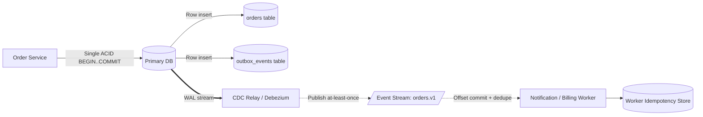

# 25 · Distributed Data Patterns: Outbox, CDC, Sagas & CQRS

**Level:** Intermediate → Advanced · **Status:** Draft · **Module:** 05 · Asynchronous Systems, Streaming & Search

## Learning objectives
- Diagnose the **dual-write problem** between a database and a message broker.
- Implement the **Transactional Outbox + Debezium CDC** pattern so state changes and published events are atomic.
- Design **Choreography** and **Orchestration Sagas** with explicit **pivot transactions** and **compensating actions**.
- Recognize when **CQRS** (Command Query Responsibility Segregation) and **Event Sourcing** are justified—and when they are over-engineering.

---

## 1. The Problem: Saving the order worked, publishing the event didn't

Consider these four innocent lines in your Checkout Service:

```python
db.execute("INSERT INTO orders (id, total) VALUES (%s, %s)", order_id, 9900)
db.commit()
kafka.send("orders.created", {"order_id": order_id, "total": 9900})  # <- crashes here!
```

If the pod gets `SIGKILL`ed or Kafka times out right after `db.commit()`, the order exists in PostgreSQL, **but the `orders.created` event never existed**. The Warehouse never ships the item, and Billing never charges the card. Flipping the order (Kafka first, then DB) is just as broken: if the DB transaction rolls back on a constraint error, downstream services ship an order that doesn't exist!

And once a workflow spans three separate microservices (`Orders`, `Payments`, `Inventory`), you can't wrap three databases in one ACID transaction without fragile Two-Phase Commit (`2PC`). You need **Transactional Outbox**, **Sagas**, and—for complex read projections—**CQRS**.

---

## 2. Mental Model: Write the letter inside the same notarized envelope

- **Transactional Outbox:** Instead of trying to update your DB and mail a letter (`Kafka`) in two separate actions, put the letter (`outbox_events` row) **inside the exact same local database transaction** as the order row. Either both commit together, or neither does. A separate postal carrier (**CDC Relay** reading the database WAL) picks up committed outbox rows and delivers them to the broker *at-least-once*.
- **Saga:** When a vacation booking spans Flight + Hotel + Rental Car across three separate companies, there is no global undo button. You run local transactions in sequence (`Book Flight` → `Book Hotel` → `Book Car`). If `Book Car` fails, you don't roll back the database—you execute **compensating transactions** in reverse (`Cancel Hotel` → `Cancel Flight`).
- **CQRS:** Instead of forcing one normalized table to handle both high-speed transactional writes and complex search/reporting joins, you separate the **Write Model (Commands)** from optimized **Read Models (Queries)** fed asynchronously by events.

Key terms:
- **Dual-Write Problem:** Updating two independent systems (e.g., DB + Broker or DB + Cache) without an atomic transaction spanning both, risking silent divergence on partial failure.
- **CDC (Change Data Capture):** Streaming row-level inserts/updates/deletes directly from a database's Write-Ahead Log (e.g., Debezium reading Postgres WAL or MySQL binlog).
- **Compensating Transaction:** A forward semantic undo action (e.g., `RefundPayment`, `ReleaseInventory`) reversing a previously committed local step in a Saga.
- **Pivot Transaction:** The point of no return in a Saga after which remaining steps are guaranteed to retry forward until completion.

---

## 3. How It Works Under the Hood

### Pattern 1: Transactional Outbox + WAL CDC



*(Source diagram: [transactional-outbox-cdc.mmd](../diagrams/transactional-outbox-cdc.mmd))*

**Two relay mechanisms:**
1. **Polling Publisher:** A background thread queries `SELECT * FROM outbox WHERE published = false ORDER BY seq LIMIT 500`, sends to Kafka, and updates `published = true`. Simple, *but* adds polling load to the primary DB and limits sub-100ms latency.
2. **Transaction Log Tailing (Debezium CDC):** Tails PostgreSQL's logical replication slot (`pgoutput`) directly from the WAL. Zero polling queries on `orders`, preserves exact commit order, and delivers events in **`10–50 ms`**. *Bonus trick:* You can `DELETE` the outbox row immediately or never even persist it long-term—WAL still captures the insert!

### Pattern 2: Sagas (Choreography vs. Orchestration)

A multi-service checkout Saga executes: `1. Create Pending Order` → `2. Reserve Inventory` → `3. Authorize Payment` → `4. Confirm Order`.

- **Choreography (Event-Driven):** Each service listens for events and emits the next (`OrderCreated` → Inventory emits `InventoryReserved` → Payment emits `PaymentFailed` → Inventory listens and releases stock).
  - *Pros:* No central coordinator; decoupled for simple 2–3 step flows.
  - *Cons:* Logic is scattered across 5 repos; hard to debug cyclic dependencies or inspect where an order is stuck.
- **Orchestration (State Machine Coordinator):** A dedicated **Order Saga Orchestrator** (e.g., Temporal, AWS Step Functions, or durable DB state machine) explicitly commands `ReserveInventory`, awaits reply, then commands `CapturePayment`. On failure, it runs `ReleaseInventory` → `FailOrder`.
  - *Pros:* Centralized workflow visibility, clear timeout handling, zero cyclic dependencies.
  - *Cons:* Extra orchestrator service to operate and scale cleanly.

**Crucial Saga Rule — Semantic Locks & Commutativity:** Because Sagas lack **Isolation (the "I" in ACID)**, another user can read intermediate dirty state (`Order: PENDING`). Use explicit status columns (`PENDING`, `CONFIRMED`, `COMPENSATING`, `CANCELLED`), make compensating actions **idempotent and retryable** (what if `ReleaseInventory` times out?), and place non-compensable actions (like `SendConfirmationEmail`) **after the pivot transaction**.

### Pattern 3: CQRS & Event Sourcing (Use Sparingly!)

- **CQRS** splits writes (normalized ACID Postgres) from reads (Elasticsearch, Redis materialized views, or OLAP projections) via CDC/Outbox. Useful when read/write workloads diverge by `10×–100×` or require radically different data models.
- **Event Sourcing** stores *every domain mutation as an immutable event log* (`MoneyDeposited`, `MoneyWithdrawn`) rather than storing current balance, deriving current state by folding events (with periodic snapshots). *Powerful for financial ledgers, version control, and audit compliance; painful for simple CRUD due to schema evolution/upcasting of 5-year-old events.*

---

## 4. Worked Example & Interactive Visualization

Let's size a **Transactional Outbox + Debezium CDC** pipeline for a checkout system:

**Workload assumptions:**
- Peak checkout rate: `3,000 orders/s`
- Average `orders` row: `600 bytes`; `outbox_events` payload (UUID `event_id`, `aggregate_id`, `event_type`, JSON/Protobuf payload): `900 bytes`
- CDC replication slot retention guard: max `10 minutes` of WAL backlog if Kafka is unreachable
- Saga workflow: `3` steps (`Order -> Inventory -> Payment`), average `4` messages per order

**Calculations:**
1. **Outbox write amplification in Primary DB:**
   Each checkout writes `600 + 900 = 1,500 bytes` (`2.5×` single-table bytes, but within the *same* `BEGIN..COMMIT` `fsync`!). At `3,000 orders/s`, outbox adds `3,000 × 900 B = 2.7 MB/s` of WAL.
2. **WAL accumulation during a 10-minute Kafka outage:**
   `2.7 MB/s × 600 s = 1.62 GB` (plus `1.8 MB/s × 600 s = 1.08 GB` from `orders` = **`2.7 GB`** unconsumed WAL retained in Postgres). Always set a `max_slot_wal_keep_size` (e.g., `20 GB`) in Postgres so a dead CDC connector can't fill primary disk!
3. **Outbox table cleanup:**
   If you retain `outbox_events` rows for `24 hours`, `3,000/s × 86,400 s = 259.2M rows/day × 900 B ≈ 233 GB/day`. Instead, **partition `outbox_events` hourly** and `DROP` old partitions, or run `DELETE` immediately after insert in the same transaction (since Debezium still reads the `INSERT` from WAL!).

**Interactive Visualization (`anim-saga-compensation`):**
In `anim-saga-compensation`, run the **Success Path** (`Order -> Inventory -> Payment -> Confirm`) and then trigger **Fail Payment** to watch the orchestrator execute reverse compensating actions (`Release Inventory` → `Cancel Order`) while keeping idempotency intact.

---

## 5. Trade-Offs & Failure Modes

| Choice | Benefit | Cost / Risk | Fails When |
|---|---|---|---|
| **Transactional Outbox + CDC** | Eliminates dual-write loss; zero broker latency on user request | Extra `outbox` table + CDC connector ops; WAL disk fills if CDC stalls | Teams with no CDC ops experience on tiny `< 50 QPS` apps (use simple polling outbox first) |
| **Choreography Saga** | No central orchestrator SPOF; simple for 2-step flows | Hidden distributed state machine; hard to trace/debug across 5+ services | Complex branching workflows, timeouts, and compensation ordering (`4+` services) |
| **Orchestration Saga** | Explicit workflow graph, timeouts, retries, and observability | Single logical orchestrator becomes critical control-plane dependency | Ultra-low-overhead pub/sub fan-out where services shouldn't couple to an orchestrator |
| **Full Event Sourcing + CQRS** | Complete audit log, time-travel debugging, multiple read projections | Event schema versioning/upcasting pain; eventual consistency lag on read views | Standard CRUD domains where current-state tables + audit log suffice |

### What changes at 10× and 100× scale?
- **At 10× (`30,000 orders/s`, `~45 MB/s` WAL):** A single-threaded Debezium connector reading one primary DB hits throughput ceiling. You shard the primary DB (Lesson 20) and run **one CDC connector per database shard**, feeding partitioned Kafka topics keyed by `order_id`.
- **At 100× (`300,000 events/s`):** Long-lived Sagas (`hours` or `days`, e.g., shipping + settlement) accumulate millions of open workflow states. Store Saga execution state in a durable **workflow engine** (Temporal / partitioned state DB with timer wheels) rather than polling database tables every second.

---

## 6. Practical Exercise

Trace a **Money Transfer + Fraud Check + Notification** workflow (`Transfer Service` → `Fraud Service` → `Ledger Service` → `Notification Service`):
1. Identify which step is the **pivot transaction** (point of no return).
2. Design the `outbox_events` schema (`event_id`, `aggregate_type`, `aggregate_id`, `payload`, `created_at`) and explain how you prevent `outbox_events` from growing unboundedly.
3. Draw the Orchestration Saga compensation sequence if `Ledger Service` fails after `Fraud Service` placed a temporary hold, and specify how you handle a network timeout during the compensation call itself.

---

## 7. Retrieval Practice & Primary Sources

1. Why can't you solve the dual-write problem between PostgreSQL and Kafka simply by wrapping both calls in a `try / catch` block?
2. What critical safety limit must you configure on a PostgreSQL logical replication slot used by Debezium CDC?
3. Why must compensating transactions in a Saga be **idempotent** and **retriable**, and what happens if a step *after* the pivot transaction fails?
4. When is **CQRS** worth the complexity of eventual consistency, and why is **Event Sourcing** optional even when using CQRS?

<details><summary>Hints</summary>
1. If PostgreSQL commits and the process crashes (OOM kill, power loss) before `kafka.send()`, or if `kafka.send()` times out even though the broker actually persisted the message, the two stores permanently diverge.
2. `max_slot_wal_keep_size` (and disk alerts): if Debezium crashes for hours, Postgres refuses to recycle WAL segments needed by the slot, filling the primary disk and halting all writes.
3. Because compensation calls go over unreliable networks too—if `ReleaseInventory` times out, the orchestrator must retry until it succeeds without releasing stock twice. Steps after the pivot transaction cannot roll back; they must retry forward to completion.
4. CQRS pays off when write schemas (normalized OLTP) and read access patterns (full-text search, personalized feeds, heavy aggregations) have incompatible indexes or `100:1` scaling asymmetry. You can project CQRS read views from CDC outbox events on normal state tables without storing your primary DB as an event-sourced log.
</details>

### Primary Sources
- **Architecture Pattern Guide:** [Microservices.io · Transactional Outbox & Saga Patterns](https://microservices.io/patterns/data/transactional-outbox.html) — formal specification of polling vs. log-tailing outbox and Saga types.
- **Official Docs:** [Debezium Documentation · Outbox Event Router](https://debezium.io/documentation/reference/stable/transformations/outbox-event-router.html) — production WAL-to-Kafka outbox routing.
- **Research Paper:** Hector Garcia-Molina & Kenneth Salem, *Sagas* (ACM SIGMOD 1987) ([PDF](https://www.cs.cornell.edu/andru/cs711/2002fa/reading/sagas.pdf)) — foundational paper defining long-lived transactions and compensating actions.
- **Engineering Blog:** [Martin Fowler · CQRS](https://martinfowler.com/bliki/CQRS.html) — scope, cautions against defaulting to CQRS everywhere, and separation from Event Sourcing.

---

## Next
Continue to [26 · Full-Text Search, Inverted Indexes & Autocomplete](26-search-pipelines.md).
