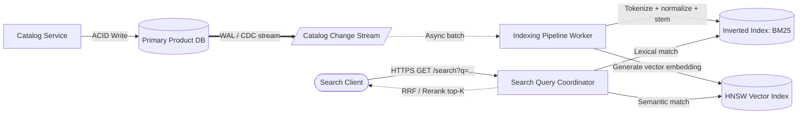

# 26 · Full-Text Search, Inverted Indexes & Autocomplete

**Level:** Intermediate → Advanced · **Status:** Draft · **Module:** 05 · Asynchronous Systems, Streaming & Search

## Learning objectives
- Explain why `WHERE title LIKE '%wireless%'` destroys relational database performance at scale.
- Trace how an **inverted index** stores compressed posting lists and scores matches with **BM25**.
- Design **sub-50ms typeahead autocomplete** using prefix tries with precomputed top-K lists and Finite State Transducers (FSTs).
- Synchronize primary OLTP writes to lexical + vector search indexes asynchronously via CDC without coupling user checkout/save latency to search indexing.

---

## 1. The Problem: `LIKE '%noise cancelling%'` just froze the catalog database

Your e-commerce catalog has **12 million products**. Users type queries like `"noise cancel headphones"` or typos like `"wireles charger"` into the search bar—and expect live autocomplete suggestions on **every keystroke within 50 ms**.

Initially, the backend ran `SELECT * FROM products WHERE title ILIKE '%noise%' AND title ILIKE '%cancel%'` against PostgreSQL. A B+Tree index only accelerates *left-anchored* prefixes (`LIKE 'noise%'`), not middle-word matches (`%cancel%`), forcing full sequential scans across `12 million` rows (`3.8 seconds p95`)! Worse, ranking by relevance (`exact title match` above `mentions headphones in footer`) and handling typos is awkward in raw SQL.

Search engines flip the data structure upside down: instead of mapping `document -> words`, they map **`word -> sorted document IDs`**.

---

## 2. Mental Model: The index at the back of a textbook

- **Relational Table / B+Tree:** Like flipping through all 800 pages of a textbook from page 1 to page 800 to find every mention of *"quorum"*.
- **Inverted Index:** Like the **Index at the back of the textbook**: look up `"quorum"` alphabetically in milliseconds and jump directly to the exact list of pages `[42, 118, 305]` (**posting list**). To find `"quorum" AND "raft"`, intersect `[42, 118, 305]` with `[19, 118, 410]` → `[118]`.
- **Prefix Trie for Autocomplete:** Like a predictive phone tree where every path `w -> i -> r -> e` already holds a sticky note listing the **top 5 most popular searches** starting with `"wire"`, so answering a keystroke takes `4` pointer hops (`< 1 ms`) instead of scanning `50,000` descendant words.

Key terms:
- **Analyzer / Tokenizer:** Pipeline converting raw text (`"Running Shoes!"`) into normalized searchable terms (`["run", "shoe"]`) via lowercasing, punctuation stripping, stopword removal, and stemming.
- **Posting List:** Sorted list of document IDs (plus term frequencies and positions) containing a given term.
- **BM25 (Best Matching 25):** Standard probabilistic ranking formula scoring documents by term frequency (with saturation), inverse document frequency (rarity), and document length normalization.
- **Prefix Trie / FST:** Tree/automaton data structure keyed by character prefix for `O(prefix_length)` autocomplete lookups.
- **Hybrid Search (BM25 + Vector):** Combining exact lexical keyword matching (BM25) with semantic embedding similarity (HNSW vector index), often merged via Reciprocal Rank Fusion (RRF).

---

## 3. How It Works Under the Hood

### Async Search Synchronization Pipeline

Never update your primary DB and Elasticsearch/OpenSearch synchronously in one API call (dual-write hazard!). Instead, stream mutations from the primary DB via **WAL / CDC** (Lesson 25):

*(Source diagram: [search-indexing-pipeline.mmd](../diagrams/search-indexing-pipeline.mmd))*

### Inside an Inverted Index & BM25 Scoring

1. **Index Time (Immutable Segments, LSM-Style):** Lucene/Elasticsearch writes incoming batches to an in-memory buffer and periodically flushes immutable **index segments** (every `1 s` refresh interval by default, making search *near-real-time*), merging small segments in the background.
2. **Posting List Compression & Intersection:** Document IDs are delta-encoded (`[100, 105, 112]` → `[100, +5, +7]`) and bit-packed (Frame-of-Reference / Roaring Bitmaps). Multi-term `AND` queries intersect the **shortest posting list first** (`"titanium"` has `400` docs vs `"phone"` having `2M` docs) using skip-pointers (`advance()`), skipping `99.9%` of comparisons!
3. **Why BM25 beats raw TF-IDF:**
   - **Term Frequency saturation:** A 100-word review mentioning `"battery"` `50` times shouldn't score `50×` higher than one mentioning it `4` times. BM25 saturates term frequency via parameter `k1` (typically `1.2`).
   - **Length normalization (`b = 0.75`):** Penalizes giant spammy descriptions vs concise matching titles.

### Sub-50ms Typeahead Autocomplete Architecture

- **Naive Trie Problem:** Walking down `"a"` and running DFS over `800,000` completions takes `100+ ms`.
- **Top-K Cached Trie:** Offline (every 15–60 min from aggregated query logs), build a Trie storing **precomputed top-`K` (`K = 5` or `10`) `(query, score)` entries directly on every node**. Lookup for `"app"` takes `3` node hops (`< 1 ms`), zero sorting at request time!
- **Memory Compression:** At `50M` strings, raw pointer-heavy Tries consume tens of GiBs. Production engines compress common suffixes as well as prefixes into a **Finite State Transducer (FST)** or Radix Tree, cutting RAM `5–10×` so the entire trie fits in L3/RAM on edge servers.
- **Client-side protections:** Debounce keystrokes (`100–150 ms`), cache prefix responses on CDN/Edge for popular `1–3` character prefixes (`"i"`, `"ip"`, `"iph"` account for a huge fraction of traffic!), and cancel stale in-flight XHRs.

---

## 4. Worked Example & Interactive Visualization

Let's size **inverted index memory/disk**, **autocomplete Trie RAM**, and **search QPS** for our 12M-product catalog:

**Workload assumptions:**
- Corpus: `12,000,000` products (`1.5 KB` searchable text/JSON each = `18 GB` raw text)
- Inverted index expansion factor (postings + positions + term dictionary + stored fields): `~1.8×` raw text (`~32.4 GB`), plus `768-dim float32` embeddings for hybrid semantic search: `12M × 768 × 4 bytes = 36.86 GB` raw vectors (`~55 GB` with HNSW graph edges!)
- Search QPS: `3,000` full-text queries/s peak; Autocomplete QPS: `18,000` keystroke queries/s peak (`6` keystrokes per search)
- Autocomplete dictionary: `5,000,000` unique popular phrases, top-5 cached per node

**Calculations:**
1. **Search Cluster Sharding:**
   With `RF = 2` (primary + 1 replica per shard):
   - Lexical-only index footprint = `32.4 GB × 2 = 64.8 GB`. Fits comfortably on **4 data shards** (`~16 GB` per shard, keeping hot OS page-cache warm in `32 GiB` RAM instances).
   - Hybrid Lexical + HNSW Vector footprint = `(32.4 + 55) × 2 ≈ 175 GB` total → size to **6–8 shards** with `64 GiB` RAM each so HNSW graphs stay **100% resident in RAM** (disk-spilled HNSW kills `p99` latency!).
2. **Autocomplete Memory & Latency Budget (`50 ms` E2E):**
   - Network RTT (`25 ms`) + API Gateway (`3 ms`) leaves **`< 15 ms` server budget**.
   - Precomputed Top-5 Trie/FST lookup in RAM: **`0.2–1.5 ms` p99** (`18,000 QPS` easily served by `3–4` stateless trie nodes behind an edge cache absorbing `60%` of `1–2` char prefixes).
   - Average `10` bytes/phrase compressed FST + top-5 IDs ≈ `~1.2–2.5 GiB` RAM—replicated in full inside every autocomplete pod!

**Interactive Visualization (`anim-inverted-index-lookup`):**
In `anim-inverted-index-lookup`, type multi-word queries and watch the tokenizer normalize terms, intersect compressed posting lists via skip-pointers, and compare raw prefix DFS against `O(len)` top-K Trie lookup.

---

## 5. Trade-Offs & Failure Modes

| Choice | Benefit | Cost / Risk | Fails When |
|---|---|---|---|
| **PostgreSQL `GIN` / `FTS5` (Built-in)** | Zero sync lag; single ACID DB; no extra cluster ops | Limited horizontal sharding, weaker relevance tuning & vector scale, shares OLTP IOPS | `> 500–2,000` complex search QPS or `10M+` docs needing custom BM25/synonym/HNSW pipelines |
| **Dedicated Inverted Index (OpenSearch / Elasticsearch)** | Fast BM25, faceting, fuzziness, distributed shards | Near-real-time (`1 s` lag); heavy JVM/heap tuning; dual-write/CDC pipeline required | Strict transactional reads (`read-your-own-writes` on checkout) or deep relational joins |
| **Precomputed Top-K Trie / FST** | Sub-millisecond prefix lookup (`O(prefix_len)`); CDN-friendly | Offline rebuild lag (`15–60 min`) for brand-new trending queries; extra RAM per node | Real-time personalized per-user search history or instant breaking-news autocomplete |
| **Hybrid BM25 + HNSW Vector** | Understands both exact SKUs/codes (`"RTX-4090"`) and intent (`"quiet commute audio"`) | `3–5×` higher RAM cost for HNSW graphs; two-stage RRF/reranking latency | Tight cost budgets or pure exact-match SKU/ID lookups |

### What changes at 10× and 100× scale?
- **At 10× (`120M` products, `30,000` search QPS):** Cross-shard fan-out (`scatter-gather` across 40 shards) amplifies tail latency and duplicates work. Partition documents by **tenant/marketplace** when isolated, and use **adaptive replica selection** + **query-result caching** for top head queries (Zipf distribution: top 5% of queries often drive 40%+ of search volume).
- **At 100× (`1.2B` documents, `300,000` QPS):** Storing full `float32` HNSW vectors in RAM (`3.7 TB` raw!) is cost-prohibitive. Apply **Scalar Quantization (`int8`, 4× smaller)** or **Product Quantization / DiskANN** with two-phase scoring (fast quantized retrieval of top-200 candidates → exact rescoring), and build **distributed sharded autocomplete tries** partitioned by first 1–2 characters.

---

## 6. Practical Exercise

Complete **[Lab 10 · Inverted Index Search & Sub-50ms Autocomplete Engine](../labs/10-search-autocomplete.md)**:
- Implement a tokenizer + BM25 inverted index and a Top-5 Cached Prefix Trie across `50,000` Zipf-weighted phrases/docs.
- Benchmark `p50`, `p95`, and `p99` query latency (`ms`) and memory (`MiB`) comparing naive DFS vs. precomputed Top-K lookup.

---

## 7. Retrieval Practice & Primary Sources

1. Why can a standard PostgreSQL B+Tree index accelerate `LIKE 'head%'` queries, yet fail completely on `LIKE '%headphones%'`?
2. How does storing **precomputed top-5 results on every Trie node** change autocomplete lookup time complexity, and what does it trade off?
3. Why should search index updates flow asynchronously via **CDC / event stream** rather than synchronously inside the Product Save HTTP request?
4. When does pure vector semantic search fail where BM25 lexical search succeeds (and vice versa)?

Hints

1. B+Trees sort strings lexicographically from left to right; a known prefix narrows to one contiguous key range, whereas a leading wildcard `%` can start with any letter, forcing a full index/table scan.
2. Lookup drops from `O(subtree_size)` DFS (potentially scanning millions of leaves on `"a"`) to `O(prefix_length)` (`1–10` hops), trading extra RAM at each node and periodic offline rebuilds.
3. Synchronous dual-writes couple OLTP catalog saves to search cluster latency/availability and risk partial-failure inconsistency if one store commits and the other fails.
4. Vector search struggles with exact rare tokens like part numbers (`"ERR_504_X"`), SKUs, or exact names; BM25 struggles with synonyms and conceptual intent (`"noise blocking"` vs `"ANC"`). Hybrid search + RRF combines both.

### Primary Sources
- **Official Docs:** [Elasticsearch / OpenSearch · Inverted Index, Analyzers & BM25](https://www.elastic.co/guide/en/elasticsearch/reference/current/getting-started.html) — segment architecture, refresh intervals, and similarity scoring.
- **Engineering Deep Dive:** [Andrew Gallant (BurntSushi) · Index 1,600,000,000 Keys with Automata and Rust](https://burntsushi.net/transducers/) — authoritative explanation of Finite State Transducers (FSTs) in Lucene/Rust.
- **Research Paper:** Stephen Robertson & Hugo Zaragoza, *The Probabilistic Relevance Framework: BM25 and Beyond* ([PDF](https://www.staff.city.ac.uk/~sbrp622/papers/foundations_bm25_review.pdf)).
- **Search Architecture:** [Pinecone / Qdrant · Hybrid Search & Reciprocal Rank Fusion (RRF)](https://www.elastic.co/guide/en/elasticsearch/reference/current/rrf.html) — merging lexical and dense vector rankings.

---

## Next
Continue to [27 · Batch, Stream Processing & Real-Time OLAP](27-stream-olap.md).
