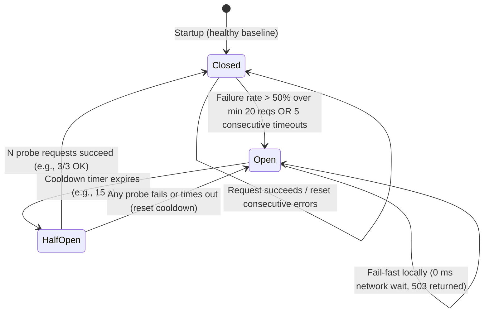

# 28 · Partial Failure, Timeouts, Backoff, Jitter & Circuit Breakers

**Level:** Advanced · **Module:** 06 (Distributed Systems Theory & Coordination) · **Status:** Draft

## Learning objectives

By the end of this lesson, you should be able to:
- Distinguish **partial failure** (slow, hanging, or packet-dropping dependencies) from clean crash-stop failures.
- Calculate retry amplification across multi-hop RPC chains and prevent **metastable retry storms**.
- Apply **bounded deadlines**, **Exponential Backoff with Full Jitter**, and **retry budgets**.
- Implement a **Circuit Breaker** (`Closed -> Open -> Half-Open`) without turning transient blips into prolonged outages.

---

## 1. The Problem: When a 10-Second Glitch Causes a 45-Minute Outage

Suppose an e-commerce **Checkout API** serves `1,000 req/s` and calls three downstream microservices synchronously: **Auth**, **Inventory**, and **Payment Ledger**. At `14:02:00`, a brief `10 s` lock contention event inside the Payment Ledger database slows queries from `25 ms` to `4,500 ms` and cuts throughput to `150 req/s`.

Each Checkout caller is configured with a well-intentioned reliability rule: *"If a downstream call fails or times out after `2,000 ms`, retry up to `3` times immediately."*

Within `4 seconds`, Checkout workers hold thousands of open sockets waiting on slow Ledger calls, while every timeout triggers `3` more requests. Offered load on the struggling Ledger jumps from `1,000 req/s` to `4,000 req/s`. At `14:02:10`, the original database lock clears—**yet the system stays dead until `14:47:00`** when on-call engineers manually shed external traffic. The recovery itself became impossible because retries kept the dependency pinned above `100%` saturation.

---

## 2. Mental Model

On a single machine, a failed function call throws an exception or crashes the whole process cleanly. Across a network, failure is **non-deterministic and partial**: packets are delayed, dropped, or arrive after the caller already gave up.

Think of a crowded highway toll plaza after an accident clears:
- **Timeouts** stop drivers from parking indefinitely at a broken booth.
- **Exponential Backoff** tells drivers to wait longer after each failed attempt instead of tailgating.
- **Jitter** spreads drivers out randomly so all `1,000` cars do not hit the booth at the exact same millisecond.
- **Retry Budgets** cap how many extra retry cars can enter the road relative to healthy traffic.
- **Circuit Breakers** close the on-ramp temporarily when the plaza is jammed, letting the backlog drain before sending a small probe car (`Half-Open`) to test recovery.

Key terms:
- **Partial failure:** A state where some components or network links degrade, hang, or drop packets while the rest of the system keeps running.
- **Gray failure:** Subtle degradation (e.g., high tail latency or `15%` packet loss) that passes simple `HTTP 200 /health` checks while harming user traffic.
- **Metastable failure:** A self-sustaining outage where a temporary overload triggers feedback loops (retries, GC pauses, cache misses) that keep the system overloaded even after the original trigger disappears.

---

## 3. How It Works Under the Hood

### Layer 1: Bounded Timeouts & Deadline Propagation
A timeout without a global **deadline** fails across multi-hop calls. If `Gateway` has a `1,000 ms` user SLA, `Order Service` has spent `750 ms` parsing and querying inventory, and then sends a call to `Payment` with a fresh `1,000 ms` timeout, `Payment` works on a request the client will abandon in `250 ms`.

Instead, propagate an absolute deadline header (e.g., `Grpc-Timeout` or `X-Request-Deadline-Ms`):
1. Gateway sets `deadline = now + 1,000 ms`.
2. Each hop computes `remaining = deadline - now` and refuses to start downstream work if `remaining < min_useful_time` (e.g., `50 ms`).
3. Distinguish **connect timeout** (fast, e.g., `100–300 ms` across a regional VPC) from **request/read timeout** (based on historical `p99.9`).

### Layer 2: Exponential Backoff with Full Jitter
Fixed or pure exponential backoff (`100 ms, 200 ms, 400 ms`) causes **synchronized retry waves**: all callers that failed during the same `100 ms` outage wake up together at `t + 100 ms`, `t + 300 ms`, and `t + 700 ms`.

The AWS Builders' Library **Full Jitter** formula eliminates clustering by picking uniformly between `0` and the exponential cap:

$$\text{sleep} = \text{random}\Big(0,\ \min\big(\text{cap},\ \text{base} \times 2^{\text{attempt}}\big)\Big)$$

### Layer 3: Per-Client Retry Budgets
Backoff alone still multiplies total volume during sustained outages. A **retry budget** (e.g., token bucket or rolling ratio capped at `10%` of successful requests, plus a minimum allowance like `10 req/s` for low-traffic services) guarantees that even if `100%` of downstream calls fail, retry traffic never exceeds `1.1×` normal load.

### Layer 4: Circuit Breaker State Machine
When a dependency is clearly broken, retrying—even with jitter—wastes caller threads and downstream accept queues. A **Circuit Breaker** tracks recent outcomes in a sliding window and transitions across three states (see [circuit-breaker-state.mmd](../diagrams/circuit-breaker-state.mmd)):

- **Minimum volume threshold (`min_samples = 20`):** Prevents `1` failed request at low traffic from tripping the breaker.
- **Fail-fast (`Open`):** Returns a cached fallback, degraded response, or `503` in `< 1 ms` without opening a socket.
- **Half-Open probe limit:** Only allows `1–3` concurrent probe requests after cooldown so `500` callers do not stampede a newly restarted dependency.

---

## 4. Worked Example & Interactive Visualization

Let's quantify retry amplification in a **3-hop synchronous chain**:

`Gateway -> Order API -> Inventory API -> Primary DB`

Suppose steady-state traffic is `500 req/s`, average DB query time is `15 ms`, and **every hop** blindly sets `max_retries = 3` with a `2,000 ms` timeout.

1. **Worst-case retry amplification across `H = 3` hops:**
   $$\text{Amplification} = (1 + 3)^3 = 4^3 = 64\times$$
   During a brief DB stall, `500 req/s` from users can amplify into **`32,000 req/s`** hitting the Primary DB!
2. **Thread pool exhaustion via Little's Law (`L = λW`):**
   At `Order API`, if incoming rate is `500 req/s` and timeouts jump from `20 ms` (`0.02 s`) to `2,000 ms` (`2.0 s`), required concurrent worker threads/sockets grow from:
   - Healthy: `L = 500 × 0.02 = 10` concurrent connections.
   - Stalled: `L = 500 × 2.0 = 1,000` concurrent connections per tier (`100×` surge), exhausting `500`-connection pools and `256`-worker thread limits in under `1 second`.
3. **Hardened design numbers:**
   - Retry **only at the outermost idempotent edge** (`Order -> Inventory` disabled if `Gateway` retries, or use a `10%` retry budget per hop: `1.1^3 = 1.33×` max amplification instead of `64×`).
   - Full Jitter with `base = 50 ms`, `cap = 1,000 ms`, max `2` retries (`<= 3` total attempts), plus `deadline = 800 ms` propagated downstream.
   - Circuit breaker opens at `> 50%` error/timeout rate over `20` requests (`min 10 s` window) with `15 s` cooldown and `3` Half-Open probes.

> **Interactive Visualization (`sim-retry-jitter-circuit`):** In the companion simulation [sim-retry-jitter-circuit](../animations-and-visuals.md), simulate `1,000` concurrent clients hitting a `200 req/s` dependency during a `10 s` brownout. Toggle between **Immediate Retry**, **Exponential Backoff**, **Full Jitter**, and **Full Jitter + Circuit Breaker** to observe downstream QPS spikes and recovery time.

---

## 5. Trade-Offs & Failure Modes

| Mechanism | Benefit | Cost / Risk | Fails When |
|---|---|---|---|
| **Tight Per-Attempt Timeouts** | Frees blocked sockets/threads quickly | False positives during legitimate slow spikes; partial writes | Server still executes work after caller hangs up (must cancel/check deadline) |
| **Retries + Full Jitter** | Masks transient packet drops & rolling restarts | Amplifies load during real capacity outages; unsafe on non-idempotent POST | Missing `Idempotency-Key` causes duplicate charges or double writes |
| **Retry Budget (`10%`)** | Hard upper bound on retry amplification | Legitimate retries dropped if budget shared across unrelated tenants | Noisy tenant burns shared budget unless partitioned per tenant/route |
| **Client Circuit Breaker** | Stops calling dead dependencies in `< 1 ms` | Per-pod state disagrees across `100` pods; sticky `Open` if probe fails once | Health recovers unevenly or `min_samples` is too low at off-peak QPS |
| **Hedged Requests** | Cuts tail latency (`p99`) by racing a backup call after `p95` delay | Immediately adds `5%–10%` extra baseline load (`2×` on slow calls) | System is already near CPU/DB saturation (hedging worsens overload) |

### What changes at 10× and 100× scale?
- **At 10× (`5,000 req/s`, `50` client pods):** Each pod has `~100 req/s`, so local in-memory circuit breakers sample quickly (`20` reqs in `200 ms`), **but** pods trip and probe independently. Use **adaptive concurrency limits** (like Netflix Gradient/AIMD or Envoy outlier detection) alongside local breakers.
- **At 100× (`50,000 req/s`, `500` client pods):** When `500` pods all enter `Half-Open` within the same second, `500 × 3 = 1,500` probes hit a cold restarted backend simultaneously. Add **jitter to the Open cooldown timer** (`15 s ± 5 s`), use **lazy/gradual warm-up** (Envoy slow-start), and move coarse load shedding to L7 proxies/service meshes.

---

## 6. Practical Exercise

Run the local fault-injection experiment in [Lab 11 · Retry Storms, Jitter & Circuit Breakers](../labs/11-retry-storm-circuit-breaker.md) to measure how naive retries keep a recovered downstream service pinned in metastable overload, and verify the exact `p99` and recovery-time improvement under Full Jitter + Retry Budget + Circuit Breaker.

---

## 7. Retrieval Practice

1. Why can a `10 s` database slowdown cause a `45-minute` outage even after the database lock disappears?
2. Why does pure exponential backoff (`100 ms, 200 ms, 400 ms` without jitter) still overload a recovering server?
3. What is the worst-case amplification factor across `4` synchronous hops if every hop does `2` retries?
4. When is retrying a timed-out `POST /payments` request dangerous, and what prerequisite makes it safe?
5. Why should a Circuit Breaker require a minimum request count (e.g., `20` requests in `10 s`) before tripping to `Open`?

Hints

1. Retry amplification keeps offered load above `100%` of recovery capacity—a metastable feedback loop.
2. Clients that failed together during the same outage window wake up in synchronized spikes (`thundering herd`).
3. `(1 + 2)^4 = 3^4 = 81×` worst-case load on the leaf dependency.
4. The server may have committed the payment even though the response packet was lost; require an `Idempotency-Key` stored atomically with the payment record.
5. Otherwise `1` or `2` random errors during low-traffic overnight periods (`0.2 req/s`) would trip `100%` error rate and falsely block traffic.

---

## Primary Sources

- **Tier 4 (Eng Blog):** [AWS Builders' Library · Timeouts, Retries & Backoff with Jitter](https://aws.amazon.com/builders-library/timeouts-retries-and-backoff-with-jitter/) — Production guidance on retry amplification, deadline propagation, and retry budgets.
- **Tier 4 (Eng Blog):** [Marc Brooker · Exponential Backoff and Jitter](https://aws.amazon.com/blogs/architecture/exponential-backoff-and-jitter/) — Empirical comparison of No Jitter, Full Jitter, Equal Jitter, and Decorrelated Jitter.
- **Tier 4 (Eng Blog):** [Google SRE Book · Addressing Cascading Failures](https://sre.google/sre-book/addressing-cascading-failures/) — Root causes of retry storms, queue pileups, and fail-fast defenses.
- **Tier 3 (Paper):** [Metastable Failures in Distributed Systems (Bronson et al., HotOS '21)](https://sigops.org/s/conferences/hotos/2021/papers/hotos21-s11-bronson.pdf) — Formal model of triggers, feedback loops, and recovery barriers.

---

## Next

Continue to [29 · Time, Clocks, Ordering & Fencing Tokens](29-clocks-and-fencing.md).
