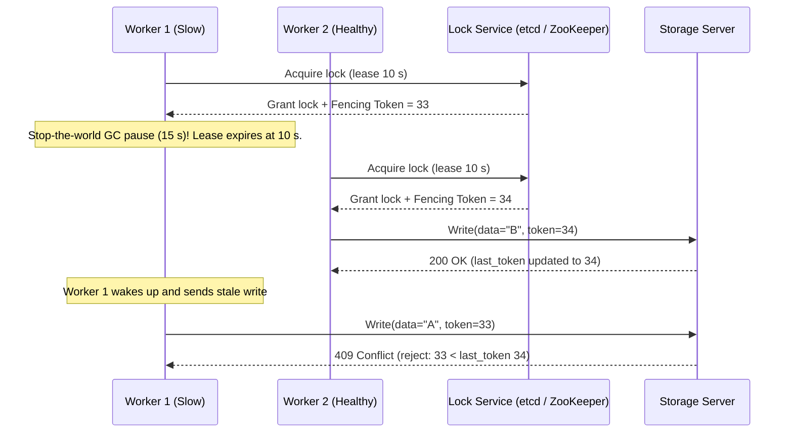

# 29 · Time, Clocks, Ordering & Fencing Tokens

**Level:** Advanced · **Module:** 06 (Distributed Systems Theory & Coordination) · **Status:** Draft

## Learning objectives

By the end of this lesson, you should be able to:
- Explain why physical wall clocks (`CLOCK_REALTIME` / `Date.now()`) jump backward and skew across servers.
- Choose **monotonic clocks** (`CLOCK_MONOTONIC`) for elapsed-time measurements and timeouts.
- Compare **Lamport clocks**, **Vector clocks**, and **Google TrueTime (`2ε`)** for causal and external ordering.
- Prevent split-brain data corruption using **storage-enforced monotonic fencing tokens**.

---

## 1. The Problem: The Ghost Write That Corrupted Storage

Suppose you run a distributed billing worker fleet where only one worker at a time may compact and overwrite a tenant's ledger file in Object Storage. You add a Redis lock with a `10,000 ms` (`10 s`) TTL lease:

1. At `t = 0.0 s`, **Worker A** acquires the lock (`TTL = 10 s`) and checks its local clock: *"I have until `10.0 s`."*
2. At `t = 0.2 s`, Worker A pauses for **`15.0 s`** due to a stop-the-world JVM/Go GC pause (or VM live migration / disk I/O stall).
3. At `t = 10.0 s`, the lock expires in Redis. **Worker B** acquires the lock, reads the file, appends a new transaction, and writes safely at `t = 11.5 s`.
4. At `t = 15.2 s`, Worker A wakes up from its pause, unaware that `15 s` elapsed. It sends its stale `PUT /ledger/tenant-42` request—and **silently overwrites Worker B's update**!

Even worse, suppose someone replaced locks with *"Last-Write-Wins (LWW) using client timestamps."* If Worker B's NTP clock happened to lag `200 ms` behind Worker A's clock, Worker B's causally **later** write carries a **smaller** timestamp and is silently discarded.

---

## 2. Mental Model

In a single-core program, every instruction happens along one shared timeline. In a distributed system, **there is no global clock**—only independent quartz crystals drifting by `10–50 ppm` (`~1–4 seconds/day`), periodically nudged by NTP over variable network paths.

Think of two hikers with slightly inaccurate wristwatches sending postcards across mountains:
- **Wall clock (`CLOCK_REALTIME`):** Tells you the date on the wall, but someone can reset the watch backward at any time. Never use it to time a `500 ms` lock or measure latency!
- **Monotonic clock (`CLOCK_MONOTONIC`):** A stopwatch that only ticks forward on *one* machine. Great for elapsed time (`timeout`), useless for comparing events across *two* machines.
- **Logical clocks (Lamport / Vector):** Ignore wristwatches completely and number postcards (`Msg #1 -> Msg #2`) based on cause-and-effect (*"I read your card #4, so my reply is #5"*).
- **Fencing tokens:** A ticket dispenser at a deli counter. Even if Customer #33 falls asleep for `15 minutes`, the counter clerk is already serving `#34` and refuses to fulfill `#33`'s stale order.

Key terms:
- **Clock skew / drift:** Difference in time values between two clocks (`skew`) and the rate at which a quartz clock gains or loses seconds relative to UTC (`drift`).
- **Happens-before (`a -> b`):** Causal relation defined by Lamport: if `a` occurs before `b` in the same process, or `a` sends a message received by `b`, then `a` causally precedes `b`.
- **Fencing token:** A strictly monotonically increasing integer issued by a lock/coordination service on every lock acquisition, verified by the target storage engine on every write.

---

## 3. How It Works Under the Hood

### Physical Clocks: Wall vs. Monotonic vs. TrueTime
1. **Wall Clock (`gettimeofday` / `System.currentTimeMillis()`):** Synchronized via NTP. If local drift exceeds thresholds (or during leap seconds), NTP may **step backward**, causing `end - start` durations to become negative or TTLs to appear valid forever.
2. **Monotonic Clock (`clock_gettime(CLOCK_MONOTONIC)` / `time.monotonic()`):** Guaranteed never to go backward on a host (subject to slew rate adjustments, not step jumps). **Rule:** Always use monotonic clocks for timeouts, circuit breaker cooldowns, and latency histograms; use wall clocks only for human-readable log timestamps.
3. **Google TrueTime (Spanner):** Instead of returning a point timestamp `t`, TrueTime returns a bounded uncertainty interval `[earliest, latest]` using GPS receivers and atomic clocks in every datacenter (`ε` half-width is typically `1–7 ms`). To guarantee **external consistency**, Spanner executes a **commit wait**: after choosing timestamp `s = TT.now().latest`, the leader waits until `TT.after(s)` (`TT.now().earliest > s`), sleeping `~2ε` (`2–14 ms`) before releasing locks or returning to the client. Thus any later transaction is guaranteed to receive `s' > s`.

### Logical Clocks: Lamport vs. Vector Clocks
- **Lamport Clock:** Each node keeps an integer counter `C`:
  - Increment `C = C + 1` before each local event or send.
  - Attach `C` to every outgoing message; on receipt of `m` with `C_m`, set `C = max(C, C_m) + 1`.
  - **Guarantee:** `a -> b => C(a) < C(b)`. **Limitation:** `C(a) < C(b)` does **not** tell you whether `a` caused `b` or they were **concurrent** (`a || b`).
- **Vector Clock:** Each of `N` nodes keeps an array `V[1..N]` of counters. Comparing `V(a)` and `V(b)` distinguishes **causal precedence** (`V(a) < V(b)`) from **concurrent conflict** (`V(a)` and `V(b)` neither strictly dominates the other), enabling Dynamo-style sibling conflict detection.

### Fencing Tokens End-to-End
Locks *never* provide safety by themselves if the resource being protected does not check a token.



> **Crucial insight:** Even if Worker 1 checks `if (localClock < lockExpiry)` right before calling `DB.Write`, a network delay *after* that `if` statement (packet delayed in a switch buffer for `5 s`) still causes the same corruption unless `DB` checks `token > last_token` atomically!

---

## 4. Worked Example & Interactive Visualization

Let's size a fencing-enabled ledger update and compare TrueTime vs. NTP LWW failure margins:

1. **NTP Clock Skew vs. LWW Data Loss:**
   - Standard cloud VM NTP sync keeps `ε` within `±10–50 ms`, and occasional asymmetric routing or paused VM resume can push skew to `250–2,000 ms`.
   - At `5,000 writes/s` on hot keys (e.g., collaborative document edits or inventory decrements), a `200 ms` clock skew means up to `5,000 × 0.2 = 1,000` cluster-wide writes/sec fall inside the ambiguity window where a causally *newer* write can carry an *older* timestamp and get silently dropped by LWW.
2. **Storage Fencing Check Overhead:**
   - Storing an unsigned 64-bit `last_fencing_token` per protected partition/row adds `8 bytes` of state.
   - Conditional write in PostgreSQL or DynamoDB:
     ```sql
     UPDATE tenant_ledgers
     SET balance_cents = $1, last_fencing_token = $2
     WHERE tenant_id = $3 AND last_fencing_token < $2;
     ```
     If `rows_affected == 0`, the worker knows its lease was superseded and aborts immediately—`0` extra network hops compared to an unfenced write.
3. **TrueTime Commit-Wait Cost:**
   - With `ε = 3 ms` (`2ε = 6 ms` average wait), a single Spanner shard holding locks across a transaction pays `6 ms` of extra lock-hold time. At `100%` contention on one hot row, max throughput on that single row is capped at `1,000 ms / 6 ms ≈ 166 tx/s` (versus `~1,000 tx/s` for `1 ms` local memory locks).

> **Interactive Visualization (`anim-fencing-tokens`):** Step through [anim-fencing-tokens](../animations-and-visuals.md) to trigger a `15 s` GC pause on Client 1, watch Redis/etcd expire the lease and grant Client 2 token `34`, and toggle **Storage Token Enforcement ON/OFF** to observe silent corruption vs. `409 Conflict` rejection.

---

## 5. Trade-Offs & Failure Modes

| Mechanism | Benefit | Cost / Risk | Fails When |
|---|---|---|---|
| **Wall-Clock LWW** | Zero coordination; tiny metadata (`8 B` timestamp) | Silently drops causally newer writes under NTP skew | Concurrent hot-key updates or VMs resuming with stale RTC |
| **Monotonic Clock** | Never steps backward; safe for durations/TTLs | Host-local only; cannot compare across two servers | Used to build cross-node event logs or distributed IDs |
| **Vector Clocks** | Captures exact causality & detects concurrent conflicts | Metadata grows `O(N_writers)` per key; needs pruning | Open-ended dynamic clients write directly (client IDs explode) |
| **TrueTime (`2ε` wait)** | Global external consistency without central lock bottleneck | Requires GPS + atomic clocks; commit-wait limits hot-row TPS | GPS antenna/clock drift spikes `ε` -> commit-wait stalls throughput |
| **Lock + Fencing Token** | Strict mutual exclusion across crashes & GC pauses | Requires a linearizable token generator (Raft/Paxos) AND storage check | Target external API (e.g., Stripe webhook/S3 without conditional `If-Match`) ignores tokens |

### What changes at 10× and 100× scale?
- **At 10× (`10,000` concurrent locks/s):** A single Redis/etcd key-level lock becomes noisy; shard locks by `tenant_id` or `partition_id` and generate per-key `fencing_token` sequences (or Raft log index `modRevision` in etcd) rather than one global counter.
- **At 100× (`100,000+` writes/s across nodes):** If you cannot modify a legacy 3rd-party sink to check `fencing_token`, you cannot rely on distributed locks for exactly-once safety—you must design **idempotent operations** (idempotency keys, compare-and-set ETags on S3, or double-entry append-only ledgers) or route writes through a single partitioned Kafka consumer.

---

## 6. Practical Exercise

Pick an object store or relational table you use (`PostgreSQL` or `S3`):
1. Write the exact conditional check (`UPDATE ... WHERE token < $new` or S3 `If-Match: <etag>` / `If-None-Match: *`) that turns an unsafe advisory lock into a fenced write.
2. Trace what happens if a worker receives a `500` timeout from the database *after* submitting a fenced write: can it safely retry with the *same* fencing token, or must it re-acquire a new lease? (Hint: if its lease expired, another worker may have acquired `token + 1`!)

---

## 7. Retrieval Practice

1. Why is `time.Now()` (wall clock) dangerous for computing lock expiration or measuring RPC latency?
2. What is the difference between a Lamport clock and a Vector clock when comparing two events `A` and `B`?
3. Why does a Redis `SET key uuid NX PX 10000` lock *still* fail to guarantee mutual exclusion even with a safe Lua `unlock-if-uuid-matches` script?
4. How can a storage backend that does *not* support custom integer fencing tokens (like Amazon S3) still prevent stale-writer overwrites?
5. Why does Google Spanner perform a `2ε` commit wait instead of returning immediately after Paxos consensus commits?

<details><summary>Hints</summary>
1. NTP adjustments or leap seconds can jump wall clocks backward or forward abruptly; use a monotonic clock (`CLOCK_MONOTONIC`) for elapsed durations.
2. Lamport guarantees `A -> B => C(A) < C(B)`, but not the converse; Vector clocks can distinguish `A -> B` from true concurrency `A || B`.
3. The pause (GC/network delay) happens *after* the worker checks the lock and *before* its write reaches the target database; `DEL` safety only prevents deleting someone else's lock, not sending a stale write.
4. Optimistic concurrency control using conditional `PUT` with `If-Match: "<prior-ETag>"` (version/ETag acts as a per-object fencing check).
5. To ensure any transaction that starts in real time *after* T1 returns gets a strictly greater timestamp (`T2.s > T1.s`), preserving external consistency across non-zero clock uncertainty `ε`.
</details>

---

## Primary Sources

- **Tier 4 (Eng Blog):** [Martin Kleppmann · How to Do Distributed Locking](https://martin.kleppmann.com/2016/02/08/how-to-do-distributed-locking.html) — Canonical analysis of GC pauses, Redlock, and fencing tokens.
- **Tier 3 (Paper):** [Time, Clocks, and the Ordering of Events in a Distributed System (Lamport, 1978)](https://lamport.azurewebsites.net/pubs/time-clocks.pdf) — Foundational logical clocks and happens-before relation.
- **Tier 3 (Paper):** [Spanner: Google's Globally-Distributed Database (Corbett et al., OSDI '12)](https://research.google/pubs/spanner-googles-globally-distributed-database/) — TrueTime uncertainty bounds (`[earliest, latest]`) and commit-wait protocol.
- **Tier 4 (Eng Blog):** [AWS · Keeping Time With Amazon Time Sync Service](https://aws.amazon.com/blogs/mt/keeping-time-with-amazon-time-sync-service/) — Practical NTP/PTP clock error bounds in cloud environments.

---

## Next

Continue to [30 · Consistency Models, Quorums (`R + W > N`) & CRDTs](30-consistency-quorums.md).
