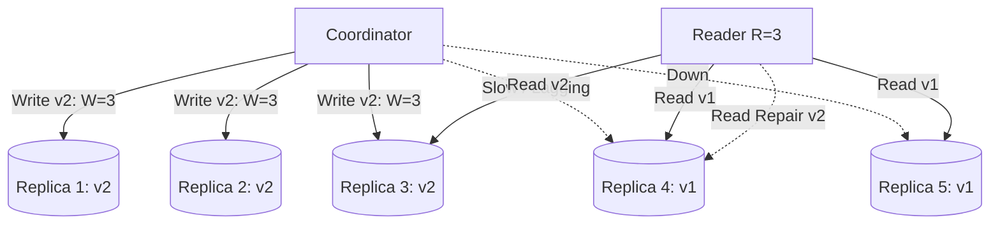

# 30 · Consistency Models, Quorums (`R + W > N`) & CRDTs

**Level:** Advanced · **Module:** 06 (Distributed Systems Theory & Coordination) · **Status:** Draft

## Learning objectives

By the end of this lesson, you should be able to:
- Order consistency models from strongest to weakest (**Linearizable -> Sequential -> Causal -> Eventual**) with concrete user-visible examples.
- Configure **`N, R, W`** replication quorums (`R + W > N`) and explain how **read repair**, **anti-entropy Merkle trees**, and **sloppy quorums** affect freshness.
- Identify subtle edge cases where `R + W > N` still fails linearizability.
- Design conflict-free shared counters, sets, and collaborative state using **CRDTs**.

---

## 1. The Problem: When "Eventually Consistent" Loses Items in a Shopping Cart

Suppose you build a globally replicated user shopping cart across `N = 3` replicas (`Replica 1, 2, 3`) using leaderless writes (`W = 1`) and single-replica reads (`R = 1`) for `5 ms` latency.

1. A user adds `"Wireless Headphones"` (`Replica 1` acknowledges `200 OK`; async replication to `2` and `3` lags by `40 ms`).
2. `10 ms` later, the user refreshes the page; the load balancer routes the read to `Replica 2`. The cart looks **empty**!
3. Worse: the user adds `"USB-C Cable"` (`Replica 3` receives it), and then both replicas overwrite each other via Last-Write-Wins (LWW)—one item vanishes permanently.

How do we tune replication overlap to stop stale reads, and when does mathematical convergence (CRDTs) beat timestamps?

---

## 2. Mental Model

Consistency models are **contracts** between a data store and its callers about what values a read is allowed to return after concurrent writes:

1. **Linearizability (Strong / External):** Looks like a single copy of data on one machine. Once any write finishes, *every* subsequent read anywhere sees that write (or a newer one).
2. **Sequential Consistency:** All nodes see writes in the same global order, and each client sees its own operations in program order—but that order doesn't have to match real-time wall clocks across different clients.
3. **Causal Consistency:** Operations that are causally related (`Question -> Answer`) must be seen by everyone in that order; unrelated concurrent operations (`Post A || Post B`) may appear in different orders to different readers.
4. **Eventual Consistency:** If writes stop, replicas converge to the same state eventually—with zero guarantee on *when* or *what order* intermediate reads see.

Key terms:
- **Strict Quorum (`R + W > N`):** Out of `N` replica owners for a key, every write waits for `W` acknowledgments and every read queries `R` replicas, guaranteeing at least one overlapping replica holds the newest version.
- **Read Repair & Merkle Trees:** Background and inline mechanisms that heal lagging replicas by pushing newer versions (`read repair`) or comparing hash trees of key ranges (`anti-entropy`).
- **CRDT (Conflict-free Replicated Data Type):** A data structure whose merge operation is **commutative, associative, and idempotent** (`join-semilattice`), guaranteeing identical state across replicas regardless of message order or duplicates.

---

## 3. How It Works Under the Hood

### Quorum Overlap (`R + W > N`)
When a coordinator writes key `k` with `W = 3` and reads with `R = 3` across `N = 5` replicas, the Pigeonhole Principle guarantees that the read set and write set intersect on at least `(R + W) - N = 1` replica:

- Coordinator collects `(value, version)` from `R = 3` nodes (`R3=v2, R4=v1, R5=v1`), picks the highest version (`v2`), returns `v2` to the client, and asynchronously issues **Read Repair** to `R4`.
- **Background Anti-Entropy:** Replicas exchange **Merkle trees** (binary trees of SHA-256 hashes over key-range buckets) to locate out-of-sync keys in `O(log K)` hashes without transferring whole databases.

### Why `R + W > N` Is Necessary—But NOT Sufficient for Linearizability!
Even with `R + W > N`, leaderless Dynamo quorums (`Cassandra`, `DynamoDB` without Paxos) can still violate linearizability in three situations:
1. **Sloppy Quorums & Hinted Handoff:** During a network partition, if only `2` of the `N = 5` home replicas are reachable, a sloppy quorum writes to a `3rd` standby node with a "hint". Readers querying the home nodes won't see the hinted write until the partition heals.
2. **Concurrent Writes + LWW:** Two concurrent writes at `W = 2` on `N = 3` can interleave across replicas (`R1` sees `A`, `R2` sees `B`, `R3` sees `B` first then `A`).
3. **Partial Write Failure + Read Anomaly:** A write succeeds on `1` replica (`R1`) and fails on `R2, R3`, returning `500 Error` to the caller (`W = 2` failed). A subsequent reader hitting `R1` sees the "failed" write, while another reader hitting `R2, R3` does not—**not atomic/linearizable** unless readers also repair or consensus commits it.

### Conflict-Free Replicated Data Types (CRDTs)
Instead of resolving concurrent writes by throwing one away (`LWW`), CRDTs make concurrent updates mathematically mergeable:
- **G-Counter (Grow-only Counter):** Each replica `i` stores a vector `P[1..M]` and only increments its own slot `P[i] += 1`. Value = `sum(P)`. Merge = element-wise `max(P_a[i], P_b[i])`.
- **PN-Counter:** Two G-Counters (`P` for increments, `N` for decrements); value = `sum(P) - sum(N)`.
- **OR-Set (Observed-Remove Set):** Tags each added element with a unique `(node_id, seq)` token; `remove(x)` only removes tokens *observed* locally, so a concurrent `add(x)` on another replica survives instead of being clobbered.
- **State-based (CvRDT)** sends full state and merges via a commutative, associative, idempotent function (`merge(A, B)`). **Op-based (CmRDT)** ships small operations (`+1`) over reliable, causally ordered delivery.

---

## 4. Worked Example & Interactive Visualization

Let's size a `N = 5` replica cluster serving `10,000 req/s` (`8,000 reads/s`, `2,000 writes/s`) across `3` Availability Zones (`1 ms` intra-AZ RTT, `3 ms` cross-AZ RTT):

| Configuration | `R + W > N`? | Fault Tolerance (Reads / Writes) | Coordinator Wait Latency (Best `K` of `N`) | Anomaly Risk |
|---|---:|---:|---:|---|
| **`N=5, W=3, R=3`** | `6 > 5` (Yes) | Tolerates `2` down for R & W | `3rd` fastest node (`~3–5 ms`) | Stale only under sloppy quorum / concurrent LWW |
| **`N=5, W=5, R=1`** | `6 > 5` (Yes) | Reads tolerate `4` down; Writes tolerate **`0` down** | Read `1 ms`; Write waits on **slowest** node (`p99` spike!) | Any single dead node blocks ALL writes |
| **`N=5, W=1, R=5`** | `6 > 5` (Yes) | Writes tolerate `4` down; Reads tolerate **`0` down** | Write `1 ms`; Read waits on slowest (`p99` spike!) | Any single dead node blocks ALL reads |
| **`N=5, W=2, R=2`** | `4 <= 5` (No) | Tolerates `3` down for R & W | `2nd` fastest (`~1–2 ms`) | **Stale reads** (`1` non-overlapping replica) |

**Byte overhead of a `G-Counter` vs `LWW` scalar:**
- A `64-bit` LWW counter is `8 B` + `8 B` timestamp = `16 B`.
- A `G-Counter` across `5` replicas is `5 × 8 B = 40 B` (`2.5×` metadata)—trivial for a shopping cart or video view counter, **but** if tracked per *client device* (`100,000` devices), `100,000 × 8 B = 800 KB` per key! Always bound CRDT actor IDs to server replicas (`M <= 10–50`), not end-user devices, or garbage-collect tombstones.

> **Interactive Visualization (`sim-quorum-rw`):** Open [sim-quorum-rw](../animations-and-visuals.md) to adjust sliders for `N (3..7)`, `W`, and `R`, toggle individual replicas offline, and watch whether read/write sets overlap (`R + W > N`) or return stale values.

---

## 5. Trade-Offs & Failure Modes

| Approach | Benefit | Cost / Risk | Fails When |
|---|---|---|---|
| **Linearizable Consensus (`Raft`/`Paxos`)** | Zero stale reads; atomic conditional writes | `>= 1` WAN RTT per cross-region write; single-leader bottleneck | Network partitions isolate minority nodes (unavailable by CAP) |
| **Strict Quorum (`R + W > N`)** | Tunable read/write latency; no single leader bottleneck | Not strictly linearizable on partial write failures; tail latency `max(W)` | Sloppy quorum enabled during partition, or LWW drops concurrent updates |
| **Weak Quorum (`R + W <= N`)** | Ultra-low latency & high availability | Frequent stale reads & lost updates | Used for financial balances, unique usernames, or inventory stock |
| **CRDTs (PN-Counter, OR-Set)** | `100%` write availability even while partitioned; deterministic merge | State/tombstone metadata growth (`O(actors)` / `O(ops)`); limited invariants | Hard global constraints needed (e.g., `balance >= 0` cannot be merged blindly!) |

### What changes at 10× and 100× scale?
- **At 10× (`100,000 req/s`):** Synchronous read repair and full-key comparisons double intra-cluster bandwidth (`80k reads × 3 replicas = 240k internal RPCs/s`). Use **digest reads** (send `R` full-payload request to `1` replica and lightweight SHA-256 hash requests to the other `R - 1` replicas) to cut network payload by `~66%`.
- **At 100× (`1M req/s` across regions):** Cross-region `R + W > N` quorums (`80 ms` RTT) kill interactive latency. Split state by invariant: use **CRDTs or causal local writes** for likes, carts, and presence, and **single-home consensus / reservation leases** for money and inventory.

---

## 6. Practical Exercise

Suppose you are designing a **Collaborative Document & Reaction Counter** (`N = 3` replicas across `US-East`, `US-West`, `EU-West`):
1. Choose consistency models separately for: (a) **Document ACL permissions** (`who can view`), (b) **Emoji reaction counts**, and (c) **Rich-text paragraph edits**.
2. Justify why `balance >= 0` (bank overdraft protection) **cannot** be solved safely with a `PN-Counter` CRDT across disconnected regions.

---

## 7. Retrieval Practice

1. Give a concrete user-facing anomaly prevented by **Linearizability** that **Sequential Consistency** allows.
2. With `N = 7` replicas, you need writes to tolerate `2` simultaneous node failures while minimizing read latency. What `W` and `R` values satisfy `R + W > N`?
3. Why does `R + W > N` with **sloppy quorum** fail to prevent stale reads?
4. How does a **digest read** reduce network bandwidth in a Dynamo-style quorum read?
5. Why must a **CRDT** merge function be commutative, associative, and idempotent?

Hints

1. Alice posts an update, phones Bob ("check the page!"), and Bob refreshes immediately. Linearizability guarantees Bob sees it; Sequential Consistency allows Bob's replica to still be slightly behind real-time as long as the global order is consistent.
2. Max `W = 7 - 2 = 5` (tolerates 2 down); then `R > 7 - 5 => R = 3`. (Or `W = 5, R = 3`, though check whether reads also need to tolerate failures: `R = 3` tolerates `4` down).
3. Sloppy quorum writes to temporary fallback nodes outside the canonical `N` replicas, so readers querying `R` canonical nodes miss the write.
4. Coordinator requests the full value from only `1` (closest) replica and requests tiny cryptographic hashes from the other `R - 1` replicas; full bodies are fetched only on hash mismatch.
5. So replicas can merge updates arriving in any order (commutative), in any grouping (associative), and even if duplicated by at-least-once delivery (idempotent), always reaching the exact same state.

---

## Primary Sources

- **Tier 3 (Docs/Site):** [Jepsen · Consistency Models](https://jepsen.io/consistency) — Formal lattice of single-object and transactional consistency guarantees.
- **Tier 3 (Paper):** [Dynamo: Amazon's Highly Available Key-value Store (DeCandia et al., SOSP '07)](https://www.allthingsdistributed.com/files/amazon-dynamo-sosp2007.pdf) — Vector clocks, `N/R/W` quorums, hinted handoff, and Merkle-tree anti-entropy.
- **Tier 3 (Paper):** [A Comprehensive Study of Convergent and Commutative Replicated Data Types (Shapiro et al., 2011)](https://inria.hal.science/inria-00555588/document) — Mathematical foundations of CvRDTs and CmRDTs.
- **Tier 5 (Book):** *Designing Data-Intensive Applications* (Martin Kleppmann, Ch. 5 & Ch. 9 — paid book) — Practical walkthrough of linearizability vs. causality and quorum edge cases.

---

## Next

Continue to [31 · CAP, PACELC & Consensus Algorithms (Raft / Paxos)](31-cap-consensus-raft.md).
