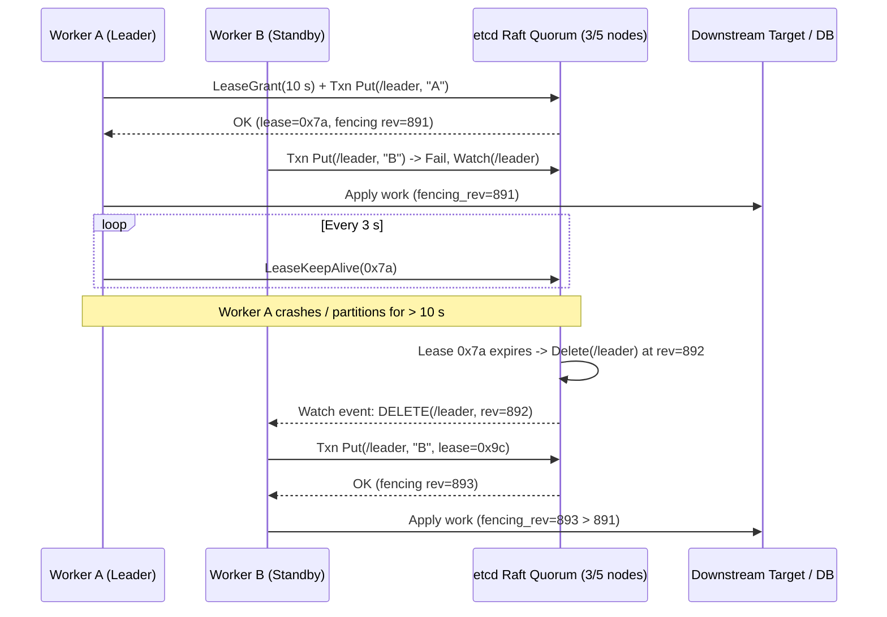

# 32 · Distributed Coordination, Leases & Locking

**Level:** Advanced · **Module:** 06 (Distributed Systems Theory & Coordination) · **Status:** Draft

## Learning objectives

By the end of this lesson, you should be able to:
- Describe the core primitives offered by consensus-backed coordination services (`etcd`, `ZooKeeper`, `Consul`, `Google Chubby`): **compare-and-swap (CAS)**, **leases/ephemeral nodes**, and **watches**.
- Implement **leader election** and **group membership** using lease heartbeats and revision-based fencing.
- Prevent the **herd effect** when `500` workers watch the same lock key.
- Enforce the strict boundary between **control-plane coordination** and **data-plane traffic**.

---

## 1. The Problem: A Cluster Without a Single Source of Truth

Suppose you deploy `20` stateless **Shard Manager** workers responsible for assigning `1,000` Kafka/DB partitions and triggering nightly billing runs. You want **exactly one** active Controller at any moment:

- If you hardcode `worker-0` as Controller, its machine crash leaves partitions unassigned until an engineer intervenes.
- If workers poll PostgreSQL every `1 second` with `UPDATE ... WHERE expires_at < NOW()`, a database failover or slow query stalls everyone—and `20` polling workers miss leader failures for whole seconds or storm the DB when a leader drops.
- Worse, a developer decides to also store `50 KB` user session blobs inside `etcd` *"because it's already strongly consistent,"* causing `etcd` compaction stalls and taking down Kubernetes cluster scheduling.

What are coordination services actually built for, how do TTL leases + watches work safely, and where are their hard limits?

---

## 2. Mental Model

A distributed coordination service (`etcd`, `ZooKeeper`, `Chubby`) is **an air-traffic control tower**, not a cargo airline:
- It handles **tiny, infrequent, high-stakes control decisions**: *Who is the active controller? Which shard lives on Node 7? Which config version is live?*
- **Leases (Ephemeral State):** Instead of holding a permanent lock that stays stuck forever if a worker crashes, the worker rents a **TTL lease** (`e.g., 10 s`) and renews it via `KeepAlive` heartbeats every `3 s`. If the worker dies, the tower automatically revokes the lease and deletes attached keys when the TTL expires.
- **Watches (Push Notifications):** Instead of polling *"Are we there yet?"* every `100 ms`, workers open a persistent gRPC watch stream on a key prefix and receive ordered events (`revision = 1042`) the millisecond leadership changes.

Key terms:
- **Control plane vs. Data plane:** Control plane manages topology, configuration, leader election, and routing rules (low QPS, tiny payloads, high consistency); data plane serves user requests and bulk records (high QPS, scalable storage).
- **Lease (`etcd`) / Ephemeral Node (`ZooKeeper`):** A server-managed TTL token bound to a client session; keys attached to the lease auto-delete when heartbeats stop.
- **Herd effect:** A thundering stampede when `N` waiting workers all wake up simultaneously on a single lock-release watch event, even though only `1` can acquire the lock.

---

## 3. How It Works Under the Hood

### Leader Election via Lease + CAS + Watch (`etcd` Pattern)
1. **Grant Lease:** Leader Candidate A requests a `10 s` lease (`LeaseGrant(ttl=10) -> lease_id=0x7a`) and starts a background `LeaseKeepAlive` stream sending heartbeats every `~3 s`.
2. **Atomic Compare-and-Swap (Transaction):** Candidate A runs an `etcd` `Txn`:
   - `If(create_revision("/control/leader") == 0)`
   - `Then(Put("/control/leader", "node-A", lease=0x7a))`
   - `Else(Get("/control/leader"))`
   Because `etcd` serializes transactions through Raft, **at most one** candidate succeeds and receives the key's `mod_revision` (e.g., `revision = 891`), which serves directly as a **monotonic fencing token**!
3. **Follower Watch Without Polling:** Candidate B sees `If` failed (`create_revision != 0`), so it subscribes to `Watch("/control/leader")` starting at the returned header revision.
4. **Failure & Safe Handoff:** If Node A crashes or loses network connectivity for `> 10 s`, the `etcd` leader expires `lease_id=0x7a`, deletes `/control/leader` at `revision = 892`, and pushes a `DELETE` event to Candidate B's watch stream.

### Solving the Herd Effect with Prefix Sequence Keys
If `500` workers all call `Watch("/locks/job-1")`, every lock release wakes all `500` workers (`O(N^2)` messages across `N` acquisitions).
Instead, both ZooKeeper (`EPHEMERAL_SEQUENTIAL`) and `etcd` (`concurrency.Mutex` using `lease_id` suffix `/locks/job-1/<lease_id>` ordered by `create_revision`) avoid the herd:
- Each waiter creates its own sequential key (`rev=101, 102, 103`).
- Waiter `103` lists keys under `/locks/job-1/` and watches **only its immediate predecessor (`102`)**—reducing wakeups from `O(N)` per release to **`O(1)`**!

### Lease Safety Gotcha: Client-Side Self-Stepping-Down
What if Worker A's network drops to `etcd`, so `etcd` expires its lease at `t = 10 s` and elects Worker B, **while Worker A's CPU is healthy** and keeps thinking it's Leader?
- Worker A tracks `last_keepalive_ack_monotonic` locally. If no `KeepAlive` ACK arrives within `TTL - safety_margin` (e.g., `8 s`), Worker A proactively **steps down** and stops scheduling new work—while downstream storage still enforces `fencing_rev` as the hard safety net.

---

## 4. Worked Example & Interactive Visualization

Let's budget capacity for an `etcd` coordination cluster managing **`5,000` microservices** (`3` replicas each = `15,000` endpoints) and **`200` leader-elected shard controllers**:

1. **Heartbeat / KeepAlive Load:**
   - If `200` controllers + `15,000` service registrations each keep a `10 s` lease renewed every `3 s`:
     $$\text{KeepAlive rate} = \frac{15,200}{3\text{ s}} \approx 5,067\text{ KeepAlive RPCs/s}$$
   - KeepAlive messages in `etcd` are lightweight (only Raft lease renewal when needed, multiplexed on one gRPC stream per client)—**but** if a naive implementation puts `15,000` separate `Put` writes every `3 s` instead of using TTL leases, that generates `5,000 Raft fsync writes/s`, risking disk saturation!
2. **Watch Fan-Out Math:**
   - Suppose `1,000` API gateways watch `/services/` (`5,000` keys). A noisy deploy restarting `500` pods in `10 s` triggers `500 × 2 (delete + put) = 1,000` key events (`100 events/s`).
   - Total watch egress = `100 events/s × 1,000 watchers × 500 B/event = 50 MB/s` (`400 Mbps`) from a **single** Raft leader!
   - **Fix:** Place an intermediary discovery cache / xDS control plane (e.g., Istio/Envoy EDS or regional read replicas) between `etcd` and `1,000+` edge proxies, and keep `etcd` DB size compact (`<= 2–8 GiB` default quota).

> **Interactive Visualization (`anim-lease-expiry`):** Step through [anim-lease-expiry](../animations-and-visuals.md) to watch a `10 s` TTL lease count down under `3 s` `KeepAlive` heartbeats, sever the network link to the Leader, observe automatic lease revocation + `Watch` handoff to Standby, and inspect the `fencing_rev` handoff.

---

## 5. Trade-Offs & Failure Modes

| Design Pattern | Benefit | Cost / Risk | Fails When |
|---|---|---|---|
| **Advisory TTL Lease (`etcd` / `ZK`)** | Auto-recovers crashed leaders in `TTL` seconds | False failovers during GC/network blips if `TTL` is too short (`< 5 s`) | Storage lacks fencing check (`mod_revision`) -> split-brain writes |
| **Long Lease TTL (`60 s`)** | Survives brief network hiccups without leader churn | Slow failure detection (`60 s` outage until new leader takes over) | Tight availability SLO requires `< 10 s` failover |
| **Predecessor-Only Watch** | Eliminates `O(N^2)` herd effect on contended locks | Slightly more client state (must re-list if predecessor died early) | Naive clients use single-key watch with `100+` contenders |
| **In-Cluster DB (`PostgreSQL` advisory locks) vs `etcd`** | Reuses existing DB; zero new infra to run | Tied to DB failover/connection pool limits; no push watch stream | High watcher count (`1,000+` pods) polling DB every `500 ms` |

### What changes at 10× and 100× scale?
- **At 10× (`50,000` endpoints, `2,000` watchers):** Isolate `etcd` strictly to control-plane metadata; push service discovery snapshots through a stateless **xDS / aggregator tier** so `etcd` only talks to `10–20` aggregators instead of `2,000` application pods.
- **At 100× (`500,000+` shards/tenants):** A single Raft consensus cluster cannot hold millions of fine-grained locks or high-churn keys. Partition coordination across **regional/cell-based coordination clusters** (cell architecture) and move per-tenant/per-job locking to a sharded transactional database or partitioned queue (e.g., Kafka consumer groups).

---

## 6. Practical Exercise

You are reviewing an architecture proposal where a team wants to:
1. Store `100,000` active user shopping-cart sessions (`4 KB` each) in `etcd` with `30 min` TTL leases.
2. Put a distributed lock in ZooKeeper around every `POST /checkout` call (`2,000 req/s`).

Write a short 6-bullet critique explaining **both** mistakes with numbers (total DB size, Raft write QPS, watch/lease churn) and propose the right alternative for each (Redis/DynamoDB for sessions; idempotency keys + DB row constraints/partitioned queue for checkout).

Then complete **[Checkpoint 04 · Distributed Failure, Consistency & Coordination](../assessments/checkpoint-04.md)** before starting Module 07.

---

## 7. Retrieval Practice

1. What is the difference between a **control plane** and a **data plane**, and why do consensus stores belong strictly in the control plane?
2. How does an `etcd` `mod_revision` returned on lock acquisition solve the fencing token problem from Lesson 29?
3. Why does watching a single shared lock key cause a **herd effect**, and how do sequential keys fix it?
4. Why is setting a lease TTL to `500 ms` across availability zones usually a bad idea?
5. Why did Google's Chubby paper recommend **coarse-grained locks** (held for hours/minutes) rather than fine-grained per-request locks (held for milliseconds)?

Hints

1. Consensus stores serialize writes through one leader and `fsync` quorum logs (`~1k–10k` writes/s, small GB cap). High-QPS user payloads saturate the leader and destabilize cluster health checks.
2. `mod_revision` is a cluster-wide strictly increasing 64-bit integer assigned by Raft; the target database rejects any write whose `revision <= last_seen_revision`.
3. Every watcher wakes up and races to acquire the key when it deletes, causing `O(N)` wasted RPCs; watching only the immediate predecessor key wakes exactly `1` waiter (`O(1)`).
4. Brief `300 ms` GC pauses or cross-AZ packet retries would constantly expire healthy leases and trigger nonstop leader elections (`flapping`).
5. Coarse-grained locks (e.g., *"I own Shard 42 for the next 5 minutes"*) keep QPS against the consensus cluster low even during bursts, and survive brief Chubby maintenance blips via local caching/leases.

---

## Primary Sources

- **Tier 2 (Official Docs):** [etcd Documentation · Architecture & Leases](https://etcd.io/docs/) — Revision model, MVCC storage, lease KeepAlive, and production limits (checked 2026-11).
- **Tier 3 (Paper):** [The Chubby Lock Service for Loosely-Coupled Distributed Systems (Burrows, OSDI '06)](https://research.google/pubs/the-chubby-lock-service-for-loosely-coupled-distributed-systems/) — Coarse-grained locks, sequencers (fencing tokens), and session keepalives.
- **Tier 2 (Official Docs):** [Apache ZooKeeper Recipes · Locks & Leader Election](https://zookeeper.apache.org/doc/current/recipes.html) — Ephemeral sequential nodes and herd-free predecessor watches.

---

## Next

Complete [Checkpoint 04 · Distributed Failure, Consistency & Coordination](../assessments/checkpoint-04.md), then continue to [33 · Reliability Engineering, SLIs/SLOs & Overload Control](33-reliability-overload.md).
