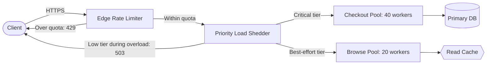

# 33 · Reliability Engineering, SLIs/SLOs & Overload Control

**Level:** Advanced · **Module:** 07 (Reliability, Security, Observability & Cloud) · **Status:** Draft

## Learning objectives

By the end of this lesson, you should be able to:
- Translate business expectations into **SLIs** (measurements), **SLOs** (targets), and **Error Budgets** (`100% - SLO`).
- Explain why **FIFO queues** destroy useful goodput when demand exceeds capacity (`λ > μ`).
- Stack **edge rate limits**, **priority load shedding**, **LIFO + CoDel/deadline checks**, and **bulkheads**.
- Contrast **static concurrency caps** with **adaptive concurrency control** (AIMD / Gradient2).

---

## 1. The Problem: Serving 0% of Users When Traffic Is Only 130% of Capacity

Suppose your **Order & Catalog Service** comfortably handles `1,000 req/s` (`p99 = 60 ms`). During a flash promotion, traffic climbs to `1,300 req/s` (`30%` over capacity).

You might expect `1,000 req/s` to succeed and `300 req/s` to get rejected. Instead, **success rate drops to nearly `0%`**:
- Every incoming request sits in a large unbounded in-memory queue (`FIFO`) waiting `2,500 ms` before reaching a worker.
- By the time the worker finishes the database query at `t = 2,540 ms`, the mobile client already timed out at `t = 1,000 ms`—and retried!
- Meanwhile, the high-margin **`POST /checkout`** endpoint shares the exact same worker pool and DB connection pool as the low-priority **`GET /recommendations`** feed, so a recommendation spike starves checkout completely.

How do we measure reliability honestly, and how do we shed `300 req/s` gracefully so `1,000 req/s` of critical requests stay healthy?

---

## 2. Mental Model

Reliability is not *"zero errors ever"*—100% reliability is infinitely expensive and freezes feature shipping. Instead, Google SRE models reliability as an **economic budget**:
- **SLI (Service Level Indicator):** A user-facing ratio—e.g., *proportion of valid HTTP requests returning non-5xx within `300 ms` measured at the load balancer.*
- **SLO (Service Level Objective):** The target over a rolling window—e.g., *`99.9%` over `30` days.*
- **Error Budget:** `100% - 99.9% = 0.1%`. Over `30` days (`43,200` minutes), that allows `43.2` minutes of equivalent full downtime (or `100,000` bad requests out of `100M`). When budget remains, ship fast; when budget hits `0`, freeze non-critical releases and invest in reliability.

And when traffic exceeds capacity, think of an **emergency room triage desk** instead of a bakery ticket line:
- **Load Shedding:** Drop non-critical requests at the door (`503 Service Unavailable`) *before* spending CPU/DB work on them.
- **Priority Tiers:** Always treat cardiac arrest (`POST /checkout`) ahead of a routine refill (`GET /recommendations`).
- **Bulkheads:** Waterproof compartments in a ship—if the `Recommendations` compartment floods, bulkheads stop it from sinking `Checkout`.
- **LIFO under overload:** When a line is permanently backed up, serve the *newest* arrival first (because oldest arrivals have already given up or timed out!).

---

## 3. How It Works Under the Hood

### Layered Overload Defense
A single defense is brittle; production services stack four complementary layers:

1. **Edge Rate Limiter (Per-Tenant / Per-IP):** Stops abusive scrapers or misconfigured tenant loops (`429 Too Many Requests` + `Retry-After`) before they reach application compute.
2. **Priority Load Shedder (Per-Node Concurrency / CPU / Queue Depth):** Tags every request at ingress with criticality (`CRITICAL_PLUS`, `CRITICAL`, `SHEDDABLE_PLUS`, `SHEDDABLE`). As utilization approaches `85–90%`, the node drops `SHEDDABLE` first, preserving `100%` of `CRITICAL` capacity.
3. **Bounded Queues + Deadline Check + LIFO:** Cap queue depth tightly (e.g., `10–50 ms` worth of work). Before popping a request from the queue, inspect `now > request_deadline` and discard expired requests in `O(1)` microseconds. Under active queuing, switch from FIFO to **LIFO** (or **CoDel**, Controlled Delay, which drops head packets whenever minimum queue sojourn time exceeds `5–10 ms` for an interval).
4. **Bulkheads (Isolated Resource Pools):** Assign dedicated thread pools, semaphores, and DB connection limits per dependency/tier (`Checkout` gets `40` connections; `Recommendations` gets `15`) so one slow dependency cannot exhaust the shared pool.

### Adaptive Concurrency Limits (No Manual Magic Numbers)
Static worker limits (`max_inflight = 100`) rot quickly: if a DB upgrade doubles throughput or a bad query slows it 4×, `100` is either way too low or causes overload.
- **AIMD (Additive Increase, Multiplicative Decrease):** Increase `limit += 1` when `p95` latency stays below target and error rate is `0`; cut `limit *= 0.85` immediately when latency spikes or `503`/timeouts appear (inspired by TCP congestion control).
- **Little's Law Gradient (Netflix `concurrency-limits`):** Compares short-window `RTT_sample` against long-window baseline `RTT_no_load`. As soon as queuing begins (`RTT_sample > RTT_no_load`), estimated queue size `q = limit * (1 - RTT_no_load / RTT_sample)` shrinks `limit` smoothly *before* threads saturate!

---

## 4. Worked Example & Interactive Visualization

Let's prove why FIFO collapses and calculate exact error budgets and queue bounds:

1. **Error Budget Math (`99.95%` Monthly SLO):**
   - Minutes in `30` days = `30 × 24 × 60 = 43,200 min`.
   - Error budget = `0.0005 × 43,200 = 21.6 minutes/month`.
   - At `2,000 req/s` average (`5.184 × 10^9` requests/month), total allowed failed/slow requests = `2.592M` requests/month.
2. **Why Unbounded FIFO Collapses at `130%` Load:**
   - Service capacity `μ = 1,000 req/s` (`20 ms` work across `20` workers).
   - Arrival rate `λ = 1,300 req/s`. Net queue growth = `λ - μ = +300 req/s`.
   - After just **`10 seconds`**, queue length `L = 3,000` requests.
   - Wait time for a newly arriving request via Little's Law:
     $$W = \frac{L}{\mu} = \frac{3,000}{1,000\text{ req/s}} = 3.0\text{ s}$$
   - If the client timeout is `1.0 s`, **100% of requests expire before starting execution** (`0 req/s` useful goodput, while CPUs run at `100%`!).
3. **Bounded LIFO + Priority Shedding Fix:**
   - Cap queue at `L_max = 50` requests (`max wait = 50 / 1,000 = 50 ms`).
   - Offered `1,300 req/s` comprises `260 req/s` `CRITICAL` (`checkout`) and `1,040 req/s` `SHEDDABLE` (`browse`).
   - Shedder drops `300 req/s` of `SHEDDABLE` at ingress (`< 0.2 ms` per `503`), letting `260 req/s` `checkout` (`100%` success, `p99 = 35 ms`) + `740 req/s` `browse` complete cleanly = **`1,000 req/s` useful goodput**!

> **Interactive Visualization (`sim-load-shedding`):** Launch [sim-load-shedding](../animations-and-visuals.md) and push offered load to `120%` and `150%`. Watch an unbounded FIFO queue climb past the `1,000 ms` client deadline (`0%` goodput), then flip **Priority + Bounded LIFO Shedding ON** to watch `p99` snap back under `50 ms` and goodput lock onto `100%` of true capacity.

---

## 5. Trade-Offs & Failure Modes

| Choice | Benefit | Cost / Risk | Fails When |
|---|---|---|---|
| **Strict SLO Error Budgets** | Aligns product + SRE on release speed vs. stability | Requires accurate SLIs & buy-in to enforce release freezes | Alerts ignore user pain or error budgets are routinely overridden |
| **Bounded Queue + Fast `503`** | Keeps `p99` latency flat & prevents OOM | Drops short legitimate micro-bursts (`100 ms`) if `L_max` is tiny | Micro-bursts exceed `L_max` -> size `L_max` to `~50–100 ms` of capacity |
| **LIFO + CoDel** | Maximizes useful goodput during sustained overload | Starves older queued requests during long spikes (expected!) | Used for strict FIFO financial job ordering (shed at ingress instead) |
| **Static Concurrency Limits** | Simple semaphore; zero tuning feedback loops | Under-utilizes fast hardware or overloads slower queries | Query mix shifts (`20 ms -> 200 ms`) or hardware autoscaling changes capacity |
| **Adaptive Concurrency (AIMD)** | Auto-tracks true downstream capacity | Can oscillate or misread legitimate payload shifts as overload | Health checks/keepalives skew `RTT_no_load` baseline if not excluded |

### What changes at 10× and 100× scale?
- **At 10× (`10,000 req/s`, `50` pods):** Local per-pod load shedding can reject unevenly if load balancer routing is uneven (`Round-Robin` instead of `Least-Requests` / `Peak EWMA`). Pair L7 `Peak EWMA` load balancing with **client-side adaptive throttling** (clients stop sending excess retries/traffic to pods returning `503`).
- **At 100× (`100,000 req/s`):** Shedding `50,000 req/s` inside Python/JVM application processes still burns significant TLS/JSON CPU. Push coarse **priority shedding and static degradation** (`serve cached catalog`, disable personalization) out to the **Envoy/API Gateway edge** so origin workers never parse dropped requests.

---

## 6. Practical Exercise

Execute **[Lab 12 · Load Shedding, Backpressure & Token-Bucket Rate Limiting](../labs/12-load-shedding-rate-limiter.md)** locally to observe FIFO queue collapse at `160%` offered load (`320 req/s` against `200 req/s` capacity) and verify `checkout` protection under Priority + LIFO shedding and per-tenant Token Bucket isolation.

---

## 7. Retrieval Practice

1. Why is `99.99%` availability (`4.32` minutes/month error budget) often counterproductive for a fast-moving B2B feature team compared to `99.9%` (`43.2` minutes/month)?
2. Using Little's Law (`L = λW`), explain why a service with `20` workers (`20 ms`/req) and an unbounded queue delivers **zero** useful responses during a `120%` overload spike.
3. Why should a load shedder drop requests in **LIFO** order (or using **CoDel**) rather than **FIFO** once a queue grows past target wait time?
4. What is a **bulkhead**, and how does it differ from a **circuit breaker**?
5. How does **propagating remaining client deadlines** prevent wasted work on backend databases during overload?

Hints

1. Every extra "9" multiplies engineering, multi-AZ/multi-region redundancy, and release-gating cost; `4.32` minutes leaves almost zero budget for routine canary testing or risky deployments.
2. Arrival rate `λ > μ` drives queue depth `L -> infinity`, so wait time `W = L / μ` exceeds the client timeout; every request completes after the caller disconnected.
3. Under sustained overload, the oldest item at the head of a FIFO queue has already waited longest (likely past caller timeout); serving the newest item gives it the best chance of finishing within SLA.
4. A **bulkhead** partitions resources *proactively* (separate pools for checkout vs. recommendations) so one cannot starve the other; a **circuit breaker** trips *reactively* after failures occur to stop calling a broken dependency.
5. Every downstream worker checks `deadline - now < min_cost` before acquiring locks or running expensive SQL, aborting dead requests before touching the DB.

---

## Primary Sources

- **Tier 4 (Eng Blog):** [Google SRE Book · Handling Overload](https://sre.google/sre-book/handling-overload/) — Criticality tiers, client-side throttling, and per-customer capacity limits.
- **Tier 4 (Eng Blog):** [AWS Builders' Library · Using Load Shedding to Avoid Overload](https://aws.amazon.com/builders-library/using-load-shedding-to-avoid-overload/) — Work conservation, LIFO queues, and prioritized shedding.
- **Tier 4 (Eng Blog):** [Netflix TechBlog · Performance Under Load (Concurrency Limits)](https://netflixtechblog.medium.com/performance-under-load-3e6fa9a60581) — Little's Law gradient concurrency limits (`AIMD` / `Vegas` / `Gradient2`).
- **Tier 1 (RFC):** [RFC 8289 · Controlled Delay (CoDel) Active Queue Management](https://www.rfc-editor.org/rfc/rfc8289) — Queue sojourn-time threshold algorithm.

---

## Next

Continue to [34 · Observability: Logs, Metrics, Traces & Chaos Testing](34-observability-chaos.md).
