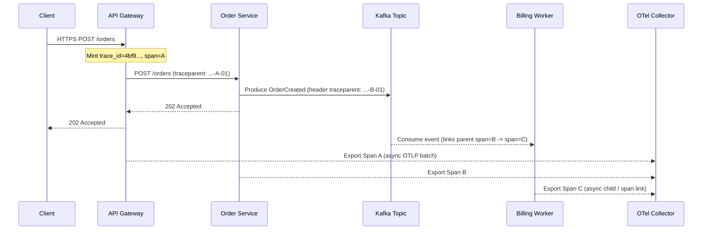

# 34 · Observability: Logs, Metrics, Traces & Chaos Testing

**Level:** Advanced · **Module:** 07 (Reliability, Security, Observability & Cloud) · **Status:** Draft

## Learning objectives

By the end of this lesson, you should be able to:
- Separate the roles of **Metrics** (cheap aggregation), **Structured Logs** (high-cardinality event records), and **Distributed Traces** (end-to-end causal timing).
- Avoid **cardinality explosions** in Prometheus/OTel metrics while retaining debuggability via **exemplars** and **tail-based sampling**.
- Replace noisy `CPU > 80%` alerts with **multi-window, multi-burn-rate SLO alerts**.
- Design hypothesis-driven **Chaos / GameDay experiments** with explicit abort triggers.

---

## 1. The Problem: "All Dashboards Are Green, Yet Checkout Is Down for VIP Users"

At `09:15`, enterprise customers report `504 Gateway Timeout` errors on `POST /checkout`. On-call opens monitoring:
- CPU across API pods is `32%`, DB CPU is `28%`.
- Yesterday, an engineer added `user_id` as a Prometheus label to debug a bug, causing `2.4 million` active time series to OOM-crash the metrics server right when traffic picked up!
- Logs exist across `8` microservices, **without** a shared `trace_id`, so nobody knows whether latency is stuck in TLS, Auth, Inventory, Kafka, or a hidden `N+1` database loop.

Monitoring tells you *known* things broke; **observability** lets you ask arbitrary new questions about unknown failure modes in production.

---

## 2. Mental Model

Think of the **Three Telemetry Signals** like investigating an airline delay:
- **Metrics (The Airport Departure Board):** Cheap, pre-aggregated numbers over time (`Rate`, `Errors`, `Duration` histograms). Tells you *something* is late right now (`p99 = 1,400 ms`), **not** which passenger or baggage cart caused it.
- **Distributed Traces (The Baggage Tracking Receipt):** Follows one request (`trace_id`) across every service, RPC, queue, and SQL query (`span_id` + `parent_span_id`) to reveal the exact critical path (`N+1` query or `350 ms` Kafka lag).
- **Structured Logs (The Cockpit Black Box):** Rich JSON event details (`user_id`, `order_id`, `error_code`, `shard_id`) that would explode memory if stored in a metric index.

And **Chaos Engineering** is a fire drill while the fire department is watching: instead of discovering during a `3 AM` outage that your failover script fails or your circuit breaker wasn't wired up, you inject controlled faults during business hours with an automated kill switch.

Key terms:
- **RED & USE methods:** **RED** (Rate, Errors, Duration) for request-driven services; **USE** (Utilization, Saturation, Errors) for infrastructure resources (CPU, disk I/O, connection pools).
- **Cardinality:** The number of unique combinations of metric label values (`service × route × status × tenant_id`). Unbounded IDs (`user_id`, `request_id`) cause catastrophic time-series explosion.
- **Burn rate:** How fast a service consumes its monthly error budget relative to a steady `30`-day pace (`burn rate = 1` consumes `100%` in `30` days; `burn rate = 14.4` consumes `2%` in `1 hour`).

---

## 3. How It Works Under the Hood

### End-to-End Trace Context Propagation (`W3C Trace Context`)
In OpenTelemetry, the ingress gateway generates a `16-byte` `trace_id` and `8-byte` `span_id`, injecting the W3C `traceparent` header into **both** synchronous HTTP/gRPC calls and asynchronous Kafka/SQS message headers:

`traceparent: 00-4bf92f3577b34da6a3ce929d0e0e4736-00f067aa0ba902b7-01` (`version-traceId-parentSpanId-flags`)

### Sampling & Exemplars (Keeping Costs Bounded)
Recording `100%` of trace spans at `20,000 req/s` (`8` spans/req = `160,000` spans/s) is prohibitively expensive. Production systems combine:
1. **Head-based sampling (`1%–5%`):** Decided at the gateway (`flags=01`)—very cheap, **but** misses rare `500` errors if sampled out!
2. **Tail-based sampling (in OTel Collector):** Buffers traces in memory for `15–30 s`, keeps **`100%` of errors and slow traces (`> p99`)**, and samples only `1%` of fast `200 OK` traces.
3. **Metric Exemplars:** Attach one sample `trace_id` directly to a Prometheus histogram bucket (`http_duration_bucket{le="2.0"} # trace_id=4bf9...`) so clicking a `p99` spike on a dashboard jumps straight to a failing trace!

### Multi-Window SLO Burn-Rate Alerting
Paging on raw error rate (`> 1%` for `1 min`) causes alert fatigue; paging on a `30`-day window fires hours too late. Google SRE's **multi-window burn-rate** rule pages only when **both** a long window and a short confirmation window exceed the burn rate:
- **Page immediately (Sev-1):** `14.4×` burn rate (`2%` of monthly budget burned in **`1 hour`**) **AND** still burning over the last **`5 minutes`** (prevents paging after a transient spike already self-healed!).
- **Page / Ticket (Sev-2):** `6×` burn rate (`5%` burned in **`6 hours`**) **AND** last **`30 minutes`**.

### Hypothesis-Driven Chaos Engineering
1. Define steady state via SLIs (`checkout success >= 99.9%`, `p99 <= 250 ms`).
2. State hypothesis (*"Killing 1 of 3 Redis cache nodes triggers failover in `< 5 s` with `< 0.5%` error bump and zero DB overload"*).
3. Limit blast radius (`1%` canary traffic, `1` non-primary AZ, or `60 s` auto-abort timer).
4. Inject fault (packet delay `200 ms`, kill pod, drop DNS, exhaust connection pool) and compare real telemetry against hypothesis.

---

## 4. Worked Example & Interactive Visualization

Let's size telemetry storage and prove why cardinality explodes:

1. **Metric Cardinality Explosion Math:**
   - Safe metric: `http_req_duration_seconds` with `service` (`10`) × `route` (`20`) × `status_class` (`4`) × `histogram_buckets` (`12`) = **`9,600` time series**.
   - At `~3 KB` RAM per active series in Prometheus TSDB: `9,600 × 3 KB ≈ 28.8 MB` RAM—effortless!
   - Unsafe metric: add `user_id` (`500,000` active users/hour): `9,600 × 500,000` (even conservatively `1` route × `12` buckets × `500k` users) = **`6,000,000` series × `3 KB` = `18 GB` RAM** just for one metric, crashing TSDB scrape loops!
2. **Trace & Log Bandwidth Budget (`5,000 req/s`):**
   - Average `10` spans/trace × `600 B`/span = `6 KB`/trace.
   - At `100%` ingestion: `5,000 × 6 KB = 30 MB/s` (`~77.8 TB/month` decimal!).
   - With `2%` head sampling on healthy traffic + `100%` error/slow tail retention (`~3%` overall kept): `30 MB/s × 0.03 = 0.9 MB/s` (`~2.33 TB/month`—a **`97%` cost cut** while keeping every incident trace!).
   - Structured JSON logs (`500 B`/log, `2` logs/req at `INFO` vs `ERROR`): `5,000 × 1 KB = 5 MB/s` (`~13 TB/month`). Dropping verbose `DEBUG` logs in steady state and logging only structured ingress/error summaries saves `80%+` log spend.

> **Interactive Visualization (`anim-distributed-trace`):** Open [anim-distributed-trace](../animations-and-visuals.md) to inspect a `1,420 ms` trace waterfall across Gateway, Auth, Order, Inventory, and Kafka. Expand hidden `N+1` sequential DB spans (`12 × 45 ms = 540 ms`) and async consumer lag to locate the true critical path vs. parallel background work.

---

## 5. Trade-Offs & Failure Modes

| Choice | Benefit | Cost / Risk | Fails When |
|---|---|---|---|
| **Metrics (RED / USE)** | Sub-second dashboards & cheap alerting | Cannot store high-cardinality keys (`user_id`, `order_id`) | Engineers add unbounded labels -> TSDB OOM |
| **Structured JSON Logs** | Full high-cardinality context & audit trail | High ingestion/index cost (`$/GB`) at `10k+ req/s` | Unbounded payload logging (`req.body`) leaks PII or spikes bills |
| **Head-Based Trace Sampling (`1%`)** | Tiny collector memory; stateless propagation | `99%` chance of dropping a rare `500` bug | Debugging infrequent customer-specific failures |
| **Tail-Based Trace Sampling** | Keeps `100%` of errors & slow `p99` traces | Collector must hold `30 s` of spans in RAM & route same `trace_id` to same collector | Collector autoscaling shuffles `trace_id` routing, splitting traces |
| **Chaos / GameDay Fault Injection** | Uncovers silent config/timeout bugs before real outages | Can trigger a real outage if blast radius or kill switch fails | No automated abort condition, or injected onto un-backed-up stateful primary |

### What changes at 10× and 100× scale?
- **At 10× (`50,000 req/s`):** Consistent-hash load-balance spans by `trace_id` at the OTel Collector gateway tier so tail-based sampling works across a cluster of collectors without splitting traces.
- **At 100× (`500,000 req/s`):** Even `30 s` of full-span buffering for tail sampling needs clusters of high-RAM collectors (`500k × 6 KB × 30 s = 90 GB` in-flight RAM!). Adopt **two-tier dynamic sampling** (always sample `error`/`debug-header` flags + adaptive per-route rate limiting + **wide canonical log lines**—one rich structured event per request per service).

---

## 6. Practical Exercise

Inspect a multi-service flow (`Gateway -> Order -> Inventory -> Payment`) and write:
1. Exactly `3` **RED** Prometheus metrics (names + safe low-cardinality labels only) and `2` **USE** infrastructure metrics for the DB connection pool.
2. One **multi-window burn-rate** alert rule for a `99.9%` monthly SLO (`2%` budget in `1 h` AND `5 m` confirmation).
3. A **1-page Chaos GameDay card**: target failure (`inject 400 ms latency on 25% of Inventory -> DB calls`), steady-state hypothesis, abort condition, and expected circuit-breaker/shedding behavior.

---

## 7. Retrieval Practice

1. Why is adding `customer_id` or `request_id` as a Prometheus metric label an operational anti-pattern, and where do those fields belong?
2. What is the difference between **RED** metrics and **USE** metrics, and when do you need both?
3. How do **metric exemplars** connect a spike on a latency percentile graph directly to a root-cause investigation?
4. Why does a **multi-window** SLO burn-rate alert check *both* a `1 hour` window and a `5 minute` short window before paging?
5. Name three mandatory safety guardrails before running a Chaos experiment in production.

Hints

1. Each unique `(metric, label_set)` creates a new indexed time series in memory; unbounded IDs cause millions of series and OOM crashes. Put `customer_id` and `request_id` in structured logs, trace spans, and exemplars.
2. **RED** (Rate, Errors, Duration) measures user-facing request work on stateless services; **USE** (Utilization, Saturation, Errors) exposes resource bottlenecks (thread pools, CPU throttling, disk queue saturation) causing RED degradation.
3. Exemplars store a single `trace_id` alongside a histogram observation, letting dashboards link directly from a slow bucket (`p99` spike) to a real distributed trace.
4. Checking the short `5 min` window ensures the outage is *still actively burning* right now, avoiding 3 AM pages for a brief spike that already recovered 40 minutes ago.
5. Clear steady-state SLI baseline + hypothesis, bounded blast radius (canary/single AZ/percentage), and an automated instant abort switch if error budget burn exceeds a hard ceiling.

---

## Primary Sources

- **Tier 2 (Official Docs):** [OpenTelemetry Documentation · Concepts & Trace Context](https://opentelemetry.io/docs/concepts/) — Signals, W3C `traceparent`, head vs. tail sampling, and collector pipelines (checked 2026-11).
- **Tier 4 (Eng Blog):** [Google SRE Workbook · Alerting on SLOs](https://sre.google/workbook/alerting-on-slos/) — Exact math for multi-window, multi-burn-rate error-budget alerting.
- **Tier 4 (Eng Blog):** [Brendan Gregg · The USE Method](https://www.brendangregg.com/usemethod.html) — Resource saturation diagnostics vs. request RED metrics.
- **Tier 4 (Eng Blog):** [Principles of Chaos Engineering](https://principlesofchaos.org/) — Hypothesis-driven fault injection and blast-radius control.

---

## Next

Continue to [35 · System Security, Identity & Abuse Prevention](35-security-identity.md).
