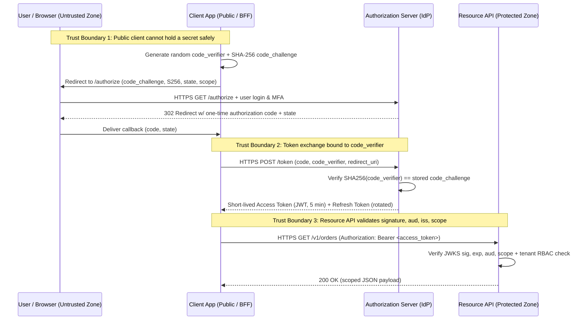

# 35 · System Security, Identity & Abuse Prevention

**Level:** Advanced · **Module:** 07 (Reliability, Security, Observability & Cloud) · **Status:** Draft

## Learning objectives

By the end of this lesson, you should be able to:
- Implement **OAuth 2.1 Authorization Code + PKCE (`S256`)** and **OIDC** safely, closing code-interception and CSRF gaps.
- Choose between **short-lived JWTs** and **opaque tokens**, and enforce `alg`, `iss`, `aud`, `exp`, and **BOLA** checks.
- Model authorization with **RBAC**, **ABAC**, and **ReBAC (Google Zanzibar)**.
- Secure east-west traffic (**mTLS**), data at rest (**KMS envelope encryption**), and public APIs (**Token Bucket** vs. **Sliding Window** rate limiters).

---

## 1. The Problem: "We Validated the JWT Signature, So How Did a User Download Another Tenant's Invoices?"

A startup launches a multi-tenant SaaS billing portal and passes a quick smoke test:
- Every request carries an `Authorization: Bearer <jwt>` header signed by the Identity Provider.
- Yet within a week, a security researcher reports three critical flaws:
  1. Changing `/v1/invoices/9041` to `/v1/invoices/9042` returns **another company's PDF** (`200 OK`)—the API verified the token signature, **not** whether the caller's `org_id` owned invoice `9042`!
  2. Revoking a fired employee's session does nothing for `60 minutes` because the stateless JWT remains valid until `exp`.
  3. A bot script exploits a **Fixed Window** rate limiter (`100 req/min`) at `12:00:59` and `12:01:00` to fire **`200` credential-stuffing requests in `2 seconds`**.

Security is not one login screen—it is **explicit trust boundaries, least privilege, and abuse math** across every layer.

---

## 2. Mental Model

Separate security into four concrete questions at every boundary:
1. **Authentication (AuthN — *Who are you?*):** Proving identity via **OIDC** (`id_token`) on top of **OAuth 2.1** (`access_token`), or **mTLS** (`X.509` client certificates) between internal microservices.
2. **Authorization (AuthZ — *Can you touch this exact object?*):** Separating coarse role checks (`RBAC`) from relationship graphs (`ReBAC`) and enforcing object ownership (`BOLA` protection) on every query.
3. **Confidentiality & Key Hygiene (*Who can read stored bytes?*):** Never encrypt `1 TB` of files with one master KMS key directly—use **envelope encryption** (one fast local Data Encryption Key per object/tenant wrapped by KMS).
4. **Abuse Prevention (*How fast can one actor spend our compute?*):** Enforcing per-IP/user/tenant quotas (`Token Bucket`, `Sliding Window`) at the edge before expensive auth or DB work runs.

Key terms:
- **Trust boundary:** Any boundary where execution or data crosses between privilege zones (Browser -> Gateway, Gateway -> Internal Mesh, App -> KMS/DB) and inputs must be re-authenticated and re-authorized.
- **PKCE (Proof Key for Code Exchange):** Binding an OAuth authorization code to a secret one-time `code_verifier` held only by the client that started the flow.
- **BOLA (Broken Object Level Authorization):** Allowing an authenticated user of Tenant A to read/modify Tenant B's record by guessing or incrementing an ID (`#1` risk in OWASP API Top 10).

---

## 3. How It Works Under the Hood

### OAuth 2.1 + PKCE (`S256`) & Trust Boundaries
OAuth 2.1 deprecates the legacy Implicit flow (`token` in URL fragment) and mandates **PKCE** for *all* Authorization Code flows (RFC 9700). See [oauth-pkce-and-trust-boundaries.mmd](../diagrams/oauth-pkce-and-trust-boundaries.mmd):

- **Why PKCE stops code theft:** Even if malware intercepts the `302` callback `code`, it cannot exchange `code` at `/token` without the original `code_verifier` (held in memory / `HttpOnly` BFF session).
- **JWT Validation Checklist:** Enforce a strict `alg` allowlist (`EdDSA` or `RS256`—never `alg: none` or accepting `HS256` with a public key!), verify `iss`, `aud` (prevents token intended for Service A from being replayed on Service B), `exp`, `nbf`, and keep access-token TTL short (`5 min`) paired with **single-use rotating refresh tokens** (reuse triggers instant family revocation!).
- **Stateless JWT vs. Opaque Token:** For immediate logout/ban enforcement (`< 1 s`), either issue **opaque tokens** backed by a `Redis` lookup at the API Gateway (translating to an internal signed JWT for downstream services) or short-TTL JWTs + a compact `jti` revocation set in Redis.

### Authorization Models: RBAC -> ABAC -> ReBAC
- **RBAC (`Role -> Permission`):** Great for coarse roles (`org:admin`, `org:billing_viewer`), fails when permissions depend on *which* folder or document is requested.
- **ABAC (`Attribute predicates`):** Evaluates rules like `user.dept == doc.dept && env.ip in corp_cidr`. Flexible, **but** auditing *"who can access doc X?"* is hard.
- **ReBAC (Relationship-Based / Google Zanzibar):** Stores tuples `(object, relation, subject)` such as `doc:42#viewer@group:eng#member` and `group:eng#member@user:alice`. Evaluates graph reachability in `< 5 ms` using Leopard indexing and `Zookie` consistency tokens—and always pair AuthZ with DB-level `WHERE org_id = $token_org_id` to stop BOLA.

### Zero-Trust mTLS & KMS Envelope Encryption
- **mTLS (Mutual TLS):** In a service mesh (Envoy/Istio/Linkerd) or SPIFFE/SPIRE, **both** client and server present short-lived (`1–24 h`) X.509 certificates (`SPIFFE ID: spiffe://prod/ns/billing/sa/api`) so network location (`VPC IP`) alone never grants trust.
- **Envelope Encryption:** App asks KMS for a `Data Encryption Key (DEK)`: KMS returns `(plaintext_DEK, KMS_encrypted_DEK)`. App encrypts payload locally with `AES-256-GCM` using `plaintext_DEK`, stores `(ciphertext, KMS_encrypted_DEK)` together, and wipes `plaintext_DEK` from memory—avoiding `100 MB/s` network round-trips to KMS and enabling fast key rotation via KEK re-wrapping.

### Edge Rate Limiting Algorithms
- **Fixed Window Counter:** Fast (`1` Redis `INCR` per key/minute), **but** suffers the **2× boundary burst bug** (`100` reqs at `00:59` + `100` at `01:01` = `200` in `2 s`).
- **Sliding Window Log:** Stores every timestamp in a Redis `ZSET`—exact, **but** `O(limit)` memory per user (`1,000 req/min × 1M users` = huge RAM!).
- **Sliding Window Counter:** Weighted average of previous + current fixed windows (`~16 B` per user, `< 0.5%` approximation error).
- **Token Bucket:** Stores `(tokens, last_refill_ts)` (`~16 B` per user) updated atomically via Redis Lua: allows controlled short bursts up to `bucket_capacity` while capping sustained average rate at `refill_rate`.

---

## 4. Worked Example & Interactive Visualization

Let's size a **Token Bucket** rate limiter and compare **Sliding Window Log** memory for `1,000,000` active API clients (`limit = 100 req/min`, `burst = 25`):

1. **Fixed Window Bug vs. Token Bucket Math:**
   - Suppose `bucket_capacity = 25 tokens`, `refill_rate = 100 / 60 = 1.667 tokens/s`.
   - At `t = 0 s`, a client sends a legitimate `25`-request page-load burst: all `25` succeed (`tokens -> 0`). To send `25` more, the client must wait `25 / 1.667 = 15 s`. No `200`-request `2 s` boundary spike is possible!
2. **Memory Footprint at `1M` Active Users:**
   - **Token Bucket / Sliding Window Counter:** Each user key holds `2` integers (`16 B`) + Redis key/hash overhead (`~64 B`) = **`~80 MB` total RAM** for `1M` active users (`O(1)` per user).
   - **Sliding Window Log (`ZSET`):** At `100` timestamps/user (`~40 B`/ZSET entry), `1M × 100 × 40 B = 4.0 GB` RAM (and explodes to `40 GB` if the limit is `1,000 req/min`)!
3. **Token Introspection / JWT Cost at `20,000 req/s`:**
   - Local JWT verification (`EdDSA` / `RS256` with cached JWKS): `~0.08 ms` CPU, `0` network hops (`1.6 CPU cores` total across fleet).
   - Opaque token introspection via central Auth DB (uncached): `20,000` DB queries/s—instant bottleneck. Using a regional Redis token cache (`150 B`/session, `0.4 ms` RTT) handles `20,000` lookups/s cleanly while retaining sub-second revocation.

> **Interactive Visualization (`sim-rate-limiter-algorithms`):** Launch [sim-rate-limiter-algorithms](../animations-and-visuals.md) to fire a boundary burst at `t = 59.5 s` and `t = 60.5 s`. Compare **Fixed Window** (letting `2×` burst slip through), **Leaky Bucket** (smoothing output at constant rate), **Token Bucket** (allowing bounded burst up to capacity), and **Sliding Window Counter**.

---

## 5. Trade-Offs & Failure Modes

| Choice | Benefit | Cost / Risk | Fails When |
|---|---|---|---|
| **Stateless Short-TTL JWT** | Zero IdP/Redis lookup per API request | Cannot revoke immediately before `exp` (`5–15 min` window) | Compromised session or instant permission downgrade required |
| **Opaque Token + Edge Introspection** | Instant `0 ms` global revocation; hides claims from browser | Redis/introspection cluster becomes a Tier-0 availability dependency | Redis outage takes down all authenticated traffic (need failover/grace) |
| **RBAC** | Simple, fast, matches org charts | Role explosion (`project_42_editor`) on per-resource sharing | Multi-tenant collaborative apps with nested folders/groups (use ReBAC) |
| **Token Bucket Rate Limiter** | `O(1)` memory (`~80 B`/user); allows natural bursts | Needs atomic read-modify-write (Redis Lua) across distributed pods | Non-atomic `GET` then `SET` race condition lets concurrent bursts bypass limit |
| **Fail-Open vs. Fail-Closed Rate Limiter** | Fail-open avoids outage if Redis blips; Fail-closed protects DB from flood | Fail-open exposes origin during abuse; Fail-closed blocks paying users on Redis crash | Choice isn't tiered (fail-open for login/checkout with local in-memory fallback cap!) |

### What changes at 10× and 100× scale?
- **At 10× (`200,000 req/s`):** Central Redis rate-limiting adds `~1 ms` and saturates single-shard Redis (`~100k ops/s` per shard). Shard Redis Cluster by `tenant_id`/`user_id`, or batch-sync local token buckets every `100–250 ms` (local Envoy/gateway counter syncs asynchronously with Redis, cutting Redis RPCs by `90%+`).
- **At 100× (`2M req/s` global):** Move coarse DDoS, WAF, and IP rate limits to **Anycast Edge PoPs**; enforce **ReBAC (Zanzibar)** with local edge permission caches invalidated via CDC + consistency `Zookie` tokens; rotate mTLS SPIFFE workload certificates automatically via Envoy SDS every hour with zero downtime.

---

## 6. Practical Exercise

Complete **[Lab 13 · Threat Modeling & OAuth 2.1 + PKCE Audit](../labs/13-threat-model-oauth.md)** to map STRIDE threats across all three trust boundaries, test `S256` PKCE exchange and replay rejection locally, and verify `alg` + `aud` + tenant BOLA defenses.

---

## 7. Retrieval Practice

1. Why does OAuth 2.1 require **PKCE (`S256`)** even when using a confidential backend client, and what attack does it stop?
2. An API verifies a JWT's cryptographic signature using the IdP's public JWKS, yet still suffers a security breach. Name **three** other checks the API must perform on every request.
3. Why does **envelope encryption** avoid sending full object payloads to KMS on every read and write?
4. Explain the **boundary burst bug** in a Fixed Window rate limiter (`100 req/min`) and how **Token Bucket** or **Sliding Window Counter** prevents it.
5. Why should rate-limiter counters in Redis execute via a **Lua script** (or `INCR` + `EXPIRE` atomic pipeline) instead of application-side `GET -> compute -> SET`?

Hints

1. PKCE prevents authorization code interception and code-injection attacks on redirect callbacks by proving the caller exchanging `code` at `/token` is the same client that generated `code_verifier`.
2. (a) `alg` allowlist (reject `none` / key-confusion), (b) `iss` and `aud` match this exact service, (c) `exp`/`nbf` and `scope`, plus (d) object-level tenant authorization (`org_id` ownership—stopping BOLA).
3. KMS only encrypts/decrypts tiny `32-byte` Data Encryption Keys (DEKs); bulk data is encrypted locally in app memory via `AES-256-GCM`, cutting KMS QPS and bandwidth drastically.
4. Fixed Window resets at `:00`, allowing `100` requests at `00:59` and `100` at `01:01` (`200` in `2 s`). Token Bucket caps bursts at `bucket_capacity` regardless of clock boundaries; Sliding Window Counter blends prior and current windows.
5. Concurrent requests reading the same `tokens` value simultaneously would all think tokens remain and overwrite each other (`TOCTOU` race), letting `N×` traffic slip past the limit.

---

## Primary Sources

- **Tier 1 (RFC):** [RFC 9700 · Best Current Practice for OAuth 2.0 Security](https://www.rfc-editor.org/rfc/rfc9700) — Mandatory PKCE, exact redirect URI matching, and refresh token rotation/sender-constraining.
- **Tier 1 (RFC):** [RFC 7636 · Proof Key for Code Exchange (PKCE)](https://www.rfc-editor.org/rfc/rfc7636) — `S256` challenge construction and verification.
- **Tier 2 (Official Docs):** [OWASP API Security Top 10 & Cheat Sheets](https://owasp.org/API-Security/) — BOLA (`API1`), Broken Auth, and JWT security controls (checked 2026-11).
- **Tier 3 (Paper):** [Zanzibar: Google's Consistent, Global Authorization System (Pang et al., USENIX ATC '19)](https://research.google/pubs/zanzibar-googles-consistent-global-authorization-system/) — ReBAC tuple model, Zookie causality, and Leopard graph indexing.
- **Tier 4 (Eng Blog):** [Cloudflare · How We Built Rate Limiting](https://blog.cloudflare.com/counting-things-a-lot-of-different-things/) — Sliding window counter math at global edge scale.

---

## Next

Continue to [36 · Cloud Infrastructure, Containers & Deployment Strategies](36-cloud-deployments.md).
