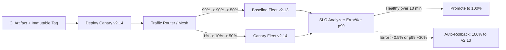

# 36 · Cloud Infrastructure, Containers & Deployment Strategies

**Level:** Advanced · **Module:** 07 (Reliability, Security, Observability & Cloud) · **Status:** Draft

## Learning objectives

By the end of this lesson, you should be able to:
- Architect multi-AZ VPC topologies isolating public ingress from private compute and database subnets.
- Configure **liveness vs. readiness probes**, **preStop / SIGTERM graceful draining**, and **CPU/queue-based autoscaling** cleanly.
- Choose between **Rolling**, **Blue/Green**, and **Progressive Canary** deployments with automated SLO rollback gates.
- Coordinate zero-downtime code rollouts with database schema migrations (**Expand-Contract**).

---

## 1. The Problem: A Routine Tuesday Deploy Takes Down Production for 18 Minutes

A team pushes a routine `v2.14` release of their API (`30` Kubernetes pods across `3` Availability Zones). Three things go wrong in `90 seconds`:
1. The rollout terminates old pods immediately on `SIGTERM` while the load balancer still takes `5 s` to update its endpoint table—dropping in-flight `POST /orders` requests (`502 Bad Gateway`).
2. `v2.14`'s **liveness probe** checks `/healthz`, which runs `SELECT 1` on PostgreSQL. A brief `3 s` DB hiccup fails `/healthz` across **all `30` pods simultaneously**, causing Kubernetes to kill and restart the entire healthy fleet at once!
3. Worse, `v2.14` included a memory leak and an eager `DROP COLUMN` migration, so even rolling back to `v2.13` crashes because the old binary queries the dropped column.

Most production outages are triggered not by hardware failures, but by **deployments and configuration changes**. Safe deployment infrastructure isolates blast radius and makes rollback instantaneous.

---

## 2. Mental Model

Think of deploying software to a busy airport while planes are landing:
- **Regions & Availability Zones (AZs):** Separate runways (`AZs`) in the same city (`Region`, `< 2 ms` apart) with independent power, cooling, and network fiber. Never put all planes on one runway (`single-AZ`), and keep passenger baggage (`databases`) in a restricted private subnet behind the security perimeter (`public LB -> private app -> isolated DB subnet`).
- **Readiness vs. Liveness Probes:**
  - **Readiness (`Am I ready for new passengers?`):** Removes a pod from the load balancer if its cache is warming or a dependency is down—**never kills the process**.
  - **Liveness (`Is my process deadlocked?`):** Restarts a wedged container—**never** depend on external databases or downstream APIs inside a liveness check!
- **Blue/Green vs. Canary + Feature Flags:** Blue/Green builds an entire second runway and flips traffic `100%` (fast rollback, `2×` peak cost); Canary sends `1% -> 10% -> 50% -> 100%` of flights down the new runway while automated radar watches error rates; Feature Flags separate **code deploy** from **feature release** (`0 s` kill switch!).

Key terms:
- **Graceful shutdown (`SIGTERM` + drain):** Stopping new request acceptance, returning `503`/unready on readiness probes, waiting for load balancer propagation (`5–15 s`), finishing in-flight requests, and closing DB connections cleanly.
- **Canary analysis:** Automated statistical comparison of golden SLIs (error rate, `p99` latency, saturation) between a baseline (`v1`) and canary (`v2`) before advancing traffic weight.
- **Backward-compatible rollout:** Ensuring `v_old` and `v_new` can both run simultaneously against the same database schema and cache format during rollouts and rollbacks.

---

## 3. How It Works Under the Hood

### Network Isolation: Multi-AZ VPC Subnets
1. **Public Subnets (`3` AZs):** Host only internet-facing Load Balancers, Bastions/NAT Gateways (`0` application servers or databases with public IPs!).
2. **Private App Subnets (`3` AZs):** Host Kubernetes worker nodes / stateless API pods (`100%` reachable only via Load Balancer / Service Mesh).
3. **Isolated Data Subnets (`3` AZs):** Host Primary DB, Read Replicas, and Redis (`ingress` restricted by Security Group strictly from Private App Subnets; zero internet egress).

### Zero-Drop Pod Lifecycle (`SIGTERM` Race Fix)
In Kubernetes/ECS, deleting a pod triggers **two asynchronous paths in parallel**: (a) kubelet sends `SIGTERM` to the container, and (b) the control plane removes the pod IP from Service/ALB target groups (`2–10 s` propagation delay!).
If the app exits immediately on `SIGTERM`, packets already routed by the ALB hit a closed port (`502`). Safe sequence:
1. Container receives `preStop` hook (`sleep 10` seconds) **while keeping HTTP listener open** so in-flight and already-en-route ALB packets still succeed, **while** readiness probe flips to failing immediately.
2. Once ALB deregisters the endpoint (`~10 s`), `SIGTERM` triggers `server.Shutdown(grace=20s)` to drain remaining active connections and close DB pools.

### Progressive Canary Pipeline with Automated SLO Rollback

- **Why keep a small `Baseline` canary comparison?** Comparing Canary `v2` (`10%`) against Baseline `v1` (`90%` on the exact same live traffic mix) cancels out time-of-day traffic shifts!
- **Schema Rule (Expand-Contract):** Because `v2.13` and `v2.14` run **at the same time** during Canary (and during instant rollback), never run destructive migrations (`DROP COLUMN`, `RENAME`, incompatible JSON changes) in the same deploy. Always: (1) *Expand* (add nullable new column + dual-write), (2) *Backfill*, (3) *Deploy `v2` reading new column*, (4) *Contract* (drop old column in a *later* release after rollback window closes).

---

## 4. Worked Example & Interactive Visualization

Let's compare infrastructure cost, blast radius, and autoscaling timing for a **`60`-pod API fleet** (`20` pods/AZ, `2 vCPU / 4 GiB` each, `25,000 req/s` peak):

1. **Blast Radius Math Across Deployment Modes:**
   - **Naive Big-Bang In-Place (`maxUnavailable=50%`):** Breaks `100%` of users if `v2` crashes, and drops capacity to `50%` (`12,500 req/s` < `25,000 req/s` demand) during deploy -> immediate overload outage!
   - **Blue/Green (`60` Blue + `60` Green = `120` pods briefly):** Zero capacity drop and `< 5 s` instant DNS/ALB target-group switch rollback, **but** requires `100%` spare compute headroom (`+60` pods = `120 vCPU` temporary surge) and can hit `100%` of users before an error metric fires.
   - **Progressive Canary (`1% -> 10% -> 50% -> 100%`):** Spin up `2` Canary pods (`~3%` capacity overhead). At `1%` weight (`250 req/s`), an undetected crash impacts only `1%` of requests for `5 min` (`75,000` requests out of `7.5M` in `5 min`), preserving almost `99%` of monthly error budget!
2. **HPA (Horizontal Pod Autoscaler) Cold-Start Lag:**
   - Suppose traffic doubles from `12,500 -> 25,000 req/s` in `60 s`:
     - Metrics scrape + HPA evaluation loop: `~30 s`
     - Pod scheduling + container image pull + JVM/Python startup + readiness probe (`3 × 5 s`): `~45–90 s`
     - **Total scale-out lag: `~75–120 s`!**
   - During those `90 s`, existing `30` pods run at `200%` unless you maintain **headroom buffers** (target `55%–60%` CPU utilization, not `90%`!) or **overprovisioned pause pods** for instant node capacity, plus pre-baked minimal container images (`distroless` / `Alpine`) cached on nodes.

> **Interactive Visualization (`anim-canary-rollback`):** Step through [anim-canary-rollback](../animations-and-visuals.md) as weight advances `1% -> 10%`. Inject a memory leak / `500` error surge at `10%` canary traffic and watch the SLO gate halt promotion and shift traffic back to `0%` canary within seconds.

---

## 5. Trade-Offs & Failure Modes

| Strategy | Benefit | Cost / Risk | Fails When |
|---|---|---|---|
| **Rolling Update** | Low extra compute (`maxSurge: 10–25%`); simple | Slow rollback (must roll forward/re-pull old pods); mixed versions live | Rollback takes `10 min` while `v2` corrupts cache/DB |
| **Blue/Green** | Instant `< 5 s` cutover & instant rollback; clean env isolation | `2×` peak compute + DB connection surge (`2×` pools during overlap!) | DB `max_connections` exhausts when `60` Green pods boot next to `60` Blue |
| **Progressive Canary** | Tiny initial blast radius (`1%–5%`); data-driven promotion | Requires L7 traffic splitting, versioned metrics, and longer deploy time (`30–45 min`) | Low-traffic service (`5 req/s`) lacks statistical sample size at `1%` |
| **Feature Flags** | Sub-second kill switch independent of container builds | Flag debt (`if/else` spaghetti); untested flag combinations | Kill switch stored in external DB without local cache fallback |
| **Liveness Probe w/ DB Check** | Seems thorough on paper | **Causes fleet-wide cascading reboot** during minor DB stalls | Any transient `3 s` downstream blip triggers simultaneous pod kills |

### What changes at 10× and 100× scale?
- **At 10× (`600` pods, `250,000 req/s`):** Rolling `600` pods against one DB saturates `max_connections` and thrashes caches on cold pods. Use **Pod Disruption Budgets (PDBs)** (`minAvailable: 85%`), warm local caches *before* passing `readinessProbe`, and route through connection poolers (`PgBouncer`).
- **At 100× (Global Fleet, Multiple Clusters/Regions):** Never roll out globally in one wave. Use **cellular / ring-based staged deployments**: `Canary (1 cluster, 1%) -> Stage 1 (1 non-peak AZ) -> Stage 2 (1 region) -> Bake 2 h -> Global Wave`, halting automatically if *any* cell breaches its burn-rate gate.

---

## 6. Practical Exercise

Audit a sample deployment manifest for a stateful API + PostgreSQL service:
1. List the exact changes needed to eliminate `502` errors during rolling pod termination (`preStop`, `readinessProbe`, `terminationGracePeriodSeconds`, HTTP keep-alive idle timeout > LB idle timeout).
2. Design a **3-stage Canary rollout (`2% -> 20% -> 100%`)** with `2` explicit automated rollback metrics and an **Expand-Contract** step plan for renaming `users.full_name` to `users.display_name`.

---

## 7. Retrieval Practice

1. Why should a Kubernetes **liveness probe** *never* run a `SELECT 1` query against PostgreSQL or ping Redis?
2. Explain the race condition between `SIGTERM` and load-balancer target deregistration, and how `preStop` sleep + `readinessProbe` fixes it.
3. Why does **Blue/Green** deployment risk exhausting PostgreSQL's `max_connections` even when total user QPS hasn't changed?
4. When a Canary at `1%` traffic has `500` requests/min vs. `2` requests/min, why does statistical canary analysis break at low QPS?
5. Why must destructive database migrations (`DROP COLUMN`) never ship in the same deployment as the code that stops using the old column?

Hints

1. If PostgreSQL stalls briefly, every pod fails liveness simultaneously and gets restarted by kubelet, turning a `3 s` DB blip into a `2-minute` fleet-wide cold-start outage. Use `/livez` strictly for process deadlock/event-loop health; put dependency checks on `/readyz` only if traffic can route elsewhere safely.
2. Pod termination (`SIGTERM`) and LB endpoint removal run asynchronously in parallel; `preStop` (`sleep 10 s`) keeps the socket open for in-flight LB traffic while `/readyz` stops new routing.
3. Both Blue (`60` pods) and Green (`60` pods) stay booted simultaneously with open DB connection pools, doubling idle/minimum pool connections against the database.
4. At `2 req/min`, `1` random client error gives a `50%` error rate—zero statistical power (`false positive` rollbacks or missed real regressions).
5. During canary overlap or instant rollback, the previous code version runs concurrently and still expects the old column to exist; dropping it breaks rollback immediately.

---

## Primary Sources

- **Tier 2 (Official Docs):** [Kubernetes · Configure Liveness, Readiness and Startup Probes](https://kubernetes.io/docs/tasks/configure-pod-container/configure-liveness-readiness-startup-probes/) — Probe semantics and failure thresholds (checked 2026-11).
- **Tier 4 (Eng Blog):** [AWS Well-Architected · Reliability Pillar (Deployment Safety)](https://docs.aws.amazon.com/wellarchitected/latest/reliability-pillar/) — Cell-based rollouts, canary gates, and AZ isolation.
- **Tier 4 (Eng Blog):** [Google SRE Workbook · Canarying Releases](https://sre.google/workbook/canarying-releases/) — Automated canary scoring and statistical baseline comparisons.
- **Tier 4 (Eng Blog):** [Kubernetes · Pod Lifecycle & Graceful Termination](https://kubernetes.io/docs/concepts/workloads/pods/pod-lifecycle/#pod-termination) — `preStop` hooks vs. endpoint propagation races.

---

## Next

Continue to [37 · Multi-Region Architecture, Disaster Recovery & FinOps](37-multi-region-finops.md).
